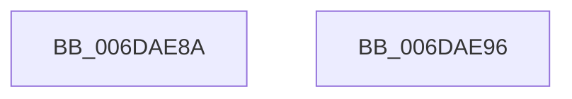

# sub_006DAE8A

- RVA: `0x006DAE8A`–`0x006DAEA8` (길이 `30` bytes)
- VA: `0x00000001406DAE8A`
- 실행 섹션: `.text`
- PDB 이름 있음: `아니요`; PDB Function 태그: `아니요`
- unwind 정보 RVA: `0x00068934`
- 디코드: `8`개 명령, `30/30` bytes 표시
- 미해석 바이트: `0` (있으면 어셈블리에 `.byte`로 보존)

> 이 문서는 커널 이미지의 기계어와 PDB 기호를 분석해 생성했습니다. 4번과 5번은 함수 원형과 자료형을 바이너리 사용 방식에서 추정한 C 해석이며 원본 소스 복구 결과는 아닙니다.

## 1. Dependencies

- 직접 호출 지점: **3**; 고유 호출 대상: **2**
- 직접 호출자로 확인된 함수: **0**
- RIP 상대 이미지 참조: **0**

### Outgoing calls
- `0x006DAE8A` → [LOCK_HIVE_LOAD](../../page/9B/LOCK_HIVE_LOAD_function_009B2300.md) (function, `0x009B2300`)
- `0x006DAE96` → [LOCK_HIVE_LOAD](../../page/9B/LOCK_HIVE_LOAD_function_009B2300.md) (function, `0x009B2300`)
- `0x006DAE9D` → [CmpLockRegistryFreezeAware](../../page/9B/CmpLockRegistryFreezeAware_function_009B4AE4.md) (function, `0x009B4AE4`)

### Direct callers
- 이 함수 시작 RVA로 연결되는 직접 call은 확인되지 않았습니다. 간접 호출은 완전히 역산할 수 없습니다.

### Static image references
- 디코드된 RIP-relative 메모리 참조가 없습니다.

## 2. Other-region calls and transfers

- 다른 실행 섹션으로 향하는 call: **3**
  - `0x006DAE8A` → [LOCK_HIVE_LOAD](../../page/9B/LOCK_HIVE_LOAD_function_009B2300.md) (`.text` → `PAGE`)
  - `0x006DAE96` → [LOCK_HIVE_LOAD](../../page/9B/LOCK_HIVE_LOAD_function_009B2300.md) (`.text` → `PAGE`)
  - `0x006DAE9D` → [CmpLockRegistryFreezeAware](../../page/9B/CmpLockRegistryFreezeAware_function_009B4AE4.md) (`.text` → `PAGE`)
- call이 아닌 외부 분기/꼬리 이동: **2**
  - `0x006DAE91` → [CmpTryToRundownHive + 0x83](../2A/CmpTryToRundownHive_function_002A4A60.md) (`tail-transfer`)
  - `0x006DAEA3` → [CmpTryToRundownHive + 0x1FD](../2A/CmpTryToRundownHive_function_002A4A60.md) (`tail-transfer`)

## 3. Assembly (complete function range)

```asm
006DAE8A  E8 71 74 2D 00                  call 0x1409b2300
006DAE8F  B1 01                           mov cl, 1
006DAE91  E9 4D 9C BC FF                  jmp 0x1402a4ae3
006DAE96  E8 65 74 2D 00                  call 0x1409b2300
006DAE9B  B1 01                           mov cl, 1
006DAE9D  E8 42 9C 2D 00                  call 0x1409b4ae4
006DAEA2  90                              nop
006DAEA3  E9 B5 9D BC FF                  jmp 0x1402a4c5d
```

## 4. C-style interpretation (structured pseudocode)

```c
__int64 __fastcall sub_006DAE8A(void)
{
    __int64 result;

    result = LOCK_HIVE_LOAD(a1, a2, a3, a4);
}
```

## 5. (Beta) C Style

```c
void sub_006DAE8A(void)
{
    int64_t result;

    result = LOCK_HIVE_LOAD(a1, a2, a3, a4);
}
```

## 6. Execution-region graph

[열기: 2D/3D 그래프와 함수 탐색 컨트롤 패널](../../../control-panel.html?section=text&rva=0x006DAE8A&view=graph)

- 2D 그래프는 위에서 아래로 흐르고, 3D 그래프는 빈 공간을 드래그해 회전합니다. Shift+드래그는 이동, 휠은 확대·축소, 함수 노드 선택은 대상 보고서 이동입니다.

### Static fallback


