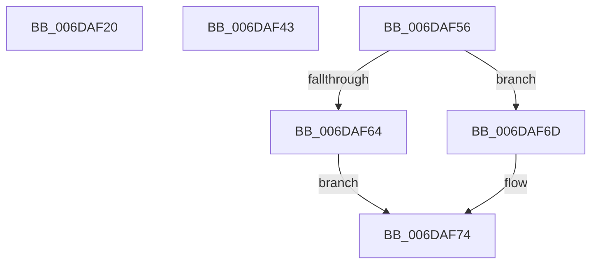

# sub_006DAF20

- RVA: `0x006DAF20`–`0x006DAF7D` (길이 `93` bytes)
- VA: `0x00000001406DAF20`
- 실행 섹션: `.text`
- PDB 이름 있음: `아니요`; PDB Function 태그: `아니요`
- unwind 정보 RVA: `0x00068B80`
- 디코드: `22`개 명령, `93/93` bytes 표시
- 미해석 바이트: `0` (있으면 어셈블리에 `.byte`로 보존)

> 이 문서는 커널 이미지의 기계어와 PDB 기호를 분석해 생성했습니다. 4번과 5번은 함수 원형과 자료형을 바이너리 사용 방식에서 추정한 C 해석이며 원본 소스 복구 결과는 아닙니다.

## 1. Dependencies

- 직접 호출 지점: **1**; 고유 호출 대상: **1**
- 직접 호출자로 확인된 함수: **0**
- RIP 상대 이미지 참조: **1**

### Outgoing calls
- `0x006DAF38` → [MiReleaseSpinLockExclusive](../24/MiReleaseSpinLockExclusive_function_002482C0.md) (function, `0x002482C0`)

### Direct callers
- 이 함수 시작 RVA로 연결되는 직접 call은 확인되지 않았습니다. 간접 호출은 완전히 역산할 수 없습니다.

### Static image references
- `0x006DAF64` → RVA `0x00E38858` (`.data`; read)

## 2. Other-region calls and transfers

- 다른 실행 섹션으로 향하는 call: **0**
- call이 아닌 외부 분기/꼬리 이동: **3**
  - `0x006DAF3E` → [MmOutSwapWorkingSet + 0x37B](../2A/MmOutSwapWorkingSet_function_002A6BC8.md) (`tail-transfer`)
  - `0x006DAF51` → [MmOutSwapWorkingSet + 0x359](../2A/MmOutSwapWorkingSet_function_002A6BC8.md) (`tail-transfer`)
  - `0x006DAF78` → [MmOutSwapWorkingSet + 0x359](../2A/MmOutSwapWorkingSet_function_002A6BC8.md) (`tail-transfer`)

## 3. Assembly (complete function range)

```asm
006DAF20  48 83 F8 02                     cmp rax, 2
006DAF24  BF 21 00 00 C0                  mov edi, 0xc0000021
006DAF29  B9 0A 01 00 C0                  mov ecx, 0xc000010a
006DAF2E  0F 44 F9                        cmove edi, ecx
006DAF31  49 8D 8F A0 04 00 00            lea rcx, [r15 + 0x4a0]
006DAF38  E8 83 D3 B6 FF                  call 0x1402482c0
006DAF3D  90                              nop
006DAF3E  E9 00 C0 BC FF                  jmp 0x1402a6f43
006DAF43  49 81 C6 D8 00 00 00            add r14, 0xd8
006DAF4A  49 89 36                        mov qword ptr [r14], rsi
006DAF4D  33 F6                           xor esi, esi
006DAF4F  33 FF                           xor edi, edi
006DAF51  E9 CB BF BC FF                  jmp 0x1402a6f21
006DAF56  41 8B 86 B8 00 00 00            mov eax, dword ptr [r14 + 0xb8]
006DAF5D  24 0F                           and al, 0xf
006DAF5F  41 3A C0                        cmp al, r8b
006DAF62  75 09                           jne 0x1406daf6d
006DAF64  4C 8D 35 ED D8 75 00            lea r14, [rip + 0x75d8ed]
006DAF6B  EB 07                           jmp 0x1406daf74
006DAF6D  49 81 C6 D8 00 00 00            add r14, 0xd8
006DAF74  49 83 26 00                     and qword ptr [r14], 0
006DAF78  E9 A4 BF BC FF                  jmp 0x1402a6f21
```

## 4. C-style interpretation (structured pseudocode)

```c
__int64 __fastcall sub_006DAF20(__int64 a1, __int64 a2, unsigned __int8 a3)
{
    __int64 result;
    __int64 v_rdi;

    v_rdi = (unsigned int)(0xC0000021ULL);
    if (result == 2) { v_rdi = (unsigned int)((unsigned int)(0xC000010AULL)); }
    result = MiReleaseSpinLockExclusive(v_r15 + 1184, a2, a3, a4);
}
```

## 5. (Beta) C Style

```c
int64_t sub_006DAF20(int64_t Arg1, int64_t Arg2, uint8_t Arg3)
{
    int64_t result;
    int64_t local_rdi;

    local_rdi = (uint32_t)(0xC0000021ULL);
    if (result == 2) { local_rdi = (uint32_t)((uint32_t)(0xC000010AULL)); }
    result = MiReleaseSpinLockExclusive(local_r15 + 1184, Arg2, Arg3, a4);
}
```

## 6. Execution-region graph

[열기: 2D/3D 그래프와 함수 탐색 컨트롤 패널](../../../control-panel.html?section=text&rva=0x006DAF20&view=graph)

- 2D 그래프는 위에서 아래로 흐르고, 3D 그래프는 빈 공간을 드래그해 회전합니다. Shift+드래그는 이동, 휠은 확대·축소, 함수 노드 선택은 대상 보고서 이동입니다.

### Static fallback


