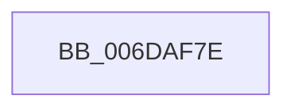

# sub_006DAF7E

- RVA: `0x006DAF7E`–`0x006DAFB7` (길이 `57` bytes)
- VA: `0x00000001406DAF7E`
- 실행 섹션: `.text`
- PDB 이름 있음: `아니요`; PDB Function 태그: `아니요`
- unwind 정보 RVA: `0x00068BFC`
- 디코드: `12`개 명령, `57/57` bytes 표시
- 미해석 바이트: `0` (있으면 어셈블리에 `.byte`로 보존)

> 이 문서는 커널 이미지의 기계어와 PDB 기호를 분석해 생성했습니다. 4번과 5번은 함수 원형과 자료형을 바이너리 사용 방식에서 추정한 C 해석이며 원본 소스 복구 결과는 아닙니다.

## 1. Dependencies

- 직접 호출 지점: **2**; 고유 호출 대상: **2**
- 직접 호출자로 확인된 함수: **0**
- RIP 상대 이미지 참조: **1**

### Outgoing calls
- `0x006DAF87` → [MiGetCurrentSlabIdentity](../3B/MiGetCurrentSlabIdentity_function_003BD020.md) (function, `0x003BD020`)
- `0x006DAFAC` → [MiWaitForFreePage](../2A/MiWaitForFreePage_function_002A3324.md) (function, `0x002A3324`)

### Direct callers
- 이 함수 시작 RVA로 연결되는 직접 call은 확인되지 않았습니다. 간접 호출은 완전히 역산할 수 없습니다.

### Static image references
- `0x006DAFA1` → RVA `0x00E30088` (`.data`; read)

## 2. Other-region calls and transfers

- 다른 실행 섹션으로 향하는 call: **0**
- call이 아닌 외부 분기/꼬리 이동: **1**
  - `0x006DAFB2` → [MiCopyOnWriteCheckConditions + 0x22](../2A/MiCopyOnWriteCheckConditions_function_002A750C.md) (`tail-transfer`)

## 3. Assembly (complete function range)

```asm
006DAF7E  65 48 8B 0C 25 88 01 00 00      mov rcx, qword ptr gs:[0x188]
006DAF87  E8 94 20 CE FF                  call 0x1403bd020
006DAF8C  BA 03 00 00 00                  mov edx, 3
006DAF91  3C FF                           cmp al, 0xff
006DAF93  41 0F B7 80 AE 00 00 00         movzx eax, word ptr [r8 + 0xae]
006DAF9B  8D 4A FE                        lea ecx, [rdx - 2]
006DAF9E  0F 44 D1                        cmove edx, ecx
006DAFA1  48 8B 0D E0 50 75 00            mov rcx, qword ptr [rip + 0x7550e0]
006DAFA8  48 8B 0C C1                     mov rcx, qword ptr [rcx + rax*8]
006DAFAC  E8 73 83 BC FF                  call 0x1402a3324
006DAFB1  90                              nop
006DAFB2  E9 77 C5 BC FF                  jmp 0x1402a752e
```

## 4. C-style interpretation (structured pseudocode)

```c
__int64 __fastcall sub_006DAF7E(__int64 a1, __int64 a2, __int64 a3)
{
    __int64 result;

    result = MiGetCurrentSlabIdentity(*(unsigned __int64 *)(gs_base + (0 + 392)), a2, a3, a4);
    a2 = 3;
    if (((unsigned __int8)(result)) == 255) { a2 = (unsigned int)(3 - 2); }
    result = MiWaitForFreePage(*(unsigned __int64 *)(*(unsigned __int64 *)(v_rip + 7688416) + *(unsigned __int16 *)(a3 + 174) * 8), a2, a3, a4);
}
```

## 5. (Beta) C Style

```c
int64_t sub_006DAF7E(int64_t Arg1, int64_t Arg2, int64_t Arg3)
{
    int64_t result;

    result = MiGetCurrentSlabIdentity(*(uint64_t *)(gs_base + (0 + 0x188)), Arg2, Arg3, a4);
    Arg2 = 3;
    if (((uint8_t)(result)) == 255) { Arg2 = (uint32_t)(3 - 2); }
    result = MiWaitForFreePage(*(uint64_t *)(*(uint64_t *)(v_rip + 0x7550E0) + *(uint16_t *)(Arg3 + 0xAE) * 8), Arg2, Arg3, a4);
}
```

## 6. Execution-region graph

[열기: 2D/3D 그래프와 함수 탐색 컨트롤 패널](../../../control-panel.html?section=text&rva=0x006DAF7E&view=graph)

- 2D 그래프는 위에서 아래로 흐르고, 3D 그래프는 빈 공간을 드래그해 회전합니다. Shift+드래그는 이동, 휠은 확대·축소, 함수 노드 선택은 대상 보고서 이동입니다.

### Static fallback


