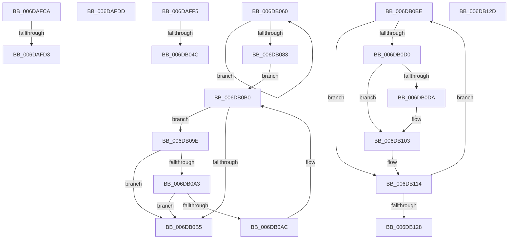

# sub_006DAFCA

- RVA: `0x006DAFCA`–`0x006DB143` (길이 `377` bytes)
- VA: `0x00000001406DAFCA`
- 실행 섹션: `.text`
- PDB 이름 있음: `아니요`; PDB Function 태그: `아니요`
- unwind 정보 RVA: `0x00068D20`
- 디코드: `95`개 명령, `377/377` bytes 표시
- 미해석 바이트: `0` (있으면 어셈블리에 `.byte`로 보존)

> 이 문서는 커널 이미지의 기계어와 PDB 기호를 분석해 생성했습니다. 4번과 5번은 함수 원형과 자료형을 바이너리 사용 방식에서 추정한 C 해석이며 원본 소스 복구 결과는 아닙니다.

## 1. Dependencies

- 직접 호출 지점: **5**; 고유 호출 대상: **4**
- 직접 호출자로 확인된 함수: **0**
- RIP 상대 이미지 참조: **0**

### Outgoing calls
- `0x006DAFE8` → [MiUnlockPageTable](../21/MiUnlockPageTable_function_00216EC0.md) (function, `0x00216EC0`)
- `0x006DB0DA` → [MiGetProcessorFlushList](../24/MiGetProcessorFlushList_function_00242C90.md) (function, `0x00242C90`)
- `0x006DB0FB` → [MiInitializeTbFlushList](../29/MiInitializeTbFlushList_function_00294F00.md) (function, `0x00294F00`)
- `0x006DB109` → [MiMakePteClean](../2A/MiMakePteClean_function_002A901C.md) (function, `0x002A901C`)
- `0x006DB133` → [MiMakePteClean](../2A/MiMakePteClean_function_002A901C.md) (function, `0x002A901C`)

### Direct callers
- 이 함수 시작 RVA로 연결되는 직접 call은 확인되지 않았습니다. 간접 호출은 완전히 역산할 수 없습니다.

### Static image references
- 디코드된 RIP-relative 메모리 참조가 없습니다.

## 2. Other-region calls and transfers

- 다른 실행 섹션으로 향하는 call: **0**
- call이 아닌 외부 분기/꼬리 이동: **8**
  - `0x006DAFCD` → [NtGetWriteWatch + 0x6B8](../2A/NtGetWriteWatch_function_002A7CE0.md) (`tail-transfer`)
  - `0x006DAFD8` → [NtGetWriteWatch + 0x2D0](../2A/NtGetWriteWatch_function_002A7CE0.md) (`tail-transfer`)
  - `0x006DAFF0` → [NtGetWriteWatch + 0x400](../2A/NtGetWriteWatch_function_002A7CE0.md) (`tail-transfer`)
  - `0x006DB046` → [NtGetWriteWatch + 0x490](../2A/NtGetWriteWatch_function_002A7CE0.md) (`tail-transfer`)
  - `0x006DB05B` → [NtGetWriteWatch + 0x482](../2A/NtGetWriteWatch_function_002A7CE0.md) (`tail-transfer`)
  - `0x006DB0B9` → [NtGetWriteWatch + 0x4DF](../2A/NtGetWriteWatch_function_002A7CE0.md) (`tail-transfer`)
  - `0x006DB128` → [NtGetWriteWatch + 0x553](../2A/NtGetWriteWatch_function_002A7CE0.md) (`tail-transfer`)
  - `0x006DB13E` → [NtGetWriteWatch + 0x53F](../2A/NtGetWriteWatch_function_002A7CE0.md) (`tail-transfer`)

## 3. Assembly (complete function range)

```asm
006DAFCA  4C 85 E1                        test rcx, r12
006DAFCD  0F 85 C5 D3 BC FF               jne 0x1402a8398
006DAFD3  B9 01 00 00 00                  mov ecx, 1
006DAFD8  E9 D3 CF BC FF                  jmp 0x1402a7fb0
006DAFDD  49 8B D5                        mov rdx, r13
006DAFE0  48 8B 74 24 58                  mov rsi, qword ptr [rsp + 0x58]
006DAFE5  48 8B CE                        mov rcx, rsi
006DAFE8  E8 D3 BE B3 FF                  call 0x140216ec0
006DAFED  45 33 ED                        xor r13d, r13d
006DAFF0  E9 EB D0 BC FF                  jmp 0x1402a80e0
006DAFF5  48 8B CF                        mov rcx, rdi
006DAFF8  48 C1 E1 19                     shl rcx, 0x19
006DAFFC  48 B8 00 00 00 00 80 F6 FF FF   movabs rax, 0xfffff68000000000
006DB006  48 8B C0                        mov rax, rax
006DB009  48 C1 E0 19                     shl rax, 0x19
006DB00D  48 2B C8                        sub rcx, rax
006DB010  48 C1 F9 10                     sar rcx, 0x10
006DB014  48 8B 84 24 98 00 00 00         mov rax, qword ptr [rsp + 0x98]
006DB01C  48 89 08                        mov qword ptr [rax], rcx
006DB01F  48 83 C0 08                     add rax, 8
006DB023  48 89 84 24 98 00 00 00         mov qword ptr [rsp + 0x98], rax
006DB02B  48 8B 94 24 88 00 00 00         mov rdx, qword ptr [rsp + 0x88]
006DB033  49 03 D1                        add rdx, r9
006DB036  48 89 94 24 88 00 00 00         mov qword ptr [rsp + 0x88], rdx
006DB03E  48 3B 94 24 A0 00 00 00         cmp rdx, qword ptr [rsp + 0xa0]
006DB046  0F 84 24 D1 BC FF               je 0x1402a8170
006DB04C  4D 03 D1                        add r10, r9
006DB04F  4C 89 54 24 48                  mov qword ptr [rsp + 0x48], r10
006DB054  4A 8D 3C F7                     lea rdi, [rdi + r14*8]
006DB058  49 2B F1                        sub rsi, r9
006DB05B  E9 02 D1 BC FF                  jmp 0x1402a8162
006DB060  49 C1 E0 09                     shl r8, 9
006DB064  48 C1 EF 09                     shr rdi, 9
006DB068  49 23 FF                        and rdi, r15
006DB06B  48 8B C6                        mov rax, rsi
006DB06E  48 03 F8                        add rdi, rax
006DB071  48 C1 E9 09                     shr rcx, 9
006DB075  49 23 CF                        and rcx, r15
006DB078  48 8B C6                        mov rax, rsi
006DB07B  48 03 C8                        add rcx, rax
006DB07E  49 2B D1                        sub rdx, r9
006DB081  75 DD                           jne 0x1406db060
006DB083  4C 8B EF                        mov r13, rdi
006DB086  49 C1 ED 09                     shr r13, 9
006DB08A  4D 23 EF                        and r13, r15
006DB08D  48 8B C6                        mov rax, rsi
006DB090  4C 03 E8                        add r13, rax
006DB093  4C 8D 7F 08                     lea r15, [rdi + 8]
006DB097  BA FF 0F 00 00                  mov edx, 0xfff
006DB09C  EB 12                           jmp 0x1406db0b0
006DB09E  4C 3B F9                        cmp r15, rcx
006DB0A1  77 12                           ja 0x1406db0b5
006DB0A3  49 8B 07                        mov rax, qword ptr [r15]
006DB0A6  24 81                           and al, 0x81
006DB0A8  3C 81                           cmp al, 0x81
006DB0AA  75 09                           jne 0x1406db0b5
006DB0AC  49 83 C7 08                     add r15, 8
006DB0B0  4C 85 FA                        test rdx, r15
006DB0B3  75 E9                           jne 0x1406db09e
006DB0B5  49 83 EF 08                     sub r15, 8
006DB0B9  E9 01 D1 BC FF                  jmp 0x1402a81bf
006DB0BE  48 8B 06                        mov rax, qword ptr [rsi]
006DB0C1  A8 42                           test al, 0x42
006DB0C3  0F 95 C1                        setne cl
006DB0C6  41 84 C0                        test r8b, al
006DB0C9  0F 95 C0                        setne al
006DB0CC  84 C8                           test al, cl
006DB0CE  74 44                           je 0x1406db114
006DB0D0  48 8B 44 24 50                  mov rax, qword ptr [rsp + 0x50]
006DB0D5  48 85 C0                        test rax, rax
006DB0D8  75 29                           jne 0x1406db103
006DB0DA  E8 B1 7B B6 FF                  call 0x140242c90
006DB0DF  48 89 44 24 50                  mov qword ptr [rsp + 0x50], rax
006DB0E4  C7 44 24 20 0A 00 00 00         mov dword ptr [rsp + 0x20], 0xa
006DB0EC  45 33 C9                        xor r9d, r9d
006DB0EF  44 8B 40 0C                     mov r8d, dword ptr [rax + 0xc]
006DB0F3  48 8B 54 24 58                  mov rdx, qword ptr [rsp + 0x58]
006DB0F8  48 8B C8                        mov rcx, rax
006DB0FB  E8 00 9E BB FF                  call 0x140294f00
006DB100  48 8B C1                        mov rax, rcx
006DB103  4C 8B C0                        mov r8, rax
006DB106  48 8B D6                        mov rdx, rsi
006DB109  E8 0E DF BC FF                  call 0x1402a901c
006DB10E  41 B8 01 00 00 00               mov r8d, 1
006DB114  48 83 C6 08                     add rsi, 8
006DB118  45 03 F0                        add r14d, r8d
006DB11B  41 8B C6                        mov eax, r14d
006DB11E  48 3B 84 24 A8 00 00 00         cmp rax, qword ptr [rsp + 0xa8]
006DB126  72 96                           jb 0x1406db0be
006DB128  E9 06 D1 BC FF                  jmp 0x1402a8233
006DB12D  4C 8B C0                        mov r8, rax
006DB130  48 8B D6                        mov rdx, rsi
006DB133  E8 E4 DE BC FF                  call 0x1402a901c
006DB138  41 B8 01 00 00 00               mov r8d, 1
006DB13E  E9 DC D0 BC FF                  jmp 0x1402a821f
```

## 4. C-style interpretation (structured pseudocode)

```c
__int64 __fastcall sub_006DAFCA(__int64 a1, __int64 a2, __int64 a3, __int64 a4)
{
    unsigned int v_stack_p20;
    unsigned __int64 v_stack_p48;
    unsigned __int64 v_stack_p50;
    unsigned __int64 v_stack_p58;
    unsigned __int64 v_stack_p88;
    unsigned __int64 v_stack_p98;
    unsigned __int64 v_stack_pA0;
    unsigned __int64 v_stack_pA8;
}
```

## 5. (Beta) C Style

```c
int64_t sub_006DAFCA(int64_t Arg1, int64_t Arg2, int64_t Arg3, int64_t Arg4)
{
    uint32_t v_stack_p20;
    uint64_t v_stack_p48;
    uint64_t v_stack_p50;
    uint64_t v_stack_p58;
    uint64_t v_stack_p88;
    uint64_t v_stack_p98;
    uint64_t v_stack_pA0;
    uint64_t v_stack_pA8;
}
```

## 6. Execution-region graph

[열기: 2D/3D 그래프와 함수 탐색 컨트롤 패널](../../../control-panel.html?section=text&rva=0x006DAFCA&view=graph)

- 2D 그래프는 위에서 아래로 흐르고, 3D 그래프는 빈 공간을 드래그해 회전합니다. Shift+드래그는 이동, 휠은 확대·축소, 함수 노드 선택은 대상 보고서 이동입니다.

### Static fallback


