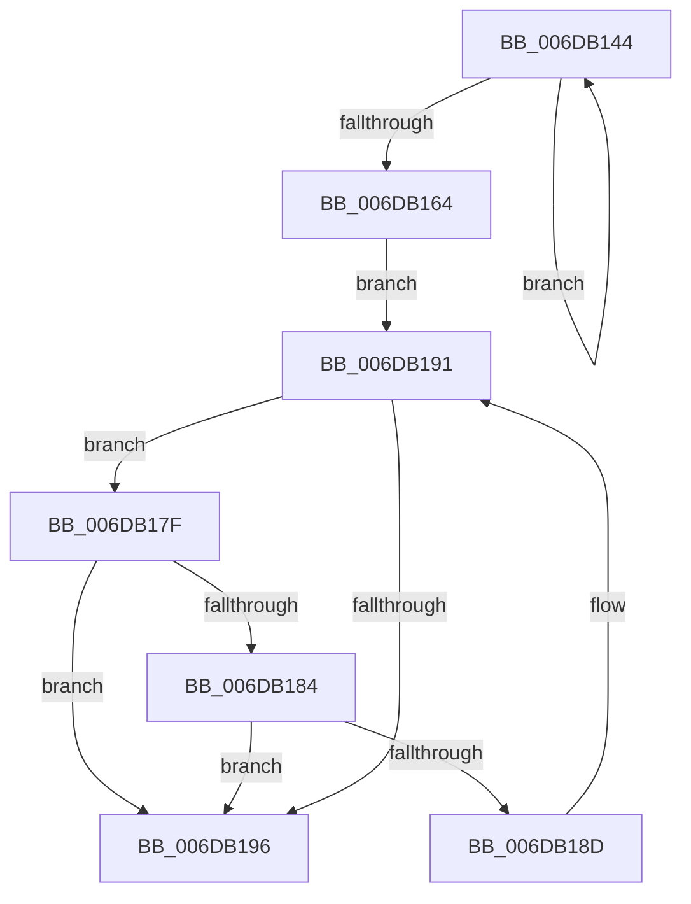

# sub_006DB144

- RVA: `0x006DB144`–`0x006DB19F` (길이 `91` bytes)
- VA: `0x00000001406DB144`
- 실행 섹션: `.text`
- PDB 이름 있음: `아니요`; PDB Function 태그: `아니요`
- unwind 정보 RVA: `0x00068D4C`
- 디코드: `29`개 명령, `91/91` bytes 표시
- 미해석 바이트: `0` (있으면 어셈블리에 `.byte`로 보존)

> 이 문서는 커널 이미지의 기계어와 PDB 기호를 분석해 생성했습니다. 4번과 5번은 함수 원형과 자료형을 바이너리 사용 방식에서 추정한 C 해석이며 원본 소스 복구 결과는 아닙니다.

## 1. Dependencies

- 직접 호출 지점: **0**; 고유 호출 대상: **0**
- 직접 호출자로 확인된 함수: **0**
- RIP 상대 이미지 참조: **0**

### Outgoing calls
- 직접 디코드된 call 명령이 없습니다.

### Direct callers
- 이 함수 시작 RVA로 연결되는 직접 call은 확인되지 않았습니다. 간접 호출은 완전히 역산할 수 없습니다.

### Static image references
- 디코드된 RIP-relative 메모리 참조가 없습니다.

## 2. Other-region calls and transfers

- 다른 실행 섹션으로 향하는 call: **0**
- call이 아닌 외부 분기/꼬리 이동: **1**
  - `0x006DB19A` → [MiMoveDirtyBitsToPfns + 0x10E](../2A/MiMoveDirtyBitsToPfns_function_002A8624.md) (`tail-transfer`)

## 3. Assembly (complete function range)

```asm
006DB144  48 C1 EE 09                     shr rsi, 9
006DB148  49 23 F1                        and rsi, r9
006DB14B  49 8B C0                        mov rax, r8
006DB14E  48 C1 E9 09                     shr rcx, 9
006DB152  48 03 F0                        add rsi, rax
006DB155  49 23 C9                        and rcx, r9
006DB158  49 8B C0                        mov rax, r8
006DB15B  48 03 C8                        add rcx, rax
006DB15E  48 83 EA 01                     sub rdx, 1
006DB162  75 E0                           jne 0x1406db144
006DB164  48 8B DE                        mov rbx, rsi
006DB167  48 C1 EB 09                     shr rbx, 9
006DB16B  49 23 D9                        and rbx, r9
006DB16E  49 8B C0                        mov rax, r8
006DB171  48 03 D8                        add rbx, rax
006DB174  48 8D 7E 08                     lea rdi, [rsi + 8]
006DB178  BA FF 0F 00 00                  mov edx, 0xfff
006DB17D  EB 12                           jmp 0x1406db191
006DB17F  48 3B F9                        cmp rdi, rcx
006DB182  77 12                           ja 0x1406db196
006DB184  48 8B 07                        mov rax, qword ptr [rdi]
006DB187  24 81                           and al, 0x81
006DB189  3C 81                           cmp al, 0x81
006DB18B  75 09                           jne 0x1406db196
006DB18D  48 83 C7 08                     add rdi, 8
006DB191  48 85 FA                        test rdx, rdi
006DB194  75 E9                           jne 0x1406db17f
006DB196  48 83 EF 08                     sub rdi, 8
006DB19A  E9 93 D5 BC FF                  jmp 0x1402a8732
```

## 4. C-style interpretation (structured pseudocode)

```c
__int64 __fastcall sub_006DB144(__int64 a1, __int64 a2, __int64 a3, __int64 a4)
{
    __int64 result;
    __int64 v_rbx;
    __int64 v_rdi;
    __int64 v_rsi;

    v_rsi = (v_rsi) >> (9);
    v_rsi = (v_rsi) & (a4);
    a1 = (a1) >> (9);
    v_rsi = (v_rsi) + (a3);
    a1 = (a1) & (a4);
    a1 = (a1) + (a3);
    a2 = (a2) - (1);
    if (condition_is_not_equal) goto loc_006DB144;
    v_rbx = (v_rsi) >> (9);
    v_rbx = (v_rbx) & (a4);
    v_rbx = (v_rbx) + (a3);
    goto loc_006DB191;
loc_006DB17F:
    if ((v_rsi + 8) > a1) goto loc_006DB196;
    result = (unsigned __int8)((*(unsigned __int64 *)(v_rsi + 8)) & (129));
    if (((unsigned __int8)(result)) != 129) goto loc_006DB196;
    v_rdi = (v_rsi + 8) + (8);
loc_006DB191:
    if ((((unsigned int)(0xFFFULL)) & (v_rdi)) != 0) goto loc_006DB17F;
loc_006DB196:
    v_rdi = (v_rdi) - (8);
}
```

## 5. (Beta) C Style

```c
int64_t sub_006DB144(int64_t Arg1, int64_t Arg2, int64_t Arg3, int64_t Arg4)
{
    int64_t result;
    int64_t local_rbx;
    int64_t local_rdi;
    int64_t local_rsi;

    local_rsi = (local_rsi) >> (9);
    local_rsi = (local_rsi) & (Arg4);
    Arg1 = (Arg1) >> (9);
    local_rsi = (local_rsi) + (Arg3);
    Arg1 = (Arg1) & (Arg4);
    Arg1 = (Arg1) + (Arg3);
    Arg2 = (Arg2) - (1);
    if (condition_is_not_equal) goto loc_006DB144;
    local_rbx = (local_rsi) >> (9);
    local_rbx = (local_rbx) & (Arg4);
    local_rbx = (local_rbx) + (Arg3);
    goto loc_006DB191;
loc_006DB17F:
    if ((local_rsi + 8) > Arg1) goto loc_006DB196;
    result = (uint8_t)((*(uint64_t *)(local_rsi + 0x8)) & (129));
    if (((uint8_t)(result)) != 129) goto loc_006DB196;
    local_rdi = (local_rsi + 8) + (8);
loc_006DB191:
    if ((((uint32_t)(0xFFFULL)) & (local_rdi)) != 0) goto loc_006DB17F;
loc_006DB196:
    local_rdi = (local_rdi) - (8);
}
```

## 6. Execution-region graph

[열기: 2D/3D 그래프와 함수 탐색 컨트롤 패널](../../../control-panel.html?section=text&rva=0x006DB144&view=graph)

- 2D 그래프는 위에서 아래로 흐르고, 3D 그래프는 빈 공간을 드래그해 회전합니다. Shift+드래그는 이동, 휠은 확대·축소, 함수 노드 선택은 대상 보고서 이동입니다.

### Static fallback


