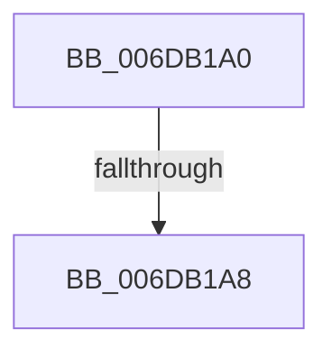

# sub_006DB1A0

- RVA: `0x006DB1A0`–`0x006DB1DF` (길이 `63` bytes)
- VA: `0x00000001406DB1A0`
- 실행 섹션: `.text`
- PDB 이름 있음: `아니요`; PDB Function 태그: `아니요`
- unwind 정보 RVA: `0x00068DD4`
- 디코드: `15`개 명령, `63/63` bytes 표시
- 미해석 바이트: `0` (있으면 어셈블리에 `.byte`로 보존)

> 이 문서는 커널 이미지의 기계어와 PDB 기호를 분석해 생성했습니다. 4번과 5번은 함수 원형과 자료형을 바이너리 사용 방식에서 추정한 C 해석이며 원본 소스 복구 결과는 아닙니다.

## 1. Dependencies

- 직접 호출 지점: **2**; 고유 호출 대상: **2**
- 직접 호출자로 확인된 함수: **0**
- RIP 상대 이미지 참조: **0**

### Outgoing calls
- `0x006DB1C7` → [MiRewritePteWithLockBit](../32/MiRewritePteWithLockBit_function_00322FEC.md) (function, `0x00322FEC`)
- `0x006DB1D4` → [MiInsertLargeTbFlushEntry](../37/MiInsertLargeTbFlushEntry_function_0037827C.md) (function, `0x0037827C`)

### Direct callers
- 이 함수 시작 RVA로 연결되는 직접 call은 확인되지 않았습니다. 간접 호출은 완전히 역산할 수 없습니다.

### Static image references
- 디코드된 RIP-relative 메모리 참조가 없습니다.

## 2. Other-region calls and transfers

- 다른 실행 섹션으로 향하는 call: **0**
- call이 아닌 외부 분기/꼬리 이동: **2**
  - `0x006DB1A2` → [MiMakePteClean + 0x5F](../2A/MiMakePteClean_function_002A901C.md) (`tail-transfer`)
  - `0x006DB1DA` → [MiMakePteClean + 0x1F0](../2A/MiMakePteClean_function_002A901C.md) (`tail-transfer`)

## 3. Assembly (complete function range)

```asm
006DB1A0  85 DB                           test ebx, ebx
006DB1A2  0F 84 D3 DE BC FF               je 0x1402a907b
006DB1A8  65 48 8B 04 25 88 01 00 00      mov rax, qword ptr gs:[0x188]
006DB1B1  4D 8B CF                        mov r9, r15
006DB1B4  4D 8B C6                        mov r8, r14
006DB1B7  33 D2                           xor edx, edx
006DB1B9  48 8B 88 B8 00 00 00            mov rcx, qword ptr [rax + 0xb8]
006DB1C0  48 81 C1 00 04 00 00            add rcx, 0x400
006DB1C7  E8 20 7E C4 FF                  call 0x140322fec
006DB1CC  4D 8B C6                        mov r8, r14
006DB1CF  8B D3                           mov edx, ebx
006DB1D1  48 8B CF                        mov rcx, rdi
006DB1D4  E8 A3 D0 C9 FF                  call 0x14037827c
006DB1D9  90                              nop
006DB1DA  E9 2D E0 BC FF                  jmp 0x1402a920c
```

## 4. C-style interpretation (structured pseudocode)

```c
__int64 __fastcall sub_006DB1A0(__int64 a1, int a2)
{
    __int64 result;

    a2 = 0;
    a1 = (*(unsigned __int64 *)(*(unsigned __int64 *)(gs_base + (0 + 392)) + 184)) + (0x400ULL);
    result = MiRewritePteWithLockBit(a1, a2, v_r14, v_r15);
    result = MiInsertLargeTbFlushEntry(v_rdi, (unsigned int)((unsigned int)(v_rbx)), v_r14, v_r15);
}
```

## 5. (Beta) C Style

```c
int64_t sub_006DB1A0(int64_t Arg1, int32_t Arg2)
{
    int64_t result;

    Arg2 = 0;
    Arg1 = (*(uint64_t *)(*(uint64_t *)(gs_base + (0 + 0x188)) + 0xB8)) + (0x400ULL);
    result = MiRewritePteWithLockBit(Arg1, Arg2, local_r14, local_r15);
    result = MiInsertLargeTbFlushEntry(local_rdi, (uint32_t)((uint32_t)(local_rbx)), local_r14, local_r15);
}
```

## 6. Execution-region graph

[열기: 2D/3D 그래프와 함수 탐색 컨트롤 패널](../../../control-panel.html?section=text&rva=0x006DB1A0&view=graph)

- 2D 그래프는 위에서 아래로 흐르고, 3D 그래프는 빈 공간을 드래그해 회전합니다. Shift+드래그는 이동, 휠은 확대·축소, 함수 노드 선택은 대상 보고서 이동입니다.

### Static fallback


