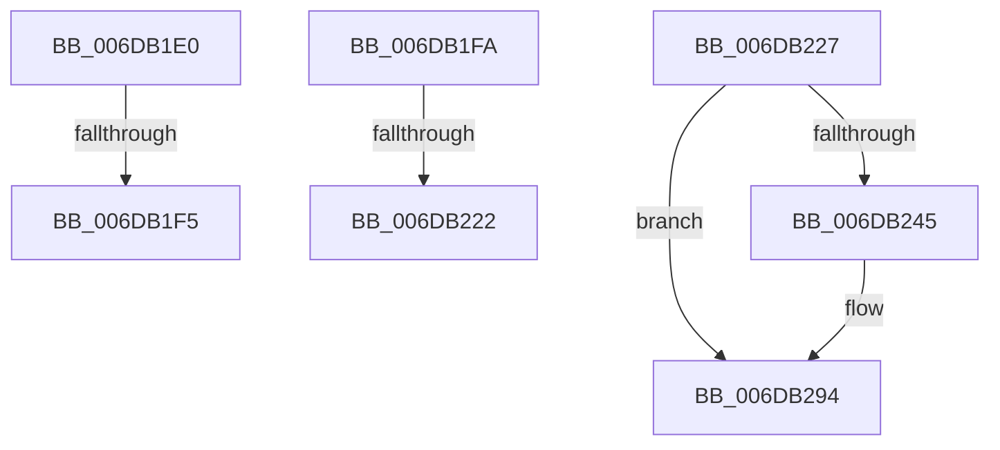

# sub_006DB1E0

- RVA: `0x006DB1E0`–`0x006DB2A3` (길이 `195` bytes)
- VA: `0x00000001406DB1E0`
- 실행 섹션: `.text`
- PDB 이름 있음: `아니요`; PDB Function 태그: `아니요`
- unwind 정보 RVA: `0x0006CFF0`
- 디코드: `45`개 명령, `195/195` bytes 표시
- 미해석 바이트: `0` (있으면 어셈블리에 `.byte`로 보존)

> 이 문서는 커널 이미지의 기계어와 PDB 기호를 분석해 생성했습니다. 4번과 5번은 함수 원형과 자료형을 바이너리 사용 방식에서 추정한 C 해석이며 원본 소스 복구 결과는 아닙니다.

## 1. Dependencies

- 직접 호출 지점: **8**; 고유 호출 대상: **8**
- 직접 호출자로 확인된 함수: **0**
- RIP 상대 이미지 참조: **1**

### Outgoing calls
- `0x006DB236` → [MiInsertTbFlushEntry](../29/MiInsertTbFlushEntry_function_00293670.md) (function, `0x00293670`)
- `0x006DB250` → [MiUnlockIoPfnTree](../2A/MiUnlockIoPfnTree_function_002AC7F8.md) (function, `0x002AC7F8`)
- `0x006DB25B` → [MiUnlockPageTable](../21/MiUnlockPageTable_function_00216EC0.md) (function, `0x00216EC0`)
- `0x006DB267` → [MiUnlockWorkingSetShared](../27/MiUnlockWorkingSetShared_function_0027D690.md) (function, `0x0027D690`)
- `0x006DB271` → [MiInvokeIoReleasePages](../4E/MiInvokeIoReleasePages_function_004E3E40.md) (function, `0x004E3E40`)
- `0x006DB279` → [MiLockWorkingSetShared](../27/MiLockWorkingSetShared_function_0027CBF0.md) (function, `0x0027CBF0`)
- `0x006DB284` → [MiLockNestedPageTable](../23/MiLockNestedPageTable_function_0023E890.md) (function, `0x0023E890`)
- `0x006DB28C` → [MiLockIoPfnTree](../2A/MiLockIoPfnTree_function_002AC8A4.md) (function, `0x002AC8A4`)

### Direct callers
- 이 함수 시작 RVA로 연결되는 직접 call은 확인되지 않았습니다. 간접 호출은 완전히 역산할 수 없습니다.

### Static image references
- `0x006DB1FA` → RVA `0x00E2DC38` (`.data`; read)

## 2. Other-region calls and transfers

- 다른 실행 섹션으로 향하는 call: **0**
- call이 아닌 외부 분기/꼬리 이동: **5**
  - `0x006DB1EF` → [MiUnlockOpportunisticPagesInPageTable + 0x124](../2A/MiUnlockOpportunisticPagesInPageTable_function_002AA88C.md) (`tail-transfer`)
  - `0x006DB1F5` → [MiUnlockOpportunisticPagesInPageTable + 0x172](../2A/MiUnlockOpportunisticPagesInPageTable_function_002AA88C.md) (`tail-transfer`)
  - `0x006DB21C` → [MiUnlockOpportunisticPagesInPageTable + 0x124](../2A/MiUnlockOpportunisticPagesInPageTable_function_002AA88C.md) (`tail-transfer`)
  - `0x006DB222` → [MiUnlockOpportunisticPagesInPageTable + 0x172](../2A/MiUnlockOpportunisticPagesInPageTable_function_002AA88C.md) (`tail-transfer`)
  - `0x006DB29E` → [MiUnlockOpportunisticPagesInPageTable + 0x124](../2A/MiUnlockOpportunisticPagesInPageTable_function_002AA88C.md) (`tail-transfer`)

## 3. Assembly (complete function range)

```asm
006DB1E0  41 B8 02 00 00 00               mov r8d, 2
006DB1E6  41 8B 44 CA 20                  mov eax, dword ptr [r10 + rcx*8 + 0x20]
006DB1EB  66 41 3B C0                     cmp ax, r8w
006DB1EF  0F 86 BB F7 BC FF               jbe 0x1402aa9b0
006DB1F5  E9 04 F8 BC FF                  jmp 0x1402aa9fe
006DB1FA  8A 0D 38 2A 75 00               mov cl, byte ptr [rip + 0x752a38]
006DB200  49 8B C3                        mov rax, r11
006DB203  80 C1 F4                        add cl, 0xf4
006DB206  48 D3 E0                        shl rax, cl
006DB209  49 2B C3                        sub rax, r11
006DB20C  48 23 C2                        and rax, rdx
006DB20F  48 2B 43 18                     sub rax, qword ptr [rbx + 0x18]
006DB213  66 44 39 8C 43 B0 00 00 00      cmp word ptr [rbx + rax*2 + 0xb0], r9w
006DB21C  0F 84 8E F7 BC FF               je 0x1402aa9b0
006DB222  E9 D7 F7 BC FF                  jmp 0x1402aa9fe
006DB227  48 C1 E2 0C                     shl rdx, 0xc
006DB22B  48 8D 4C 24 50                  lea rcx, [rsp + 0x50]
006DB230  45 33 C9                        xor r9d, r9d
006DB233  4D 8B C3                        mov r8, r11
006DB236  E8 35 84 BB FF                  call 0x140293670
006DB23B  8B 44 24 5C                     mov eax, dword ptr [rsp + 0x5c]
006DB23F  39 44 24 6C                     cmp dword ptr [rsp + 0x6c], eax
006DB243  75 4F                           jne 0x1406db294
006DB245  41 BF 05 00 00 00               mov r15d, 5
006DB24B  B1 11                           mov cl, 0x11
006DB24D  41 8B D7                        mov edx, r15d
006DB250  E8 A3 15 BD FF                  call 0x1402ac7f8
006DB255  49 8B D4                        mov rdx, r12
006DB258  48 8B CE                        mov rcx, rsi
006DB25B  E8 60 BC B3 FF                  call 0x140216ec0
006DB260  8A 54 24 30                     mov dl, byte ptr [rsp + 0x30]
006DB264  48 8B CE                        mov rcx, rsi
006DB267  E8 24 24 BA FF                  call 0x14027d690
006DB26C  48 8D 4C 24 50                  lea rcx, [rsp + 0x50]
006DB271  E8 CA 8B E0 FF                  call 0x1404e3e40
006DB276  48 8B CE                        mov rcx, rsi
006DB279  E8 72 19 BA FF                  call 0x14027cbf0
006DB27E  49 8B D4                        mov rdx, r12
006DB281  48 8B CE                        mov rcx, rsi
006DB284  E8 07 36 B6 FF                  call 0x14023e890
006DB289  41 8B CF                        mov ecx, r15d
006DB28C  E8 13 16 BD FF                  call 0x1402ac8a4
006DB291  4C 8B FF                        mov r15, rdi
006DB294  48 BF FF FF FF FF FF 00 00 00   movabs rdi, 0xffffffffff
006DB29E  E9 0D F7 BC FF                  jmp 0x1402aa9b0
```

## 4. C-style interpretation (structured pseudocode)

```c
__int64 __fastcall sub_006DB1E0(__int64 a1, __int64 a2, __int64 a3, int a4)
{
    unsigned __int8 v_stack_p30;
    unsigned __int64 v_stack_p50;
    unsigned int v_stack_p5C;
    unsigned int v_stack_p6C;
}
```

## 5. (Beta) C Style

```c
int64_t sub_006DB1E0(int64_t Arg1, int64_t Arg2, int64_t Arg3, int32_t Arg4)
{
    uint8_t v_stack_p30;
    uint64_t v_stack_p50;
    uint32_t v_stack_p5C;
    uint32_t v_stack_p6C;
}
```

## 6. Execution-region graph

[열기: 2D/3D 그래프와 함수 탐색 컨트롤 패널](../../../control-panel.html?section=text&rva=0x006DB1E0&view=graph)

- 2D 그래프는 위에서 아래로 흐르고, 3D 그래프는 빈 공간을 드래그해 회전합니다. Shift+드래그는 이동, 휠은 확대·축소, 함수 노드 선택은 대상 보고서 이동입니다.

### Static fallback


