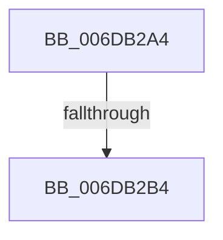

# sub_006DB2A4

- RVA: `0x006DB2A4`–`0x006DB2CF` (길이 `43` bytes)
- VA: `0x00000001406DB2A4`
- 실행 섹션: `.text`
- PDB 이름 있음: `아니요`; PDB Function 태그: `아니요`
- unwind 정보 RVA: `0x0006D030`
- 디코드: `11`개 명령, `43/43` bytes 표시
- 미해석 바이트: `0` (있으면 어셈블리에 `.byte`로 보존)

> 이 문서는 커널 이미지의 기계어와 PDB 기호를 분석해 생성했습니다. 4번과 5번은 함수 원형과 자료형을 바이너리 사용 방식에서 추정한 C 해석이며 원본 소스 복구 결과는 아닙니다.

## 1. Dependencies

- 직접 호출 지점: **1**; 고유 호출 대상: **1**
- 직접 호출자로 확인된 함수: **0**
- RIP 상대 이미지 참조: **0**

### Outgoing calls
- `0x006DB2C9` → [KeBugCheckEx](../4F/KeBugCheckEx_function_004FD660.md) (function, `0x004FD660`)

### Direct callers
- 이 함수 시작 RVA로 연결되는 직접 call은 확인되지 않았습니다. 간접 호출은 완전히 역산할 수 없습니다.

### Static image references
- 디코드된 RIP-relative 메모리 참조가 없습니다.

## 2. Other-region calls and transfers

- 다른 실행 섹션으로 향하는 call: **0**
- call이 아닌 외부 분기/꼬리 이동: **1**
  - `0x006DB2AE` → [MiUnmapFrameBuffer + 0x7D](../2A/MiUnmapFrameBuffer_function_002AAF14.md) (`tail-transfer`)

## 3. Assembly (complete function range)

```asm
006DB2A4  41 0F B7 D1                     movzx edx, r9w
006DB2A8  8B 41 20                        mov eax, dword ptr [rcx + 0x20]
006DB2AB  66 3B C2                        cmp ax, dx
006DB2AE  0F 83 DD FC BC FF               jae 0x1402aaf91
006DB2B4  48 89 4C 24 20                  mov qword ptr [rsp + 0x20], rcx
006DB2B9  4C 8B CB                        mov r9, rbx
006DB2BC  B9 1A 00 00 00                  mov ecx, 0x1a
006DB2C1  4C 8B C7                        mov r8, rdi
006DB2C4  BA 81 60 00 00                  mov edx, 0x6081
006DB2C9  E8 92 23 E2 FF                  call 0x1404fd660
006DB2CE  CC                              int3
```

## 4. C-style interpretation (structured pseudocode)

```c
__int64 __fastcall sub_006DB2A4(__int64 a1, __int64 a2, __int64 a3, unsigned __int16 a4)
{
    __int64 result;
    unsigned __int64 v_stack_p20;

    v_stack_p20 = a1;
    result = KeBugCheckEx(26, (unsigned int)(0x6081ULL), v_rdi, v_rbx);
    return result;
}
```

## 5. (Beta) C Style

```c
int64_t sub_006DB2A4(void *Arg1, int64_t Arg2, int64_t Arg3, uint16_t Arg4)
{
    uint8_t *arg1 = (uint8_t *)Arg1;

    int64_t result;
    uint64_t v_stack_p20;

    v_stack_p20 = Arg1;
    result = KeBugCheckEx(26, (uint32_t)(0x6081ULL), local_rdi, local_rbx);
    return result;
}
```

### 관측된 메모리 오프셋

구조체 형식이 확인되지 않은 접근은 인자 기준의 오프셋으로만 기록했습니다.

| 기준 인자 | 오프셋 표현 | 폭 (bit) | 접근 |
|---|---:|---:|---|
| `Arg1` | `+ 0x20` | `32` | `R` |

## 6. Execution-region graph

[열기: 2D/3D 그래프와 함수 탐색 컨트롤 패널](../../../control-panel.html?section=text&rva=0x006DB2A4&view=graph)

- 2D 그래프는 위에서 아래로 흐르고, 3D 그래프는 빈 공간을 드래그해 회전합니다. Shift+드래그는 이동, 휠은 확대·축소, 함수 노드 선택은 대상 보고서 이동입니다.

### Static fallback


