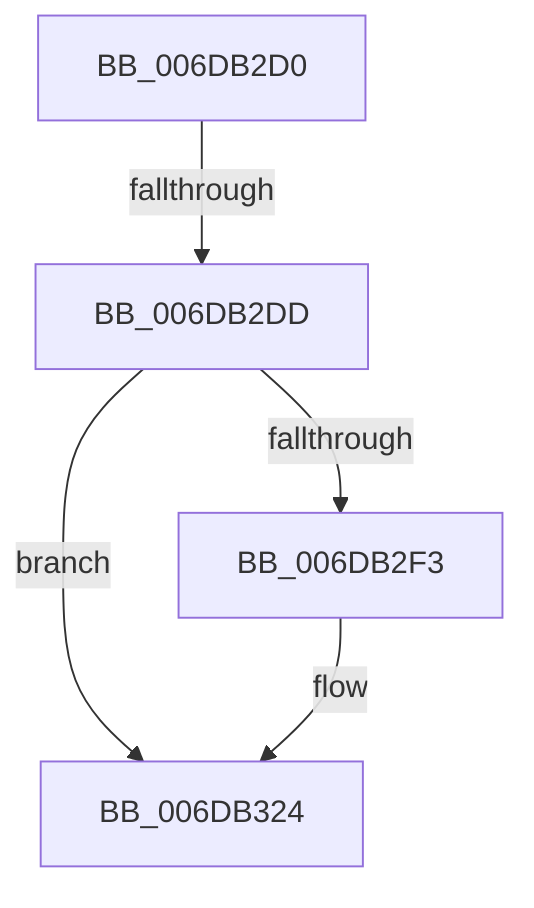

# sub_006DB2D0

- RVA: `0x006DB2D0`–`0x006DB336` (길이 `102` bytes)
- VA: `0x00000001406DB2D0`
- 실행 섹션: `.text`
- PDB 이름 있음: `아니요`; PDB Function 태그: `아니요`
- unwind 정보 RVA: `0x0006D074`
- 디코드: `17`개 명령, `102/102` bytes 표시
- 미해석 바이트: `0` (있으면 어셈블리에 `.byte`로 보존)

> 이 문서는 커널 이미지의 기계어와 PDB 기호를 분석해 생성했습니다. 4번과 5번은 함수 원형과 자료형을 바이너리 사용 방식에서 추정한 C 해석이며 원본 소스 복구 결과는 아닙니다.

## 1. Dependencies

- 직접 호출 지점: **3**; 고유 호출 대상: **3**
- 직접 호출자로 확인된 함수: **0**
- RIP 상대 이미지 참조: **8**

### Outgoing calls
- `0x006DB2E4` → [ExAcquireSpinLockExclusiveAtDpcLevel](../24/ExAcquireSpinLockExclusiveAtDpcLevel_function_00248E80.md) (function, `0x00248E80`)
- `0x006DB31F` → [ExQueueWorkItem](../2F/ExQueueWorkItem_function_002F9520.md) (function, `0x002F9520`)
- `0x006DB32B` → [ExReleaseSpinLockExclusiveFromDpcLevel](../24/ExReleaseSpinLockExclusiveFromDpcLevel_function_002497E0.md) (function, `0x002497E0`)

### Direct callers
- 이 함수 시작 RVA로 연결되는 직접 call은 확인되지 않았습니다. 간접 호출은 완전히 역산할 수 없습니다.

### Static image references
- `0x006DB2D0` → RVA `0x00FC6A88` (`ALMOSTRO`; read)
- `0x006DB2DD` → RVA `0x00E37310` (`.data`; read)
- `0x006DB2E9` → RVA `0x00E37330` (`.data`; read)
- `0x006DB2F3` → RVA `0x0067B780` (`MiDeleteStaleCacheMaps`; read)
- `0x006DB2FA` → RVA `0x00E37318` (`.data`; write)
- `0x006DB305` → RVA `0x00E37318` (`.data`; read)
- `0x006DB30C` → RVA `0x00E37328` (`.data`; write)
- `0x006DB318` → RVA `0x00E37330` (`.data`; write)

## 2. Other-region calls and transfers

- 다른 실행 섹션으로 향하는 call: **0**
- call이 아닌 외부 분기/꼬리 이동: **2**
  - `0x006DB2D7` → [MiDereferenceIoPages + 0x365](../2A/MiDereferenceIoPages_function_002AB1B0.md) (`tail-transfer`)
  - `0x006DB331` → [MiDereferenceIoPages + 0x365](../2A/MiDereferenceIoPages_function_002AB1B0.md) (`tail-transfer`)

## 3. Assembly (complete function range)

```asm
006DB2D0  F6 05 B1 B7 8E 00 30            test byte ptr [rip + 0x8eb7b1], 0x30
006DB2D7  0F 84 38 02 BD FF               je 0x1402ab515
006DB2DD  48 8D 0D 2C C0 75 00            lea rcx, [rip + 0x75c02c]
006DB2E4  E8 97 DB B6 FF                  call 0x140248e80
006DB2E9  48 83 3D 3F C0 75 00 00         cmp qword ptr [rip + 0x75c03f], 0
006DB2F1  75 31                           jne 0x1406db324
006DB2F3  48 8D 05 86 04 FA FF            lea rax, [rip - 0x5fb7a]
006DB2FA  48 C7 05 13 C0 75 00 00 00 00 00  mov qword ptr [rip + 0x75c013], 0
006DB305  48 8D 0D 0C C0 75 00            lea rcx, [rip + 0x75c00c]
006DB30C  48 89 05 15 C0 75 00            mov qword ptr [rip + 0x75c015], rax
006DB313  BA 01 00 00 00                  mov edx, 1
006DB318  48 89 0D 11 C0 75 00            mov qword ptr [rip + 0x75c011], rcx
006DB31F  E8 FC E1 C1 FF                  call 0x1402f9520
006DB324  48 8D 0D E5 BF 75 00            lea rcx, [rip + 0x75bfe5]
006DB32B  E8 B0 E4 B6 FF                  call 0x1402497e0
006DB330  90                              nop
006DB331  E9 DF 01 BD FF                  jmp 0x1402ab515
```

## 4. C-style interpretation (structured pseudocode)

```c
__int64 __fastcall sub_006DB2D0(void)
{
    __int64 result;

    result = ExAcquireSpinLockExclusiveAtDpcLevel(v_rip + 7716908, a2, a3, a4);
    if ((*(unsigned __int64 *)(v_rip + 7716927)) == 0) {
        result = v_rip - 392058;
        *(unsigned __int64 *)(v_rip + 7716883) = 0;
        a1 = v_rip + 7716876;
        *(unsigned __int64 *)(v_rip + 7716885) = result;
        a2 = 1;
        *(unsigned __int64 *)(v_rip + 7716881) = a1;
        result = ExQueueWorkItem(a1, a2, a3, a4);
    }
    result = ExReleaseSpinLockExclusiveFromDpcLevel(v_rip + 7716837, a2, a3, a4);
}
```

## 5. (Beta) C Style

```c
void sub_006DB2D0(void)
{
    int64_t result;

    result = ExAcquireSpinLockExclusiveAtDpcLevel(v_rip + 7716908, a2, a3, a4);
    if ((*(uint64_t *)(v_rip + 0x75C03F)) == 0) {
        result = v_rip - 392058;
        *(uint64_t *)(v_rip + 0x75C013) = 0;
        a1 = v_rip + 7716876;
        *(uint64_t *)(v_rip + 0x75C015) = result;
        a2 = 1;
        *(uint64_t *)(v_rip + 0x75C011) = a1;
        result = ExQueueWorkItem(a1, a2, a3, a4);
    }
    result = ExReleaseSpinLockExclusiveFromDpcLevel(v_rip + 7716837, a2, a3, a4);
}
```

## 6. Execution-region graph

[열기: 2D/3D 그래프와 함수 탐색 컨트롤 패널](../../../control-panel.html?section=text&rva=0x006DB2D0&view=graph)

- 2D 그래프는 위에서 아래로 흐르고, 3D 그래프는 빈 공간을 드래그해 회전합니다. Shift+드래그는 이동, 휠은 확대·축소, 함수 노드 선택은 대상 보고서 이동입니다.

### Static fallback


