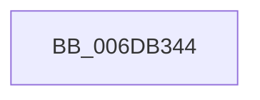

# sub_006DB344

- RVA: `0x006DB344`–`0x006DB4D7` (길이 `403` bytes)
- VA: `0x00000001406DB344`
- 실행 섹션: `.text`
- PDB 이름 있음: `아니요`; PDB Function 태그: `아니요`
- unwind 정보 RVA: `0x0006D184`
- 디코드: `73`개 명령, `403/403` bytes 표시
- 미해석 바이트: `0` (있으면 어셈블리에 `.byte`로 보존)

> 이 문서는 커널 이미지의 기계어와 PDB 기호를 분석해 생성했습니다. 4번과 5번은 함수 원형과 자료형을 바이너리 사용 방식에서 추정한 C 해석이며 원본 소스 복구 결과는 아닙니다.

## 1. Dependencies

- 직접 호출 지점: **2**; 고유 호출 대상: **2**
- 직접 호출자로 확인된 함수: **0**
- RIP 상대 이미지 참조: **1**

### Outgoing calls
- `0x006DB366` → [tlgCreate1Sz_char](../42/tlgCreate1Sz_char_function_00427304.md) (function, `0x00427304`)
- `0x006DB4CC` → [tlgWriteEx_EtwWriteEx](../4A/tlgWriteEx_EtwWriteEx_function_004AA348.md) (function, `0x004AA348`)

### Direct callers
- 이 함수 시작 RVA로 연결되는 직접 call은 확인되지 않았습니다. 간접 호출은 완전히 역산할 수 없습니다.

### Static image references
- `0x006DB379` → RVA `0x00057FF3` (`.rdata`; read)

## 2. Other-region calls and transfers

- 다른 실행 섹션으로 향하는 call: **0**
- call이 아닌 외부 분기/꼬리 이동: **1**
  - `0x006DB4D2` → [MiLogTrimWs + 0xC1](../2A/MiLogTrimWs_function_002AC4B4.md) (`tail-transfer`)

## 3. Assembly (complete function range)

```asm
006DB344  41 8B 82 B8 00 00 00            mov eax, dword ptr [r10 + 0xb8]
006DB34B  48 8D 4D D0                     lea rcx, [rbp - 0x30]
006DB34F  24 0F                           and al, 0xf
006DB351  48 C7 45 C8 01 00 00 00         mov qword ptr [rbp - 0x38], 1
006DB359  88 44 24 40                     mov byte ptr [rsp + 0x40], al
006DB35D  48 8D 44 24 40                  lea rax, [rsp + 0x40]
006DB362  48 89 45 C0                     mov qword ptr [rbp - 0x40], rax
006DB366  E8 99 BF D4 FF                  call 0x140427304
006DB36B  48 8D 44 24 44                  lea rax, [rsp + 0x44]
006DB370  44 89 4C 24 44                  mov dword ptr [rsp + 0x44], r9d
006DB375  48 89 45 E0                     mov qword ptr [rbp - 0x20], rax
006DB379  48 8D 15 73 CC 97 FF            lea rdx, [rip - 0x68338d]
006DB380  48 8D 44 24 58                  lea rax, [rsp + 0x58]
006DB385  48 C7 45 E8 04 00 00 00         mov qword ptr [rbp - 0x18], 4
006DB38D  48 89 45 F0                     mov qword ptr [rbp - 0x10], rax
006DB391  41 B9 01 00 00 00               mov r9d, 1
006DB397  48 8D 44 24 60                  lea rax, [rsp + 0x60]
006DB39C  4C 89 7C 24 58                  mov qword ptr [rsp + 0x58], r15
006DB3A1  48 89 45 00                     mov qword ptr [rbp], rax
006DB3A5  49 8B C8                        mov rcx, r8
006DB3A8  48 8D 44 24 68                  lea rax, [rsp + 0x68]
006DB3AD  48 C7 45 F8 08 00 00 00         mov qword ptr [rbp - 8], 8
006DB3B5  48 89 45 10                     mov qword ptr [rbp + 0x10], rax
006DB3B9  48 8D 44 24 70                  lea rax, [rsp + 0x70]
006DB3BE  48 89 45 20                     mov qword ptr [rbp + 0x20], rax
006DB3C2  48 8D 44 24 78                  lea rax, [rsp + 0x78]
006DB3C7  48 89 45 30                     mov qword ptr [rbp + 0x30], rax
006DB3CB  48 8B 85 10 01 00 00            mov rax, qword ptr [rbp + 0x110]
006DB3D2  48 89 45 80                     mov qword ptr [rbp - 0x80], rax
006DB3D6  48 8D 45 80                     lea rax, [rbp - 0x80]
006DB3DA  48 89 45 40                     mov qword ptr [rbp + 0x40], rax
006DB3DE  48 8D 45 88                     lea rax, [rbp - 0x78]
006DB3E2  48 89 45 50                     mov qword ptr [rbp + 0x50], rax
006DB3E6  48 8D 45 90                     lea rax, [rbp - 0x70]
006DB3EA  48 89 45 60                     mov qword ptr [rbp + 0x60], rax
006DB3EE  48 8D 45 98                     lea rax, [rbp - 0x68]
006DB3F2  48 89 45 70                     mov qword ptr [rbp + 0x70], rax
006DB3F6  8B 85 18 01 00 00               mov eax, dword ptr [rbp + 0x118]
006DB3FC  89 44 24 48                     mov dword ptr [rsp + 0x48], eax
006DB400  48 8D 44 24 48                  lea rax, [rsp + 0x48]
006DB405  48 89 85 80 00 00 00            mov qword ptr [rbp + 0x80], rax
006DB40C  8B 85 20 01 00 00               mov eax, dword ptr [rbp + 0x120]
006DB412  89 44 24 4C                     mov dword ptr [rsp + 0x4c], eax
006DB416  48 8D 44 24 4C                  lea rax, [rsp + 0x4c]
006DB41B  48 89 85 90 00 00 00            mov qword ptr [rbp + 0x90], rax
006DB422  41 0F B7 82 AE 00 00 00         movzx eax, word ptr [r10 + 0xae]
006DB42A  89 44 24 50                     mov dword ptr [rsp + 0x50], eax
006DB42E  48 8D 44 24 50                  lea rax, [rsp + 0x50]
006DB433  48 89 85 A0 00 00 00            mov qword ptr [rbp + 0xa0], rax
006DB43A  48 8D 45 A0                     lea rax, [rbp - 0x60]
006DB43E  48 89 44 24 38                  mov qword ptr [rsp + 0x38], rax
006DB443  C7 44 24 30 11 00 00 00         mov dword ptr [rsp + 0x30], 0x11
006DB44B  4C 89 64 24 60                  mov qword ptr [rsp + 0x60], r12
006DB450  48 C7 45 08 08 00 00 00         mov qword ptr [rbp + 8], 8
006DB458  48 89 7C 24 68                  mov qword ptr [rsp + 0x68], rdi
006DB45D  48 C7 45 18 08 00 00 00         mov qword ptr [rbp + 0x18], 8
006DB465  48 89 5C 24 70                  mov qword ptr [rsp + 0x70], rbx
006DB46A  48 C7 45 28 08 00 00 00         mov qword ptr [rbp + 0x28], 8
006DB472  48 89 74 24 78                  mov qword ptr [rsp + 0x78], rsi
006DB477  48 C7 45 38 08 00 00 00         mov qword ptr [rbp + 0x38], 8
006DB47F  48 C7 45 48 08 00 00 00         mov qword ptr [rbp + 0x48], 8
006DB487  4C 89 75 88                     mov qword ptr [rbp - 0x78], r14
006DB48B  48 C7 45 58 08 00 00 00         mov qword ptr [rbp + 0x58], 8
006DB493  4C 89 5D 90                     mov qword ptr [rbp - 0x70], r11
006DB497  48 C7 45 68 08 00 00 00         mov qword ptr [rbp + 0x68], 8
006DB49F  4C 89 5D 98                     mov qword ptr [rbp - 0x68], r11
006DB4A3  48 C7 45 78 08 00 00 00         mov qword ptr [rbp + 0x78], 8
006DB4AB  48 C7 85 88 00 00 00 04 00 00 00  mov qword ptr [rbp + 0x88], 4
006DB4B6  48 C7 85 98 00 00 00 04 00 00 00  mov qword ptr [rbp + 0x98], 4
006DB4C1  48 C7 85 A8 00 00 00 04 00 00 00  mov qword ptr [rbp + 0xa8], 4
006DB4CC  E8 77 EE DC FF                  call 0x1404aa348
006DB4D1  90                              nop
006DB4D2  E9 9E 10 BD FF                  jmp 0x1402ac575
```

## 4. C-style interpretation (structured pseudocode)

```c
__int64 __fastcall sub_006DB344(__int64 a1, __int64 a2, __int64 a3, int a4, __int64 a5, __int64 a6, __int64 a7, __int64 a8, __int64 a9, __int64 a10, __int64 a11, __int64 a12, __int64 a13, __int64 a14, __int64 a15)
{
    __int64 result;
    unsigned int v_stack_p30;
    unsigned __int64 v_stack_p38;
    unsigned __int8 v_stack_p40;
    unsigned __int64 v_stack_p44;
    unsigned int v_stack_p48;
    unsigned int v_stack_p4C;
    unsigned int v_stack_p50;
    unsigned __int64 v_stack_p58;
    unsigned __int64 v_stack_p60;
    unsigned __int64 v_stack_p68;
    unsigned __int64 v_stack_p70;
    unsigned __int64 v_stack_p78;

    result = (unsigned __int8)(((unsigned int)(*(unsigned int *)(v_r10 + 184))) & (15));
    *(unsigned __int64 *)(v_rbp - 56) = 1;
    v_stack_p40 = (unsigned __int8)(result);
    *(unsigned __int64 *)(v_rbp - 64) = a8;
    result = tlgCreate1Sz_char(v_rbp - 48, a2, a3, a4);
    v_stack_p44 = a4;
    *(unsigned __int64 *)(v_rbp - 32) = v_stack_p44;
    *(unsigned __int64 *)(v_rbp - 24) = 4;
    *(unsigned __int64 *)(v_rbp - 16) = a11;
    v_stack_p58 = v_r15;
    *(unsigned __int64 *)(v_rbp) = a12;
    *(unsigned __int64 *)(v_rbp - 8) = 8;
    *(unsigned __int64 *)(v_rbp + 16) = a13;
    *(unsigned __int64 *)(v_rbp + 32) = a14;
    *(unsigned __int64 *)(v_rbp + 48) = a15;
    *(unsigned __int64 *)(v_rbp - 128) = *(unsigned __int64 *)(v_rbp + 272);
    *(unsigned __int64 *)(v_rbp + 64) = v_rbp - 128;
    *(unsigned __int64 *)(v_rbp + 80) = v_rbp - 120;
    *(unsigned __int64 *)(v_rbp + 96) = v_rbp - 112;
    *(unsigned __int64 *)(v_rbp + 112) = v_rbp - 104;
    v_stack_p48 = (unsigned int)((unsigned int)(*(unsigned int *)(v_rbp + 280)));
    *(unsigned __int64 *)(v_rbp + 128) = a9;
    v_stack_p4C = (unsigned int)((unsigned int)(*(unsigned int *)(v_rbp + 288)));
    *(unsigned __int64 *)(v_rbp + 144) = v_stack_p4C;
    v_stack_p50 = (unsigned int)(*(unsigned __int16 *)(v_r10 + 174));
    *(unsigned __int64 *)(v_rbp + 160) = a10;
    v_stack_p38 = v_rbp - 96;
    v_stack_p30 = 17;
    v_stack_p60 = v_r12;
    *(unsigned __int64 *)(v_rbp + 8) = 8;
    v_stack_p68 = v_rdi;
    *(unsigned __int64 *)(v_rbp + 24) = 8;
    v_stack_p70 = v_rbx;
    *(unsigned __int64 *)(v_rbp + 40) = 8;
    v_stack_p78 = v_rsi;
    *(unsigned __int64 *)(v_rbp + 56) = 8;
    *(unsigned __int64 *)(v_rbp + 72) = 8;
    *(unsigned __int64 *)(v_rbp - 120) = v_r14;
    *(unsigned __int64 *)(v_rbp + 88) = 8;
    *(unsigned __int64 *)(v_rbp - 112) = v_r11;
    *(unsigned __int64 *)(v_rbp + 104) = 8;
    *(unsigned __int64 *)(v_rbp - 104) = v_r11;
    *(unsigned __int64 *)(v_rbp + 120) = 8;
    *(unsigned __int64 *)(v_rbp + 136) = 4;
    *(unsigned __int64 *)(v_rbp + 152) = 4;
    *(unsigned __int64 *)(v_rbp + 168) = 4;
    result = tlgWriteEx_EtwWriteEx(a3, v_rip - 6828941, a3, 1);
}
```

## 5. (Beta) C Style

```c
int64_t sub_006DB344(int64_t Arg1, int64_t Arg2, int64_t Arg3, int32_t Arg4, uint64_t Arg5, uint64_t Arg6, uint64_t Arg7, int64_t Arg8, int64_t Arg9, int64_t Arg10, int64_t Arg11, int64_t Arg12, int64_t Arg13, int64_t Arg14, int64_t Arg15)
{
    int64_t result;
    uint32_t v_stack_p30;
    uint64_t v_stack_p38;
    uint8_t v_stack_p40;
    uint64_t v_stack_p44;
    uint32_t v_stack_p48;
    uint32_t v_stack_p4C;
    uint32_t v_stack_p50;
    uint64_t v_stack_p58;
    uint64_t v_stack_p60;
    uint64_t v_stack_p68;
    uint64_t v_stack_p70;
    uint64_t v_stack_p78;

    result = (uint8_t)(((uint32_t)(*(uint32_t *)(local_r10 + 0xB8))) & (15));
    *(uint64_t *)(local_rbp - 0x38) = 1;
    v_stack_p40 = (uint8_t)(result);
    *(uint64_t *)(local_rbp - 0x40) = Arg8;
    result = tlgCreate1Sz_char(local_rbp - 48, Arg2, Arg3, Arg4);
    v_stack_p44 = Arg4;
    *(uint64_t *)(local_rbp - 0x20) = v_stack_p44;
    *(uint64_t *)(local_rbp - 0x18) = 4;
    *(uint64_t *)(local_rbp - 0x10) = Arg11;
    v_stack_p58 = local_r15;
    *(uint64_t *)(local_rbp) = Arg12;
    *(uint64_t *)(local_rbp - 0x8) = 8;
    *(uint64_t *)(local_rbp + 0x10) = Arg13;
    *(uint64_t *)(local_rbp + 0x20) = Arg14;
    *(uint64_t *)(local_rbp + 0x30) = Arg15;
    *(uint64_t *)(local_rbp - 0x80) = *(uint64_t *)(local_rbp + 0x110);
    *(uint64_t *)(local_rbp + 0x40) = local_rbp - 128;
    *(uint64_t *)(local_rbp + 0x50) = local_rbp - 120;
    *(uint64_t *)(local_rbp + 0x60) = local_rbp - 112;
    *(uint64_t *)(local_rbp + 0x70) = local_rbp - 104;
    v_stack_p48 = (uint32_t)((uint32_t)(*(uint32_t *)(local_rbp + 0x118)));
    *(uint64_t *)(local_rbp + 0x80) = Arg9;
    v_stack_p4C = (uint32_t)((uint32_t)(*(uint32_t *)(local_rbp + 0x120)));
    *(uint64_t *)(local_rbp + 0x90) = v_stack_p4C;
    v_stack_p50 = (uint32_t)(*(uint16_t *)(local_r10 + 0xAE));
    *(uint64_t *)(local_rbp + 0xA0) = Arg10;
    v_stack_p38 = local_rbp - 96;
    v_stack_p30 = 17;
    v_stack_p60 = local_r12;
    *(uint64_t *)(local_rbp + 0x8) = 8;
    v_stack_p68 = local_rdi;
    *(uint64_t *)(local_rbp + 0x18) = 8;
    v_stack_p70 = local_rbx;
    *(uint64_t *)(local_rbp + 0x28) = 8;
    v_stack_p78 = local_rsi;
    *(uint64_t *)(local_rbp + 0x38) = 8;
    *(uint64_t *)(local_rbp + 0x48) = 8;
    *(uint64_t *)(local_rbp - 0x78) = local_r14;
    *(uint64_t *)(local_rbp + 0x58) = 8;
    *(uint64_t *)(local_rbp - 0x70) = local_r11;
    *(uint64_t *)(local_rbp + 0x68) = 8;
    *(uint64_t *)(local_rbp - 0x68) = local_r11;
    *(uint64_t *)(local_rbp + 0x78) = 8;
    *(uint64_t *)(local_rbp + 0x88) = 4;
    *(uint64_t *)(local_rbp + 0x98) = 4;
    *(uint64_t *)(local_rbp + 0xA8) = 4;
    result = tlgWriteEx_EtwWriteEx(Arg3, v_rip - 6828941, Arg3, 1);
}
```

## 6. Execution-region graph

[열기: 2D/3D 그래프와 함수 탐색 컨트롤 패널](../../../control-panel.html?section=text&rva=0x006DB344&view=graph)

- 2D 그래프는 위에서 아래로 흐르고, 3D 그래프는 빈 공간을 드래그해 회전합니다. Shift+드래그는 이동, 휠은 확대·축소, 함수 노드 선택은 대상 보고서 이동입니다.

### Static fallback


