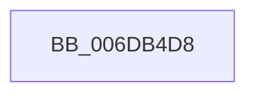

# sub_006DB4D8

- RVA: `0x006DB4D8`–`0x006DB4F4` (길이 `28` bytes)
- VA: `0x00000001406DB4D8`
- 실행 섹션: `.text`
- PDB 이름 있음: `아니요`; PDB Function 태그: `아니요`
- unwind 정보 RVA: `0x0006D1B4`
- 디코드: `7`개 명령, `28/28` bytes 표시
- 미해석 바이트: `0` (있으면 어셈블리에 `.byte`로 보존)

> 이 문서는 커널 이미지의 기계어와 PDB 기호를 분석해 생성했습니다. 4번과 5번은 함수 원형과 자료형을 바이너리 사용 방식에서 추정한 C 해석이며 원본 소스 복구 결과는 아닙니다.

## 1. Dependencies

- 직접 호출 지점: **1**; 고유 호출 대상: **1**
- 직접 호출자로 확인된 함수: **0**
- RIP 상대 이미지 참조: **0**

### Outgoing calls
- `0x006DB4EE` → [KeBugCheckEx](../4F/KeBugCheckEx_function_004FD660.md) (function, `0x004FD660`)

### Direct callers
- 이 함수 시작 RVA로 연결되는 직접 call은 확인되지 않았습니다. 간접 호출은 완전히 역산할 수 없습니다.

### Static image references
- 디코드된 RIP-relative 메모리 참조가 없습니다.

## 2. Other-region calls and transfers

- 다른 실행 섹션으로 향하는 call: **0**
- 별도 외부 분기/꼬리 이동을 확인하지 못했습니다.

## 3. Assembly (complete function range)

```asm
006DB4D8  48 83 64 24 20 00               and qword ptr [rsp + 0x20], 0
006DB4DE  4D 8B CD                        mov r9, r13
006DB4E1  4C 8B C6                        mov r8, rsi
006DB4E4  BA 49 19 06 00                  mov edx, 0x61949
006DB4E9  B9 1A 00 00 00                  mov ecx, 0x1a
006DB4EE  E8 6D 21 E2 FF                  call 0x1404fd660
006DB4F3  CC                              int3
```

## 4. C-style interpretation (structured pseudocode)

```c
__int64 __fastcall sub_006DB4D8(void)
{
    __int64 result;
    unsigned __int64 v_stack_p20;

    result = KeBugCheckEx(26, (unsigned int)(0x61949ULL), v_rsi, v_r13);
    return result;
}
```

## 5. (Beta) C Style

```c
void sub_006DB4D8(void)
{
    int64_t result;
    uint64_t v_stack_p20;

    result = KeBugCheckEx(26, (uint32_t)(0x61949ULL), local_rsi, local_r13);
    return result;
}
```

## 6. Execution-region graph

[열기: 2D/3D 그래프와 함수 탐색 컨트롤 패널](../../../control-panel.html?section=text&rva=0x006DB4D8&view=graph)

- 2D 그래프는 위에서 아래로 흐르고, 3D 그래프는 빈 공간을 드래그해 회전합니다. Shift+드래그는 이동, 휠은 확대·축소, 함수 노드 선택은 대상 보고서 이동입니다.

### Static fallback


