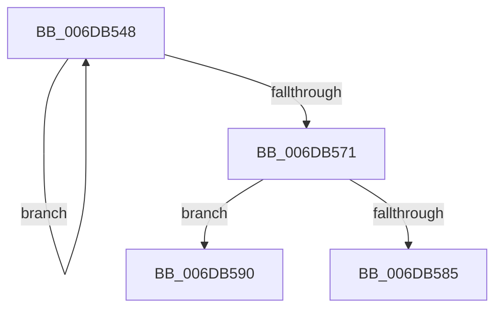

# sub_006DB548

- RVA: `0x006DB548`–`0x006DB59E` (길이 `86` bytes)
- VA: `0x00000001406DB548`
- 실행 섹션: `.text`
- PDB 이름 있음: `아니요`; PDB Function 태그: `아니요`
- unwind 정보 RVA: `0x0006D1DC`
- 디코드: `20`개 명령, `86/86` bytes 표시
- 미해석 바이트: `0` (있으면 어셈블리에 `.byte`로 보존)

> 이 문서는 커널 이미지의 기계어와 PDB 기호를 분석해 생성했습니다. 4번과 5번은 함수 원형과 자료형을 바이너리 사용 방식에서 추정한 C 해석이며 원본 소스 복구 결과는 아닙니다.

## 1. Dependencies

- 직접 호출 지점: **3**; 고유 호출 대상: **2**
- 직접 호출자로 확인된 함수: **0**
- RIP 상대 이미지 참조: **1**

### Outgoing calls
- `0x006DB556` → [ExReleaseSpinLockExclusiveFromDpcLevel](../24/ExReleaseSpinLockExclusiveFromDpcLevel_function_002497E0.md) (function, `0x002497E0`)
- `0x006DB585` → [ExReleaseSpinLockExclusiveFromDpcLevel](../24/ExReleaseSpinLockExclusiveFromDpcLevel_function_002497E0.md) (function, `0x002497E0`)
- `0x006DB593` → [MiReleaseSpinLockExclusive](../24/MiReleaseSpinLockExclusive_function_002482C0.md) (function, `0x002482C0`)

### Direct callers
- 이 함수 시작 RVA로 연결되는 직접 call은 확인되지 않았습니다. 간접 호출은 완전히 역산할 수 없습니다.

### Static image references
- `0x006DB55B` → RVA `0x00FC5000` (`ALMOSTRO`; read)

## 2. Other-region calls and transfers

- 다른 실행 섹션으로 향하는 call: **0**
- call이 아닌 외부 분기/꼬리 이동: **2**
  - `0x006DB58B` → [MiUnlockIoPfnTree + 0x49](../2A/MiUnlockIoPfnTree_function_002AC7F8.md) (`tail-transfer`)
  - `0x006DB599` → [MiUnlockIoPfnTree + 0x49](../2A/MiUnlockIoPfnTree_function_002AC7F8.md) (`tail-transfer`)

## 3. Assembly (complete function range)

```asm
006DB548  48 8B 8D 78 01 00 00            mov rcx, qword ptr [rbp + 0x178]
006DB54F  48 81 C1 80 02 00 00            add rcx, 0x280
006DB556  E8 85 E2 B6 FF                  call 0x1402497e0
006DB55B  0F B7 05 9E 9A 8E 00            movzx eax, word ptr [rip + 0x8e9a9e]
006DB562  48 81 C5 80 01 00 00            add rbp, 0x180
006DB569  FF C8                           dec eax
006DB56B  FF C3                           inc ebx
006DB56D  3B D8                           cmp ebx, eax
006DB56F  72 D7                           jb 0x1406db548
006DB571  48 8B 8D 78 01 00 00            mov rcx, qword ptr [rbp + 0x178]
006DB578  48 81 C1 80 02 00 00            add rcx, 0x280
006DB57F  41 F6 C6 04                     test r14b, 4
006DB583  74 0B                           je 0x1406db590
006DB585  E8 56 E2 B6 FF                  call 0x1402497e0
006DB58A  90                              nop
006DB58B  E9 B1 12 BD FF                  jmp 0x1402ac841
006DB590  40 8A D7                        mov dl, dil
006DB593  E8 28 CD B6 FF                  call 0x1402482c0
006DB598  90                              nop
006DB599  E9 A3 12 BD FF                  jmp 0x1402ac841
```

## 4. C-style interpretation (structured pseudocode)

```c
__int64 __fastcall sub_006DB548(void)
{
    __int64 result;
    __int64 v_rbp;
    __int64 v_rbx;

    a1 = (*(unsigned __int64 *)(v_rbp + 376)) + (640);
    result = ExReleaseSpinLockExclusiveFromDpcLevel(a1, a2, a3, a4);
    v_rbp = (v_rbp) + (384);
    result = (unsigned int)((*(unsigned __int16 *)(v_rip + 9345694)) - 1);
    v_rbx = (unsigned int)((v_rbx) + 1);
    if (((unsigned int)(v_rbx)) < ((unsigned int)(result))) goto loc_006DB548;
    a1 = (*(unsigned __int64 *)(v_rbp + 376)) + (640);
    if ((((unsigned __int8)(v_r14)) & (4)) == 0) goto loc_006DB590;
    result = ExReleaseSpinLockExclusiveFromDpcLevel(a1, a2, a3, a4);
loc_006DB590:
    result = MiReleaseSpinLockExclusive(a1, (unsigned __int8)(v_rdi), a3, a4);
}
```

## 5. (Beta) C Style

```c
void sub_006DB548(void)
{
    int64_t result;
    int64_t local_rbp;
    int64_t local_rbx;

    a1 = (*(uint64_t *)(local_rbp + 0x178)) + (640);
    result = ExReleaseSpinLockExclusiveFromDpcLevel(a1, a2, a3, a4);
    local_rbp = (local_rbp) + (384);
    result = (uint32_t)((*(uint16_t *)(v_rip + 0x8E9A9E)) - 1);
    local_rbx = (uint32_t)((local_rbx) + 1);
    if (((uint32_t)(local_rbx)) < ((uint32_t)(result))) goto loc_006DB548;
    a1 = (*(uint64_t *)(local_rbp + 0x178)) + (640);
    if ((((uint8_t)(local_r14)) & (4)) == 0) goto loc_006DB590;
    result = ExReleaseSpinLockExclusiveFromDpcLevel(a1, a2, a3, a4);
loc_006DB590:
    result = MiReleaseSpinLockExclusive(a1, (uint8_t)(local_rdi), a3, a4);
}
```

## 6. Execution-region graph

[열기: 2D/3D 그래프와 함수 탐색 컨트롤 패널](../../../control-panel.html?section=text&rva=0x006DB548&view=graph)

- 2D 그래프는 위에서 아래로 흐르고, 3D 그래프는 빈 공간을 드래그해 회전합니다. Shift+드래그는 이동, 휠은 확대·축소, 함수 노드 선택은 대상 보고서 이동입니다.

### Static fallback


