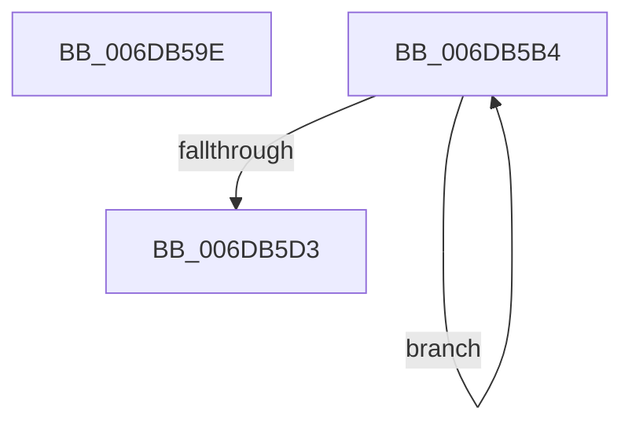

# sub_006DB59E

- RVA: `0x006DB59E`–`0x006DB5D8` (길이 `58` bytes)
- VA: `0x00000001406DB59E`
- 실행 섹션: `.text`
- PDB 이름 있음: `아니요`; PDB Function 태그: `아니요`
- unwind 정보 RVA: `0x0006D208`
- 디코드: `15`개 명령, `58/58` bytes 표시
- 미해석 바이트: `0` (있으면 어셈블리에 `.byte`로 보존)

> 이 문서는 커널 이미지의 기계어와 PDB 기호를 분석해 생성했습니다. 4번과 5번은 함수 원형과 자료형을 바이너리 사용 방식에서 추정한 C 해석이며 원본 소스 복구 결과는 아닙니다.

## 1. Dependencies

- 직접 호출 지점: **1**; 고유 호출 대상: **1**
- 직접 호출자로 확인된 함수: **0**
- RIP 상대 이미지 참조: **1**

### Outgoing calls
- `0x006DB5BA` → [ExAcquireSpinLockExclusiveAtDpcLevel](../24/ExAcquireSpinLockExclusiveAtDpcLevel_function_00248E80.md) (function, `0x00248E80`)

### Direct callers
- 이 함수 시작 RVA로 연결되는 직접 call은 확인되지 않았습니다. 간접 호출은 완전히 역산할 수 없습니다.

### Static image references
- `0x006DB5BF` → RVA `0x00FC5000` (`ALMOSTRO`; read)

## 2. Other-region calls and transfers

- 다른 실행 섹션으로 향하는 call: **0**
- call이 아닌 외부 분기/꼬리 이동: **2**
  - `0x006DB5AF` → [MiLockIoPfnTree + 0x25](../2A/MiLockIoPfnTree_function_002AC8A4.md) (`tail-transfer`)
  - `0x006DB5D3` → [MiLockIoPfnTree + 0x53](../2A/MiLockIoPfnTree_function_002AC8A4.md) (`tail-transfer`)

## 3. Assembly (complete function range)

```asm
006DB59E  BF 11 00 00 00                  mov edi, 0x11
006DB5A3  0F B6 C3                        movzx eax, bl
006DB5A6  40 3A DD                        cmp bl, bpl
006DB5A9  0F 44 C7                        cmove eax, edi
006DB5AC  40 8A F8                        mov dil, al
006DB5AF  E9 15 13 BD FF                  jmp 0x1402ac8c9
006DB5B4  49 8B 0E                        mov rcx, qword ptr [r14]
006DB5B7  48 03 CE                        add rcx, rsi
006DB5BA  E8 C1 D8 B6 FF                  call 0x140248e80
006DB5BF  0F B7 05 3A 9A 8E 00            movzx eax, word ptr [rip + 0x8e9a3a]
006DB5C6  4D 8D B6 80 01 00 00            lea r14, [r14 + 0x180]
006DB5CD  03 DD                           add ebx, ebp
006DB5CF  3B D8                           cmp ebx, eax
006DB5D1  72 E1                           jb 0x1406db5b4
006DB5D3  E9 1F 13 BD FF                  jmp 0x1402ac8f7
```

## 4. C-style interpretation (structured pseudocode)

```c
__int64 __fastcall sub_006DB59E(void)
{
    __int64 result;

    result = (unsigned __int8)(v_rbx);
    if (((unsigned __int8)(v_rbx)) == ((unsigned __int8)(v_rbp))) { result = 17; }
}
```

## 5. (Beta) C Style

```c
void sub_006DB59E(void)
{
    int64_t result;

    result = (uint8_t)(local_rbx);
    if (((uint8_t)(local_rbx)) == ((uint8_t)(local_rbp))) { result = 17; }
}
```

## 6. Execution-region graph

[열기: 2D/3D 그래프와 함수 탐색 컨트롤 패널](../../../control-panel.html?section=text&rva=0x006DB59E&view=graph)

- 2D 그래프는 위에서 아래로 흐르고, 3D 그래프는 빈 공간을 드래그해 회전합니다. Shift+드래그는 이동, 휠은 확대·축소, 함수 노드 선택은 대상 보고서 이동입니다.

### Static fallback


