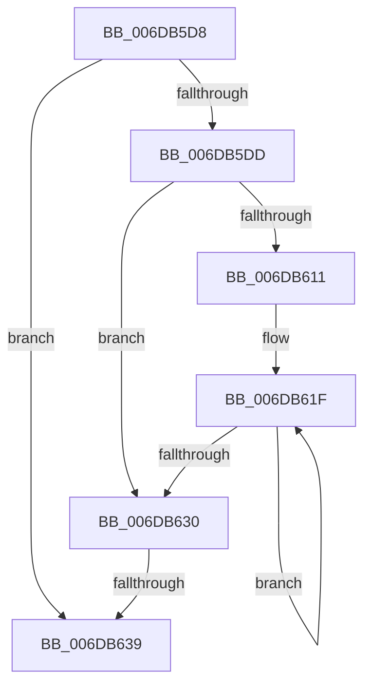

# sub_006DB5D8

- RVA: `0x006DB5D8`–`0x006DB64E` (길이 `118` bytes)
- VA: `0x00000001406DB5D8`
- 실행 섹션: `.text`
- PDB 이름 있음: `아니요`; PDB Function 태그: `아니요`
- unwind 정보 RVA: `0x0006D65C`
- 디코드: `35`개 명령, `118/118` bytes 표시
- 미해석 바이트: `0` (있으면 어셈블리에 `.byte`로 보존)

> 이 문서는 커널 이미지의 기계어와 PDB 기호를 분석해 생성했습니다. 4번과 5번은 함수 원형과 자료형을 바이너리 사용 방식에서 추정한 C 해석이며 원본 소스 복구 결과는 아닙니다.

## 1. Dependencies

- 직접 호출 지점: **0**; 고유 호출 대상: **0**
- 직접 호출자로 확인된 함수: **0**
- RIP 상대 이미지 참조: **0**

### Outgoing calls
- 직접 디코드된 call 명령이 없습니다.

### Direct callers
- 이 함수 시작 RVA로 연결되는 직접 call은 확인되지 않았습니다. 간접 호출은 완전히 역산할 수 없습니다.

### Static image references
- 디코드된 RIP-relative 메모리 참조가 없습니다.

## 2. Other-region calls and transfers

- 다른 실행 섹션으로 향하는 call: **0**
- call이 아닌 외부 분기/꼬리 이동: **2**
  - `0x006DB633` → [MiReplaceTransitionPage + 0x465](../2B/MiReplaceTransitionPage_function_002B1120.md) (`tail-transfer`)
  - `0x006DB649` → [MiReplaceTransitionPage + 0x465](../2B/MiReplaceTransitionPage_function_002B1120.md) (`tail-transfer`)

## 3. Assembly (complete function range)

```asm
006DB5D8  4D 85 C9                        test r9, r9
006DB5DB  74 5C                           je 0x1406db639
006DB5DD  8B C3                           mov eax, ebx
006DB5DF  BA 20 00 00 00                  mov edx, 0x20
006DB5E4  83 E0 1F                        and eax, 0x1f
006DB5E7  2B D0                           sub edx, eax
006DB5E9  B8 01 00 00 00                  mov eax, 1
006DB5EE  8B CA                           mov ecx, edx
006DB5F0  D3 E0                           shl eax, cl
006DB5F2  49 8B C9                        mov rcx, r9
006DB5F5  FF C8                           dec eax
006DB5F7  D3 E0                           shl eax, cl
006DB5F9  F0 41 09 00                     lock or dword ptr [r8], eax
006DB5FD  8B C2                           mov eax, edx
006DB5FF  49 83 C0 04                     add r8, 4
006DB603  BA 01 00 00 00                  mov edx, 1
006DB608  48 2B D0                        sub rdx, rax
006DB60B  48 83 FA 20                     cmp rdx, 0x20
006DB60F  72 1F                           jb 0x1406db630
006DB611  48 8B CA                        mov rcx, rdx
006DB614  48 C1 E9 05                     shr rcx, 5
006DB618  48 6B C1 E0                     imul rax, rcx, -0x20
006DB61C  48 03 D0                        add rdx, rax
006DB61F  41 C7 00 FF FF FF FF            mov dword ptr [r8], 0xffffffff
006DB626  49 83 C0 04                     add r8, 4
006DB62A  48 83 E9 01                     sub rcx, 1
006DB62E  75 EF                           jne 0x1406db61f
006DB630  48 85 D2                        test rdx, rdx
006DB633  0F 84 4C 5F BD FF               je 0x1402b1585
006DB639  48 8B CA                        mov rcx, rdx
006DB63C  B8 01 00 00 00                  mov eax, 1
006DB641  D3 E0                           shl eax, cl
006DB643  FF C8                           dec eax
006DB645  F0 41 09 00                     lock or dword ptr [r8], eax
006DB649  E9 37 5F BD FF                  jmp 0x1402b1585
```

## 4. C-style interpretation (structured pseudocode)

```c
__int64 __fastcall sub_006DB5D8(__int64 a1, __int64 a2, __int64 a3, __int64 a4)
{
    __int64 result;

    if (a4 == 0) goto loc_006DB639;
    result = (unsigned int)(((unsigned int)((unsigned int)(v_rbx))) & (31));
    a2 = (unsigned int)((32) - ((unsigned int)(result)));
    result = (unsigned int)((1) << ((unsigned __int8)((unsigned int)((unsigned int)(a2)))));
    result = (unsigned int)((result) - 1);
    result = (unsigned int)((result) << ((unsigned __int8)(a4)));
    a3 = (a3) + (4);
    a2 = (1) - ((unsigned int)((unsigned int)(a2)));
    if (a2 < 32) goto loc_006DB630;
    a1 = (a2) >> (5);
    result = ((unsigned int)((unsigned int)(a2))) * (a1);
    a2 = (a2) + (result);
loc_006DB61F:
    *(unsigned int *)(a3) = 0xFFFFFFFFULL;
    a3 = (a3) + (4);
    a1 = (a1) - (1);
    if (condition_is_not_equal) goto loc_006DB61F;
loc_006DB630:
loc_006DB639:
    result = (unsigned int)((1) << ((unsigned __int8)(a2)));
    result = (unsigned int)((result) - 1);
}
```

## 5. (Beta) C Style

```c
int64_t sub_006DB5D8(int64_t Arg1, int64_t Arg2, void *Arg3, int64_t Arg4)
{
    uint8_t *arg3 = (uint8_t *)Arg3;

    int64_t result;

    if (Arg4 == 0) goto loc_006DB639;
    result = (uint32_t)(((uint32_t)((uint32_t)(local_rbx))) & (31));
    Arg2 = (uint32_t)((32) - ((uint32_t)(result)));
    result = (uint32_t)((1) << ((uint8_t)((uint32_t)((uint32_t)(Arg2)))));
    result = (uint32_t)((result) - 1);
    result = (uint32_t)((result) << ((uint8_t)(Arg4)));
    Arg3 = (Arg3) + (4);
    Arg2 = (1) - ((uint32_t)((uint32_t)(Arg2)));
    if (Arg2 < 32) goto loc_006DB630;
    Arg1 = (Arg2) >> (5);
    result = ((uint32_t)((uint32_t)(Arg2))) * (Arg1);
    Arg2 = (Arg2) + (result);
loc_006DB61F:
    *(uint32_t *)(arg3) = 0xFFFFFFFFULL;
    Arg3 = (Arg3) + (4);
    Arg1 = (Arg1) - (1);
    if (condition_is_not_equal) goto loc_006DB61F;
loc_006DB630:
loc_006DB639:
    result = (uint32_t)((1) << ((uint8_t)(Arg2)));
    result = (uint32_t)((result) - 1);
}
```

### 관측된 메모리 오프셋

구조체 형식이 확인되지 않은 접근은 인자 기준의 오프셋으로만 기록했습니다.

| 기준 인자 | 오프셋 표현 | 폭 (bit) | 접근 |
|---|---:|---:|---|
| `Arg3` | `+ 0x0` | `32` | `R/W` |
| `Arg3` | `+ 0x0` | `32` | `W` |

## 6. Execution-region graph

[열기: 2D/3D 그래프와 함수 탐색 컨트롤 패널](../../../control-panel.html?section=text&rva=0x006DB5D8&view=graph)

- 2D 그래프는 위에서 아래로 흐르고, 3D 그래프는 빈 공간을 드래그해 회전합니다. Shift+드래그는 이동, 휠은 확대·축소, 함수 노드 선택은 대상 보고서 이동입니다.

### Static fallback


