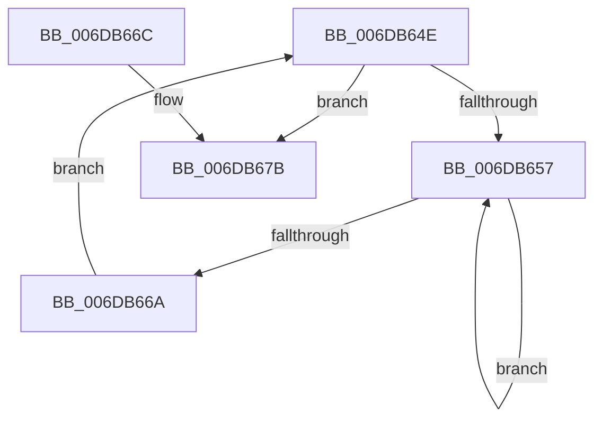

# sub_006DB64E

- RVA: `0x006DB64E`–`0x006DB6A6` (길이 `88` bytes)
- VA: `0x00000001406DB64E`
- 실행 섹션: `.text`
- PDB 이름 있음: `아니요`; PDB Function 태그: `아니요`
- unwind 정보 RVA: `0x0006D6C0`
- 디코드: `21`개 명령, `88/88` bytes 표시
- 미해석 바이트: `0` (있으면 어셈블리에 `.byte`로 보존)

> 이 문서는 커널 이미지의 기계어와 PDB 기호를 분석해 생성했습니다. 4번과 5번은 함수 원형과 자료형을 바이너리 사용 방식에서 추정한 C 해석이며 원본 소스 복구 결과는 아닙니다.

## 1. Dependencies

- 직접 호출 지점: **5**; 고유 호출 대상: **5**
- 직접 호출자로 확인된 함수: **0**
- RIP 상대 이미지 참조: **0**

### Outgoing calls
- `0x006DB65C` → [KeYieldProcessorEx](../3F/KeYieldProcessorEx_function_003FBD00.md) (function, `0x003FBD00`)
- `0x006DB66F` → [MiLockPageInline](../31/MiLockPageInline_function_0031A340.md) (function, `0x0031A340`)
- `0x006DB683` → [MiMarkPfnVerified](../38/MiMarkPfnVerified_function_003833C4.md) (function, `0x003833C4`)
- `0x006DB68B` → [MiAbortCombineScan](../2A/MiAbortCombineScan_function_002A1160.md) (function, `0x002A1160`)
- `0x006DB69B` → [MiUnlockPage](../31/MiUnlockPage_function_0031A3E0.md) (function, `0x0031A3E0`)

### Direct callers
- 이 함수 시작 RVA로 연결되는 직접 call은 확인되지 않았습니다. 간접 호출은 완전히 역산할 수 없습니다.

### Static image references
- 디코드된 RIP-relative 메모리 참조가 없습니다.

## 2. Other-region calls and transfers

- 다른 실행 섹션으로 향하는 call: **0**
- call이 아닌 외부 분기/꼬리 이동: **1**
  - `0x006DB6A1` → [sub_002B1D4E + 0x2A3](../2B/Unknown_function_002B1D4E.md) (`tail-transfer`)

## 3. Assembly (complete function range)

```asm
006DB64E  F0 49 0F BA 6D 18 3F            lock bts qword ptr [r13 + 0x18], 0x3f
006DB655  73 24                           jae 0x1406db67b
006DB657  48 8D 4C 24 38                  lea rcx, [rsp + 0x38]
006DB65C  E8 9F 06 D2 FF                  call 0x1403fbd00
006DB661  49 8B 45 18                     mov rax, qword ptr [r13 + 0x18]
006DB665  48 85 C0                        test rax, rax
006DB668  78 ED                           js 0x1406db657
006DB66A  EB E2                           jmp 0x1406db64e
006DB66C  49 8B CD                        mov rcx, r13
006DB66F  E8 CC EC C3 FF                  call 0x14031a340
006DB674  88 84 24 F0 00 00 00            mov byte ptr [rsp + 0xf0], al
006DB67B  BA 04 00 00 00                  mov edx, 4
006DB680  49 8B CD                        mov rcx, r13
006DB683  E8 3C 7D CA FF                  call 0x1403833c4
006DB688  49 8B CD                        mov rcx, r13
006DB68B  E8 D0 5A BC FF                  call 0x1402a1160
006DB690  0F B6 94 24 F0 00 00 00         movzx edx, byte ptr [rsp + 0xf0]
006DB698  49 8B CD                        mov rcx, r13
006DB69B  E8 40 ED C3 FF                  call 0x14031a3e0
006DB6A0  90                              nop
006DB6A1  E9 4B 69 BD FF                  jmp 0x1402b1ff1
```

## 4. C-style interpretation (structured pseudocode)

```c
__int64 __fastcall sub_006DB64E(__int64 a1, __int64 a2, __int64 a3, __int64 a4, __int64 a5, __int64 a6, __int64 a7, __int64 a8, __int64 a9, __int64 a10, __int64 a11, __int64 a12, __int64 a13, __int64 a14, __int64 a15, __int64 a16, __int64 a17, __int64 a18, __int64 a19, __int64 a20, __int64 a21, __int64 a22, __int64 a23, __int64 a24, __int64 a25, __int64 a26, __int64 a27, __int64 a28, __int64 a29, unsigned __int8 a30)
{
    __int64 result;
    unsigned __int8 v_stack_pF0;

    if (condition_is_above_or_equal) goto loc_006DB67B;
loc_006DB657:
    result = KeYieldProcessorEx(a7, a2, a3, a4);
    if (sign_flag) goto loc_006DB657;
    goto loc_006DB64E;
loc_006DB67B:
    result = MiMarkPfnVerified(v_r13, 4, a3, a4);
    result = MiAbortCombineScan(v_r13, 4, a3, a4);
    result = MiUnlockPage(v_r13, a30, a3, a4);
}
```

## 5. (Beta) C Style

```c
int64_t sub_006DB64E(int64_t Arg1, int64_t Arg2, int64_t Arg3, int64_t Arg4, uint64_t Arg5, uint64_t Arg6, int64_t Arg7, uint64_t Arg8, uint64_t Arg9, uint64_t Arg10, uint64_t Arg11, uint64_t Arg12, uint64_t Arg13, uint64_t Arg14, uint64_t Arg15, uint64_t Arg16, uint64_t Arg17, uint64_t Arg18, uint64_t Arg19, uint64_t Arg20, uint64_t Arg21, uint64_t Arg22, uint64_t Arg23, uint64_t Arg24, uint64_t Arg25, uint64_t Arg26, uint64_t Arg27, uint64_t Arg28, uint64_t Arg29, uint8_t Arg30)
{
    int64_t result;
    uint8_t v_stack_pF0;

    if (condition_is_above_or_equal) goto loc_006DB67B;
loc_006DB657:
    result = KeYieldProcessorEx(Arg7, Arg2, Arg3, Arg4);
    if (sign_flag) goto loc_006DB657;
    goto loc_006DB64E;
loc_006DB67B:
    result = MiMarkPfnVerified(local_r13, 4, Arg3, Arg4);
    result = MiAbortCombineScan(local_r13, 4, Arg3, Arg4);
    result = MiUnlockPage(local_r13, Arg30, Arg3, Arg4);
}
```

## 6. Execution-region graph

[열기: 2D/3D 그래프와 함수 탐색 컨트롤 패널](../../../control-panel.html?section=text&rva=0x006DB64E&view=graph)

- 2D 그래프는 위에서 아래로 흐르고, 3D 그래프는 빈 공간을 드래그해 회전합니다. Shift+드래그는 이동, 휠은 확대·축소, 함수 노드 선택은 대상 보고서 이동입니다.

### Static fallback


