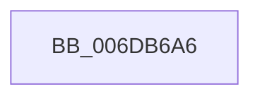

# sub_006DB6A6

- RVA: `0x006DB6A6`–`0x006DB70F` (길이 `105` bytes)
- VA: `0x00000001406DB6A6`
- 실행 섹션: `.text`
- PDB 이름 있음: `아니요`; PDB Function 태그: `아니요`
- unwind 정보 RVA: `0x0006D730`
- 디코드: `24`개 명령, `105/105` bytes 표시
- 미해석 바이트: `0` (있으면 어셈블리에 `.byte`로 보존)

> 이 문서는 커널 이미지의 기계어와 PDB 기호를 분석해 생성했습니다. 4번과 5번은 함수 원형과 자료형을 바이너리 사용 방식에서 추정한 C 해석이며 원본 소스 복구 결과는 아닙니다.

## 1. Dependencies

- 직접 호출 지점: **4**; 고유 호출 대상: **4**
- 직접 호출자로 확인된 함수: **0**
- RIP 상대 이미지 참조: **0**

### Outgoing calls
- `0x006DB6BF` → [MiVaToFlushVm](../31/MiVaToFlushVm_function_0031AD84.md) (function, `0x0031AD84`)
- `0x006DB6DB` → [MiInitializeTbFlushList](../29/MiInitializeTbFlushList_function_00294F00.md) (function, `0x00294F00`)
- `0x006DB6EF` → [MiInsertTbFlushEntry](../29/MiInsertTbFlushEntry_function_00293670.md) (function, `0x00293670`)
- `0x006DB6F9` → [MiFlushTbList](../31/MiFlushTbList_function_00311FC0.md) (function, `0x00311FC0`)

### Direct callers
- 이 함수 시작 RVA로 연결되는 직접 call은 확인되지 않았습니다. 간접 호출은 완전히 역산할 수 없습니다.

### Static image references
- 디코드된 RIP-relative 메모리 참조가 없습니다.

## 2. Other-region calls and transfers

- 다른 실행 섹션으로 향하는 call: **0**
- call이 아닌 외부 분기/꼬리 이동: **1**
  - `0x006DB70A` → [MiGetPteFromCopyList + 0x6D](../2B/MiGetPteFromCopyList_function_002B20E0.md) (`tail-transfer`)

## 3. Assembly (complete function range)

```asm
006DB6A6  48 8B 5D 10                     mov rbx, qword ptr [rbp + 0x10]
006DB6AA  48 C1 E3 19                     shl rbx, 0x19
006DB6AE  49 8B C0                        mov rax, r8
006DB6B1  48 C1 E0 19                     shl rax, 0x19
006DB6B5  48 2B D8                        sub rbx, rax
006DB6B8  48 C1 FB 10                     sar rbx, 0x10
006DB6BC  48 8B CB                        mov rcx, rbx
006DB6BF  E8 C0 F6 C3 FF                  call 0x14031ad84
006DB6C4  41 B9 08 00 00 00               mov r9d, 8
006DB6CA  44 89 64 24 20                  mov dword ptr [rsp + 0x20], r12d
006DB6CF  48 8B D0                        mov rdx, rax
006DB6D2  48 8D 4C 24 30                  lea rcx, [rsp + 0x30]
006DB6D7  45 8D 41 0C                     lea r8d, [r9 + 0xc]
006DB6DB  E8 20 98 BB FF                  call 0x140294f00
006DB6E0  44 8B 45 00                     mov r8d, dword ptr [rbp]
006DB6E4  48 8D 4C 24 30                  lea rcx, [rsp + 0x30]
006DB6E9  48 8B D3                        mov rdx, rbx
006DB6EC  45 33 C9                        xor r9d, r9d
006DB6EF  E8 7C 7F BB FF                  call 0x140293670
006DB6F4  48 8D 4C 24 30                  lea rcx, [rsp + 0x30]
006DB6F9  E8 C2 68 C3 FF                  call 0x140311fc0
006DB6FE  33 D2                           xor edx, edx
006DB700  49 B8 00 00 00 00 80 F6 FF FF   movabs r8, 0xfffff68000000000
006DB70A  E9 3E 6A BD FF                  jmp 0x1402b214d
```

## 4. C-style interpretation (structured pseudocode)

```c
__int64 __fastcall sub_006DB6A6(__int64 a1, __int64 a2, __int64 a3, __int64 a4, __int64 a5, __int64 a6)
{
    __int64 result;
    __int64 v_rbx;
    unsigned int v_stack_p20;

    v_rbx = (*(unsigned __int64 *)(v_rbp + 16)) << (25);
    result = (a3) << (25);
    v_rbx = (v_rbx) - (result);
    v_rbx = (v_rbx) >> (16);
    result = MiVaToFlushVm(v_rbx, a2, a3, a4);
    v_stack_p20 = (unsigned int)(v_r12);
    result = MiInitializeTbFlushList(a6, result, 8 + 12, 8);
    a4 = 0;
    result = MiInsertTbFlushEntry(a6, v_rbx, (unsigned int)(*(unsigned int *)(v_rbp)), a4);
    result = MiFlushTbList(a6, v_rbx, (unsigned int)(*(unsigned int *)(v_rbp)), a4);
    a2 = 0;
}
```

## 5. (Beta) C Style

```c
int64_t sub_006DB6A6(int64_t Arg1, int64_t Arg2, int64_t Arg3, int64_t Arg4, uint64_t Arg5, int64_t Arg6)
{
    int64_t result;
    int64_t local_rbx;
    uint32_t v_stack_p20;

    local_rbx = (*(uint64_t *)(local_rbp + 0x10)) << (25);
    result = (Arg3) << (25);
    local_rbx = (local_rbx) - (result);
    local_rbx = (local_rbx) >> (16);
    result = MiVaToFlushVm(local_rbx, Arg2, Arg3, Arg4);
    v_stack_p20 = (uint32_t)(local_r12);
    result = MiInitializeTbFlushList(Arg6, result, 8 + 12, 8);
    Arg4 = 0;
    result = MiInsertTbFlushEntry(Arg6, local_rbx, (uint32_t)(*(uint32_t *)(local_rbp)), Arg4);
    result = MiFlushTbList(Arg6, local_rbx, (uint32_t)(*(uint32_t *)(local_rbp)), Arg4);
    Arg2 = 0;
}
```

## 6. Execution-region graph

[열기: 2D/3D 그래프와 함수 탐색 컨트롤 패널](../../../control-panel.html?section=text&rva=0x006DB6A6&view=graph)

- 2D 그래프는 위에서 아래로 흐르고, 3D 그래프는 빈 공간을 드래그해 회전합니다. Shift+드래그는 이동, 휠은 확대·축소, 함수 노드 선택은 대상 보고서 이동입니다.

### Static fallback


