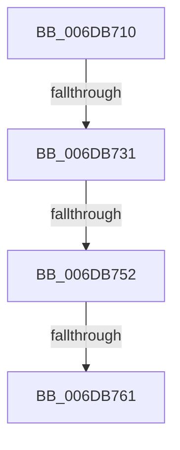

# sub_006DB710

- RVA: `0x006DB710`–`0x006DB77B` (길이 `107` bytes)
- VA: `0x00000001406DB710`
- 실행 섹션: `.text`
- PDB 이름 있음: `아니요`; PDB Function 태그: `아니요`
- unwind 정보 RVA: `0x0006D78C`
- 디코드: `25`개 명령, `107/107` bytes 표시
- 미해석 바이트: `0` (있으면 어셈블리에 `.byte`로 보존)

> 이 문서는 커널 이미지의 기계어와 PDB 기호를 분석해 생성했습니다. 4번과 5번은 함수 원형과 자료형을 바이너리 사용 방식에서 추정한 C 해석이며 원본 소스 복구 결과는 아닙니다.

## 1. Dependencies

- 직접 호출 지점: **1**; 고유 호출 대상: **1**
- 직접 호출자로 확인된 함수: **0**
- RIP 상대 이미지 참조: **1**

### Outgoing calls
- `0x006DB767` → [MiUpdatePageFileHighInPte](../36/MiUpdatePageFileHighInPte_function_0036D840.md) (function, `0x0036D840`)

### Direct callers
- 이 함수 시작 RVA로 연결되는 직접 call은 확인되지 않았습니다. 간접 호출은 완전히 역산할 수 없습니다.

### Static image references
- `0x006DB714` → RVA `0x00E30088` (`.data`; read)

## 2. Other-region calls and transfers

- 다른 실행 섹션으로 향하는 call: **0**
- call이 아닌 외부 분기/꼬리 이동: **4**
  - `0x006DB72B` → [MiCopyPfnEntryEx + 0xE3](../2B/MiCopyPfnEntryEx_function_002B2670.md) (`tail-transfer`)
  - `0x006DB74C` → [MiCopyPfnEntryEx + 0xE3](../2B/MiCopyPfnEntryEx_function_002B2670.md) (`tail-transfer`)
  - `0x006DB75B` → [MiCopyPfnEntryEx + 0xE3](../2B/MiCopyPfnEntryEx_function_002B2670.md) (`tail-transfer`)
  - `0x006DB776` → [MiCopyPfnEntryEx + 0xE3](../2B/MiCopyPfnEntryEx_function_002B2670.md) (`tail-transfer`)

## 3. Assembly (complete function range)

```asm
006DB710  48 8B 46 28                     mov rax, qword ptr [rsi + 0x28]
006DB714  48 8B 0D 6D 49 75 00            mov rcx, qword ptr [rip + 0x75496d]
006DB71B  48 C1 E8 2B                     shr rax, 0x2b
006DB71F  48 23 C2                        and rax, rdx
006DB722  48 8B 04 C1                     mov rax, qword ptr [rcx + rax*8]
006DB726  8B 40 04                        mov eax, dword ptr [rax + 4]
006DB729  84 C0                           test al, al
006DB72B  0F 88 22 70 BD FF               js 0x1402b2753
006DB731  49 8B 42 28                     mov rax, qword ptr [r10 + 0x28]
006DB735  48 8B 0D 4C 49 75 00            mov rcx, qword ptr [rip + 0x75494c]
006DB73C  48 C1 E8 2B                     shr rax, 0x2b
006DB740  48 23 C2                        and rax, rdx
006DB743  48 8B 04 C1                     mov rax, qword ptr [rcx + rax*8]
006DB747  8B 40 04                        mov eax, dword ptr [rax + 4]
006DB74A  84 C0                           test al, al
006DB74C  0F 88 01 70 BD FF               js 0x1402b2753
006DB752  41 8B 42 10                     mov eax, dword ptr [r10 + 0x10]
006DB756  48 0F BA E0 0A                  bt rax, 0xa
006DB75B  0F 82 F2 6F BD FF               jb 0x1402b2753
006DB761  48 8B 4D C7                     mov rcx, qword ptr [rbp - 0x39]
006DB765  33 D2                           xor edx, edx
006DB767  E8 D4 20 C9 FF                  call 0x14036d840
006DB76C  48 25 FF 0F FF FF               and rax, 0xffffffffffff0fff
006DB772  48 89 45 C7                     mov qword ptr [rbp - 0x39], rax
006DB776  E9 D8 6F BD FF                  jmp 0x1402b2753
```

## 4. C-style interpretation (structured pseudocode)

```c
__int64 __fastcall sub_006DB710(__int64 a1, __int64 a2)
{
    __int64 result;

    result = (*(unsigned __int64 *)(v_rsi + 40)) >> (43);
    result = (result) & (a2);
    result = (*(unsigned __int64 *)(v_r10 + 40)) >> (43);
    result = (result) & (a2);
    a2 = 0;
    result = MiUpdatePageFileHighInPte(*(unsigned __int64 *)(v_rbp - 57), a2, a3, a4);
    result = (result) & (0xFFFFFFFFFFFF0FFFULL);
    *(unsigned __int64 *)(v_rbp - 57) = result;
}
```

## 5. (Beta) C Style

```c
int64_t sub_006DB710(int64_t Arg1, int64_t Arg2)
{
    int64_t result;

    result = (*(uint64_t *)(local_rsi + 0x28)) >> (43);
    result = (result) & (Arg2);
    result = (*(uint64_t *)(local_r10 + 0x28)) >> (43);
    result = (result) & (Arg2);
    Arg2 = 0;
    result = MiUpdatePageFileHighInPte(*(uint64_t *)(local_rbp - 0x39), Arg2, a3, a4);
    result = (result) & (0xFFFFFFFFFFFF0FFFULL);
    *(uint64_t *)(local_rbp - 0x39) = result;
}
```

## 6. Execution-region graph

[열기: 2D/3D 그래프와 함수 탐색 컨트롤 패널](../../../control-panel.html?section=text&rva=0x006DB710&view=graph)

- 2D 그래프는 위에서 아래로 흐르고, 3D 그래프는 빈 공간을 드래그해 회전합니다. Shift+드래그는 이동, 휠은 확대·축소, 함수 노드 선택은 대상 보고서 이동입니다.

### Static fallback


