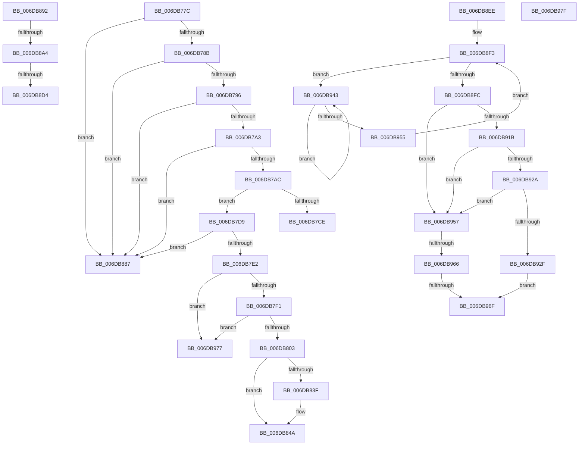

# sub_006DB77C

- RVA: `0x006DB77C`–`0x006DB988` (길이 `524` bytes)
- VA: `0x00000001406DB77C`
- 실행 섹션: `.text`
- PDB 이름 있음: `아니요`; PDB Function 태그: `아니요`
- unwind 정보 RVA: `0x0006D7C0`
- 디코드: `128`개 명령, `524/524` bytes 표시
- 미해석 바이트: `0` (있으면 어셈블리에 `.byte`로 보존)

> 이 문서는 커널 이미지의 기계어와 PDB 기호를 분석해 생성했습니다. 4번과 5번은 함수 원형과 자료형을 바이너리 사용 방식에서 추정한 C 해석이며 원본 소스 복구 결과는 아닙니다.

## 1. Dependencies

- 직접 호출 지점: **15**; 고유 호출 대상: **14**
- 직접 호출자로 확인된 함수: **0**
- RIP 상대 이미지 참조: **3**

### Outgoing calls
- `0x006DB7AF` → [MI_READ_PTE_LOCK_FREE](../28/MI_READ_PTE_LOCK_FREE_function_002828A0.md) (function, `0x002828A0`)
- `0x006DB7F4` → [MiGetWsleContents](../31/MiGetWsleContents_function_00316540.md) (function, `0x00316540`)
- `0x006DB803` → [MiGetProcessorFlushList](../24/MiGetProcessorFlushList_function_00242C90.md) (function, `0x00242C90`)
- `0x006DB82E` → [MiInitializeTbFlushList](../29/MiInitializeTbFlushList_function_00294F00.md) (function, `0x00294F00`)
- `0x006DB836` → [MiVmAccessLoggingEnabled](../36/MiVmAccessLoggingEnabled_function_003629D4.md) (function, `0x003629D4`)
- `0x006DB845` → [MI_WSLE_LOG_ACCESS](../29/MI_WSLE_LOG_ACCESS_function_00294400.md) (function, `0x00294400`)
- `0x006DB857` → [MiInsertTbFlushEntry](../29/MiInsertTbFlushEntry_function_00293670.md) (function, `0x00293670`)
- `0x006DB865` → [MiFreeWsleList](../24/MiFreeWsleList_function_00241168.md) (function, `0x00241168`)
- `0x006DB879` → [MiReleaseProcessorFlushList](../31/MiReleaseProcessorFlushList_function_00313C70.md) (function, `0x00313C70`)
- `0x006DB8A7` → [MiGetPfnSlabType](../28/MiGetPfnSlabType_function_0028E2D0.md) (function, `0x0028E2D0`)
- `0x006DB8B2` → [MiGetPfnSlabType](../28/MiGetPfnSlabType_function_0028E2D0.md) (function, `0x0028E2D0`)
- `0x006DB8C7` → [MiCheckSameSlabType](../29/MiCheckSameSlabType_function_0029FC90.md) (function, `0x0029FC90`)
- `0x006DB91F` → [MiSetOriginalPtePfnFromFreeList](../28/MiSetOriginalPtePfnFromFreeList_function_0028A99C.md) (function, `0x0028A99C`)
- `0x006DB937` → [MiReturnFreeZeroPage](../33/MiReturnFreeZeroPage_function_00334BD0.md) (function, `0x00334BD0`)
- `0x006DB947` → [KeYieldProcessorEx](../3F/KeYieldProcessorEx_function_003FBD00.md) (function, `0x003FBD00`)

### Direct callers
- 이 함수 시작 RVA로 연결되는 직접 call은 확인되지 않았습니다. 간접 호출은 완전히 역산할 수 없습니다.

### Static image references
- `0x006DB7CE` → RVA `0x00EF5214` (`.data`; read/write)
- `0x006DB887` → RVA `0x00EF5218` (`.data`; read/write)
- `0x006DB8E3` → RVA `0x00EF5190` (`.data`; read/write)

## 2. Other-region calls and transfers

- 다른 실행 섹션으로 향하는 call: **0**
- call이 아닌 외부 분기/꼬리 이동: **11**
  - `0x006DB7D4` → [MiStealPage + 0xBD9](../2B/MiStealPage_function_002B28D0.md) (`tail-transfer`)
  - `0x006DB882` → [MiStealPage + 0x873](../2B/MiStealPage_function_002B28D0.md) (`tail-transfer`)
  - `0x006DB88D` → [MiStealPage + 0xBD9](../2B/MiStealPage_function_002B28D0.md) (`tail-transfer`)
  - `0x006DB89E` → [MiStealPage + 0x3A0](../2B/MiStealPage_function_002B28D0.md) (`tail-transfer`)
  - `0x006DB8CE` → [MiStealPage + 0x3A0](../2B/MiStealPage_function_002B28D0.md) (`tail-transfer`)
  - `0x006DB8E9` → [MiStealPage + 0x867](../2B/MiStealPage_function_002B28D0.md) (`tail-transfer`)
  - `0x006DB960` → [MiStealPage + 0x873](../2B/MiStealPage_function_002B28D0.md) (`tail-transfer`)
  - `0x006DB969` → [MiStealPage + 0x873](../2B/MiStealPage_function_002B28D0.md) (`tail-transfer`)
  - `0x006DB972` → [MiStealPage + 0x873](../2B/MiStealPage_function_002B28D0.md) (`tail-transfer`)
  - `0x006DB97A` → [MiStealPage + 0x873](../2B/MiStealPage_function_002B28D0.md) (`tail-transfer`)
  - `0x006DB983` → [MiStealPage + 0x898](../2B/MiStealPage_function_002B28D0.md) (`tail-transfer`)

## 3. Assembly (complete function range)

```asm
006DB77C  8B 8D 38 01 00 00               mov ecx, dword ptr [rbp + 0x138]
006DB782  F6 C1 20                        test cl, 0x20
006DB785  0F 85 FC 00 00 00               jne 0x1406db887
006DB78B  41 F6 46 22 10                  test byte ptr [r14 + 0x22], 0x10
006DB790  0F 85 F1 00 00 00               jne 0x1406db887
006DB796  83 BD 60 01 00 00 02            cmp dword ptr [rbp + 0x160], 2
006DB79D  0F 84 E4 00 00 00               je 0x1406db887
006DB7A3  F6 C1 08                        test cl, 8
006DB7A6  0F 85 DB 00 00 00               jne 0x1406db887
006DB7AC  49 8B CF                        mov rcx, r15
006DB7AF  E8 EC 70 BA FF                  call 0x1402828a0
006DB7B4  48 8B C8                        mov rcx, rax
006DB7B7  49 BC FF FF FF FF FF 00 00 00   movabs r12, 0xffffffffff
006DB7C1  49 8B 46 28                     mov rax, qword ptr [r14 + 0x28]
006DB7C5  49 23 C4                        and rax, r12
006DB7C8  48 3B 45 B8                     cmp rax, qword ptr [rbp - 0x48]
006DB7CC  75 0B                           jne 0x1406db7d9
006DB7CE  FF 05 40 9A 81 00               inc dword ptr [rip + 0x819a40]
006DB7D4  E9 D0 7C BD FF                  jmp 0x1402b34a9
006DB7D9  F6 C1 42                        test cl, 0x42
006DB7DC  0F 85 A5 00 00 00               jne 0x1406db887
006DB7E2  41 8B 46 20                     mov eax, dword ptr [r14 + 0x20]
006DB7E6  C1 E8 18                        shr eax, 0x18
006DB7E9  A8 08                           test al, 8
006DB7EB  0F 85 86 01 00 00               jne 0x1406db977
006DB7F1  48 8B D7                        mov rdx, rdi
006DB7F4  E8 47 AD C3 FF                  call 0x140316540
006DB7F9  24 0F                           and al, 0xf
006DB7FB  3C 08                           cmp al, 8
006DB7FD  0F 84 74 01 00 00               je 0x1406db977
006DB803  E8 88 74 B6 FF                  call 0x140242c90
006DB808  48 8B 75 B0                     mov rsi, qword ptr [rbp - 0x50]
006DB80C  41 BC 02 00 00 00               mov r12d, 2
006DB812  45 8B CC                        mov r9d, r12d
006DB815  C7 44 24 20 01 00 00 00         mov dword ptr [rsp + 0x20], 1
006DB81D  48 8B D6                        mov rdx, rsi
006DB820  48 8D 98 28 10 00 00            lea rbx, [rax + 0x1028]
006DB827  44 8B 43 0C                     mov r8d, dword ptr [rbx + 0xc]
006DB82B  48 8B CB                        mov rcx, rbx
006DB82E  E8 CD 96 BB FF                  call 0x140294f00
006DB833  48 8B CE                        mov rcx, rsi
006DB836  E8 99 71 C8 FF                  call 0x1403629d4
006DB83B  85 C0                           test eax, eax
006DB83D  74 0B                           je 0x1406db84a
006DB83F  49 8B D7                        mov rdx, r15
006DB842  48 8B CE                        mov rcx, rsi
006DB845  E8 B6 8B BB FF                  call 0x140294400
006DB84A  45 33 C9                        xor r9d, r9d
006DB84D  48 8B D7                        mov rdx, rdi
006DB850  48 8B CB                        mov rcx, rbx
006DB853  45 8D 41 01                     lea r8d, [r9 + 1]
006DB857  E8 14 7E BB FF                  call 0x140293670
006DB85C  45 33 C0                        xor r8d, r8d
006DB85F  48 8B D3                        mov rdx, rbx
006DB862  48 8B CE                        mov rcx, rsi
006DB865  E8 FE 58 B6 FF                  call 0x140241168
006DB86A  8B 5C 24 7C                     mov ebx, dword ptr [rsp + 0x7c]
006DB86E  48 85 C0                        test rax, rax
006DB871  41 0F 44 DC                     cmove ebx, r12d
006DB875  89 5C 24 7C                     mov dword ptr [rsp + 0x7c], ebx
006DB879  E8 F2 83 C3 FF                  call 0x140313c70
006DB87E  48 8B 7D 90                     mov rdi, qword ptr [rbp - 0x70]
006DB882  E9 BC 78 BD FF                  jmp 0x1402b3143
006DB887  FF 05 8B 99 81 00               inc dword ptr [rip + 0x81998b]
006DB88D  E9 17 7C BD FF                  jmp 0x1402b34a9
006DB892  8B C3                           mov eax, ebx
006DB894  25 00 00 41 00                  and eax, 0x410000
006DB899  3D 00 00 41 00                  cmp eax, 0x410000
006DB89E  0F 85 CC 73 BD FF               jne 0x1402b2c70
006DB8A4  49 8B CF                        mov rcx, r15
006DB8A7  E8 24 2A BB FF                  call 0x14028e2d0
006DB8AC  49 8B CE                        mov rcx, r14
006DB8AF  44 8B C8                        mov r9d, eax
006DB8B2  E8 19 2A BB FF                  call 0x14028e2d0
006DB8B7  8B D0                           mov edx, eax
006DB8B9  C7 44 24 20 01 00 00 00         mov dword ptr [rsp + 0x20], 1
006DB8C1  49 8B CE                        mov rcx, r14
006DB8C4  4D 8B C7                        mov r8, r15
006DB8C7  E8 C4 43 BC FF                  call 0x14029fc90
006DB8CC  85 C0                           test eax, eax
006DB8CE  0F 85 9C 73 BD FF               jne 0x1402b2c70
006DB8D4  49 BD FF FF FF FF FF FF FF 7F   movabs r13, 0x7fffffffffffffff
006DB8DE  F0 4D 21 6E 18                  lock and qword ptr [r14 + 0x18], r13
006DB8E3  FF 05 A7 98 81 00               inc dword ptr [rip + 0x8198a7]
006DB8E9  E9 49 78 BD FF                  jmp 0x1402b3137
006DB8EE  33 DB                           xor ebx, ebx
006DB8F0  89 5D C0                        mov dword ptr [rbp - 0x40], ebx
006DB8F3  F0 48 0F BA 6F 18 3F            lock bts qword ptr [rdi + 0x18], 0x3f
006DB8FA  72 47                           jb 0x1406db943
006DB8FC  8B 47 20                        mov eax, dword ptr [rdi + 0x20]
006DB8FF  89 44 24 74                     mov dword ptr [rsp + 0x74], eax
006DB903  C1 E8 10                        shr eax, 0x10
006DB906  24 FD                           and al, 0xfd
006DB908  0C 05                           or al, 5
006DB90A  88 44 24 76                     mov byte ptr [rsp + 0x76], al
006DB90E  8B 44 24 74                     mov eax, dword ptr [rsp + 0x74]
006DB912  89 47 20                        mov dword ptr [rdi + 0x20], eax
006DB915  40 F6 C6 04                     test sil, 4
006DB919  74 3C                           je 0x1406db957
006DB91B  48 8D 4F 10                     lea rcx, [rdi + 0x10]
006DB91F  E8 78 F0 BA FF                  call 0x14028a99c
006DB924  40 F6 C6 08                     test sil, 8
006DB928  74 2D                           je 0x1406db957
006DB92A  49 3B FF                        cmp rdi, r15
006DB92D  75 28                           jne 0x1406db957
006DB92F  BA 00 10 00 00                  mov edx, 0x1000
006DB934  48 8B CF                        mov rcx, rdi
006DB937  E8 94 92 C5 FF                  call 0x140334bd0
006DB93C  F0 4C 21 6F 18                  lock and qword ptr [rdi + 0x18], r13
006DB941  EB 2C                           jmp 0x1406db96f
006DB943  48 8D 4D C0                     lea rcx, [rbp - 0x40]
006DB947  E8 B4 03 D2 FF                  call 0x1403fbd00
006DB94C  48 8B 47 18                     mov rax, qword ptr [rdi + 0x18]
006DB950  48 85 C0                        test rax, rax
006DB953  78 EE                           js 0x1406db943
006DB955  EB 9C                           jmp 0x1406db8f3
006DB957  F0 4C 21 6F 18                  lock and qword ptr [rdi + 0x18], r13
006DB95C  40 F6 C6 08                     test sil, 8
006DB960  0F 84 DD 77 BD FF               je 0x1402b3143
006DB966  49 3B FF                        cmp rdi, r15
006DB969  0F 85 D4 77 BD FF               jne 0x1402b3143
006DB96F  48 8B FB                        mov rdi, rbx
006DB972  E9 CC 77 BD FF                  jmp 0x1402b3143
006DB977  48 8B FE                        mov rdi, rsi
006DB97A  E9 C4 77 BD FF                  jmp 0x1402b3143
006DB97F  33 C0                           xor eax, eax
006DB981  8B D8                           mov ebx, eax
006DB983  E9 E0 77 BD FF                  jmp 0x1402b3168
```

## 4. C-style interpretation (structured pseudocode)

```c
__int64 __fastcall sub_006DB77C(void)
{
    __int64 result;
    __int64 v_rbx;
    unsigned int v_stack_p20;
    unsigned int v_stack_p74;
    unsigned __int8 v_stack_p76;
    unsigned int v_stack_p7C;

    if ((((unsigned __int8)((unsigned int)(*(unsigned int *)(v_rbp + 312)))) & (32)) != 0) goto loc_006DB887;
    if (((*(unsigned __int8 *)(v_r14 + 34)) & (16)) != 0) goto loc_006DB887;
    if ((*(unsigned int *)(v_rbp + 352)) == 2) goto loc_006DB887;
    if ((((unsigned __int8)((unsigned int)(*(unsigned int *)(v_rbp + 312)))) & (8)) != 0) goto loc_006DB887;
    result = MI_READ_PTE_LOCK_FREE(v_r15, a2, a3, a4);
    result = (*(unsigned __int64 *)(v_r14 + 40)) & (v_r12);
    if (result != (*(unsigned __int64 *)(v_rbp - 72))) goto loc_006DB7D9;
loc_006DB7D9:
    if ((((unsigned __int8)(result)) & (66)) != 0) goto loc_006DB887;
    result = (unsigned int)(((unsigned int)(*(unsigned int *)(v_r14 + 32))) >> (24));
    if ((((unsigned __int8)(result)) & (8)) != 0) goto loc_006DB977;
    result = MiGetWsleContents(result, v_rdi, a3, a4);
    result = (unsigned __int8)((result) & (15));
    if (((unsigned __int8)(result)) == 8) goto loc_006DB977;
    result = MiGetProcessorFlushList(result, v_rdi, a3, a4);
    v_stack_p20 = 1;
    result = MiInitializeTbFlushList(result + 4136, *(unsigned __int64 *)(v_rbp - 80), (unsigned int)(*(unsigned int *)(result + 4136 + 12)), 2);
    result = MiVmAccessLoggingEnabled(*(unsigned __int64 *)(v_rbp - 80), *(unsigned __int64 *)(v_rbp - 80), (unsigned int)(*(unsigned int *)(result + 4136 + 12)), 2);
    if ((unsigned int)(result) != 0) {
        a2 = v_r15;
        a1 = *(unsigned __int64 *)(v_rbp - 80);
        result = MI_WSLE_LOG_ACCESS(a1, a2, (unsigned int)(*(unsigned int *)(result + 4136 + 12)), 2);
    }
    a4 = 0;
    result = MiInsertTbFlushEntry(result + 4136, v_rdi, a4 + 1, a4);
    a3 = 0;
    result = MiFreeWsleList(*(unsigned __int64 *)(v_rbp - 80), result + 4136, a3, a4);
    v_rbx = (unsigned int)(v_stack_p7C);
    if (result == 0) { v_rbx = 2; }
    v_stack_p7C = (unsigned int)(v_rbx);
    result = MiReleaseProcessorFlushList(*(unsigned __int64 *)(v_rbp - 80), result + 4136, a3, a4);
loc_006DB887:
loc_006DB977:
}
```

## 5. (Beta) C Style

```c
void sub_006DB77C(void)
{
    int64_t result;
    int64_t local_rbx;
    uint32_t v_stack_p20;
    uint32_t v_stack_p74;
    uint8_t v_stack_p76;
    uint32_t v_stack_p7C;

    if ((((uint8_t)((uint32_t)(*(uint32_t *)(local_rbp + 0x138)))) & (32)) != 0) goto loc_006DB887;
    if (((*(uint8_t *)(local_r14 + 0x22)) & (16)) != 0) goto loc_006DB887;
    if ((*(uint32_t *)(local_rbp + 0x160)) == 2) goto loc_006DB887;
    if ((((uint8_t)((uint32_t)(*(uint32_t *)(local_rbp + 0x138)))) & (8)) != 0) goto loc_006DB887;
    result = MI_READ_PTE_LOCK_FREE(local_r15, a2, a3, a4);
    result = (*(uint64_t *)(local_r14 + 0x28)) & (local_r12);
    if (result != (*(uint64_t *)(local_rbp - 0x48))) goto loc_006DB7D9;
loc_006DB7D9:
    if ((((uint8_t)(result)) & (66)) != 0) goto loc_006DB887;
    result = (uint32_t)(((uint32_t)(*(uint32_t *)(local_r14 + 0x20))) >> (24));
    if ((((uint8_t)(result)) & (8)) != 0) goto loc_006DB977;
    result = MiGetWsleContents(result, local_rdi, a3, a4);
    result = (uint8_t)((result) & (15));
    if (((uint8_t)(result)) == 8) goto loc_006DB977;
    result = MiGetProcessorFlushList(result, local_rdi, a3, a4);
    v_stack_p20 = 1;
    result = MiInitializeTbFlushList(result + 4136, *(uint64_t *)(local_rbp - 0x50), (uint32_t)(*(uint32_t *)(result + 0x1028 + 0xC)), 2);
    result = MiVmAccessLoggingEnabled(*(uint64_t *)(local_rbp - 0x50), *(uint64_t *)(local_rbp - 0x50), (uint32_t)(*(uint32_t *)(result + 0x1028 + 0xC)), 2);
    if ((uint32_t)(result) != 0) {
        a2 = local_r15;
        a1 = *(uint64_t *)(local_rbp - 0x50);
        result = MI_WSLE_LOG_ACCESS(a1, a2, (uint32_t)(*(uint32_t *)(result + 0x1028 + 0xC)), 2);
    }
    a4 = 0;
    result = MiInsertTbFlushEntry(result + 4136, local_rdi, a4 + 1, a4);
    a3 = 0;
    result = MiFreeWsleList(*(uint64_t *)(local_rbp - 0x50), result + 4136, a3, a4);
    local_rbx = (uint32_t)(v_stack_p7C);
    if (result == 0) { local_rbx = 2; }
    v_stack_p7C = (uint32_t)(local_rbx);
    result = MiReleaseProcessorFlushList(*(uint64_t *)(local_rbp - 0x50), result + 4136, a3, a4);
loc_006DB887:
loc_006DB977:
}
```

## 6. Execution-region graph

[열기: 2D/3D 그래프와 함수 탐색 컨트롤 패널](../../../control-panel.html?section=text&rva=0x006DB77C&view=graph)

- 2D 그래프는 위에서 아래로 흐르고, 3D 그래프는 빈 공간을 드래그해 회전합니다. Shift+드래그는 이동, 휠은 확대·축소, 함수 노드 선택은 대상 보고서 이동입니다.

### Static fallback


