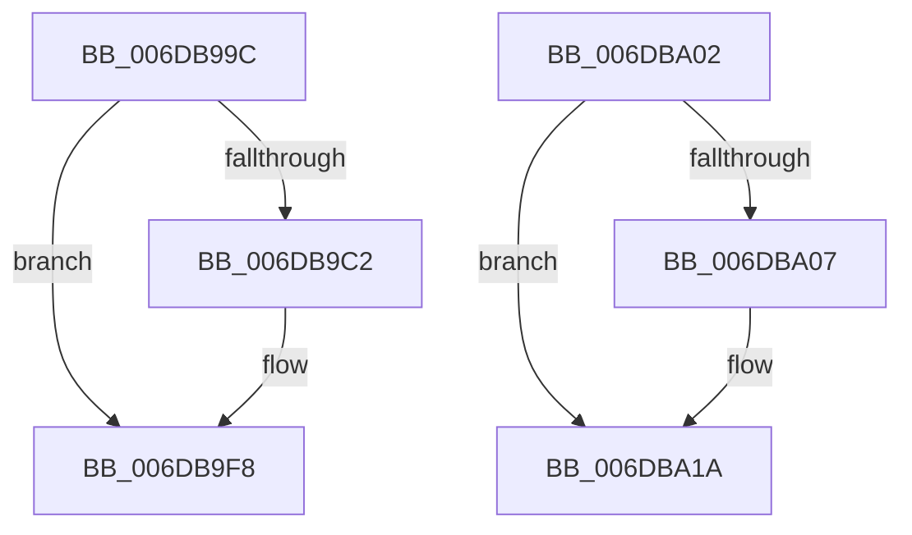

# sub_006DB99C

- RVA: `0x006DB99C`–`0x006DBA48` (길이 `172` bytes)
- VA: `0x00000001406DB99C`
- 실행 섹션: `.text`
- PDB 이름 있음: `아니요`; PDB Function 태그: `아니요`
- unwind 정보 RVA: `0x0006D844`
- 디코드: `42`개 명령, `172/172` bytes 표시
- 미해석 바이트: `0` (있으면 어셈블리에 `.byte`로 보존)

> 이 문서는 커널 이미지의 기계어와 PDB 기호를 분석해 생성했습니다. 4번과 5번은 함수 원형과 자료형을 바이너리 사용 방식에서 추정한 C 해석이며 원본 소스 복구 결과는 아닙니다.

## 1. Dependencies

- 직접 호출 지점: **5**; 고유 호출 대상: **4**
- 직접 호출자로 확인된 함수: **0**
- RIP 상대 이미지 참조: **0**

### Outgoing calls
- `0x006DB9B6` → [KeQueryNodeActiveAffinityEx](../25/KeQueryNodeActiveAffinityEx_function_00256740.md) (function, `0x00256740`)
- `0x006DB9D1` → [KeSetUserAffinityThread](../2C/KeSetUserAffinityThread_function_002CFA2C.md) (function, `0x002CFA2C`)
- `0x006DB9E4` → [memset](../6C/memset_function_006C6C40.md) (function, `0x006C6C40`)
- `0x006DB9F3` → [KeSetUserAffinityThread](../2C/KeSetUserAffinityThread_function_002CFA2C.md) (function, `0x002CFA2C`)
- `0x006DBA0F` → [ObDereferenceObjectDeferDeleteWithTag](../26/ObDereferenceObjectDeferDeleteWithTag_function_00263EA0.md) (function, `0x00263EA0`)

### Direct callers
- 이 함수 시작 RVA로 연결되는 직접 call은 확인되지 않았습니다. 간접 호출은 완전히 역산할 수 없습니다.

### Static image references
- 디코드된 RIP-relative 메모리 참조가 없습니다.

## 2. Other-region calls and transfers

- 다른 실행 섹션으로 향하는 call: **0**
- call이 아닌 외부 분기/꼬리 이동: **2**
  - `0x006DB9FD` → [MiStoreWriteModifiedPages + 0xAC](../2B/MiStoreWriteModifiedPages_function_002B46C4.md) (`tail-transfer`)
  - `0x006DBA43` → [MiStoreWriteModifiedPages + 0x4D1](../2B/MiStoreWriteModifiedPages_function_002B46C4.md) (`tail-transfer`)

## 3. Assembly (complete function range)

```asm
006DB99C  49 8D BF 98 05 00 00            lea rdi, [r15 + 0x598]
006DB9A3  66 44 89 75 77                  mov word ptr [rbp + 0x77], r14w
006DB9A8  66 41 2B DD                     sub bx, r13w
006DB9AC  4C 8D 45 77                     lea r8, [rbp + 0x77]
006DB9B0  48 8B D7                        mov rdx, rdi
006DB9B3  0F B7 CB                        movzx ecx, bx
006DB9B6  E8 85 AD B7 FF                  call 0x140256740
006DB9BB  66 44 39 75 77                  cmp word ptr [rbp + 0x77], r14w
006DB9C0  74 36                           je 0x1406db9f8
006DB9C2  65 48 8B 1C 25 88 01 00 00      mov rbx, qword ptr gs:[0x188]
006DB9CB  48 8B D7                        mov rdx, rdi
006DB9CE  48 8B CB                        mov rcx, rbx
006DB9D1  E8 56 40 BF FF                  call 0x1402cfa2c
006DB9D6  44 0F B7 07                     movzx r8d, word ptr [rdi]
006DB9DA  48 8D 4F 08                     lea rcx, [rdi + 8]
006DB9DE  49 C1 E0 03                     shl r8, 3
006DB9E2  33 D2                           xor edx, edx
006DB9E4  E8 57 B2 FE FF                  call 0x1406c6c40
006DB9E9  48 8B D7                        mov rdx, rdi
006DB9EC  66 44 89 2F                     mov word ptr [rdi], r13w
006DB9F0  48 8B CB                        mov rcx, rbx
006DB9F3  E8 34 40 BF FF                  call 0x1402cfa2c
006DB9F8  48 8B 7C 24 48                  mov rdi, qword ptr [rsp + 0x48]
006DB9FD  E9 6E 8D BD FF                  jmp 0x1402b4770
006DBA02  4D 85 C0                        test r8, r8
006DBA05  74 13                           je 0x1406dba1a
006DBA07  BA 4D 6D 50 66                  mov edx, 0x66506d4d
006DBA0C  49 8B C8                        mov rcx, r8
006DBA0F  E8 8C 84 B8 FF                  call 0x140263ea0
006DBA14  48 83 64 24 50 00               and qword ptr [rsp + 0x50], 0
006DBA1A  49 8B 87 88 05 00 00            mov rax, qword ptr [r15 + 0x588]
006DBA21  44 8B 4D 7F                     mov r9d, dword ptr [rbp + 0x7f]
006DBA25  48 C1 EF 03                     shr rdi, 3
006DBA29  44 03 CB                        add r9d, ebx
006DBA2C  44 89 4D 7F                     mov dword ptr [rbp + 0x7f], r9d
006DBA30  48 03 78 08                     add rdi, qword ptr [rax + 8]
006DBA34  8B 44 24 34                     mov eax, dword ptr [rsp + 0x34]
006DBA38  83 E0 07                        and eax, 7
006DBA3B  0F BE 0F                        movsx ecx, byte ptr [rdi]
006DBA3E  0F AB C1                        bts ecx, eax
006DBA41  88 0F                           mov byte ptr [rdi], cl
006DBA43  E9 4D 91 BD FF                  jmp 0x1402b4b95
```

## 4. C-style interpretation (structured pseudocode)

```c
__int64 __fastcall sub_006DB99C(__int64 a1, __int64 a2, __int64 a3, __int64 a4, __int64 a5, __int64 a6, __int64 a7, __int64 a8, __int64 a9)
{
    __int64 result;
    __int64 v_rbx;
    unsigned int v_stack_p34;
    unsigned __int64 v_stack_p50;

    *(unsigned __int16 *)(v_rbp + 119) = (unsigned __int16)(v_r14);
    v_rbx = (unsigned __int16)((v_rbx) - ((unsigned __int16)(v_r13)));
    result = KeQueryNodeActiveAffinityEx((unsigned __int16)(v_rbx), v_r15 + 1432, v_rbp + 119, a4);
    if ((*(unsigned __int16 *)(v_rbp + 119)) != ((unsigned __int16)(v_r14))) {
        v_rbx = *(unsigned __int64 *)(gs_base + (0 + 392));
        a2 = v_r15 + 1432;
        a1 = v_rbx;
        result = KeSetUserAffinityThread(a1, a2, v_rbp + 119, a4);
        a3 = *(unsigned __int16 *)(v_r15 + 1432);
        a1 = v_r15 + 1432 + 8;
        a3 = (a3) << (3);
        a2 = 0;
        result = memset(a1, a2, a3, a4);
        a2 = v_r15 + 1432;
        *(unsigned __int16 *)(v_r15 + 1432) = (unsigned __int16)(v_r13);
        a1 = v_rbx;
        result = KeSetUserAffinityThread(a1, a2, a3, a4);
    }
}
```

## 5. (Beta) C Style

```c
int64_t sub_006DB99C(int64_t Arg1, int64_t Arg2, int64_t Arg3, int64_t Arg4, uint64_t Arg5, uint64_t Arg6, uint64_t Arg7, uint64_t Arg8, int64_t Arg9)
{
    int64_t result;
    int64_t local_rbx;
    uint32_t v_stack_p34;
    uint64_t v_stack_p50;

    *(uint16_t *)(local_rbp + 0x77) = (uint16_t)(local_r14);
    local_rbx = (uint16_t)((local_rbx) - ((uint16_t)(local_r13)));
    result = KeQueryNodeActiveAffinityEx((uint16_t)(local_rbx), local_r15 + 1432, local_rbp + 119, Arg4);
    if ((*(uint16_t *)(local_rbp + 0x77)) != ((uint16_t)(local_r14))) {
        local_rbx = *(uint64_t *)(gs_base + (0 + 0x188));
        Arg2 = local_r15 + 1432;
        Arg1 = local_rbx;
        result = KeSetUserAffinityThread(Arg1, Arg2, local_rbp + 119, Arg4);
        Arg3 = *(uint16_t *)(local_r15 + 0x598);
        Arg1 = local_r15 + 1432 + 8;
        Arg3 = (Arg3) << (3);
        Arg2 = 0;
        result = memset(Arg1, Arg2, Arg3, Arg4);
        Arg2 = local_r15 + 1432;
        *(uint16_t *)(local_r15 + 0x598) = (uint16_t)(local_r13);
        Arg1 = local_rbx;
        result = KeSetUserAffinityThread(Arg1, Arg2, Arg3, Arg4);
    }
}
```

## 6. Execution-region graph

[열기: 2D/3D 그래프와 함수 탐색 컨트롤 패널](../../../control-panel.html?section=text&rva=0x006DB99C&view=graph)

- 2D 그래프는 위에서 아래로 흐르고, 3D 그래프는 빈 공간을 드래그해 회전합니다. Shift+드래그는 이동, 휠은 확대·축소, 함수 노드 선택은 대상 보고서 이동입니다.

### Static fallback


