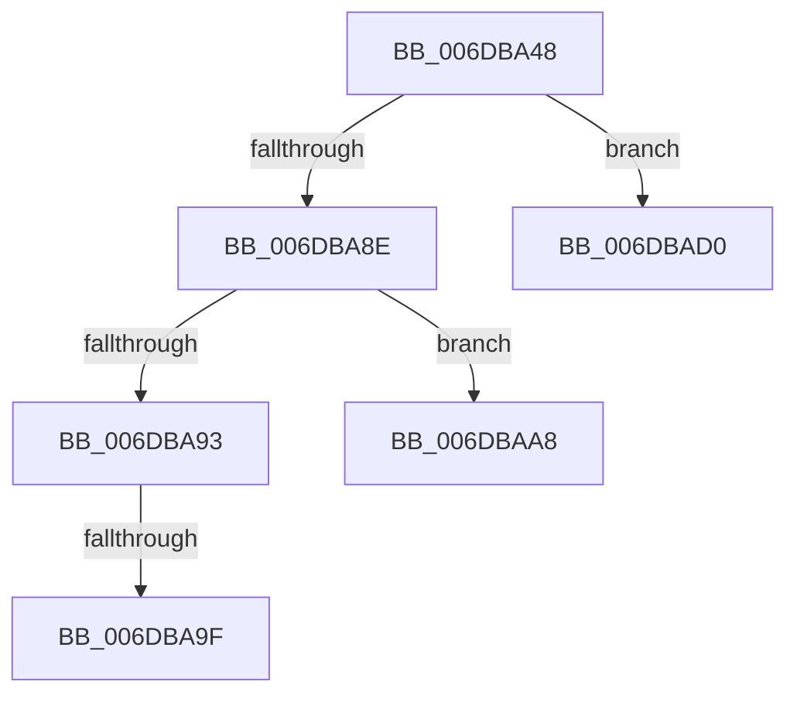

# sub_006DBA48

- RVA: `0x006DBA48`–`0x006DBAD9` (길이 `145` bytes)
- VA: `0x00000001406DBA48`
- 실행 섹션: `.text`
- PDB 이름 있음: `아니요`; PDB Function 태그: `아니요`
- unwind 정보 RVA: `0x0006D9C0`
- 디코드: `36`개 명령, `145/145` bytes 표시
- 미해석 바이트: `0` (있으면 어셈블리에 `.byte`로 보존)

> 이 문서는 커널 이미지의 기계어와 PDB 기호를 분석해 생성했습니다. 4번과 5번은 함수 원형과 자료형을 바이너리 사용 방식에서 추정한 C 해석이며 원본 소스 복구 결과는 아닙니다.

## 1. Dependencies

- 직접 호출 지점: **1**; 고유 호출 대상: **1**
- 직접 호출자로 확인된 함수: **0**
- RIP 상대 이미지 참조: **0**

### Outgoing calls
- `0x006DBA80` → [MiGetClusterPage](../4D/MiGetClusterPage_function_004DC57C.md) (function, `0x004DC57C`)

### Direct callers
- 이 함수 시작 RVA로 연결되는 직접 call은 확인되지 않았습니다. 간접 호출은 완전히 역산할 수 없습니다.

### Static image references
- 디코드된 RIP-relative 메모리 참조가 없습니다.

## 2. Other-region calls and transfers

- 다른 실행 섹션으로 향하는 call: **0**
- call이 아닌 외부 분기/꼬리 이동: **4**
  - `0x006DBA99` → [MiCreateSharedZeroPages + 0x171](../2B/MiCreateSharedZeroPages_function_002B6318.md) (`tail-transfer`)
  - `0x006DBAA3` → [MiCreateSharedZeroPages + 0x171](../2B/MiCreateSharedZeroPages_function_002B6318.md) (`tail-transfer`)
  - `0x006DBACB` → [MiCreateSharedZeroPages + 0x56](../2B/MiCreateSharedZeroPages_function_002B6318.md) (`tail-transfer`)
  - `0x006DBAD4` → [MiCreateSharedZeroPages + 0x56](../2B/MiCreateSharedZeroPages_function_002B6318.md) (`tail-transfer`)

## 3. Assembly (complete function range)

```asm
006DBA48  49 8B 46 08                     mov rax, qword ptr [r14 + 8]
006DBA4C  48 8D 4D 97                     lea rcx, [rbp - 0x69]
006DBA50  4D 8B 4D 00                     mov r9, qword ptr [r13]
006DBA54  49 8B D7                        mov rdx, r15
006DBA57  48 89 4C 24 38                  mov qword ptr [rsp + 0x38], rcx
006DBA5C  48 8B CE                        mov rcx, rsi
006DBA5F  44 0F B6 40 45                  movzx r8d, byte ptr [rax + 0x45]
006DBA64  48 8B 40 60                     mov rax, qword ptr [rax + 0x60]
006DBA68  44 23 C7                        and r8d, edi
006DBA6B  48 89 44 24 30                  mov qword ptr [rsp + 0x30], rax
006DBA70  41 8B 46 24                     mov eax, dword ptr [r14 + 0x24]
006DBA74  89 44 24 28                     mov dword ptr [rsp + 0x28], eax
006DBA78  41 8B 46 20                     mov eax, dword ptr [r14 + 0x20]
006DBA7C  89 44 24 20                     mov dword ptr [rsp + 0x20], eax
006DBA80  E8 F7 0A E0 FF                  call 0x1404dc57c
006DBA85  48 8B 4D A7                     mov rcx, qword ptr [rbp - 0x59]
006DBA89  48 85 C9                        test rcx, rcx
006DBA8C  74 42                           je 0x1406dbad0
006DBA8E  48 3B CF                        cmp rcx, rdi
006DBA91  75 15                           jne 0x1406dbaa8
006DBA93  49 89 7D 00                     mov qword ptr [r13], rdi
006DBA97  85 C0                           test eax, eax
006DBA99  0F 84 EA A9 BD FF               je 0x1402b6489
006DBA9F  41 83 0E 10                     or dword ptr [r14], 0x10
006DBAA3  E9 E1 A9 BD FF                  jmp 0x1402b6489
006DBAA8  41 8B C7                        mov eax, r15d
006DBAAB  49 C7 45 00 10 00 00 00         mov qword ptr [r13], 0x10
006DBAB3  C1 E8 0C                        shr eax, 0xc
006DBAB6  49 81 E7 00 00 FF FF            and r15, 0xffffffffffff0000
006DBABD  83 E0 0F                        and eax, 0xf
006DBAC0  4D 89 7E 10                     mov qword ptr [r14 + 0x10], r15
006DBAC4  48 F7 D8                        neg rax
006DBAC7  4D 8D 24 C4                     lea r12, [r12 + rax*8]
006DBACB  E9 9E A8 BD FF                  jmp 0x1402b636e
006DBAD0  49 89 7D 00                     mov qword ptr [r13], rdi
006DBAD4  E9 95 A8 BD FF                  jmp 0x1402b636e
```

## 4. C-style interpretation (structured pseudocode)

```c
__int64 __fastcall sub_006DBA48(void)
{
    __int64 result;
    __int64 v_r15;
    unsigned int v_stack_p20;
    unsigned int v_stack_p28;
    unsigned __int64 v_stack_p30;
    unsigned __int64 v_stack_p38;

    v_stack_p38 = v_rbp - 105;
    a3 = (unsigned int)((*(unsigned __int8 *)(*(unsigned __int64 *)(v_r14 + 8) + 69)) & ((unsigned int)(v_rdi)));
    v_stack_p30 = *(unsigned __int64 *)(*(unsigned __int64 *)(v_r14 + 8) + 96);
    v_stack_p28 = (unsigned int)((unsigned int)(*(unsigned int *)(v_r14 + 36)));
    v_stack_p20 = (unsigned int)((unsigned int)(*(unsigned int *)(v_r14 + 32)));
    result = MiGetClusterPage(v_rsi, v_r15, a3, *(unsigned __int64 *)(v_r13));
    if (*(unsigned __int64 *)(v_rbp - 89) == 0) goto loc_006DBAD0;
    if ((*(unsigned __int64 *)(v_rbp - 89)) != v_rdi) goto loc_006DBAA8;
    *(unsigned __int64 *)(v_r13) = v_rdi;
loc_006DBAA8:
    *(unsigned __int64 *)(v_r13) = 16;
    result = (unsigned int)(((unsigned int)((unsigned int)(v_r15))) >> (12));
    v_r15 = (v_r15) & (0xFFFFFFFFFFFF0000ULL);
    result = (unsigned int)((result) & (15));
    *(unsigned __int64 *)(v_r14 + 16) = v_r15;
    result = -(result);
loc_006DBAD0:
    *(unsigned __int64 *)(v_r13) = v_rdi;
}
```

## 5. (Beta) C Style

```c
void sub_006DBA48(void)
{
    int64_t result;
    int64_t local_r15;
    uint32_t v_stack_p20;
    uint32_t v_stack_p28;
    uint64_t v_stack_p30;
    uint64_t v_stack_p38;

    v_stack_p38 = local_rbp - 105;
    a3 = (uint32_t)((*(uint8_t *)(*(uint64_t *)(local_r14 + 0x8) + 0x45)) & ((uint32_t)(local_rdi)));
    v_stack_p30 = *(uint64_t *)(*(uint64_t *)(local_r14 + 0x8) + 0x60);
    v_stack_p28 = (uint32_t)((uint32_t)(*(uint32_t *)(local_r14 + 0x24)));
    v_stack_p20 = (uint32_t)((uint32_t)(*(uint32_t *)(local_r14 + 0x20)));
    result = MiGetClusterPage(local_rsi, local_r15, a3, *(uint64_t *)(local_r13));
    if (*(uint64_t *)(local_rbp - 0x59) == 0) goto loc_006DBAD0;
    if ((*(uint64_t *)(local_rbp - 0x59)) != local_rdi) goto loc_006DBAA8;
    *(uint64_t *)(local_r13) = local_rdi;
loc_006DBAA8:
    *(uint64_t *)(local_r13) = 16;
    result = (uint32_t)(((uint32_t)((uint32_t)(local_r15))) >> (12));
    local_r15 = (local_r15) & (0xFFFFFFFFFFFF0000ULL);
    result = (uint32_t)((result) & (15));
    *(uint64_t *)(local_r14 + 0x10) = local_r15;
    result = -(result);
loc_006DBAD0:
    *(uint64_t *)(local_r13) = local_rdi;
}
```

## 6. Execution-region graph

[열기: 2D/3D 그래프와 함수 탐색 컨트롤 패널](../../../control-panel.html?section=text&rva=0x006DBA48&view=graph)

- 2D 그래프는 위에서 아래로 흐르고, 3D 그래프는 빈 공간을 드래그해 회전합니다. Shift+드래그는 이동, 휠은 확대·축소, 함수 노드 선택은 대상 보고서 이동입니다.

### Static fallback


