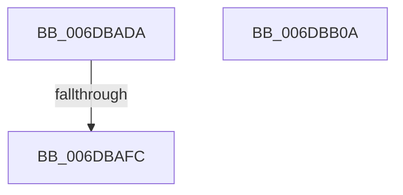

# sub_006DBADA

- RVA: `0x006DBADA`–`0x006DBB22` (길이 `72` bytes)
- VA: `0x00000001406DBADA`
- 실행 섹션: `.text`
- PDB 이름 있음: `아니요`; PDB Function 태그: `아니요`
- unwind 정보 RVA: `0x0006DA44`
- 디코드: `17`개 명령, `72/72` bytes 표시
- 미해석 바이트: `0` (있으면 어셈블리에 `.byte`로 보존)

> 이 문서는 커널 이미지의 기계어와 PDB 기호를 분석해 생성했습니다. 4번과 5번은 함수 원형과 자료형을 바이너리 사용 방식에서 추정한 C 해석이며 원본 소스 복구 결과는 아닙니다.

## 1. Dependencies

- 직접 호출 지점: **3**; 고유 호출 대상: **3**
- 직접 호출자로 확인된 함수: **0**
- RIP 상대 이미지 참조: **1**

### Outgoing calls
- `0x006DBAFF` → [KiRaiseIrqlProcessIrqlFlags](../4F/KiRaiseIrqlProcessIrqlFlags_function_004F56FC.md) (function, `0x004F56FC`)
- `0x006DBB0A` → [MiReleaseFreshPage](../33/MiReleaseFreshPage_function_00334AE0.md) (function, `0x00334AE0`)
- `0x006DBB17` → [MiReleaseNonPagedResources](../32/MiReleaseNonPagedResources_function_0032299C.md) (function, `0x0032299C`)

### Direct callers
- 이 함수 시작 RVA로 연결되는 직접 call은 확인되지 않았습니다. 간접 호출은 완전히 역산할 수 없습니다.

### Static image references
- `0x006DBAEF` → RVA `0x00FC6D20` (`ALMOSTRO`; read)

## 2. Other-region calls and transfers

- 다른 실행 섹션으로 향하는 call: **0**
- call이 아닌 외부 분기/꼬리 이동: **3**
  - `0x006DBAF6` → [MiFinishHardFault + 0x734](../2B/MiFinishHardFault_function_002B6F10.md) (`tail-transfer`)
  - `0x006DBB05` → [MiFinishHardFault + 0x734](../2B/MiFinishHardFault_function_002B6F10.md) (`tail-transfer`)
  - `0x006DBB1D` → [MiFinishHardFault + 0x374](../2B/MiFinishHardFault_function_002B6F10.md) (`tail-transfer`)

## 3. Assembly (complete function range)

```asm
006DBADA  41 0F B6 C6                     movzx eax, r14b
006DBADE  44 0F 22 C0                     mov cr8, rax
006DBAE2  44 0F 20 C1                     mov rcx, cr8
006DBAE6  B8 02 00 00 00                  mov eax, 2
006DBAEB  44 0F 22 C0                     mov cr8, rax
006DBAEF  83 3D 2A B2 8E 00 00            cmp dword ptr [rip + 0x8eb22a], 0
006DBAF6  0F 84 48 BB BD FF               je 0x1402b7644
006DBAFC  0F B6 D0                        movzx edx, al
006DBAFF  E8 F8 9B E1 FF                  call 0x1404f56fc
006DBB04  90                              nop
006DBB05  E9 3A BB BD FF                  jmp 0x1402b7644
006DBB0A  E8 D1 8F C5 FF                  call 0x140334ae0
006DBB0F  BA 01 00 00 00                  mov edx, 1
006DBB14  48 8B CB                        mov rcx, rbx
006DBB17  E8 80 6E C4 FF                  call 0x14032299c
006DBB1C  90                              nop
006DBB1D  E9 62 B7 BD FF                  jmp 0x1402b7284
```

## 4. C-style interpretation (structured pseudocode)

```c
__int64 __fastcall sub_006DBADA(void)
{
    __int64 result;

    result = KiRaiseIrqlProcessIrqlFlags((unsigned __int8)(v_r14), 2, a3, a4);
}
```

## 5. (Beta) C Style

```c
void sub_006DBADA(void)
{
    int64_t result;

    result = KiRaiseIrqlProcessIrqlFlags((uint8_t)(local_r14), 2, a3, a4);
}
```

## 6. Execution-region graph

[열기: 2D/3D 그래프와 함수 탐색 컨트롤 패널](../../../control-panel.html?section=text&rva=0x006DBADA&view=graph)

- 2D 그래프는 위에서 아래로 흐르고, 3D 그래프는 빈 공간을 드래그해 회전합니다. Shift+드래그는 이동, 휠은 확대·축소, 함수 노드 선택은 대상 보고서 이동입니다.

### Static fallback


