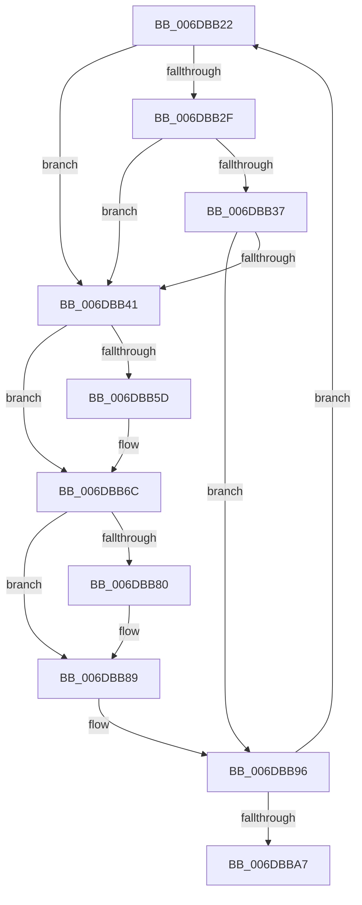

# sub_006DBB22

- RVA: `0x006DBB22`–`0x006DBBB1` (길이 `143` bytes)
- VA: `0x00000001406DBB22`
- 실행 섹션: `.text`
- PDB 이름 있음: `아니요`; PDB Function 태그: `아니요`
- unwind 정보 RVA: `0x0006DB3C`
- 디코드: `41`개 명령, `143/143` bytes 표시
- 미해석 바이트: `0` (있으면 어셈블리에 `.byte`로 보존)

> 이 문서는 커널 이미지의 기계어와 PDB 기호를 분석해 생성했습니다. 4번과 5번은 함수 원형과 자료형을 바이너리 사용 방식에서 추정한 C 해석이며 원본 소스 복구 결과는 아닙니다.

## 1. Dependencies

- 직접 호출 지점: **2**; 고유 호출 대상: **2**
- 직접 호출자로 확인된 함수: **0**
- RIP 상대 이미지 참조: **0**

### Outgoing calls
- `0x006DBB49` → [MiMapPageInHyperSpaceWorker](../33/MiMapPageInHyperSpaceWorker_function_00332B10.md) (function, `0x00332B10`)
- `0x006DBB91` → [MiUnmapPageInHyperSpaceWorker](../43/MiUnmapPageInHyperSpaceWorker_function_00432800.md) (function, `0x00432800`)

### Direct callers
- 이 함수 시작 RVA로 연결되는 직접 call은 확인되지 않았습니다. 간접 호출은 완전히 역산할 수 없습니다.

### Static image references
- 디코드된 RIP-relative 메모리 참조가 없습니다.

## 2. Other-region calls and transfers

- 다른 실행 섹션으로 향하는 call: **0**
- call이 아닌 외부 분기/꼬리 이동: **1**
  - `0x006DBBAC` → [MiMirrorOmitPagesFromCopy + 0x76](../2B/MiMirrorOmitPagesFromCopy_function_002B7AF0.md) (`tail-transfer`)

## 3. Assembly (complete function range)

```asm
006DBB22  48 8B 06                        mov rax, qword ptr [rsi]
006DBB25  48 C1 E8 3C                     shr rax, 0x3c
006DBB29  24 07                           and al, 7
006DBB2B  3C 03                           cmp al, 3
006DBB2D  75 12                           jne 0x1406dbb41
006DBB2F  48 8B 06                        mov rax, qword ptr [rsi]
006DBB32  48 85 C0                        test rax, rax
006DBB35  79 0A                           jns 0x1406dbb41
006DBB37  8B 46 E8                        mov eax, dword ptr [rsi - 0x18]
006DBB3A  48 0F BA E0 0A                  bt rax, 0xa
006DBB3F  72 55                           jb 0x1406dbb96
006DBB41  45 33 C0                        xor r8d, r8d
006DBB44  33 D2                           xor edx, edx
006DBB46  49 8B CE                        mov rcx, r14
006DBB49  E8 C2 6F C5 FF                  call 0x140332b10
006DBB4E  4C 8B C8                        mov r9, rax
006DBB51  4C 8B C0                        mov r8, rax
006DBB54  BA 00 04 00 00                  mov edx, 0x400
006DBB59  A8 04                           test al, 4
006DBB5B  74 0F                           je 0x1406dbb6c
006DBB5D  C7 00 FE FF FF FF               mov dword ptr [rax], 0xfffffffe
006DBB63  4C 8D 40 04                     lea r8, [rax + 4]
006DBB67  BA FF 03 00 00                  mov edx, 0x3ff
006DBB6C  48 8B CA                        mov rcx, rdx
006DBB6F  48 8B C5                        mov rax, rbp
006DBB72  48 D1 E9                        shr rcx, 1
006DBB75  49 8B F8                        mov rdi, r8
006DBB78  F3 48 AB                        rep stosq qword ptr [rdi], rax
006DBB7B  F6 C2 01                        test dl, 1
006DBB7E  74 09                           je 0x1406dbb89
006DBB80  41 C7 44 90 FC FE FF FF FF      mov dword ptr [r8 + rdx*4 - 4], 0xfffffffe
006DBB89  45 33 C0                        xor r8d, r8d
006DBB8C  B2 11                           mov dl, 0x11
006DBB8E  49 8B C9                        mov rcx, r9
006DBB91  E8 6A 6C D5 FF                  call 0x140432800
006DBB96  48 83 C6 30                     add rsi, 0x30
006DBB9A  49 FF C6                        inc r14
006DBB9D  48 83 EB 01                     sub rbx, 1
006DBBA1  0F 85 7B FF FF FF               jne 0x1406dbb22
006DBBA7  48 8B 6C 24 30                  mov rbp, qword ptr [rsp + 0x30]
006DBBAC  E9 B5 BF BD FF                  jmp 0x1402b7b66
```

## 4. C-style interpretation (structured pseudocode)

```c
__int64 __fastcall sub_006DBB22(__int64 a1, int a2, int a3, __int64 a4, __int64 a5, __int64 a6)
{
    __int64 result;
    __int64 v_r14;
    __int64 v_rbx;
    __int64 v_rsi;

    result = (*(unsigned __int64 *)(v_rsi)) >> (60);
    result = (unsigned __int8)((result) & (7));
    if (((unsigned __int8)(result)) != 3) goto loc_006DBB41;
    if (!sign_flag) goto loc_006DBB41;
    if (condition_is_below) goto loc_006DBB96;
loc_006DBB41:
    a3 = 0;
    a2 = 0;
    result = MiMapPageInHyperSpaceWorker(v_r14, a2, a3, a4);
    if ((((unsigned __int8)(result)) & (4)) != 0) {
        *(unsigned int *)(result) = 0xFFFFFFFEULL;
        a3 = result + 4;
        a2 = 0x3FFULL;
    }
    a1 = (a2) >> (1);
    if ((((unsigned __int8)(a2)) & (1)) != 0) {
        *(unsigned int *)(a3 + a2 * 4 - 4) = 0xFFFFFFFEULL;
    }
    a3 = 0;
    result = MiUnmapPageInHyperSpaceWorker(result, 17, a3, result);
loc_006DBB96:
    v_rsi = (v_rsi) + (48);
    v_r14 = (v_r14) + 1;
    v_rbx = (v_rbx) - (1);
    if (condition_is_not_equal) goto loc_006DBB22;
}
```

## 5. (Beta) C Style

```c
int64_t sub_006DBB22(int64_t Arg1, int32_t Arg2, int32_t Arg3, int64_t Arg4, uint64_t Arg5, int64_t Arg6)
{
    int64_t result;
    int64_t local_r14;
    int64_t local_rbx;
    int64_t local_rsi;

    result = (*(uint64_t *)(local_rsi)) >> (60);
    result = (uint8_t)((result) & (7));
    if (((uint8_t)(result)) != 3) goto loc_006DBB41;
    if (!sign_flag) goto loc_006DBB41;
    if (condition_is_below) goto loc_006DBB96;
loc_006DBB41:
    Arg3 = 0;
    Arg2 = 0;
    result = MiMapPageInHyperSpaceWorker(local_r14, Arg2, Arg3, Arg4);
    if ((((uint8_t)(result)) & (4)) != 0) {
        *(uint32_t *)(result) = 0xFFFFFFFEULL;
        Arg3 = result + 4;
        Arg2 = 0x3FFULL;
    }
    Arg1 = (Arg2) >> (1);
    if ((((uint8_t)(Arg2)) & (1)) != 0) {
        *(uint32_t *)(Arg3 + Arg2 * 4 - 0x4) = 0xFFFFFFFEULL;
    }
    Arg3 = 0;
    result = MiUnmapPageInHyperSpaceWorker(result, 17, Arg3, result);
loc_006DBB96:
    local_rsi = (local_rsi) + (48);
    local_r14 = (local_r14) + 1;
    local_rbx = (local_rbx) - (1);
    if (condition_is_not_equal) goto loc_006DBB22;
}
```

## 6. Execution-region graph

[열기: 2D/3D 그래프와 함수 탐색 컨트롤 패널](../../../control-panel.html?section=text&rva=0x006DBB22&view=graph)

- 2D 그래프는 위에서 아래로 흐르고, 3D 그래프는 빈 공간을 드래그해 회전합니다. Shift+드래그는 이동, 휠은 확대·축소, 함수 노드 선택은 대상 보고서 이동입니다.

### Static fallback


