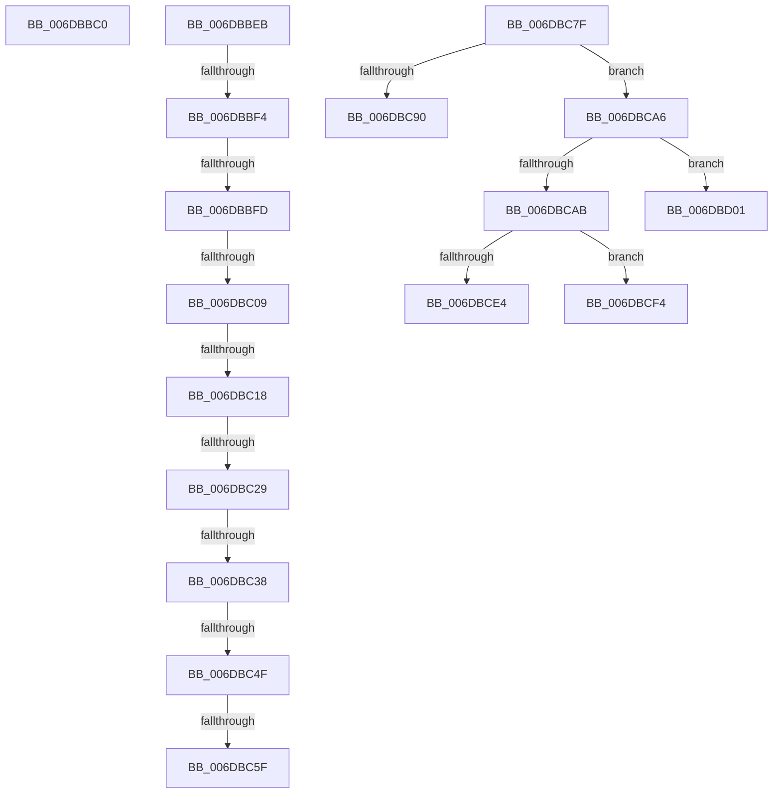

# sub_006DBBC0

- RVA: `0x006DBBC0`–`0x006DBD1F` (길이 `351` bytes)
- VA: `0x00000001406DBBC0`
- 실행 섹션: `.text`
- PDB 이름 있음: `아니요`; PDB Function 태그: `아니요`
- unwind 정보 RVA: `0x0006DD5C`
- 디코드: `77`개 명령, `351/351` bytes 표시
- 미해석 바이트: `0` (있으면 어셈블리에 `.byte`로 보존)

> 이 문서는 커널 이미지의 기계어와 PDB 기호를 분석해 생성했습니다. 4번과 5번은 함수 원형과 자료형을 바이너리 사용 방식에서 추정한 C 해석이며 원본 소스 복구 결과는 아닙니다.

## 1. Dependencies

- 직접 호출 지점: **8**; 고유 호출 대상: **6**
- 직접 호출자로 확인된 함수: **0**
- RIP 상대 이미지 참조: **3**

### Outgoing calls
- `0x006DBC1C` → [MiGetPagingFileOffset](../36/MiGetPagingFileOffset_function_0036F530.md) (function, `0x0036F530`)
- `0x006DBC42` → [MiGetPagePrivilege](../28/MiGetPagePrivilege_function_00285420.md) (function, `0x00285420`)
- `0x006DBC52` → [MiIsStandbyPageCorrupted](../4D/MiIsStandbyPageCorrupted_function_004DEE50.md) (function, `0x004DEE50`)
- `0x006DBC94` → [ExAcquireSpinLockExclusiveAtDpcLevel](../24/ExAcquireSpinLockExclusiveAtDpcLevel_function_00248E80.md) (function, `0x00248E80`)
- `0x006DBCB3` → [MiClearPfnImageVerified](../40/MiClearPfnImageVerified_function_00407000.md) (function, `0x00407000`)
- `0x006DBCBF` → [ExAcquireSpinLockExclusiveAtDpcLevel](../24/ExAcquireSpinLockExclusiveAtDpcLevel_function_00248E80.md) (function, `0x00248E80`)
- `0x006DBCE9` → [MiBadPageInserted](../4D/MiBadPageInserted_function_004DD9A0.md) (function, `0x004DD9A0`)
- `0x006DBD14` → [ExAcquireSpinLockExclusiveAtDpcLevel](../24/ExAcquireSpinLockExclusiveAtDpcLevel_function_00248E80.md) (function, `0x00248E80`)

### Direct callers
- 이 함수 시작 RVA로 연결되는 직접 call은 확인되지 않았습니다. 간접 호출은 완전히 역산할 수 없습니다.

### Static image references
- `0x006DBBC0` → RVA `0x00E2D65C` (`.data`; read)
- `0x006DBBC6` → RVA `0x00E2D650` (`.data`; read)
- `0x006DBBD2` → RVA `0x00E38D00` (`.data`; read)

## 2. Other-region calls and transfers

- 다른 실행 섹션으로 향하는 call: **0**
- call이 아닌 외부 분기/꼬리 이동: **14**
  - `0x006DBBE6` → [MiInsertPageInList + 0x15E](../2B/MiInsertPageInList_function_002BA000.md) (`tail-transfer`)
  - `0x006DBBEE` → [MiInsertPageInList + 0x4BC](../2B/MiInsertPageInList_function_002BA000.md) (`tail-transfer`)
  - `0x006DBBF7` → [MiInsertPageInList + 0x4BC](../2B/MiInsertPageInList_function_002BA000.md) (`tail-transfer`)
  - `0x006DBC03` → [MiInsertPageInList + 0x4BC](../2B/MiInsertPageInList_function_002BA000.md) (`tail-transfer`)
  - `0x006DBC12` → [MiInsertPageInList + 0x4BC](../2B/MiInsertPageInList_function_002BA000.md) (`tail-transfer`)
  - `0x006DBC23` → [MiInsertPageInList + 0x4BC](../2B/MiInsertPageInList_function_002BA000.md) (`tail-transfer`)
  - `0x006DBC32` → [MiInsertPageInList + 0x4BC](../2B/MiInsertPageInList_function_002BA000.md) (`tail-transfer`)
  - `0x006DBC49` → [MiInsertPageInList + 0x4BC](../2B/MiInsertPageInList_function_002BA000.md) (`tail-transfer`)
  - `0x006DBC59` → [MiInsertPageInList + 0x4BC](../2B/MiInsertPageInList_function_002BA000.md) (`tail-transfer`)
  - `0x006DBC7A` → [MiInsertPageInList + 0x767](../2B/MiInsertPageInList_function_002BA000.md) (`tail-transfer`)
  - `0x006DBCA1` → [MiInsertPageInList + 0x291](../2B/MiInsertPageInList_function_002BA000.md) (`tail-transfer`)
  - `0x006DBCEF` → [MiInsertPageInList + 0x291](../2B/MiInsertPageInList_function_002BA000.md) (`tail-transfer`)
  - `0x006DBCFC` → [MiInsertPageInList + 0x291](../2B/MiInsertPageInList_function_002BA000.md) (`tail-transfer`)
  - `0x006DBD1A` → [MiInsertPageInList + 0x291](../2B/MiInsertPageInList_function_002BA000.md) (`tail-transfer`)

## 3. Assembly (complete function range)

```asm
006DBBC0  8B 3D 96 1A 75 00               mov edi, dword ptr [rip + 0x751a96]
006DBBC6  4C 8D 3D 83 1A 75 00            lea r15, [rip + 0x751a83]
006DBBCD  4C 89 7C 24 40                  mov qword ptr [rsp + 0x40], r15
006DBBD2  4C 8D 2D 27 D1 75 00            lea r13, [rip + 0x75d127]
006DBBD9  89 7C 24 30                     mov dword ptr [rsp + 0x30], edi
006DBBDD  48 C7 44 24 48 00 00 00 00      mov qword ptr [rsp + 0x48], 0
006DBBE6  E9 73 E5 BD FF                  jmp 0x1402ba15e
006DBBEB  83 FB 04                        cmp ebx, 4
006DBBEE  0F 83 C8 E8 BD FF               jae 0x1402ba4bc
006DBBF4  83 F9 09                        cmp ecx, 9
006DBBF7  0F 85 BF E8 BD FF               jne 0x1402ba4bc
006DBBFD  41 8B 45 04                     mov eax, dword ptr [r13 + 4]
006DBC01  84 C0                           test al, al
006DBC03  0F 88 B3 E8 BD FF               js 0x1402ba4bc
006DBC09  41 8B 46 10                     mov eax, dword ptr [r14 + 0x10]
006DBC0D  48 0F BA E0 0A                  bt rax, 0xa
006DBC12  0F 82 A4 E8 BD FF               jb 0x1402ba4bc
006DBC18  49 8B 4E 10                     mov rcx, qword ptr [r14 + 0x10]
006DBC1C  E8 0F 39 C9 FF                  call 0x14036f530
006DBC21  85 C0                           test eax, eax
006DBC23  0F 84 93 E8 BD FF               je 0x1402ba4bc
006DBC29  41 8B 46 20                     mov eax, dword ptr [r14 + 0x20]
006DBC2D  C1 E8 18                        shr eax, 0x18
006DBC30  A8 40                           test al, 0x40
006DBC32  0F 85 84 E8 BD FF               jne 0x1402ba4bc
006DBC38  45 33 C0                        xor r8d, r8d
006DBC3B  49 8B CE                        mov rcx, r14
006DBC3E  41 8D 50 01                     lea edx, [r8 + 1]
006DBC42  E8 D9 97 BA FF                  call 0x140285420
006DBC47  A8 10                           test al, 0x10
006DBC49  0F 85 6D E8 BD FF               jne 0x1402ba4bc
006DBC4F  49 8B CC                        mov rcx, r12
006DBC52  E8 F9 31 E0 FF                  call 0x1404dee50
006DBC57  85 C0                           test eax, eax
006DBC59  0F 84 5D E8 BD FF               je 0x1402ba4bc
006DBC5F  41 8B 46 20                     mov eax, dword ptr [r14 + 0x20]
006DBC63  89 44 24 40                     mov dword ptr [rsp + 0x40], eax
006DBC67  C1 E8 10                        shr eax, 0x10
006DBC6A  24 FA                           and al, 0xfa
006DBC6C  0C 02                           or al, 2
006DBC6E  88 44 24 42                     mov byte ptr [rsp + 0x42], al
006DBC72  8B 44 24 40                     mov eax, dword ptr [rsp + 0x40]
006DBC76  41 89 46 20                     mov dword ptr [r14 + 0x20], eax
006DBC7A  E9 E8 EA BD FF                  jmp 0x1402ba767
006DBC7F  48 8D 05 CA 19 75 00            lea rax, [rip + 0x7519ca]
006DBC86  F7 44 24 38 00 01 00 00         test dword ptr [rsp + 0x38], 0x100
006DBC8E  74 16                           je 0x1406dbca6
006DBC90  49 8D 4F 20                     lea rcx, [r15 + 0x20]
006DBC94  E8 E7 D1 B6 FF                  call 0x140248e80
006DBC99  49 C7 46 08 F8 FF FF FF         mov qword ptr [r14 + 8], 0xfffffffffffffff8
006DBCA1  E9 EB E5 BD FF                  jmp 0x1402ba291
006DBCA6  4C 3B F8                        cmp r15, rax
006DBCA9  74 56                           je 0x1406dbd01
006DBCAB  BA 0C 00 00 00                  mov edx, 0xc
006DBCB0  49 8B CE                        mov rcx, r14
006DBCB3  E8 48 B3 D2 FF                  call 0x140407000
006DBCB8  49 8D 8D A0 1B 00 00            lea rcx, [r13 + 0x1ba0]
006DBCBF  E8 BC D1 B6 FF                  call 0x140248e80
006DBCC4  48 8D 0D 35 D0 75 00            lea rcx, [rip + 0x75d035]
006DBCCB  49 C7 46 08 FC FF FF FF         mov qword ptr [r14 + 8], 0xfffffffffffffffc
006DBCD3  49 8D 85 80 1B 00 00            lea rax, [r13 + 0x1b80]
006DBCDA  48 89 44 24 40                  mov qword ptr [rsp + 0x40], rax
006DBCDF  4C 3B E9                        cmp r13, rcx
006DBCE2  75 10                           jne 0x1406dbcf4
006DBCE4  B9 01 00 00 00                  mov ecx, 1
006DBCE9  E8 B2 1C E0 FF                  call 0x1404dd9a0
006DBCEE  90                              nop
006DBCEF  E9 9D E5 BD FF                  jmp 0x1402ba291
006DBCF4  83 CB 08                        or ebx, 8
006DBCF7  48 89 44 24 40                  mov qword ptr [rsp + 0x40], rax
006DBCFC  E9 90 E5 BD FF                  jmp 0x1402ba291
006DBD01  49 8D 85 80 1B 00 00            lea rax, [r13 + 0x1b80]
006DBD08  49 8D 8D A0 1B 00 00            lea rcx, [r13 + 0x1ba0]
006DBD0F  48 89 44 24 40                  mov qword ptr [rsp + 0x40], rax
006DBD14  E8 67 D1 B6 FF                  call 0x140248e80
006DBD19  90                              nop
006DBD1A  E9 72 E5 BD FF                  jmp 0x1402ba291
```

## 4. C-style interpretation (structured pseudocode)

```c
__int64 __fastcall sub_006DBBC0(int a1, __int64 a2, int a3)
{
    unsigned int v_stack_p30;
    unsigned int v_stack_p38;
    unsigned __int64 v_stack_p40;
    unsigned __int8 v_stack_p42;
    unsigned __int64 v_stack_p48;

    v_stack_p40 = v_rip + 7674499;
    v_stack_p30 = (unsigned int)((unsigned int)(*(unsigned int *)(v_rip + 7674518)));
    v_stack_p48 = 0;
}
```

## 5. (Beta) C Style

```c
int64_t sub_006DBBC0(int32_t Arg1, int64_t Arg2, int32_t Arg3)
{
    uint32_t v_stack_p30;
    uint32_t v_stack_p38;
    uint64_t v_stack_p40;
    uint8_t v_stack_p42;
    uint64_t v_stack_p48;

    v_stack_p40 = v_rip + 7674499;
    v_stack_p30 = (uint32_t)((uint32_t)(*(uint32_t *)(v_rip + 0x751A96)));
    v_stack_p48 = 0;
}
```

## 6. Execution-region graph

[열기: 2D/3D 그래프와 함수 탐색 컨트롤 패널](../../../control-panel.html?section=text&rva=0x006DBBC0&view=graph)

- 2D 그래프는 위에서 아래로 흐르고, 3D 그래프는 빈 공간을 드래그해 회전합니다. Shift+드래그는 이동, 휠은 확대·축소, 함수 노드 선택은 대상 보고서 이동입니다.

### Static fallback


