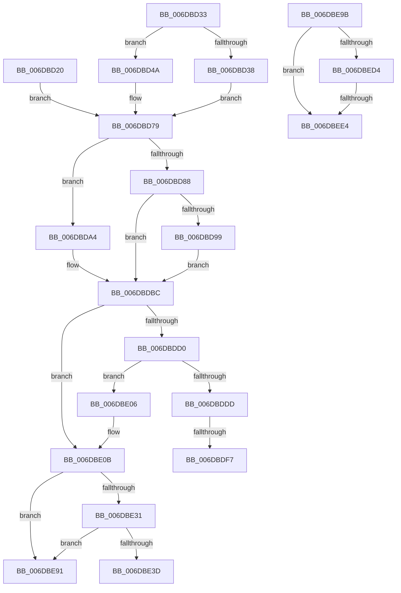

# sub_006DBD20

- RVA: `0x006DBD20`–`0x006DBEFE` (길이 `478` bytes)
- VA: `0x00000001406DBD20`
- 실행 섹션: `.text`
- PDB 이름 있음: `아니요`; PDB Function 태그: `아니요`
- unwind 정보 RVA: `0x0006DD9C`
- 디코드: `107`개 명령, `478/478` bytes 표시
- 미해석 바이트: `0` (있으면 어셈블리에 `.byte`로 보존)

> 이 문서는 커널 이미지의 기계어와 PDB 기호를 분석해 생성했습니다. 4번과 5번은 함수 원형과 자료형을 바이너리 사용 방식에서 추정한 C 해석이며 원본 소스 복구 결과는 아닙니다.

## 1. Dependencies

- 직접 호출 지점: **6**; 고유 호출 대상: **4**
- 직접 호출자로 확인된 함수: **0**
- RIP 상대 이미지 참조: **0**

### Outgoing calls
- `0x006DBDC7` → [MiPageAlreadyLocked](../40/MiPageAlreadyLocked_function_00409570.md) (function, `0x00409570`)
- `0x006DBE34` → [MiIsDecayPfn](../2B/MiIsDecayPfn_function_002B9240.md) (function, `0x002B9240`)
- `0x006DBE50` → [MiGetStandbyLookaside](../3D/MiGetStandbyLookaside_function_003D5620.md) (function, `0x003D5620`)
- `0x006DBEA6` → [MiGetStandbyLookaside](../3D/MiGetStandbyLookaside_function_003D5620.md) (function, `0x003D5620`)
- `0x006DBEBC` → [MiWriteStandbyLookasideEntry](../33/MiWriteStandbyLookasideEntry_function_0033B530.md) (function, `0x0033B530`)
- `0x006DBED7` → [MiIsDecayPfn](../2B/MiIsDecayPfn_function_002B9240.md) (function, `0x002B9240`)

### Direct callers
- 이 함수 시작 RVA로 연결되는 직접 call은 확인되지 않았습니다. 간접 호출은 완전히 역산할 수 없습니다.

### Static image references
- 디코드된 RIP-relative 메모리 참조가 없습니다.

## 2. Other-region calls and transfers

- 다른 실행 섹션으로 향하는 call: **0**
- call이 아닌 외부 분기/꼬리 이동: **6**
  - `0x006DBDF1` → [MiSynchronizeFastPageInsert + 0x34F](../2B/MiSynchronizeFastPageInsert_function_002BAE80.md) (`tail-transfer`)
  - `0x006DBE01` → [MiSynchronizeFastPageInsert + 0x34F](../2B/MiSynchronizeFastPageInsert_function_002BAE80.md) (`tail-transfer`)
  - `0x006DBE8C` → [MiSynchronizeFastPageInsert + 0x358](../2B/MiSynchronizeFastPageInsert_function_002BAE80.md) (`tail-transfer`)
  - `0x006DBE96` → [MiSynchronizeFastPageInsert + 0x490](../2B/MiSynchronizeFastPageInsert_function_002BAE80.md) (`tail-transfer`)
  - `0x006DBEDE` → [MiSynchronizeFastPageInsert + 0x4C3](../2B/MiSynchronizeFastPageInsert_function_002BAE80.md) (`tail-transfer`)
  - `0x006DBEF9` → [MiSynchronizeFastPageInsert + 0x4B9](../2B/MiSynchronizeFastPageInsert_function_002BAE80.md) (`tail-transfer`)

## 3. Assembly (complete function range)

```asm
006DBD20  4C 8B 4F 28                     mov r9, qword ptr [rdi + 0x28]
006DBD24  48 B8 FF FF FF FF FF 00 00 00   movabs rax, 0xffffffffff
006DBD2E  4C 23 C8                        and r9, rax
006DBD31  EB 46                           jmp 0x1406dbd79
006DBD33  4D 85 D2                        test r10, r10
006DBD36  75 12                           jne 0x1406dbd4a
006DBD38  4C 8B 0F                        mov r9, qword ptr [rdi]
006DBD3B  48 B8 FF FF FF FF FF 00 00 00   movabs rax, 0xffffffffff
006DBD45  4C 23 C8                        and r9, rax
006DBD48  EB 2F                           jmp 0x1406dbd79
006DBD4A  4C 8B 4F 28                     mov r9, qword ptr [rdi + 0x28]
006DBD4E  48 B8 00 00 00 00 00 00 80 0F   movabs rax, 0xf80000000000000
006DBD58  4C 23 C8                        and r9, rax
006DBD5B  48 8B 07                        mov rax, qword ptr [rdi]
006DBD5E  48 C1 E8 14                     shr rax, 0x14
006DBD62  4C 0B C8                        or r9, rax
006DBD65  8B 47 24                        mov eax, dword ptr [rdi + 0x24]
006DBD68  48 25 00 00 E0 FF               and rax, 0xffffffffffe00000
006DBD6E  49 C1 E9 14                     shr r9, 0x14
006DBD72  48 C1 E0 03                     shl rax, 3
006DBD76  4C 0B C8                        or r9, rax
006DBD79  48 B8 FF FF FF FF 3F 00 00 00   movabs rax, 0x3fffffffff
006DBD83  4C 3B C8                        cmp r9, rax
006DBD86  75 1C                           jne 0x1406dbda4
006DBD88  48 8B 94 24 E8 00 00 00         mov rdx, qword ptr [rsp + 0xe8]
006DBD90  48 83 C2 28                     add rdx, 0x28
006DBD94  4D 85 D2                        test r10, r10
006DBD97  74 23                           je 0x1406dbdbc
006DBD99  48 8B 54 24 70                  mov rdx, qword ptr [rsp + 0x70]
006DBD9E  48 83 C2 28                     add rdx, 0x28
006DBDA2  EB 18                           jmp 0x1406dbdbc
006DBDA4  4B 8D 14 49                     lea rdx, [r9 + r9*2]
006DBDA8  48 B8 00 00 00 00 00 DE FF FF   movabs rax, 0xffffde0000000000
006DBDB2  48 C1 E2 04                     shl rdx, 4
006DBDB6  48 8B C0                        mov rax, rax
006DBDB9  48 03 D0                        add rdx, rax
006DBDBC  48 8B 9C 24 08 01 00 00         mov rbx, qword ptr [rsp + 0x108]
006DBDC4  48 8B CB                        mov rcx, rbx
006DBDC7  E8 A4 D7 D2 FF                  call 0x140409570
006DBDCC  85 C0                           test eax, eax
006DBDCE  75 3B                           jne 0x1406dbe0b
006DBDD0  F0 48 0F BA 6A 18 3F            lock bts qword ptr [rdx + 0x18], 0x3f
006DBDD7  4B 8D 04 52                     lea rax, [r10 + r10*2]
006DBDDB  73 29                           jae 0x1406dbe06
006DBDDD  80 7C C3 18 00                  cmp byte ptr [rbx + rax*8 + 0x18], 0
006DBDE2  49 B9 FF FF FF FF FF FF FF 7F   movabs r9, 0x7fffffffffffffff
006DBDEC  4C 8B 44 24 48                  mov r8, qword ptr [rsp + 0x48]
006DBDF1  0F 84 D8 F3 BD FF               je 0x1402bb1cf
006DBDF7  F0 4C 21 4F 18                  lock and qword ptr [rdi + 0x18], r9
006DBDFC  C6 44 C3 18 00                  mov byte ptr [rbx + rax*8 + 0x18], 0
006DBE01  E9 C9 F3 BD FF                  jmp 0x1402bb1cf
006DBE06  C6 44 C3 30 01                  mov byte ptr [rbx + rax*8 + 0x30], 1
006DBE0B  4B 8D 04 52                     lea rax, [r10 + r10*2]
006DBE0F  49 83 C2 02                     add r10, 2
006DBE13  4C 89 4C C3 20                  mov qword ptr [rbx + rax*8 + 0x20], r9
006DBE18  48 89 54 C3 28                  mov qword ptr [rbx + rax*8 + 0x28], rdx
006DBE1D  41 8B C7                        mov eax, r15d
006DBE20  4C 89 54 24 58                  mov qword ptr [rsp + 0x58], r10
006DBE25  89 B4 84 90 00 00 00            mov dword ptr [rsp + rax*4 + 0x90], esi
006DBE2C  45 85 FF                        test r15d, r15d
006DBE2F  75 60                           jne 0x1406dbe91
006DBE31  49 8B CC                        mov rcx, r12
006DBE34  E8 07 D4 BD FF                  call 0x1402b9240
006DBE39  85 C0                           test eax, eax
006DBE3B  75 54                           jne 0x1406dbe91
006DBE3D  8D 50 02                        lea edx, [rax + 2]
006DBE40  C7 84 24 F0 00 00 00 01 00 00 00  mov dword ptr [rsp + 0xf0], 1
006DBE4B  48 8D 4C 24 60                  lea rcx, [rsp + 0x60]
006DBE50  E8 CB 97 CF FF                  call 0x1403d5620
006DBE55  8B 74 24 40                     mov esi, dword ptr [rsp + 0x40]
006DBE59  45 33 DB                        xor r11d, r11d
006DBE5C  48 8B 7C 24 38                  mov rdi, qword ptr [rsp + 0x38]
006DBE61  4C 8B C0                        mov r8, rax
006DBE64  4C 8B 54 24 58                  mov r10, qword ptr [rsp + 0x58]
006DBE69  45 8B EB                        mov r13d, r11d
006DBE6C  48 89 44 24 48                  mov qword ptr [rsp + 0x48], rax
006DBE71  41 BE FF FF FF FF               mov r14d, 0xffffffff
006DBE77  B8 40 00 00 00                  mov eax, 0x40
006DBE7C  FF CE                           dec esi
006DBE7E  89 44 24 30                     mov dword ptr [rsp + 0x30], eax
006DBE82  49 B9 FF FF FF FF FF FF FF 7F   movabs r9, 0x7fffffffffffffff
006DBE8C  E9 47 F3 BD FF                  jmp 0x1402bb1d8
006DBE91  48 8B 54 24 38                  mov rdx, qword ptr [rsp + 0x38]
006DBE96  E9 75 F4 BD FF                  jmp 0x1402bb310
006DBE9B  41 8B D6                        mov edx, r14d
006DBE9E  41 8B DB                        mov ebx, r11d
006DBEA1  48 8D 4C 24 60                  lea rcx, [rsp + 0x60]
006DBEA6  E8 75 97 CF FF                  call 0x1403d5620
006DBEAB  8B 8C 9C 90 00 00 00            mov ecx, dword ptr [rsp + rbx*4 + 0x90]
006DBEB2  4D 8B C4                        mov r8, r12
006DBEB5  41 8B D6                        mov edx, r14d
006DBEB8  48 8D 0C C8                     lea rcx, [rax + rcx*8]
006DBEBC  E8 6F F6 C5 FF                  call 0x14033b530
006DBEC1  48 8D 04 DF                     lea rax, [rdi + rbx*8]
006DBEC5  F0 48 FF 84 C6 40 3E 00 00      lock inc qword ptr [rsi + rax*8 + 0x3e40]
006DBECE  41 83 FE 01                     cmp r14d, 1
006DBED2  75 10                           jne 0x1406dbee4
006DBED4  49 8B CC                        mov rcx, r12
006DBED7  E8 64 D3 BD FF                  call 0x1402b9240
006DBEDC  85 C0                           test eax, eax
006DBEDE  0F 85 5F F4 BD FF               jne 0x1402bb343
006DBEE4  4C 8B 5C 24 50                  mov r11, qword ptr [rsp + 0x50]
006DBEE9  48 8B 54 24 38                  mov rdx, qword ptr [rsp + 0x38]
006DBEEE  41 FF C3                        inc r11d
006DBEF1  4C 89 5C 24 50                  mov qword ptr [rsp + 0x50], r11
006DBEF6  41 FF C6                        inc r14d
006DBEF9  E9 3B F4 BD FF                  jmp 0x1402bb339
```

## 4. C-style interpretation (structured pseudocode)

```c
__int64 __fastcall sub_006DBD20(__int64 a1, __int64 a2, __int64 a3, __int64 a4, __int64 a5, __int64 a6, __int64 a7, unsigned int a8, __int64 a9, __int64 a10, __int64 a11, __int64 a12, __int64 a13, __int64 a14, __int64 a15, __int64 a16, __int64 a17, __int64 a18, __int64 a19, __int64 a20, __int64 a21, __int64 a22, __int64 a23, __int64 a24, __int64 a25, __int64 a26, __int64 a27, __int64 a28, __int64 a29, __int64 a30, __int64 a31, __int64 a32, __int64 a33)
{
    __int64 result;
    __int64 v_r10;
    __int64 v_r11;
    __int64 v_rsi;
    unsigned int v_stack_p30;
    unsigned __int64 v_stack_p38;
    unsigned __int64 v_stack_p48;
    unsigned __int64 v_stack_p50;
    unsigned __int64 v_stack_p58;
    unsigned __int64 v_stack_p60;
    unsigned int v_stack_pF0;

    a4 = (*(unsigned __int64 *)(v_rdi + 40)) & (result);
    goto loc_006DBD79;
loc_006DBD79:
    if (a4 != result) goto loc_006DBDA4;
    a2 = (a29) + (40);
    if (v_r10 == 0) goto loc_006DBDBC;
    a2 = (a14) + (40);
    goto loc_006DBDBC;
loc_006DBDA4:
    a2 = (a4 + a4 * 2) << (4);
    a2 = (a2) + (result);
loc_006DBDBC:
    result = MiPageAlreadyLocked(a33, a2, a3, a4);
    if ((unsigned int)(result) != 0) goto loc_006DBE0B;
    if (condition_is_above_or_equal) goto loc_006DBE06;
    *(unsigned __int8 *)(a33 + v_r10 + v_r10 * 2 * 8 + 24) = 0;
loc_006DBE06:
    *(unsigned __int8 *)(a33 + v_r10 + v_r10 * 2 * 8 + 48) = 1;
loc_006DBE0B:
    v_r10 = (v_r10) + (2);
    *(unsigned __int64 *)(a33 + v_r10 + v_r10 * 2 * 8 + 32) = a4;
    *(unsigned __int64 *)(a33 + v_r10 + v_r10 * 2 * 8 + 40) = a2;
    v_stack_p58 = v_r10;
    *(unsigned int *)(v_rsp + (unsigned int)((unsigned int)(v_r15)) * 4 + 144) = (unsigned int)(v_rsi);
    if ((unsigned int)(v_r15) != 0) goto loc_006DBE91;
    result = MiIsDecayPfn(v_r12, a2, a9, a4);
    if ((unsigned int)(result) != 0) goto loc_006DBE91;
    v_stack_pF0 = 1;
    result = MiGetStandbyLookaside(a12, result + 2, a9, a4);
    v_r11 = 0;
    v_stack_p48 = result;
    v_rsi = (unsigned int)(((unsigned int)(a8)) - 1);
    v_stack_p30 = 64;
loc_006DBE91:
}
```

## 5. (Beta) C Style

```c
int64_t sub_006DBD20(int64_t Arg1, int64_t Arg2, int64_t Arg3, int64_t Arg4, uint64_t Arg5, uint64_t Arg6, int64_t Arg7, uint32_t Arg8, int64_t Arg9, uint64_t Arg10, int64_t Arg11, int64_t Arg12, uint64_t Arg13, int64_t Arg14, uint64_t Arg15, uint64_t Arg16, uint64_t Arg17, uint64_t Arg18, uint64_t Arg19, uint64_t Arg20, uint64_t Arg21, uint64_t Arg22, uint64_t Arg23, uint64_t Arg24, uint64_t Arg25, uint64_t Arg26, uint64_t Arg27, uint64_t Arg28, int64_t Arg29, uint64_t Arg30, uint64_t Arg31, uint64_t Arg32, void *Arg33)
{
    uint8_t *arg33 = (uint8_t *)Arg33;

    int64_t result;
    int64_t local_r10;
    int64_t local_r11;
    int64_t local_rsi;
    uint32_t v_stack_p30;
    uint64_t v_stack_p38;
    uint64_t v_stack_p48;
    uint64_t v_stack_p50;
    uint64_t v_stack_p58;
    uint64_t v_stack_p60;
    uint32_t v_stack_pF0;

    Arg4 = (*(uint64_t *)(local_rdi + 0x28)) & (result);
    goto loc_006DBD79;
loc_006DBD79:
    if (Arg4 != result) goto loc_006DBDA4;
    Arg2 = (Arg29) + (40);
    if (local_r10 == 0) goto loc_006DBDBC;
    Arg2 = (Arg14) + (40);
    goto loc_006DBDBC;
loc_006DBDA4:
    Arg2 = (Arg4 + Arg4 * 2) << (4);
    Arg2 = (Arg2) + (result);
loc_006DBDBC:
    result = MiPageAlreadyLocked(Arg33, Arg2, Arg3, Arg4);
    if ((uint32_t)(result) != 0) goto loc_006DBE0B;
    if (condition_is_above_or_equal) goto loc_006DBE06;
    *(uint8_t *)(arg33 + local_r10 + local_r10 * 2 * 8 + 0x18) = 0;
loc_006DBE06:
    *(uint8_t *)(arg33 + local_r10 + local_r10 * 2 * 8 + 0x30) = 1;
loc_006DBE0B:
    local_r10 = (local_r10) + (2);
    *(uint64_t *)(arg33 + local_r10 + local_r10 * 2 * 8 + 0x20) = Arg4;
    *(uint64_t *)(arg33 + local_r10 + local_r10 * 2 * 8 + 0x28) = Arg2;
    v_stack_p58 = local_r10;
    *(uint32_t *)(local_rsp + (uint32_t)((uint32_t)(local_r15)) * 4 + 0x90) = (uint32_t)(local_rsi);
    if ((uint32_t)(local_r15) != 0) goto loc_006DBE91;
    result = MiIsDecayPfn(local_r12, Arg2, Arg9, Arg4);
    if ((uint32_t)(result) != 0) goto loc_006DBE91;
    v_stack_pF0 = 1;
    result = MiGetStandbyLookaside(Arg12, result + 2, Arg9, Arg4);
    local_r11 = 0;
    v_stack_p48 = result;
    local_rsi = (uint32_t)(((uint32_t)(Arg8)) - 1);
    v_stack_p30 = 64;
loc_006DBE91:
}
```

### 관측된 메모리 오프셋

구조체 형식이 확인되지 않은 접근은 인자 기준의 오프셋으로만 기록했습니다.

| 기준 인자 | 오프셋 표현 | 폭 (bit) | 접근 |
|---|---:|---:|---|
| `Arg33` | `+ 0x18 + rax*8` | `8` | `R` |
| `Arg33` | `+ 0x18 + rax*8` | `8` | `W` |
| `Arg33` | `+ 0x20 + rax*8` | `64` | `W` |
| `Arg33` | `+ 0x28 + rax*8` | `64` | `W` |
| `Arg33` | `+ 0x30 + rax*8` | `8` | `W` |

## 6. Execution-region graph

[열기: 2D/3D 그래프와 함수 탐색 컨트롤 패널](../../../control-panel.html?section=text&rva=0x006DBD20&view=graph)

- 2D 그래프는 위에서 아래로 흐르고, 3D 그래프는 빈 공간을 드래그해 회전합니다. Shift+드래그는 이동, 휠은 확대·축소, 함수 노드 선택은 대상 보고서 이동입니다.

### Static fallback


