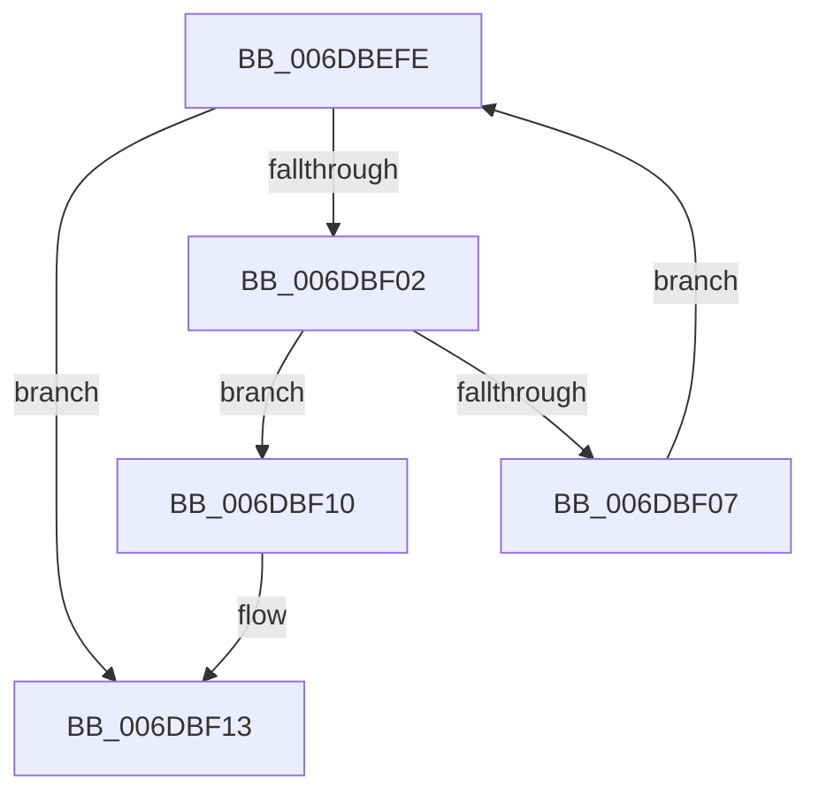

# sub_006DBEFE

- RVA: `0x006DBEFE`–`0x006DBF27` (길이 `41` bytes)
- VA: `0x00000001406DBEFE`
- 실행 섹션: `.text`
- PDB 이름 있음: `아니요`; PDB Function 태그: `아니요`
- unwind 정보 RVA: `0x0006DDE8`
- 디코드: `13`개 명령, `41/41` bytes 표시
- 미해석 바이트: `0` (있으면 어셈블리에 `.byte`로 보존)

> 이 문서는 커널 이미지의 기계어와 PDB 기호를 분석해 생성했습니다. 4번과 5번은 함수 원형과 자료형을 바이너리 사용 방식에서 추정한 C 해석이며 원본 소스 복구 결과는 아닙니다.

## 1. Dependencies

- 직접 호출 지점: **1**; 고유 호출 대상: **1**
- 직접 호출자로 확인된 함수: **0**
- RIP 상대 이미지 참조: **0**

### Outgoing calls
- `0x006DBF16` → [ExReleaseSpinLockSharedFromDpcLevel](../24/ExReleaseSpinLockSharedFromDpcLevel_function_0024A590.md) (function, `0x0024A590`)

### Direct callers
- 이 함수 시작 RVA로 연결되는 직접 call은 확인되지 않았습니다. 간접 호출은 완전히 역산할 수 없습니다.

### Static image references
- 디코드된 RIP-relative 메모리 참조가 없습니다.

## 2. Other-region calls and transfers

- 다른 실행 섹션으로 향하는 call: **0**
- call이 아닌 외부 분기/꼬리 이동: **1**
  - `0x006DBF22` → [MiDoesControlAreaHaveUserWritableReferences + 0x4B](../2B/MiDoesControlAreaHaveUserWritableReferences_function_002BB830.md) (`tail-transfer`)

## 3. Assembly (complete function range)

```asm
006DBEFE  3B F1                           cmp esi, ecx
006DBF00  73 11                           jae 0x1406dbf13
006DBF02  48 39 28                        cmp qword ptr [rax], rbp
006DBF05  74 09                           je 0x1406dbf10
006DBF07  48 83 C0 60                     add rax, 0x60
006DBF0B  41 03 F4                        add esi, r12d
006DBF0E  EB EE                           jmp 0x1406dbefe
006DBF10  49 2B FC                        sub rdi, r12
006DBF13  49 8B CF                        mov rcx, r15
006DBF16  E8 75 E6 B6 FF                  call 0x14024a590
006DBF1B  49 3B FC                        cmp rdi, r12
006DBF1E  41 0F 47 DC                     cmova ebx, r12d
006DBF22  E9 54 F9 BD FF                  jmp 0x1402bb87b
```

## 4. C-style interpretation (structured pseudocode)

```c
__int64 __fastcall sub_006DBEFE(int a1)
{
    __int64 result;
    __int64 v_rbx;
    __int64 v_rdi;
    __int64 v_rsi;

    if (((unsigned int)(v_rsi)) >= a1) goto loc_006DBF13;
    if ((*(unsigned __int64 *)(result)) == v_rbp) goto loc_006DBF10;
    result = (result) + (96);
    v_rsi = (unsigned int)((v_rsi) + ((unsigned int)(v_r12)));
    goto loc_006DBEFE;
loc_006DBF10:
    v_rdi = (v_rdi) - (v_r12);
loc_006DBF13:
    result = ExReleaseSpinLockSharedFromDpcLevel(v_r15, a2, a3, a4);
    if (v_rdi > v_r12) { v_rbx = (unsigned int)(v_r12); }
}
```

## 5. (Beta) C Style

```c
int64_t sub_006DBEFE(int32_t Arg1)
{
    int64_t result;
    int64_t local_rbx;
    int64_t local_rdi;
    int64_t local_rsi;

    if (((uint32_t)(local_rsi)) >= Arg1) goto loc_006DBF13;
    if ((*(uint64_t *)(result)) == local_rbp) goto loc_006DBF10;
    result = (result) + (96);
    local_rsi = (uint32_t)((local_rsi) + ((uint32_t)(local_r12)));
    goto loc_006DBEFE;
loc_006DBF10:
    local_rdi = (local_rdi) - (local_r12);
loc_006DBF13:
    result = ExReleaseSpinLockSharedFromDpcLevel(local_r15, a2, a3, a4);
    if (local_rdi > local_r12) { local_rbx = (uint32_t)(local_r12); }
}
```

## 6. Execution-region graph

[열기: 2D/3D 그래프와 함수 탐색 컨트롤 패널](../../../control-panel.html?section=text&rva=0x006DBEFE&view=graph)

- 2D 그래프는 위에서 아래로 흐르고, 3D 그래프는 빈 공간을 드래그해 회전합니다. Shift+드래그는 이동, 휠은 확대·축소, 함수 노드 선택은 대상 보고서 이동입니다.

### Static fallback


