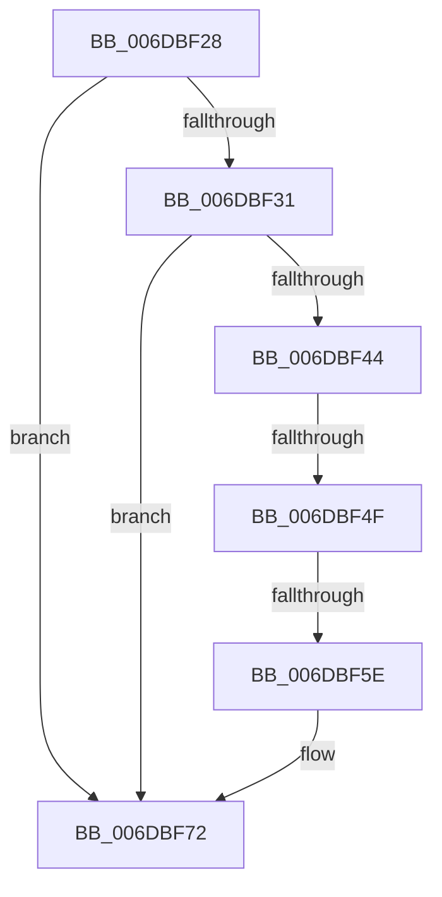

# sub_006DBF28

- RVA: `0x006DBF28`–`0x006DBF86` (길이 `94` bytes)
- VA: `0x00000001406DBF28`
- 실행 섹션: `.text`
- PDB 이름 있음: `아니요`; PDB Function 태그: `아니요`
- unwind 정보 RVA: `0x0006E170`
- 디코드: `26`개 명령, `94/94` bytes 표시
- 미해석 바이트: `0` (있으면 어셈블리에 `.byte`로 보존)

> 이 문서는 커널 이미지의 기계어와 PDB 기호를 분석해 생성했습니다. 4번과 5번은 함수 원형과 자료형을 바이너리 사용 방식에서 추정한 C 해석이며 원본 소스 복구 결과는 아닙니다.

## 1. Dependencies

- 직접 호출 지점: **3**; 고유 호출 대상: **2**
- 직접 호출자로 확인된 함수: **0**
- RIP 상대 이미지 참조: **0**

### Outgoing calls
- `0x006DBF3B` → [guard_dispatch_icall](../6B/guard_dispatch_icall_function_006BAAD0.md) (function, `0x006BAAD0`)
- `0x006DBF6C` → [PopFxBugCheck](../2B/PopFxBugCheck_function_002BFC6C.md) (function, `0x002BFC6C`)
- `0x006DBF80` → [PopFxBugCheck](../2B/PopFxBugCheck_function_002BFC6C.md) (function, `0x002BFC6C`)

### Direct callers
- 이 함수 시작 RVA로 연결되는 직접 call은 확인되지 않았습니다. 간접 호출은 완전히 역산할 수 없습니다.

### Static image references
- 디코드된 RIP-relative 메모리 참조가 없습니다.

## 2. Other-region calls and transfers

- 다른 실행 섹션으로 향하는 call: **0**
- call이 아닌 외부 분기/꼬리 이동: **2**
  - `0x006DBF49` → [PopFxDispatchPluginWorkOnce + 0xF6](../2B/PopFxDispatchPluginWorkOnce_function_002BC69C.md) (`tail-transfer`)
  - `0x006DBF58` → [PopFxDispatchPluginWorkOnce + 0x11A](../2B/PopFxDispatchPluginWorkOnce_function_002BC69C.md) (`tail-transfer`)

## 3. Assembly (complete function range)

```asm
006DBF28  48 8B 43 70                     mov rax, qword ptr [rbx + 0x70]
006DBF2C  48 85 C0                        test rax, rax
006DBF2F  74 41                           je 0x1406dbf72
006DBF31  48 8D 54 24 20                  lea rdx, [rsp + 0x20]
006DBF36  B9 0A 00 00 00                  mov ecx, 0xa
006DBF3B  E8 90 EB FD FF                  call 0x1406baad0
006DBF40  84 C0                           test al, al
006DBF42  74 2E                           je 0x1406dbf72
006DBF44  40 38 74 24 28                  cmp byte ptr [rsp + 0x28], sil
006DBF49  0F 84 43 08 BE FF               je 0x1402bc792
006DBF4F  8B 45 20                        mov eax, dword ptr [rbp + 0x20]
006DBF52  83 C0 F9                        add eax, -7
006DBF55  83 F8 01                        cmp eax, 1
006DBF58  0F 86 58 08 BE FF               jbe 0x1402bc7b6
006DBF5E  45 33 C9                        xor r9d, r9d
006DBF61  45 33 C0                        xor r8d, r8d
006DBF64  48 8B D3                        mov rdx, rbx
006DBF67  B9 12 06 00 00                  mov ecx, 0x612
006DBF6C  E8 FB 3C BE FF                  call 0x1402bfc6c
006DBF71  CC                              int3
006DBF72  45 33 C9                        xor r9d, r9d
006DBF75  4C 8B C3                        mov r8, rbx
006DBF78  48 8B D7                        mov rdx, rdi
006DBF7B  B9 05 06 00 00                  mov ecx, 0x605
006DBF80  E8 E7 3C BE FF                  call 0x1402bfc6c
006DBF85  CC                              int3
```

## 4. C-style interpretation (structured pseudocode)

```c
__int64 __fastcall sub_006DBF28(__int64 a1, __int64 a2, int a3, int a4, unsigned __int8 a5)
{
    __int64 result;
    unsigned __int64 v_stack_p20;

    if (*(unsigned __int64 *)(v_rbx + 112) == 0) goto loc_006DBF72;
    result = guard_dispatch_icall(10, v_stack_p20, a3, a4);
    if ((unsigned __int8)(result) == 0) goto loc_006DBF72;
    result = (unsigned int)(((unsigned int)(*(unsigned int *)(v_rbp + 32))) + (-7));
    a4 = 0;
    a3 = 0;
    result = PopFxBugCheck((unsigned int)(0x612ULL), v_rbx, a3, a4);
loc_006DBF72:
    a4 = 0;
    result = PopFxBugCheck((unsigned int)(0x605ULL), v_rdi, v_rbx, a4);
    return result;
}
```

## 5. (Beta) C Style

```c
int64_t sub_006DBF28(int64_t Arg1, int64_t Arg2, int32_t Arg3, int32_t Arg4, uint8_t Arg5)
{
    int64_t result;
    uint64_t v_stack_p20;

    if (*(uint64_t *)(local_rbx + 0x70) == 0) goto loc_006DBF72;
    result = guard_dispatch_icall(10, v_stack_p20, Arg3, Arg4);
    if ((uint8_t)(result) == 0) goto loc_006DBF72;
    result = (uint32_t)(((uint32_t)(*(uint32_t *)(local_rbp + 0x20))) + (-7));
    Arg4 = 0;
    Arg3 = 0;
    result = PopFxBugCheck((uint32_t)(0x612ULL), local_rbx, Arg3, Arg4);
loc_006DBF72:
    Arg4 = 0;
    result = PopFxBugCheck((uint32_t)(0x605ULL), local_rdi, local_rbx, Arg4);
    return result;
}
```

## 6. Execution-region graph

[열기: 2D/3D 그래프와 함수 탐색 컨트롤 패널](../../../control-panel.html?section=text&rva=0x006DBF28&view=graph)

- 2D 그래프는 위에서 아래로 흐르고, 3D 그래프는 빈 공간을 드래그해 회전합니다. Shift+드래그는 이동, 휠은 확대·축소, 함수 노드 선택은 대상 보고서 이동입니다.

### Static fallback


