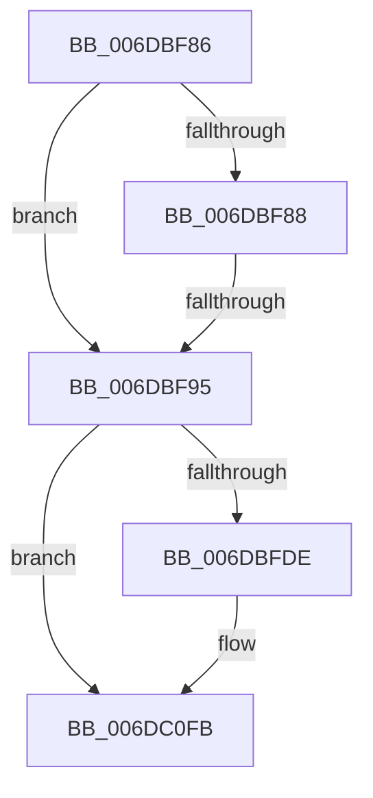

# sub_006DBF86

- RVA: `0x006DBF86`–`0x006DC118` (길이 `402` bytes)
- VA: `0x00000001406DBF86`
- 실행 섹션: `.text`
- PDB 이름 있음: `아니요`; PDB Function 태그: `아니요`
- unwind 정보 RVA: `0x0006E2BC`
- 디코드: `80`개 명령, `402/402` bytes 표시
- 미해석 바이트: `0` (있으면 어셈블리에 `.byte`로 보존)

> 이 문서는 커널 이미지의 기계어와 PDB 기호를 분석해 생성했습니다. 4번과 5번은 함수 원형과 자료형을 바이너리 사용 방식에서 추정한 C 해석이며 원본 소스 복구 결과는 아닙니다.

## 1. Dependencies

- 직접 호출 지점: **6**; 고유 호출 대상: **6**
- 직접 호출자로 확인된 함수: **0**
- RIP 상대 이미지 참조: **4**

### Outgoing calls
- `0x006DBFA5` → [KeAcquireSpinLockRaiseToDpc](../20/KeAcquireSpinLockRaiseToDpc_function_00208470.md) (function, `0x00208470`)
- `0x006DBFC1` → [PopPlCalculateDevicePowerDraw](../5D/PopPlCalculateDevicePowerDraw_function_005DD934.md) (function, `0x005DD934`)
- `0x006DC02C` → [tlgCreate1Sz_char](../42/tlgCreate1Sz_char_function_00427304.md) (function, `0x00427304`)
- `0x006DC0F6` → [tlgWriteEx_EtwWriteEx](../4A/tlgWriteEx_EtwWriteEx_function_004AA348.md) (function, `0x004AA348`)
- `0x006DC101` → [PopPlPublishSystemPowerChange](../5D/PopPlPublishSystemPowerChange_function_005DDD0C.md) (function, `0x005DDD0C`)
- `0x006DC10D` → [KeReleaseSpinLock](../39/KeReleaseSpinLock_function_00392BA0.md) (function, `0x00392BA0`)

### Direct callers
- 이 함수 시작 RVA로 연결되는 직접 call은 확인되지 않았습니다. 간접 호출은 완전히 역산할 수 없습니다.

### Static image references
- `0x006DBFD1` → RVA `0x00E07748` (`.data`; read)
- `0x006DBFEF` → RVA `0x006CC510` (` ?? ::FNODOBFM::`string'`; read)
- `0x006DC00D` → RVA `0x006CC490` (` ?? ::FNODOBFM::`string'`; read)
- `0x006DC03E` → RVA `0x000508DD` (`.rdata`; read)

## 2. Other-region calls and transfers

- 다른 실행 섹션으로 향하는 call: **0**
- call이 아닌 외부 분기/꼬리 이동: **2**
  - `0x006DBF8F` → [PopPlNotifyDeviceFState + 0x50](../2B/PopPlNotifyDeviceFState_function_002BE034.md) (`tail-transfer`)
  - `0x006DC113` → [PopPlNotifyDeviceFState + 0x50](../2B/PopPlNotifyDeviceFState_function_002BE034.md) (`tail-transfer`)

## 3. Assembly (complete function range)

```asm
006DBF86  73 0D                           jae 0x1406dbf95
006DBF88  80 BD A0 00 00 00 00            cmp byte ptr [rbp + 0xa0], 0
006DBF8F  0F 85 EF 20 BE FF               jne 0x1402be084
006DBF95  4C 8B A1 C8 04 00 00            mov r12, qword ptr [rcx + 0x4c8]
006DBF9C  49 8B 74 24 10                  mov rsi, qword ptr [r12 + 0x10]
006DBFA1  48 8D 4E 10                     lea rcx, [rsi + 0x10]
006DBFA5  E8 C6 C4 B2 FF                  call 0x140208470
006DBFAA  88 46 18                        mov byte ptr [rsi + 0x18], al
006DBFAD  4C 8D 4C 24 40                  lea r9, [rsp + 0x40]
006DBFB2  41 8B 5C 24 20                  mov ebx, dword ptr [r12 + 0x20]
006DBFB7  4C 8D 44 24 48                  lea r8, [rsp + 0x48]
006DBFBC  33 D2                           xor edx, edx
006DBFBE  49 8B CD                        mov rcx, r13
006DBFC1  E8 6E 19 F0 FF                  call 0x1405dd934
006DBFC6  44 8B F8                        mov r15d, eax
006DBFC9  41 89 44 24 20                  mov dword ptr [r12 + 0x20], eax
006DBFCE  44 2B FB                        sub r15d, ebx
006DBFD1  83 3D 70 B7 72 00 05            cmp dword ptr [rip + 0x72b770], 5
006DBFD8  0F 86 1D 01 00 00               jbe 0x1406dc0fb
006DBFDE  48 8D 44 24 40                  lea rax, [rsp + 0x40]
006DBFE3  48 C7 45 98 02 00 00 00         mov qword ptr [rbp - 0x68], 2
006DBFEB  48 89 45 90                     mov qword ptr [rbp - 0x70], rax
006DBFEF  48 8D 15 1A 05 FF FF            lea rdx, [rip - 0xfae6]
006DBFF6  48 8B 44 24 60                  mov rax, qword ptr [rsp + 0x60]
006DBFFB  48 8D 4D B0                     lea rcx, [rbp - 0x50]
006DBFFF  48 89 45 A0                     mov qword ptr [rbp - 0x60], rax
006DC003  45 33 D2                        xor r10d, r10d
006DC006  44 38 95 A0 00 00 00            cmp byte ptr [rbp + 0xa0], r10b
006DC00D  48 8D 05 7C 04 FF FF            lea rax, [rip - 0xfb84]
006DC014  41 B9 01 00 00 00               mov r9d, 1
006DC01A  48 C7 45 A8 10 00 00 00         mov qword ptr [rbp - 0x58], 0x10
006DC022  48 0F 45 D0                     cmovne rdx, rax
006DC026  66 44 89 4C 24 40               mov word ptr [rsp + 0x40], r9w
006DC02C  E8 D3 B2 D4 FF                  call 0x140427304
006DC031  48 8D 44 24 48                  lea rax, [rsp + 0x48]
006DC036  89 7C 24 48                     mov dword ptr [rsp + 0x48], edi
006DC03A  48 89 45 C0                     mov qword ptr [rbp - 0x40], rax
006DC03E  48 8D 15 98 48 97 FF            lea rdx, [rip - 0x68b768]
006DC045  48 8D 44 24 50                  lea rax, [rsp + 0x50]
006DC04A  48 C7 45 C8 04 00 00 00         mov qword ptr [rbp - 0x38], 4
006DC052  48 89 45 D0                     mov qword ptr [rbp - 0x30], rax
006DC056  41 8B 44 24 20                  mov eax, dword ptr [r12 + 0x20]
006DC05B  89 44 24 54                     mov dword ptr [rsp + 0x54], eax
006DC05F  48 8D 44 24 54                  lea rax, [rsp + 0x54]
006DC064  48 89 45 E0                     mov qword ptr [rbp - 0x20], rax
006DC068  48 8D 44 24 58                  lea rax, [rsp + 0x58]
006DC06D  48 89 45 F0                     mov qword ptr [rbp - 0x10], rax
006DC071  49 8B 44 24 10                  mov rax, qword ptr [r12 + 0x10]
006DC076  44 89 7C 24 50                  mov dword ptr [rsp + 0x50], r15d
006DC07B  48 C7 45 D8 04 00 00 00         mov qword ptr [rbp - 0x28], 4
006DC083  48 C7 45 E8 04 00 00 00         mov qword ptr [rbp - 0x18], 4
006DC08B  44 89 7C 24 58                  mov dword ptr [rsp + 0x58], r15d
006DC090  48 C7 45 F8 04 00 00 00         mov qword ptr [rbp - 8], 4
006DC098  8B 48 1C                        mov ecx, dword ptr [rax + 0x1c]
006DC09B  48 8D 44 24 60                  lea rax, [rsp + 0x60]
006DC0A0  48 89 45 00                     mov qword ptr [rbp], rax
006DC0A4  41 03 CF                        add ecx, r15d
006DC0A7  48 8D 45 28                     lea rax, [rbp + 0x28]
006DC0AB  89 4C 24 60                     mov dword ptr [rsp + 0x60], ecx
006DC0AF  48 89 45 10                     mov qword ptr [rbp + 0x10], rax
006DC0B3  48 8D 0D 8E B6 72 00            lea rcx, [rip + 0x72b68e]
006DC0BA  49 8B 85 E0 00 00 00            mov rax, qword ptr [r13 + 0xe0]
006DC0C1  48 89 45 20                     mov qword ptr [rbp + 0x20], rax
006DC0C5  41 0F B7 85 D8 00 00 00         movzx eax, word ptr [r13 + 0xd8]
006DC0CD  89 45 28                        mov dword ptr [rbp + 0x28], eax
006DC0D0  48 8D 44 24 70                  lea rax, [rsp + 0x70]
006DC0D5  48 89 44 24 38                  mov qword ptr [rsp + 0x38], rax
006DC0DA  C7 44 24 30 0C 00 00 00         mov dword ptr [rsp + 0x30], 0xc
006DC0E2  48 C7 45 08 04 00 00 00         mov qword ptr [rbp + 8], 4
006DC0EA  48 C7 45 18 02 00 00 00         mov qword ptr [rbp + 0x18], 2
006DC0F2  44 89 55 2C                     mov dword ptr [rbp + 0x2c], r10d
006DC0F6  E8 4D E2 DC FF                  call 0x1404aa348
006DC0FB  41 8B D7                        mov edx, r15d
006DC0FE  48 8B CE                        mov rcx, rsi
006DC101  E8 06 1C F0 FF                  call 0x1405ddd0c
006DC106  8A 56 18                        mov dl, byte ptr [rsi + 0x18]
006DC109  48 8D 4E 10                     lea rcx, [rsi + 0x10]
006DC10D  E8 8E 6A CB FF                  call 0x140392ba0
006DC112  90                              nop
006DC113  E9 6C 1F BE FF                  jmp 0x1402be084
```

## 4. C-style interpretation (structured pseudocode)

```c
__int64 __fastcall sub_006DBF86(__int64 a1, int a2, __int64 a3, __int64 a4, __int64 a5, __int64 a6, __int64 a7, __int64 a8, __int64 a9, __int64 a10, __int64 a11, __int64 a12, __int64 a13, __int64 a14)
{
    __int64 result;
    __int64 v_r10;
    __int64 v_r15;
    unsigned int v_stack_p30;
    unsigned __int64 v_stack_p38;
    unsigned __int16 v_stack_p40;
    unsigned int v_stack_p48;
    unsigned int v_stack_p50;
    unsigned int v_stack_p54;
    unsigned int v_stack_p58;
    unsigned int v_stack_p60;

    if (condition_is_above_or_equal) goto loc_006DBF95;
loc_006DBF95:
    result = KeAcquireSpinLockRaiseToDpc(*(unsigned __int64 *)(*(unsigned __int64 *)(a1 + 1224) + 16) + 16, a2, a3, a4);
    *(unsigned __int8 *)(*(unsigned __int64 *)(*(unsigned __int64 *)(a1 + 1224) + 16) + 24) = (unsigned __int8)(result);
    a2 = 0;
    result = PopPlCalculateDevicePowerDraw(v_r13, a2, a9, a8);
    *(unsigned int *)(*(unsigned __int64 *)(a1 + 1224) + 32) = (unsigned int)(result);
    v_r15 = (unsigned int)(((unsigned int)((unsigned int)(result))) - ((unsigned int)((unsigned int)(*(unsigned int *)(*(unsigned __int64 *)(a1 + 1224) + 32)))));
    if ((*(unsigned int *)(v_rip + 7518064)) >= = 5) {
        result = a8;
        *(unsigned __int64 *)(v_rbp - 104) = 2;
        *(unsigned __int64 *)(v_rbp - 112) = result;
        a2 = v_rip - 64230;
        result = a12;
        a1 = v_rbp - 80;
        *(unsigned __int64 *)(v_rbp - 96) = result;
        v_r10 = 0;
        result = v_rip - 64388;
        a4 = 1;
        *(unsigned __int64 *)(v_rbp - 88) = 16;
        if ((*(unsigned __int8 *)(v_rbp + 160)) != 0) { a2 = result; }
        v_stack_p40 = (unsigned __int16)(a4);
        result = tlgCreate1Sz_char(a1, a2, a9, a4);
        result = a9;
        v_stack_p48 = (unsigned int)(v_rdi);
        *(unsigned __int64 *)(v_rbp - 64) = result;
        a2 = v_rip - 6862696;
        result = a10;
        *(unsigned __int64 *)(v_rbp - 56) = 4;
        *(unsigned __int64 *)(v_rbp - 48) = result;
        result = *(unsigned int *)(*(unsigned __int64 *)(a1 + 1224) + 32);
        v_stack_p54 = (unsigned int)(result);
        result = v_stack_p54;
        *(unsigned __int64 *)(v_rbp - 32) = result;
        result = a11;
        *(unsigned __int64 *)(v_rbp - 16) = result;
        result = *(unsigned __int64 *)(*(unsigned __int64 *)(a1 + 1224) + 16);
        v_stack_p50 = (unsigned int)(v_r15);
        *(unsigned __int64 *)(v_rbp - 40) = 4;
        *(unsigned __int64 *)(v_rbp - 24) = 4;
        v_stack_p58 = (unsigned int)(v_r15);
        *(unsigned __int64 *)(v_rbp - 8) = 4;
        a1 = *(unsigned int *)(result + 28);
        result = a12;
        *(unsigned __int64 *)(v_rbp) = result;
        a1 = (unsigned int)((a1) + ((unsigned int)(v_r15)));
        result = v_rbp + 40;
        v_stack_p60 = (unsigned int)(a1);
        *(unsigned __int64 *)(v_rbp + 16) = result;
        a1 = v_rip + 7517838;
        result = *(unsigned __int64 *)(v_r13 + 224);
        *(unsigned __int64 *)(v_rbp + 32) = result;
        result = *(unsigned __int16 *)(v_r13 + 216);
        *(unsigned int *)(v_rbp + 40) = (unsigned int)(result);
        result = a14;
        v_stack_p38 = result;
        v_stack_p30 = 12;
        *(unsigned __int64 *)(v_rbp + 8) = 4;
        *(unsigned __int64 *)(v_rbp + 24) = 2;
        *(unsigned int *)(v_rbp + 44) = 0;
        result = tlgWriteEx_EtwWriteEx(a1, a2, a9, a4);
    }
    result = PopPlPublishSystemPowerChange(*(unsigned __int64 *)(*(unsigned __int64 *)(a1 + 1224) + 16), (unsigned int)((unsigned int)(v_r15)), a9, a4);
    result = KeReleaseSpinLock(*(unsigned __int64 *)(*(unsigned __int64 *)(a1 + 1224) + 16) + 16, *(unsigned __int8 *)(*(unsigned __int64 *)(*(unsigned __int64 *)(a1 + 1224) + 16) + 24), a9, a4);
}
```

## 5. (Beta) C Style

```c
int64_t sub_006DBF86(void *Arg1, int32_t Arg2, int64_t Arg3, int64_t Arg4, uint64_t Arg5, uint64_t Arg6, uint64_t Arg7, int64_t Arg8, int64_t Arg9, int64_t Arg10, int64_t Arg11, int64_t Arg12, uint64_t Arg13, int64_t Arg14)
{
    uint8_t *arg1 = (uint8_t *)Arg1;

    int64_t result;
    int64_t local_r10;
    int64_t local_r15;
    uint32_t v_stack_p30;
    uint64_t v_stack_p38;
    uint16_t v_stack_p40;
    uint32_t v_stack_p48;
    uint32_t v_stack_p50;
    uint32_t v_stack_p54;
    uint32_t v_stack_p58;
    uint32_t v_stack_p60;

    if (condition_is_above_or_equal) goto loc_006DBF95;
loc_006DBF95:
    result = KeAcquireSpinLockRaiseToDpc(*(uint64_t *)(*(uint64_t *)(arg1 + 0x4C8) + 0x10) + 16, Arg2, Arg3, Arg4);
    *(uint8_t *)(*(uint64_t *)(*(uint64_t *)(arg1 + 0x4C8) + 0x10) + 0x18) = (uint8_t)(result);
    Arg2 = 0;
    result = PopPlCalculateDevicePowerDraw(local_r13, Arg2, Arg9, Arg8);
    *(uint32_t *)(*(uint64_t *)(arg1 + 0x4C8) + 0x20) = (uint32_t)(result);
    local_r15 = (uint32_t)(((uint32_t)((uint32_t)(result))) - ((uint32_t)((uint32_t)(*(uint32_t *)(*(uint64_t *)(arg1 + 0x4C8) + 0x20)))));
    if ((*(uint32_t *)(v_rip + 0x72B770)) >= = 5) {
        result = Arg8;
        *(uint64_t *)(local_rbp - 0x68) = 2;
        *(uint64_t *)(local_rbp - 0x70) = result;
        Arg2 = v_rip - 64230;
        result = Arg12;
        Arg1 = local_rbp - 80;
        *(uint64_t *)(local_rbp - 0x60) = result;
        local_r10 = 0;
        result = v_rip - 64388;
        Arg4 = 1;
        *(uint64_t *)(local_rbp - 0x58) = 16;
        if ((*(uint8_t *)(local_rbp + 0xA0)) != 0) { Arg2 = result; }
        v_stack_p40 = (uint16_t)(Arg4);
        result = tlgCreate1Sz_char(Arg1, Arg2, Arg9, Arg4);
        result = Arg9;
        v_stack_p48 = (uint32_t)(local_rdi);
        *(uint64_t *)(local_rbp - 0x40) = result;
        Arg2 = v_rip - 6862696;
        result = Arg10;
        *(uint64_t *)(local_rbp - 0x38) = 4;
        *(uint64_t *)(local_rbp - 0x30) = result;
        result = *(uint32_t *)(*(uint64_t *)(arg1 + 0x4C8) + 0x20);
        v_stack_p54 = (uint32_t)(result);
        result = v_stack_p54;
        *(uint64_t *)(local_rbp - 0x20) = result;
        result = Arg11;
        *(uint64_t *)(local_rbp - 0x10) = result;
        result = *(uint64_t *)(*(uint64_t *)(arg1 + 0x4C8) + 0x10);
        v_stack_p50 = (uint32_t)(local_r15);
        *(uint64_t *)(local_rbp - 0x28) = 4;
        *(uint64_t *)(local_rbp - 0x18) = 4;
        v_stack_p58 = (uint32_t)(local_r15);
        *(uint64_t *)(local_rbp - 0x8) = 4;
        Arg1 = *(uint32_t *)(result + 0x1C);
        result = Arg12;
        *(uint64_t *)(local_rbp) = result;
        Arg1 = (uint32_t)((Arg1) + ((uint32_t)(local_r15)));
        result = local_rbp + 40;
        v_stack_p60 = (uint32_t)(Arg1);
        *(uint64_t *)(local_rbp + 0x10) = result;
        Arg1 = v_rip + 7517838;
        result = *(uint64_t *)(local_r13 + 0xE0);
        *(uint64_t *)(local_rbp + 0x20) = result;
        result = *(uint16_t *)(local_r13 + 0xD8);
        *(uint32_t *)(local_rbp + 0x28) = (uint32_t)(result);
        result = Arg14;
        v_stack_p38 = result;
        v_stack_p30 = 12;
        *(uint64_t *)(local_rbp + 0x8) = 4;
        *(uint64_t *)(local_rbp + 0x18) = 2;
        *(uint32_t *)(local_rbp + 0x2C) = 0;
        result = tlgWriteEx_EtwWriteEx(Arg1, Arg2, Arg9, Arg4);
    }
    result = PopPlPublishSystemPowerChange(*(uint64_t *)(*(uint64_t *)(arg1 + 0x4C8) + 0x10), (uint32_t)((uint32_t)(local_r15)), Arg9, Arg4);
    result = KeReleaseSpinLock(*(uint64_t *)(*(uint64_t *)(arg1 + 0x4C8) + 0x10) + 16, *(uint8_t *)(*(uint64_t *)(*(uint64_t *)(arg1 + 0x4C8) + 0x10) + 0x18), Arg9, Arg4);
}
```

### 관측된 메모리 오프셋

구조체 형식이 확인되지 않은 접근은 인자 기준의 오프셋으로만 기록했습니다.

| 기준 인자 | 오프셋 표현 | 폭 (bit) | 접근 |
|---|---:|---:|---|
| `Arg1` | `+ 0x4C8` | `64` | `R` |

## 6. Execution-region graph

[열기: 2D/3D 그래프와 함수 탐색 컨트롤 패널](../../../control-panel.html?section=text&rva=0x006DBF86&view=graph)

- 2D 그래프는 위에서 아래로 흐르고, 3D 그래프는 빈 공간을 드래그해 회전합니다. Shift+드래그는 이동, 휠은 확대·축소, 함수 노드 선택은 대상 보고서 이동입니다.

### Static fallback


