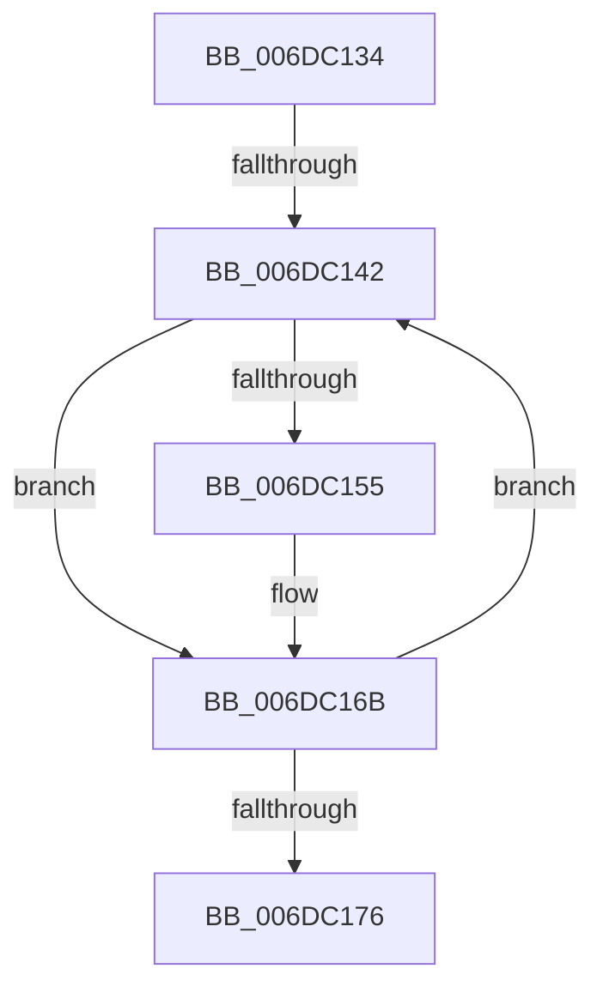

# sub_006DC134

- RVA: `0x006DC134`–`0x006DC17B` (길이 `71` bytes)
- VA: `0x00000001406DC134`
- 실행 섹션: `.text`
- PDB 이름 있음: `아니요`; PDB Function 태그: `아니요`
- unwind 정보 RVA: `0x0006E580`
- 디코드: `16`개 명령, `71/71` bytes 표시
- 미해석 바이트: `0` (있으면 어셈블리에 `.byte`로 보존)

> 이 문서는 커널 이미지의 기계어와 PDB 기호를 분석해 생성했습니다. 4번과 5번은 함수 원형과 자료형을 바이너리 사용 방식에서 추정한 C 해석이며 원본 소스 복구 결과는 아닙니다.

## 1. Dependencies

- 직접 호출 지점: **1**; 고유 호출 대상: **1**
- 직접 호출자로 확인된 함수: **0**
- RIP 상대 이미지 참조: **0**

### Outgoing calls
- `0x006DC166` → [PopFxUpdateComponentPerfStateNominalChange](../5D/PopFxUpdateComponentPerfStateNominalChange_function_005D3790.md) (function, `0x005D3790`)

### Direct callers
- 이 함수 시작 RVA로 연결되는 직접 call은 확인되지 않았습니다. 간접 호출은 완전히 역산할 수 없습니다.

### Static image references
- 디코드된 RIP-relative 메모리 참조가 없습니다.

## 2. Other-region calls and transfers

- 다른 실행 섹션으로 향하는 call: **0**
- call이 아닌 외부 분기/꼬리 이동: **2**
  - `0x006DC13C` → [PopPepDeviceDState + 0x144](../2B/PopPepDeviceDState_function_002BFE70.md) (`tail-transfer`)
  - `0x006DC176` → [PopPepDeviceDState + 0x144](../2B/PopPepDeviceDState_function_002BFE70.md) (`tail-transfer`)

## 3. Assembly (complete function range)

```asm
006DC134  8B DD                           mov ebx, ebp
006DC136  39 AE B4 00 00 00               cmp dword ptr [rsi + 0xb4], ebp
006DC13C  0F 86 72 3E BE FF               jbe 0x1402bffb4
006DC142  8B C3                           mov eax, ebx
006DC144  48 69 D0 D0 00 00 00            imul rdx, rax, 0xd0
006DC14B  40 38 AC 32 78 01 00 00         cmp byte ptr [rdx + rsi + 0x178], bpl
006DC153  74 16                           je 0x1406dc16b
006DC155  8B 94 32 C8 00 00 00            mov edx, dword ptr [rdx + rsi + 0xc8]
006DC15C  45 8B CE                        mov r9d, r14d
006DC15F  48 8B 4E 20                     mov rcx, qword ptr [rsi + 0x20]
006DC163  45 8A C7                        mov r8b, r15b
006DC166  E8 25 76 EF FF                  call 0x1405d3790
006DC16B  41 03 DF                        add ebx, r15d
006DC16E  3B 9E B4 00 00 00               cmp ebx, dword ptr [rsi + 0xb4]
006DC174  72 CC                           jb 0x1406dc142
006DC176  E9 39 3E BE FF                  jmp 0x1402bffb4
```

## 4. C-style interpretation (structured pseudocode)

```c
__int64 __fastcall sub_006DC134(void)
{
    __int64 result;
    __int64 v_rbx;

loc_006DC142:
    a2 = (a2) * ((unsigned int)((unsigned int)((unsigned int)((unsigned int)(v_rbp)))));
    result = (unsigned int)((unsigned int)((unsigned int)((unsigned int)(v_rbp))));
    if ((*(unsigned __int8 *)(a2 + v_rsi * 1 + 376)) != ((unsigned __int8)(v_rbp))) {
        a2 = *(unsigned int *)(a2 + v_rsi * 1 + 200);
        a4 = (unsigned int)(v_r14);
        a1 = *(unsigned __int64 *)(v_rsi + 32);
        a3 = (unsigned __int8)(v_r15);
        result = PopFxUpdateComponentPerfStateNominalChange(a1, a2, a3, a4);
    }
    v_rbx = (unsigned int)(((unsigned int)((unsigned int)(v_rbp))) + ((unsigned int)(v_r15)));
    if (((unsigned int)(v_rbx)) < (*(unsigned int *)(v_rsi + 180))) goto loc_006DC142;
}
```

## 5. (Beta) C Style

```c
void sub_006DC134(void)
{
    int64_t result;
    int64_t local_rbx;

loc_006DC142:
    a2 = (a2) * ((uint32_t)((uint32_t)((uint32_t)((uint32_t)(local_rbp)))));
    result = (uint32_t)((uint32_t)((uint32_t)((uint32_t)(local_rbp))));
    if ((*(uint8_t *)(a2 + local_rsi * 1 + 0x178)) != ((uint8_t)(local_rbp))) {
        a2 = *(uint32_t *)(a2 + local_rsi * 1 + 0xC8);
        a4 = (uint32_t)(local_r14);
        a1 = *(uint64_t *)(local_rsi + 0x20);
        a3 = (uint8_t)(local_r15);
        result = PopFxUpdateComponentPerfStateNominalChange(a1, a2, a3, a4);
    }
    local_rbx = (uint32_t)(((uint32_t)((uint32_t)(local_rbp))) + ((uint32_t)(local_r15)));
    if (((uint32_t)(local_rbx)) < (*(uint32_t *)(local_rsi + 0xB4))) goto loc_006DC142;
}
```

## 6. Execution-region graph

[열기: 2D/3D 그래프와 함수 탐색 컨트롤 패널](../../../control-panel.html?section=text&rva=0x006DC134&view=graph)

- 2D 그래프는 위에서 아래로 흐르고, 3D 그래프는 빈 공간을 드래그해 회전합니다. Shift+드래그는 이동, 휠은 확대·축소, 함수 노드 선택은 대상 보고서 이동입니다.

### Static fallback


