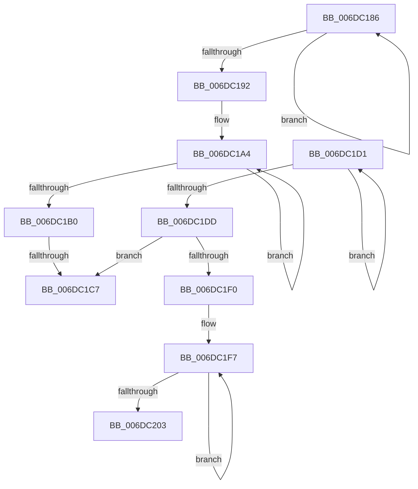

# sub_006DC186

- RVA: `0x006DC186`–`0x006DC208` (길이 `130` bytes)
- VA: `0x00000001406DC186`
- 실행 섹션: `.text`
- PDB 이름 있음: `아니요`; PDB Function 태그: `아니요`
- unwind 정보 RVA: `0x0006E648`
- 디코드: `40`개 명령, `130/130` bytes 표시
- 미해석 바이트: `0` (있으면 어셈블리에 `.byte`로 보존)

> 이 문서는 커널 이미지의 기계어와 PDB 기호를 분석해 생성했습니다. 4번과 5번은 함수 원형과 자료형을 바이너리 사용 방식에서 추정한 C 해석이며 원본 소스 복구 결과는 아닙니다.

## 1. Dependencies

- 직접 호출 지점: **0**; 고유 호출 대상: **0**
- 직접 호출자로 확인된 함수: **0**
- RIP 상대 이미지 참조: **0**

### Outgoing calls
- 직접 디코드된 call 명령이 없습니다.

### Direct callers
- 이 함수 시작 RVA로 연결되는 직접 call은 확인되지 않았습니다. 간접 호출은 완전히 역산할 수 없습니다.

### Static image references
- 디코드된 RIP-relative 메모리 참조가 없습니다.

## 2. Other-region calls and transfers

- 다른 실행 섹션으로 향하는 call: **0**
- call이 아닌 외부 분기/꼬리 이동: **3**
  - `0x006DC1C1` → [PopFxAllocatePowerIrp + 0x106](../2C/PopFxAllocatePowerIrp_function_002C0920.md) (`tail-transfer`)
  - `0x006DC1CC` → [PopFxAllocatePowerIrp + 0x180](../2C/PopFxAllocatePowerIrp_function_002C0920.md) (`tail-transfer`)
  - `0x006DC203` → [PopFxAllocatePowerIrp + 0x119](../2C/PopFxAllocatePowerIrp_function_002C0920.md) (`tail-transfer`)

## 3. Assembly (complete function range)

```asm
006DC186  8B C8                           mov ecx, eax
006DC188  41 0B C9                        or ecx, r9d
006DC18B  F0 0F B1 4F 20                  lock cmpxchg dword ptr [rdi + 0x20], ecx
006DC190  75 F4                           jne 0x1406dc186
006DC192  44 8B C0                        mov r8d, eax
006DC195  BA 00 01 00 00                  mov edx, 0x100
006DC19A  44 23 C2                        and r8d, edx
006DC19D  0F 0D 4F 20                     prefetchw byte ptr [rdi + 0x20]
006DC1A1  8B 47 20                        mov eax, dword ptr [rdi + 0x20]
006DC1A4  8B C8                           mov ecx, eax
006DC1A6  41 0B C9                        or ecx, r9d
006DC1A9  F0 0F B1 4F 20                  lock cmpxchg dword ptr [rdi + 0x20], ecx
006DC1AE  75 F4                           jne 0x1406dc1a4
006DC1B0  C1 E8 09                        shr eax, 9
006DC1B3  41 8B C9                        mov ecx, r9d
006DC1B6  83 E0 01                        and eax, 1
006DC1B9  45 85 C0                        test r8d, r8d
006DC1BC  0F 95 C1                        setne cl
006DC1BF  3B C8                           cmp ecx, eax
006DC1C1  0F 85 5F 48 BE FF               jne 0x1402c0a26
006DC1C7  BE 9A 00 00 C0                  mov esi, 0xc000009a
006DC1CC  E9 CF 48 BE FF                  jmp 0x1402c0aa0
006DC1D1  8B C8                           mov ecx, eax
006DC1D3  41 0B C9                        or ecx, r9d
006DC1D6  F0 0F B1 4F 20                  lock cmpxchg dword ptr [rdi + 0x20], ecx
006DC1DB  75 F4                           jne 0x1406dc1d1
006DC1DD  C1 E8 09                        shr eax, 9
006DC1E0  41 8B C9                        mov ecx, r9d
006DC1E3  83 E0 01                        and eax, 1
006DC1E6  45 85 C0                        test r8d, r8d
006DC1E9  0F 95 C1                        setne cl
006DC1EC  3B C8                           cmp ecx, eax
006DC1EE  74 D7                           je 0x1406dc1c7
006DC1F0  0F 0D 4F 20                     prefetchw byte ptr [rdi + 0x20]
006DC1F4  8B 47 20                        mov eax, dword ptr [rdi + 0x20]
006DC1F7  8B C8                           mov ecx, eax
006DC1F9  41 0B C9                        or ecx, r9d
006DC1FC  F0 0F B1 4F 20                  lock cmpxchg dword ptr [rdi + 0x20], ecx
006DC201  75 F4                           jne 0x1406dc1f7
006DC203  E9 31 48 BE FF                  jmp 0x1402c0a39
```

## 4. C-style interpretation (structured pseudocode)

```c
__int64 __fastcall sub_006DC186(__int64 a1, __int64 a2, __int64 a3, int a4)
{
    __int64 result;

    a1 = (unsigned int)(((unsigned int)((unsigned int)(result))) | (a4));
    if (condition_is_not_equal) goto loc_006DC186;
    a3 = (unsigned int)(((unsigned int)((unsigned int)(result))) & (256));
loc_006DC1A4:
    a1 = (unsigned int)(((unsigned int)((unsigned int)((unsigned int)(*(unsigned int *)(v_rdi + 32))))) | (a4));
    if (condition_is_not_equal) goto loc_006DC1A4;
    result = (unsigned int)(((unsigned int)(*(unsigned int *)(v_rdi + 32))) >> (9));
    result = (unsigned int)((result) & (1));
    a1 = ((unsigned int)(a3) != 0) ? 1 : 0;
loc_006DC1C7:
}
```

## 5. (Beta) C Style

```c
int64_t sub_006DC186(int64_t Arg1, int64_t Arg2, int64_t Arg3, int32_t Arg4)
{
    int64_t result;

    Arg1 = (uint32_t)(((uint32_t)((uint32_t)(result))) | (Arg4));
    if (condition_is_not_equal) goto loc_006DC186;
    Arg3 = (uint32_t)(((uint32_t)((uint32_t)(result))) & (256));
loc_006DC1A4:
    Arg1 = (uint32_t)(((uint32_t)((uint32_t)((uint32_t)(*(uint32_t *)(local_rdi + 0x20))))) | (Arg4));
    if (condition_is_not_equal) goto loc_006DC1A4;
    result = (uint32_t)(((uint32_t)(*(uint32_t *)(local_rdi + 0x20))) >> (9));
    result = (uint32_t)((result) & (1));
    Arg1 = ((uint32_t)(Arg3) != 0) ? 1 : 0;
loc_006DC1C7:
}
```

## 6. Execution-region graph

[열기: 2D/3D 그래프와 함수 탐색 컨트롤 패널](../../../control-panel.html?section=text&rva=0x006DC186&view=graph)

- 2D 그래프는 위에서 아래로 흐르고, 3D 그래프는 빈 공간을 드래그해 회전합니다. Shift+드래그는 이동, 휠은 확대·축소, 함수 노드 선택은 대상 보고서 이동입니다.

### Static fallback


