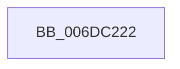

# sub_006DC222

- RVA: `0x006DC222`–`0x006DC396` (길이 `372` bytes)
- VA: `0x00000001406DC222`
- 실행 섹션: `.text`
- PDB 이름 있음: `아니요`; PDB Function 태그: `아니요`
- unwind 정보 RVA: `0x0006E8B8`
- 디코드: `71`개 명령, `372/372` bytes 표시
- 미해석 바이트: `0` (있으면 어셈블리에 `.byte`로 보존)

> 이 문서는 커널 이미지의 기계어와 PDB 기호를 분석해 생성했습니다. 4번과 5번은 함수 원형과 자료형을 바이너리 사용 방식에서 추정한 C 해석이며 원본 소스 복구 결과는 아닙니다.

## 1. Dependencies

- 직접 호출 지점: **2**; 고유 호출 대상: **2**
- 직접 호출자로 확인된 함수: **0**
- RIP 상대 이미지 참조: **1**

### Outgoing calls
- `0x006DC244` → [tlgCreate1Sz_char](../42/tlgCreate1Sz_char_function_00427304.md) (function, `0x00427304`)
- `0x006DC38B` → [tlgWriteEx_EtwWriteEx](../4A/tlgWriteEx_EtwWriteEx_function_004AA348.md) (function, `0x004AA348`)

### Direct callers
- 이 함수 시작 RVA로 연결되는 직접 call은 확인되지 않았습니다. 간접 호출은 완전히 역산할 수 없습니다.

### Static image references
- `0x006DC257` → RVA `0x0005815D` (`.rdata`; read)

## 2. Other-region calls and transfers

- 다른 실행 섹션으로 향하는 call: **0**
- call이 아닌 외부 분기/꼬리 이동: **1**
  - `0x006DC391` → [MiLogWsAging + 0x76](../2C/MiLogWsAging_function_002C244C.md) (`tail-transfer`)

## 3. Assembly (complete function range)

```asm
006DC222  41 8B 81 B8 00 00 00            mov eax, dword ptr [r9 + 0xb8]
006DC229  48 8D 4D C0                     lea rcx, [rbp - 0x40]
006DC22D  24 0F                           and al, 0xf
006DC22F  48 C7 45 B8 01 00 00 00         mov qword ptr [rbp - 0x48], 1
006DC237  88 44 24 40                     mov byte ptr [rsp + 0x40], al
006DC23B  48 8D 44 24 40                  lea rax, [rsp + 0x40]
006DC240  48 89 45 B0                     mov qword ptr [rbp - 0x50], rax
006DC244  E8 BB B0 D4 FF                  call 0x140427304
006DC249  48 8D 44 24 44                  lea rax, [rsp + 0x44]
006DC24E  44 89 54 24 44                  mov dword ptr [rsp + 0x44], r10d
006DC253  48 89 45 D0                     mov qword ptr [rbp - 0x30], rax
006DC257  48 8D 15 FF BE 97 FF            lea rdx, [rip - 0x684101]
006DC25E  48 8D 44 24 58                  lea rax, [rsp + 0x58]
006DC263  48 C7 45 D8 04 00 00 00         mov qword ptr [rbp - 0x28], 4
006DC26B  48 89 45 E0                     mov qword ptr [rbp - 0x20], rax
006DC26F  49 8B C8                        mov rcx, r8
006DC272  48 8D 44 24 60                  lea rax, [rsp + 0x60]
006DC277  48 89 7C 24 58                  mov qword ptr [rsp + 0x58], rdi
006DC27C  48 89 45 F0                     mov qword ptr [rbp - 0x10], rax
006DC280  49 8B 43 28                     mov rax, qword ptr [r11 + 0x28]
006DC284  48 89 44 24 68                  mov qword ptr [rsp + 0x68], rax
006DC289  48 8D 44 24 68                  lea rax, [rsp + 0x68]
006DC28E  48 89 45 00                     mov qword ptr [rbp], rax
006DC292  49 8B 43 10                     mov rax, qword ptr [r11 + 0x10]
006DC296  48 89 44 24 70                  mov qword ptr [rsp + 0x70], rax
006DC29B  48 8D 44 24 70                  lea rax, [rsp + 0x70]
006DC2A0  48 89 45 10                     mov qword ptr [rbp + 0x10], rax
006DC2A4  49 8B 43 20                     mov rax, qword ptr [r11 + 0x20]
006DC2A8  48 89 44 24 78                  mov qword ptr [rsp + 0x78], rax
006DC2AD  48 8D 44 24 78                  lea rax, [rsp + 0x78]
006DC2B2  48 89 45 20                     mov qword ptr [rbp + 0x20], rax
006DC2B6  49 8B 43 18                     mov rax, qword ptr [r11 + 0x18]
006DC2BA  48 89 45 80                     mov qword ptr [rbp - 0x80], rax
006DC2BE  48 8D 45 80                     lea rax, [rbp - 0x80]
006DC2C2  48 89 45 30                     mov qword ptr [rbp + 0x30], rax
006DC2C6  49 8B 43 30                     mov rax, qword ptr [r11 + 0x30]
006DC2CA  48 89 45 88                     mov qword ptr [rbp - 0x78], rax
006DC2CE  48 8D 45 88                     lea rax, [rbp - 0x78]
006DC2D2  48 89 45 40                     mov qword ptr [rbp + 0x40], rax
006DC2D6  48 8D 44 24 48                  lea rax, [rsp + 0x48]
006DC2DB  48 89 45 50                     mov qword ptr [rbp + 0x50], rax
006DC2DF  41 8B 43 0C                     mov eax, dword ptr [r11 + 0xc]
006DC2E3  89 44 24 4C                     mov dword ptr [rsp + 0x4c], eax
006DC2E7  48 8D 44 24 4C                  lea rax, [rsp + 0x4c]
006DC2EC  48 89 45 60                     mov qword ptr [rbp + 0x60], rax
006DC2F0  49 8D 41 28                     lea rax, [r9 + 0x28]
006DC2F4  48 89 45 70                     mov qword ptr [rbp + 0x70], rax
006DC2F8  41 0F B7 81 AE 00 00 00         movzx eax, word ptr [r9 + 0xae]
006DC300  41 B9 01 00 00 00               mov r9d, 1
006DC306  89 44 24 50                     mov dword ptr [rsp + 0x50], eax
006DC30A  48 8D 44 24 50                  lea rax, [rsp + 0x50]
006DC30F  48 89 85 80 00 00 00            mov qword ptr [rbp + 0x80], rax
006DC316  48 8D 45 90                     lea rax, [rbp - 0x70]
006DC31A  48 89 44 24 38                  mov qword ptr [rsp + 0x38], rax
006DC31F  C7 44 24 30 10 00 00 00         mov dword ptr [rsp + 0x30], 0x10
006DC327  48 C7 45 E8 08 00 00 00         mov qword ptr [rbp - 0x18], 8
006DC32F  48 89 74 24 60                  mov qword ptr [rsp + 0x60], rsi
006DC334  48 C7 45 F8 08 00 00 00         mov qword ptr [rbp - 8], 8
006DC33C  48 C7 45 08 08 00 00 00         mov qword ptr [rbp + 8], 8
006DC344  48 C7 45 18 08 00 00 00         mov qword ptr [rbp + 0x18], 8
006DC34C  48 C7 45 28 08 00 00 00         mov qword ptr [rbp + 0x28], 8
006DC354  48 C7 45 38 08 00 00 00         mov qword ptr [rbp + 0x38], 8
006DC35C  48 C7 45 48 08 00 00 00         mov qword ptr [rbp + 0x48], 8
006DC364  89 5C 24 48                     mov dword ptr [rsp + 0x48], ebx
006DC368  48 C7 45 58 04 00 00 00         mov qword ptr [rbp + 0x58], 4
006DC370  48 C7 45 68 04 00 00 00         mov qword ptr [rbp + 0x68], 4
006DC378  48 C7 45 78 40 00 00 00         mov qword ptr [rbp + 0x78], 0x40
006DC380  48 C7 85 88 00 00 00 04 00 00 00  mov qword ptr [rbp + 0x88], 4
006DC38B  E8 B8 DF DC FF                  call 0x1404aa348
006DC390  90                              nop
006DC391  E9 2C 61 BE FF                  jmp 0x1402c24c2
```

## 4. C-style interpretation (structured pseudocode)

```c
__int64 __fastcall sub_006DC222(__int64 a1, __int64 a2, __int64 a3, __int64 a4, __int64 a5, __int64 a6, __int64 a7, __int64 a8, __int64 a9, __int64 a10, __int64 a11, __int64 a12, __int64 a13, __int64 a14, __int64 a15)
{
    __int64 result;
    unsigned int v_stack_p30;
    unsigned __int64 v_stack_p38;
    unsigned __int8 v_stack_p40;
    unsigned __int64 v_stack_p44;
    unsigned int v_stack_p48;
    unsigned int v_stack_p4C;
    unsigned int v_stack_p50;
    unsigned __int64 v_stack_p58;
    unsigned __int64 v_stack_p60;
    unsigned __int64 v_stack_p68;
    unsigned __int64 v_stack_p70;
    unsigned __int64 v_stack_p78;

    result = (unsigned __int8)(((unsigned int)(*(unsigned int *)(a4 + 184))) & (15));
    *(unsigned __int64 *)(v_rbp - 72) = 1;
    v_stack_p40 = (unsigned __int8)(result);
    *(unsigned __int64 *)(v_rbp - 80) = a8;
    result = tlgCreate1Sz_char(v_rbp - 64, a2, a3, a4);
    v_stack_p44 = (unsigned int)(v_r10);
    *(unsigned __int64 *)(v_rbp - 48) = v_stack_p44;
    *(unsigned __int64 *)(v_rbp - 40) = 4;
    *(unsigned __int64 *)(v_rbp - 32) = a11;
    v_stack_p58 = v_rdi;
    *(unsigned __int64 *)(v_rbp - 16) = a12;
    v_stack_p68 = *(unsigned __int64 *)(v_r11 + 40);
    *(unsigned __int64 *)(v_rbp) = a13;
    v_stack_p70 = *(unsigned __int64 *)(v_r11 + 16);
    *(unsigned __int64 *)(v_rbp + 16) = a14;
    v_stack_p78 = *(unsigned __int64 *)(v_r11 + 32);
    *(unsigned __int64 *)(v_rbp + 32) = a15;
    *(unsigned __int64 *)(v_rbp - 128) = *(unsigned __int64 *)(v_r11 + 24);
    *(unsigned __int64 *)(v_rbp + 48) = v_rbp - 128;
    *(unsigned __int64 *)(v_rbp - 120) = *(unsigned __int64 *)(v_r11 + 48);
    *(unsigned __int64 *)(v_rbp + 64) = v_rbp - 120;
    *(unsigned __int64 *)(v_rbp + 80) = a9;
    v_stack_p4C = (unsigned int)((unsigned int)(*(unsigned int *)(v_r11 + 12)));
    *(unsigned __int64 *)(v_rbp + 96) = v_stack_p4C;
    *(unsigned __int64 *)(v_rbp + 112) = a4 + 40;
    v_stack_p50 = (unsigned int)(*(unsigned __int16 *)(a4 + 174));
    *(unsigned __int64 *)(v_rbp + 128) = a10;
    v_stack_p38 = v_rbp - 112;
    v_stack_p30 = 16;
    *(unsigned __int64 *)(v_rbp - 24) = 8;
    v_stack_p60 = v_rsi;
    *(unsigned __int64 *)(v_rbp - 8) = 8;
    *(unsigned __int64 *)(v_rbp + 8) = 8;
    *(unsigned __int64 *)(v_rbp + 24) = 8;
    *(unsigned __int64 *)(v_rbp + 40) = 8;
    *(unsigned __int64 *)(v_rbp + 56) = 8;
    *(unsigned __int64 *)(v_rbp + 72) = 8;
    v_stack_p48 = (unsigned int)(v_rbx);
    *(unsigned __int64 *)(v_rbp + 88) = 4;
    *(unsigned __int64 *)(v_rbp + 104) = 4;
    *(unsigned __int64 *)(v_rbp + 120) = 64;
    *(unsigned __int64 *)(v_rbp + 136) = 4;
    result = tlgWriteEx_EtwWriteEx(a3, v_rip - 6832385, a3, 1);
}
```

## 5. (Beta) C Style

```c
int64_t sub_006DC222(int64_t Arg1, int64_t Arg2, int64_t Arg3, void *Arg4, uint64_t Arg5, uint64_t Arg6, uint64_t Arg7, int64_t Arg8, int64_t Arg9, int64_t Arg10, int64_t Arg11, int64_t Arg12, int64_t Arg13, int64_t Arg14, int64_t Arg15)
{
    uint8_t *arg4 = (uint8_t *)Arg4;

    int64_t result;
    uint32_t v_stack_p30;
    uint64_t v_stack_p38;
    uint8_t v_stack_p40;
    uint64_t v_stack_p44;
    uint32_t v_stack_p48;
    uint32_t v_stack_p4C;
    uint32_t v_stack_p50;
    uint64_t v_stack_p58;
    uint64_t v_stack_p60;
    uint64_t v_stack_p68;
    uint64_t v_stack_p70;
    uint64_t v_stack_p78;

    result = (uint8_t)(((uint32_t)(*(uint32_t *)(arg4 + 0xB8))) & (15));
    *(uint64_t *)(local_rbp - 0x48) = 1;
    v_stack_p40 = (uint8_t)(result);
    *(uint64_t *)(local_rbp - 0x50) = Arg8;
    result = tlgCreate1Sz_char(local_rbp - 64, Arg2, Arg3, Arg4);
    v_stack_p44 = (uint32_t)(local_r10);
    *(uint64_t *)(local_rbp - 0x30) = v_stack_p44;
    *(uint64_t *)(local_rbp - 0x28) = 4;
    *(uint64_t *)(local_rbp - 0x20) = Arg11;
    v_stack_p58 = local_rdi;
    *(uint64_t *)(local_rbp - 0x10) = Arg12;
    v_stack_p68 = *(uint64_t *)(local_r11 + 0x28);
    *(uint64_t *)(local_rbp) = Arg13;
    v_stack_p70 = *(uint64_t *)(local_r11 + 0x10);
    *(uint64_t *)(local_rbp + 0x10) = Arg14;
    v_stack_p78 = *(uint64_t *)(local_r11 + 0x20);
    *(uint64_t *)(local_rbp + 0x20) = Arg15;
    *(uint64_t *)(local_rbp - 0x80) = *(uint64_t *)(local_r11 + 0x18);
    *(uint64_t *)(local_rbp + 0x30) = local_rbp - 128;
    *(uint64_t *)(local_rbp - 0x78) = *(uint64_t *)(local_r11 + 0x30);
    *(uint64_t *)(local_rbp + 0x40) = local_rbp - 120;
    *(uint64_t *)(local_rbp + 0x50) = Arg9;
    v_stack_p4C = (uint32_t)((uint32_t)(*(uint32_t *)(local_r11 + 0xC)));
    *(uint64_t *)(local_rbp + 0x60) = v_stack_p4C;
    *(void **)(local_rbp + 0x70) = Arg4 + 40;
    v_stack_p50 = (uint32_t)(*(uint16_t *)(arg4 + 0xAE));
    *(uint64_t *)(local_rbp + 0x80) = Arg10;
    v_stack_p38 = local_rbp - 112;
    v_stack_p30 = 16;
    *(uint64_t *)(local_rbp - 0x18) = 8;
    v_stack_p60 = local_rsi;
    *(uint64_t *)(local_rbp - 0x8) = 8;
    *(uint64_t *)(local_rbp + 0x8) = 8;
    *(uint64_t *)(local_rbp + 0x18) = 8;
    *(uint64_t *)(local_rbp + 0x28) = 8;
    *(uint64_t *)(local_rbp + 0x38) = 8;
    *(uint64_t *)(local_rbp + 0x48) = 8;
    v_stack_p48 = (uint32_t)(local_rbx);
    *(uint64_t *)(local_rbp + 0x58) = 4;
    *(uint64_t *)(local_rbp + 0x68) = 4;
    *(uint64_t *)(local_rbp + 0x78) = 64;
    *(uint64_t *)(local_rbp + 0x88) = 4;
    result = tlgWriteEx_EtwWriteEx(Arg3, v_rip - 6832385, Arg3, 1);
}
```

### 관측된 메모리 오프셋

구조체 형식이 확인되지 않은 접근은 인자 기준의 오프셋으로만 기록했습니다.

| 기준 인자 | 오프셋 표현 | 폭 (bit) | 접근 |
|---|---:|---:|---|
| `Arg4` | `+ 0xB8` | `32` | `R` |

## 6. Execution-region graph

[열기: 2D/3D 그래프와 함수 탐색 컨트롤 패널](../../../control-panel.html?section=text&rva=0x006DC222&view=graph)

- 2D 그래프는 위에서 아래로 흐르고, 3D 그래프는 빈 공간을 드래그해 회전합니다. Shift+드래그는 이동, 휠은 확대·축소, 함수 노드 선택은 대상 보고서 이동입니다.

### Static fallback


