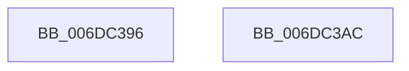

# sub_006DC396

- RVA: `0x006DC396`–`0x006DC3C3` (길이 `45` bytes)
- VA: `0x00000001406DC396`
- 실행 섹션: `.text`
- PDB 이름 있음: `아니요`; PDB Function 태그: `아니요`
- unwind 정보 RVA: `0x0006E91C`
- 디코드: `9`개 명령, `45/45` bytes 표시
- 미해석 바이트: `0` (있으면 어셈블리에 `.byte`로 보존)

> 이 문서는 커널 이미지의 기계어와 PDB 기호를 분석해 생성했습니다. 4번과 5번은 함수 원형과 자료형을 바이너리 사용 방식에서 추정한 C 해석이며 원본 소스 복구 결과는 아닙니다.

## 1. Dependencies

- 직접 호출 지점: **1**; 고유 호출 대상: **1**
- 직접 호출자로 확인된 함수: **0**
- RIP 상대 이미지 참조: **1**

### Outgoing calls
- `0x006DC3B7` → [MiSetExclusionWalkBounds](../2C/MiSetExclusionWalkBounds_function_002C0F74.md) (function, `0x002C0F74`)

### Direct callers
- 이 함수 시작 RVA로 연결되는 직접 call은 확인되지 않았습니다. 간접 호출은 완전히 역산할 수 없습니다.

### Static image references
- `0x006DC396` → RVA `0x00E38C58` (`.data`; read)

## 2. Other-region calls and transfers

- 다른 실행 섹션으로 향하는 call: **0**
- call이 아닌 외부 분기/꼬리 이동: **2**
  - `0x006DC3A7` → [MiInitializeWalkBounds + 0xBD](../2C/MiInitializeWalkBounds_function_002C2BCC.md) (`tail-transfer`)
  - `0x006DC3BE` → [MiInitializeWalkBounds + 0x63](../2C/MiInitializeWalkBounds_function_002C2BCC.md) (`tail-transfer`)

## 3. Assembly (complete function range)

```asm
006DC396  48 8B 0D BB C8 75 00            mov rcx, qword ptr [rip + 0x75c8bb]
006DC39D  48 B8 FF FF FF FF 0F 00 00 00   movabs rax, 0xfffffffff
006DC3A7  E9 DD 68 BE FF                  jmp 0x1402c2c89
006DC3AC  49 8B D2                        mov rdx, r10
006DC3AF  4C 89 5C 24 20                  mov qword ptr [rsp + 0x20], r11
006DC3B4  48 8B C8                        mov rcx, rax
006DC3B7  E8 B8 4B BE FF                  call 0x1402c0f74
006DC3BC  8B D0                           mov edx, eax
006DC3BE  E9 6C 68 BE FF                  jmp 0x1402c2c2f
```

## 4. C-style interpretation (structured pseudocode)

```c
__int64 __fastcall sub_006DC396(void)
{
    unsigned __int64 v_stack_p20;
}
```

## 5. (Beta) C Style

```c
void sub_006DC396(void)
{
    uint64_t v_stack_p20;
}
```

## 6. Execution-region graph

[열기: 2D/3D 그래프와 함수 탐색 컨트롤 패널](../../../control-panel.html?section=text&rva=0x006DC396&view=graph)

- 2D 그래프는 위에서 아래로 흐르고, 3D 그래프는 빈 공간을 드래그해 회전합니다. Shift+드래그는 이동, 휠은 확대·축소, 함수 노드 선택은 대상 보고서 이동입니다.

### Static fallback


