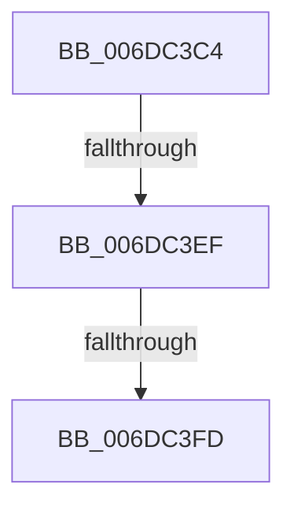

# sub_006DC3C4

- RVA: `0x006DC3C4`–`0x006DC40F` (길이 `75` bytes)
- VA: `0x00000001406DC3C4`
- 실행 섹션: `.text`
- PDB 이름 있음: `아니요`; PDB Function 태그: `아니요`
- unwind 정보 RVA: `0x0006E9B8`
- 디코드: `19`개 명령, `75/75` bytes 표시
- 미해석 바이트: `0` (있으면 어셈블리에 `.byte`로 보존)

> 이 문서는 커널 이미지의 기계어와 PDB 기호를 분석해 생성했습니다. 4번과 5번은 함수 원형과 자료형을 바이너리 사용 방식에서 추정한 C 해석이며 원본 소스 복구 결과는 아닙니다.

## 1. Dependencies

- 직접 호출 지점: **2**; 고유 호출 대상: **2**
- 직접 호출자로 확인된 함수: **0**
- RIP 상대 이미지 참조: **0**

### Outgoing calls
- `0x006DC3DD` → [MiGetProtoPteAddress](../32/MiGetProtoPteAddress_function_0032E970.md) (function, `0x0032E970`)
- `0x006DC403` → [MiPteNeedsCommitCharge](../2C/MiPteNeedsCommitCharge_function_002C13B0.md) (function, `0x002C13B0`)

### Direct callers
- 이 함수 시작 RVA로 연결되는 직접 call은 확인되지 않았습니다. 간접 호출은 완전히 역산할 수 없습니다.

### Static image references
- 디코드된 RIP-relative 메모리 참조가 없습니다.

## 2. Other-region calls and transfers

- 다른 실행 섹션으로 향하는 call: **0**
- call이 아닌 외부 분기/꼬리 이동: **3**
  - `0x006DC3E9` → [MiCountSharedPages + 0x148](../2C/MiCountSharedPages_function_002C30A4.md) (`tail-transfer`)
  - `0x006DC3F7` → [MiCountSharedPages + 0x20E](../2C/MiCountSharedPages_function_002C30A4.md) (`tail-transfer`)
  - `0x006DC40A` → [MiCountSharedPages + 0x233](../2C/MiCountSharedPages_function_002C30A4.md) (`tail-transfer`)

## 3. Assembly (complete function range)

```asm
006DC3C4  48 83 E3 EF                     and rbx, 0xffffffffffffffef
006DC3C8  49 8B D6                        mov rdx, r14
006DC3CB  4C 8D 8C 24 80 00 00 00         lea r9, [rsp + 0x80]
006DC3D3  48 C1 EA 0C                     shr rdx, 0xc
006DC3D7  45 33 C0                        xor r8d, r8d
006DC3DA  49 8B CD                        mov rcx, r13
006DC3DD  E8 8E 25 C5 FF                  call 0x14032e970
006DC3E2  48 C1 FB 10                     sar rbx, 0x10
006DC3E6  48 3B D8                        cmp rbx, rax
006DC3E9  0F 85 FD 6D BE FF               jne 0x1402c31ec
006DC3EF  41 8B 45 30                     mov eax, dword ptr [r13 + 0x30]
006DC3F3  24 70                           and al, 0x70
006DC3F5  3C 20                           cmp al, 0x20
006DC3F7  0F 85 B5 6E BE FF               jne 0x1402c32b2
006DC3FD  48 8B D6                        mov rdx, rsi
006DC400  49 8B CD                        mov rcx, r13
006DC403  E8 A8 4F BE FF                  call 0x1402c13b0
006DC408  85 C0                           test eax, eax
006DC40A  E9 C8 6E BE FF                  jmp 0x1402c32d7
```

## 4. C-style interpretation (structured pseudocode)

```c
__int64 __fastcall sub_006DC3C4(__int64 a1, __int64 a2, int a3, __int64 a4, __int64 a5, __int64 a6, __int64 a7, __int64 a8, __int64 a9, __int64 a10, __int64 a11, __int64 a12, __int64 a13, __int64 a14, __int64 a15, __int64 a16)
{
    __int64 result;
    __int64 v_rbx;

    v_rbx = (v_rbx) & (-17);
    a2 = (v_r14) >> (12);
    a3 = 0;
    result = MiGetProtoPteAddress(v_r13, a2, a3, a16);
    v_rbx = (v_rbx) >> (16);
    result = (unsigned __int8)(((unsigned int)(*(unsigned int *)(v_r13 + 48))) & (112));
    result = MiPteNeedsCommitCharge(v_r13, v_rsi, a3, a16);
}
```

## 5. (Beta) C Style

```c
int64_t sub_006DC3C4(int64_t Arg1, int64_t Arg2, int32_t Arg3, int64_t Arg4, uint64_t Arg5, uint64_t Arg6, uint64_t Arg7, uint64_t Arg8, uint64_t Arg9, uint64_t Arg10, uint64_t Arg11, uint64_t Arg12, uint64_t Arg13, uint64_t Arg14, uint64_t Arg15, int64_t Arg16)
{
    int64_t result;
    int64_t local_rbx;

    local_rbx = (local_rbx) & (-17);
    Arg2 = (local_r14) >> (12);
    Arg3 = 0;
    result = MiGetProtoPteAddress(local_r13, Arg2, Arg3, Arg16);
    local_rbx = (local_rbx) >> (16);
    result = (uint8_t)(((uint32_t)(*(uint32_t *)(local_r13 + 0x30))) & (112));
    result = MiPteNeedsCommitCharge(local_r13, local_rsi, Arg3, Arg16);
}
```

## 6. Execution-region graph

[열기: 2D/3D 그래프와 함수 탐색 컨트롤 패널](../../../control-panel.html?section=text&rva=0x006DC3C4&view=graph)

- 2D 그래프는 위에서 아래로 흐르고, 3D 그래프는 빈 공간을 드래그해 회전합니다. Shift+드래그는 이동, 휠은 확대·축소, 함수 노드 선택은 대상 보고서 이동입니다.

### Static fallback


