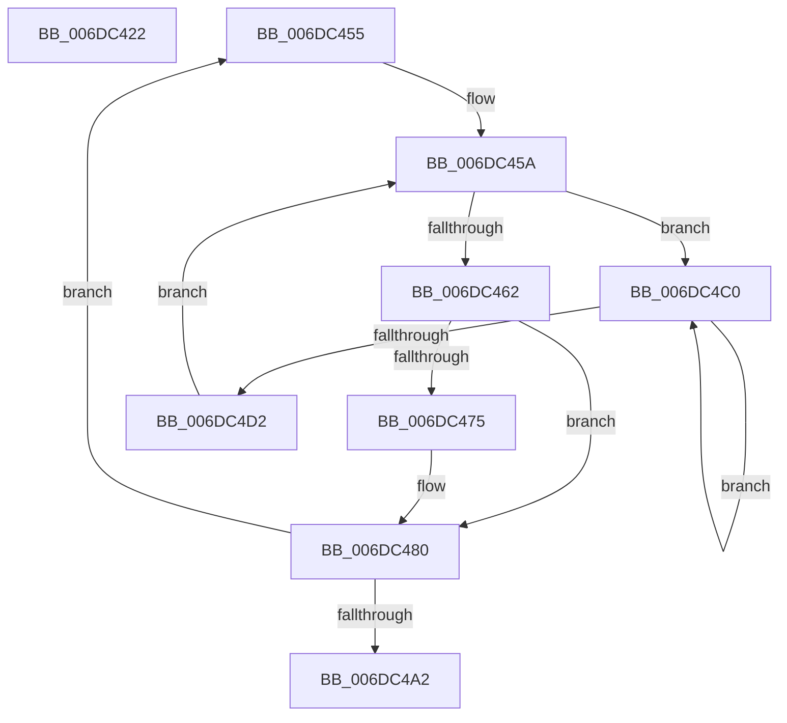

# sub_006DC422

- RVA: `0x006DC422`–`0x006DC4D4` (길이 `178` bytes)
- VA: `0x00000001406DC422`
- 실행 섹션: `.text`
- PDB 이름 있음: `아니요`; PDB Function 태그: `아니요`
- unwind 정보 RVA: `0x0006EAA0`
- 디코드: `42`개 명령, `178/178` bytes 표시
- 미해석 바이트: `0` (있으면 어셈블리에 `.byte`로 보존)

> 이 문서는 커널 이미지의 기계어와 PDB 기호를 분석해 생성했습니다. 4번과 5번은 함수 원형과 자료형을 바이너리 사용 방식에서 추정한 C 해석이며 원본 소스 복구 결과는 아닙니다.

## 1. Dependencies

- 직접 호출 지점: **3**; 고유 호출 대상: **3**
- 직접 호출자로 확인된 함수: **0**
- RIP 상대 이미지 참조: **0**

### Outgoing calls
- `0x006DC46C` → [MiGetPagePrivilege](../28/MiGetPagePrivilege_function_00285420.md) (function, `0x00285420`)
- `0x006DC47B` → [MiMarkPfnVerified](../38/MiMarkPfnVerified_function_003833C4.md) (function, `0x003833C4`)
- `0x006DC4C5` → [KeYieldProcessorEx](../3F/KeYieldProcessorEx_function_003FBD00.md) (function, `0x003FBD00`)

### Direct callers
- 이 함수 시작 RVA로 연결되는 직접 call은 확인되지 않았습니다. 간접 호출은 완전히 역산할 수 없습니다.

### Static image references
- 디코드된 RIP-relative 메모리 참조가 없습니다.

## 2. Other-region calls and transfers

- 다른 실행 섹션으로 향하는 call: **0**
- call이 아닌 외부 분기/꼬리 이동: **2**
  - `0x006DC450` → [MiRevertValidPte + 0x74](../2C/MiRevertValidPte_function_002C5160.md) (`tail-transfer`)
  - `0x006DC4BB` → [MiRevertValidPte + 0x2A7](../2C/MiRevertValidPte_function_002C5160.md) (`tail-transfer`)

## 3. Assembly (complete function range)

```asm
006DC422  4F 8B AC C5 78 45 01 00         mov r13, qword ptr [r13 + r8*8 + 0x14578]
006DC42A  B8 10 00 00 00                  mov eax, 0x10
006DC42F  4C 3B E8                        cmp r13, rax
006DC432  4C 89 6C 24 48                  mov qword ptr [rsp + 0x48], r13
006DC437  BA 01 00 00 00                  mov edx, 1
006DC43C  4D 8B C5                        mov r8, r13
006DC43F  0F 45 C2                        cmovne eax, edx
006DC442  4C 0F 44 C2                     cmove r8, rdx
006DC446  48 89 44 24 38                  mov qword ptr [rsp + 0x38], rax
006DC44B  4C 89 44 24 30                  mov qword ptr [rsp + 0x30], r8
006DC450  E9 7F 8D BE FF                  jmp 0x1402c51d4
006DC455  44 89 5C 24 20                  mov dword ptr [rsp + 0x20], r11d
006DC45A  F0 48 0F BA 2B 3F               lock bts qword ptr [rbx], 0x3f
006DC460  72 5E                           jb 0x1406dc4c0
006DC462  45 33 C0                        xor r8d, r8d
006DC465  49 8B CF                        mov rcx, r15
006DC468  41 8D 50 01                     lea edx, [r8 + 1]
006DC46C  E8 AF 8F BA FF                  call 0x140285420
006DC471  85 C0                           test eax, eax
006DC473  75 0B                           jne 0x1406dc480
006DC475  8D 50 07                        lea edx, [rax + 7]
006DC478  49 8B CF                        mov rcx, r15
006DC47B  E8 44 6F CA FF                  call 0x1403833c4
006DC480  48 B8 FF FF FF FF FF FF FF 7F   movabs rax, 0x7fffffffffffffff
006DC48A  F0 48 21 03                     lock and qword ptr [rbx], rax
006DC48E  49 83 C7 30                     add r15, 0x30
006DC492  48 83 C3 30                     add rbx, 0x30
006DC496  41 BB 00 00 00 00               mov r11d, 0
006DC49C  48 83 EE 01                     sub rsi, 1
006DC4A0  75 B3                           jne 0x1406dc455
006DC4A2  48 8B 5C 24 40                  mov rbx, qword ptr [rsp + 0x40]
006DC4A7  4C 8B 44 24 30                  mov r8, qword ptr [rsp + 0x30]
006DC4AC  44 8B 94 24 A0 00 00 00         mov r10d, dword ptr [rsp + 0xa0]
006DC4B4  49 6B C0 D0                     imul rax, r8, -0x30
006DC4B8  4C 03 F8                        add r15, rax
006DC4BB  E9 47 8F BE FF                  jmp 0x1402c5407
006DC4C0  48 8D 4C 24 20                  lea rcx, [rsp + 0x20]
006DC4C5  E8 36 F8 D1 FF                  call 0x1403fbd00
006DC4CA  48 8B 03                        mov rax, qword ptr [rbx]
006DC4CD  48 85 C0                        test rax, rax
006DC4D0  78 EE                           js 0x1406dc4c0
006DC4D2  EB 86                           jmp 0x1406dc45a
```

## 4. C-style interpretation (structured pseudocode)

```c
__int64 __fastcall sub_006DC422(__int64 a1, __int64 a2, __int64 a3)
{
    __int64 result;
    unsigned int v_stack_p20;
    unsigned __int64 v_stack_p30;
    unsigned __int64 v_stack_p38;
    unsigned __int64 v_stack_p40;
    unsigned __int64 v_stack_p48;
    unsigned int v_stack_pA0;

    v_stack_p48 = *(unsigned __int64 *)(v_r13 + a3 * 8 + 83320);
    result = 16;
    if ((*(unsigned __int64 *)(v_r13 + a3 * 8 + 83320)) != 16) { result = 1; }
    a3 = *(unsigned __int64 *)(v_r13 + a3 * 8 + 83320);
    if ((*(unsigned __int64 *)(v_r13 + a3 * 8 + 83320)) == 16) { a3 = 1; }
    v_stack_p38 = result;
    v_stack_p30 = a3;
}
```

## 5. (Beta) C Style

```c
int64_t sub_006DC422(int64_t Arg1, int64_t Arg2, int64_t Arg3)
{
    int64_t result;
    uint32_t v_stack_p20;
    uint64_t v_stack_p30;
    uint64_t v_stack_p38;
    uint64_t v_stack_p40;
    uint64_t v_stack_p48;
    uint32_t v_stack_pA0;

    v_stack_p48 = *(uint64_t *)(local_r13 + Arg3 * 8 + 0x14578);
    result = 16;
    if ((*(uint64_t *)(local_r13 + Arg3 * 8 + 0x14578)) != 16) { result = 1; }
    Arg3 = *(uint64_t *)(local_r13 + Arg3 * 8 + 0x14578);
    if ((*(uint64_t *)(local_r13 + Arg3 * 8 + 0x14578)) == 16) { Arg3 = 1; }
    v_stack_p38 = result;
    v_stack_p30 = Arg3;
}
```

## 6. Execution-region graph

[열기: 2D/3D 그래프와 함수 탐색 컨트롤 패널](../../../control-panel.html?section=text&rva=0x006DC422&view=graph)

- 2D 그래프는 위에서 아래로 흐르고, 3D 그래프는 빈 공간을 드래그해 회전합니다. Shift+드래그는 이동, 휠은 확대·축소, 함수 노드 선택은 대상 보고서 이동입니다.

### Static fallback


