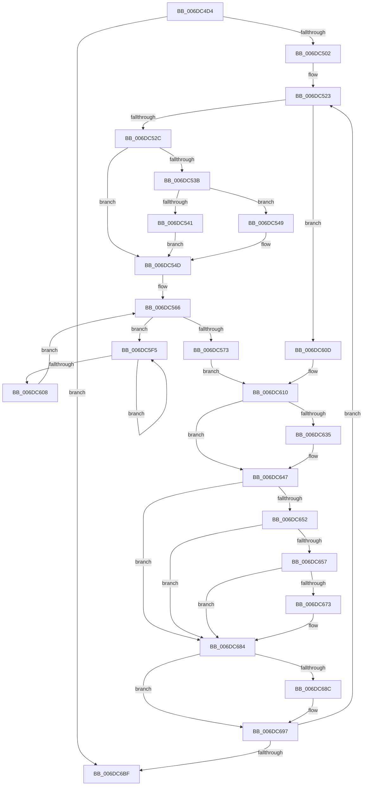

# sub_006DC4D4

- RVA: `0x006DC4D4`–`0x006DC6C6` (길이 `498` bytes)
- VA: `0x00000001406DC4D4`
- 실행 섹션: `.text`
- PDB 이름 있음: `아니요`; PDB Function 태그: `아니요`
- unwind 정보 RVA: `0x0006EB70`
- 디코드: `118`개 명령, `498/498` bytes 표시
- 미해석 바이트: `0` (있으면 어셈블리에 `.byte`로 보존)

> 이 문서는 커널 이미지의 기계어와 PDB 기호를 분석해 생성했습니다. 4번과 5번은 함수 원형과 자료형을 바이너리 사용 방식에서 추정한 C 해석이며 원본 소스 복구 결과는 아닙니다.

## 1. Dependencies

- 직접 호출 지점: **7**; 고유 호출 대상: **7**
- 직접 호출자로 확인된 함수: **0**
- RIP 상대 이미지 참조: **3**

### Outgoing calls
- `0x006DC594` → [MiSanitizePfnProtection](../36/MiSanitizePfnProtection_function_0036C040.md) (function, `0x0036C040`)
- `0x006DC5FA` → [KeYieldProcessorEx](../3F/KeYieldProcessorEx_function_003FBD00.md) (function, `0x003FBD00`)
- `0x006DC619` → [MiMakeValidPte](../2C/MiMakeValidPte_function_002C5590.md) (function, `0x002C5590`)
- `0x006DC62C` → [MiPteInShadowRange](../23/MiPteInShadowRange_function_0023FB00.md) (function, `0x0023FB00`)
- `0x006DC63A` → [MiSanitizeShadowPxe](../29/MiSanitizeShadowPxe_function_00294B68.md) (function, `0x00294B68`)
- `0x006DC67F` → [MiCheckLinearProtectedPteAccessedBit](../29/MiCheckLinearProtectedPteAccessedBit_function_00292D80.md) (function, `0x00292D80`)
- `0x006DC692` → [MiWritePteShadow](../29/MiWritePteShadow_function_00294EAC.md) (function, `0x00294EAC`)

### Direct callers
- 이 함수 시작 RVA로 연결되는 직접 call은 확인되지 않았습니다. 간접 호출은 완전히 역산할 수 없습니다.

### Static image references
- `0x006DC4D8` → RVA `0x00014578` (`.rdata`; read)
- `0x006DC52F` → RVA `0x00E2DC80` (`.data`; read)
- `0x006DC647` → RVA `0x00FC6A88` (`ALMOSTRO`; read)

## 2. Other-region calls and transfers

- 다른 실행 섹션으로 향하는 call: **0**
- call이 아닌 외부 분기/꼬리 이동: **1**
  - `0x006DC6C1` → [MiSetProtectionOnTransitionPte + 0x197](../2C/MiSetProtectionOnTransitionPte_function_002C586C.md) (`tail-transfer`)

## 3. Assembly (complete function range)

```asm
006DC4D4  48 C1 EA 13                     shr rdx, 0x13
006DC4D8  4C 8D 1D 99 80 93 FF            lea r11, [rip - 0x6c7f67]
006DC4DF  83 E2 03                        and edx, 3
006DC4E2  41 BC 10 00 00 00               mov r12d, 0x10
006DC4E8  4D 8B 1C D3                     mov r11, qword ptr [r11 + rdx*8]
006DC4EC  4D 3B DC                        cmp r11, r12
006DC4EF  4C 89 5C 24 40                  mov qword ptr [rsp + 0x40], r11
006DC4F4  4C 0F 45 E5                     cmovne r12, rbp
006DC4F8  41 83 F8 18                     cmp r8d, 0x18
006DC4FC  0F 84 BD 01 00 00               je 0x1406dc6bf
006DC502  33 FF                           xor edi, edi
006DC504  48 B9 00 00 00 00 00 DE FF FF   movabs rcx, 0xffffde0000000000
006DC50E  8B D7                           mov edx, edi
006DC510  8B F7                           mov esi, edi
006DC512  89 54 24 30                     mov dword ptr [rsp + 0x30], edx
006DC516  44 8B FF                        mov r15d, edi
006DC519  49 B8 FF FF FF FF FF 00 00 00   movabs r8, 0xffffffffff
006DC523  4D 85 FF                        test r15, r15
006DC526  0F 85 E1 00 00 00               jne 0x1406dc60d
006DC52C  49 8B 36                        mov rsi, qword ptr [r14]
006DC52F  48 8B 05 4A 17 75 00            mov rax, qword ptr [rip + 0x75174a]
006DC536  48 85 C0                        test rax, rax
006DC539  74 12                           je 0x1406dc54d
006DC53B  40 F6 C6 10                     test sil, 0x10
006DC53F  75 08                           jne 0x1406dc549
006DC541  48 F7 D0                        not rax
006DC544  48 23 F0                        and rsi, rax
006DC547  EB 04                           jmp 0x1406dc54d
006DC549  48 83 E6 EF                     and rsi, 0xffffffffffffffef
006DC54D  48 C1 EE 0C                     shr rsi, 0xc
006DC551  49 23 F0                        and rsi, r8
006DC554  48 8D 1C 76                     lea rbx, [rsi + rsi*2]
006DC558  48 C1 E3 04                     shl rbx, 4
006DC55C  48 8B C1                        mov rax, rcx
006DC55F  48 03 D8                        add rbx, rax
006DC562  89 7C 24 34                     mov dword ptr [rsp + 0x34], edi
006DC566  F0 48 0F BA 6B 18 3F            lock bts qword ptr [rbx + 0x18], 0x3f
006DC56D  0F 82 82 00 00 00               jb 0x1406dc5f5
006DC573  4C 8B 4B 10                     mov r9, qword ptr [rbx + 0x10]
006DC577  4C 8B 9C 24 90 00 00 00         mov r11, qword ptr [rsp + 0x90]
006DC57F  49 8B D1                        mov rdx, r9
006DC582  44 8B 84 24 A0 00 00 00         mov r8d, dword ptr [rsp + 0xa0]
006DC58A  49 8B CB                        mov rcx, r11
006DC58D  48 C1 EA 05                     shr rdx, 5
006DC591  83 E2 1F                        and edx, 0x1f
006DC594  E8 A7 FA C8 FF                  call 0x14036c040
006DC599  8B C8                           mov ecx, eax
006DC59B  44 8B D0                        mov r10d, eax
006DC59E  48 C1 E1 05                     shl rcx, 5
006DC5A2  48 8B C1                        mov rax, rcx
006DC5A5  49 33 C1                        xor rax, r9
006DC5A8  48 25 1F FC FF FF               and rax, 0xfffffffffffffc1f
006DC5AE  48 33 C1                        xor rax, rcx
006DC5B1  48 89 43 10                     mov qword ptr [rbx + 0x10], rax
006DC5B5  48 B8 FF FF FF FF FF FF FF 7F   movabs rax, 0x7fffffffffffffff
006DC5BF  F0 48 21 43 18                  lock and qword ptr [rbx + 0x18], rax
006DC5C4  41 8B 43 30                     mov eax, dword ptr [r11 + 0x30]
006DC5C8  41 8B CA                        mov ecx, r10d
006DC5CB  0F BA E9 1A                     bts ecx, 0x1a
006DC5CF  48 81 7C 24 40 00 02 00 00      cmp qword ptr [rsp + 0x40], 0x200
006DC5D8  41 0F 42 CA                     cmovb ecx, r10d
006DC5DC  25 00 00 60 00                  and eax, 0x600000
006DC5E1  8B D1                           mov edx, ecx
006DC5E3  0F BA EA 1F                     bts edx, 0x1f
006DC5E7  3D 00 00 60 00                  cmp eax, 0x600000
006DC5EC  0F 44 D1                        cmove edx, ecx
006DC5EF  89 54 24 30                     mov dword ptr [rsp + 0x30], edx
006DC5F3  EB 1B                           jmp 0x1406dc610
006DC5F5  48 8D 4C 24 34                  lea rcx, [rsp + 0x34]
006DC5FA  E8 01 F7 D1 FF                  call 0x1403fbd00
006DC5FF  48 8B 43 18                     mov rax, qword ptr [rbx + 0x18]
006DC603  48 85 C0                        test rax, rax
006DC606  78 ED                           js 0x1406dc5f5
006DC608  E9 59 FF FF FF                  jmp 0x1406dc566
006DC60D  48 03 F5                        add rsi, rbp
006DC610  44 8B C2                        mov r8d, edx
006DC613  49 8B CE                        mov rcx, r14
006DC616  48 8B D6                        mov rdx, rsi
006DC619  E8 72 8F BE FF                  call 0x1402c5590
006DC61E  49 8B CE                        mov rcx, r14
006DC621  48 89 44 24 38                  mov qword ptr [rsp + 0x38], rax
006DC626  48 8B D8                        mov rbx, rax
006DC629  44 8B EF                        mov r13d, edi
006DC62C  E8 CF 34 B6 FF                  call 0x14023fb00
006DC631  85 C0                           test eax, eax
006DC633  74 12                           je 0x1406dc647
006DC635  48 8D 54 24 38                  lea rdx, [rsp + 0x38]
006DC63A  E8 29 85 BB FF                  call 0x140294b68
006DC63F  48 8B 5C 24 38                  mov rbx, qword ptr [rsp + 0x38]
006DC644  44 8B E8                        mov r13d, eax
006DC647  48 0F BA 25 38 A4 8E 00 24      bt qword ptr [rip + 0x8ea438], 0x24
006DC650  73 32                           jae 0x1406dc684
006DC652  F6 C3 20                        test bl, 0x20
006DC655  75 2D                           jne 0x1406dc684
006DC657  48 B8 00 00 00 00 80 F6 FF FF   movabs rax, 0xfffff68000000000
006DC661  48 B9 00 00 00 00 40 00 00 00   movabs rcx, 0x4000000000
006DC66B  48 03 C1                        add rax, rcx
006DC66E  4C 3B F0                        cmp r14, rax
006DC671  72 11                           jb 0x1406dc684
006DC673  41 B8 80 00 00 00               mov r8d, 0x80
006DC679  48 8B D3                        mov rdx, rbx
006DC67C  49 8B CE                        mov rcx, r14
006DC67F  E8 FC 66 BB FF                  call 0x140292d80
006DC684  49 89 1E                        mov qword ptr [r14], rbx
006DC687  45 85 ED                        test r13d, r13d
006DC68A  74 0B                           je 0x1406dc697
006DC68C  48 8B D3                        mov rdx, rbx
006DC68F  49 8B CE                        mov rcx, r14
006DC692  E8 15 88 BB FF                  call 0x140294eac
006DC697  8B 54 24 30                     mov edx, dword ptr [rsp + 0x30]
006DC69B  49 83 C6 08                     add r14, 8
006DC69F  4C 03 FD                        add r15, rbp
006DC6A2  48 B9 00 00 00 00 00 DE FF FF   movabs rcx, 0xffffde0000000000
006DC6AC  49 B8 FF FF FF FF FF 00 00 00   movabs r8, 0xffffffffff
006DC6B6  4D 3B FC                        cmp r15, r12
006DC6B9  0F 82 64 FE FF FF               jb 0x1406dc523
006DC6BF  33 C0                           xor eax, eax
006DC6C1  E9 3D 93 BE FF                  jmp 0x1402c5a03
```

## 4. C-style interpretation (structured pseudocode)

```c
__int64 __fastcall sub_006DC4D4(__int64 a1, __int64 a2, int a3, __int64 a4, __int64 a5, unsigned int a6, __int64 a7, __int64 a8, __int64 a9, __int64 a10, __int64 a11, __int64 a12, __int64 a13, __int64 a14, __int64 a15, __int64 a16, __int64 a17, __int64 a18, __int64 a19, unsigned int a20)
{
    __int64 result;
    __int64 v_r12;
    __int64 v_r13;
    __int64 v_r14;
    __int64 v_r15;
    __int64 v_rbx;
    __int64 v_rdi;
    __int64 v_rsi;
    unsigned int v_stack_p30;
    unsigned int v_stack_p34;
    unsigned __int64 v_stack_p38;
    unsigned __int64 v_stack_p40;

    a2 = (a2) >> (19);
    a2 = (unsigned int)((a2) & (3));
    v_stack_p40 = *(unsigned __int64 *)(v_rip - 7110503 + a2 * 8);
    v_r12 = 16;
    if ((*(unsigned __int64 *)(v_rip - 7110503 + a2 * 8)) != 16) { v_r12 = v_rbp; }
    if (a3 == 24) goto loc_006DC6BF;
    v_rdi = 0;
    v_stack_p30 = 0;
loc_006DC523:
    if (0 != 0) goto loc_006DC60D;
    if (*(unsigned __int64 *)(v_rip + 7673674) == 0) goto loc_006DC54D;
    if ((((unsigned __int8)(*(unsigned __int64 *)(v_r14))) & (16)) != 0) goto loc_006DC549;
    result = ~(*(unsigned __int64 *)(v_rip + 7673674));
    v_rsi = (*(unsigned __int64 *)(v_r14)) & (result);
    goto loc_006DC54D;
loc_006DC549:
    v_rsi = (v_rsi) & (-17);
loc_006DC54D:
    v_rsi = (v_rsi) >> (12);
    v_rsi = (v_rsi) & (a3);
    v_rbx = (v_rsi + v_rsi * 2) << (4);
    v_rbx = (v_rbx) + (a1);
    v_stack_p34 = 0;
loc_006DC566:
    if (condition_is_below) goto loc_006DC5F5;
    a2 = (*(unsigned __int64 *)(v_rbx + 16)) >> (5);
    a2 = (unsigned int)((a2) & (31));
    result = MiSanitizePfnProtection(a18, a2, (unsigned int)(a20), *(unsigned __int64 *)(v_rbx + 16));
    a1 = ((unsigned int)((unsigned int)(result))) << (5);
    result = (a1) ^ (*(unsigned __int64 *)(v_rbx + 16));
    result = (result) & (-993);
    result = (result) ^ (a1);
    *(unsigned __int64 *)(v_rbx + 16) = result;
    a1 = (unsigned int)((unsigned int)((unsigned int)((unsigned int)(result))));
    if (a8 < 512) { a1 = (unsigned int)((unsigned int)((unsigned int)(result))); }
    result = (unsigned int)(((unsigned int)(*(unsigned int *)(a18 + 48))) & (0x600000ULL));
    a2 = (unsigned int)((unsigned int)(a1));
    if (((unsigned int)(result)) == 0x600000ULL) { a2 = (unsigned int)(a1); }
    v_stack_p30 = (unsigned int)(a2);
    goto loc_006DC610;
loc_006DC5F5:
    result = KeYieldProcessorEx(v_stack_p34, a2, (unsigned int)(a20), *(unsigned __int64 *)(v_rbx + 16));
    if (sign_flag) goto loc_006DC5F5;
    goto loc_006DC566;
loc_006DC60D:
    v_rsi = (v_rsi) + (v_rbp);
loc_006DC610:
    result = MiMakeValidPte(v_r14, v_rsi, (unsigned int)((unsigned int)(a2)), *(unsigned __int64 *)(v_rbx + 16));
    v_stack_p38 = result;
    result = MiPteInShadowRange(v_r14, v_rsi, (unsigned int)((unsigned int)(a2)), *(unsigned __int64 *)(v_rbx + 16));
    v_rbx = result;
    v_r13 = 0;
    if ((unsigned int)(result) != 0) {
        a2 = a7;
        result = MiSanitizeShadowPxe(v_r14, a2, (unsigned int)((unsigned int)(a2)), *(unsigned __int64 *)(v_rbx + 16));
        v_rbx = a7;
        v_r13 = (unsigned int)(result);
    }
    if (condition_is_above_or_equal) goto loc_006DC684;
    if ((((unsigned __int8)(v_rbx)) & (32)) != 0) goto loc_006DC684;
    result = (result) + (v_r14);
    if (v_r14 >= result) {
        a3 = 128;
        a2 = v_rbx;
        a1 = v_r14;
        result = MiCheckLinearProtectedPteAccessedBit(a1, a2, a3, *(unsigned __int64 *)(v_rbx + 16));
    }
    *(unsigned __int64 *)(v_r14) = v_rbx;
    if ((unsigned int)(v_r13) != 0) {
        a2 = v_rbx;
        a1 = v_r14;
        result = MiWritePteShadow(a1, a2, a3, *(unsigned __int64 *)(v_rbx + 16));
    }
    v_r14 = (v_r14) + (8);
    v_r15 = (0) + (v_rbp);
    if (v_r15 < v_r12) goto loc_006DC523;
loc_006DC6BF:
    result = 0;
}
```

## 5. (Beta) C Style

```c
int64_t sub_006DC4D4(int64_t Arg1, int64_t Arg2, int32_t Arg3, int64_t Arg4, uint64_t Arg5, uint32_t Arg6, int64_t Arg7, int64_t Arg8, uint64_t Arg9, uint64_t Arg10, uint64_t Arg11, uint64_t Arg12, uint64_t Arg13, uint64_t Arg14, uint64_t Arg15, uint64_t Arg16, uint64_t Arg17, int64_t Arg18, uint64_t Arg19, uint32_t Arg20)
{
    int64_t result;
    int64_t local_r12;
    int64_t local_r13;
    int64_t local_r14;
    int64_t local_r15;
    int64_t local_rbx;
    int64_t local_rdi;
    int64_t local_rsi;
    uint32_t v_stack_p30;
    uint32_t v_stack_p34;
    uint64_t v_stack_p38;
    uint64_t v_stack_p40;

    Arg2 = (Arg2) >> (19);
    Arg2 = (uint32_t)((Arg2) & (3));
    v_stack_p40 = *(uint64_t *)(v_rip - 0x6C7F67 + Arg2 * 8);
    local_r12 = 16;
    if ((*(uint64_t *)(v_rip - 0x6C7F67 + Arg2 * 8)) != 16) { local_r12 = local_rbp; }
    if (Arg3 == 24) goto loc_006DC6BF;
    local_rdi = 0;
    v_stack_p30 = 0;
loc_006DC523:
    if (0 != 0) goto loc_006DC60D;
    if (*(uint64_t *)(v_rip + 0x75174A) == 0) goto loc_006DC54D;
    if ((((uint8_t)(*(uint64_t *)(local_r14))) & (16)) != 0) goto loc_006DC549;
    result = ~(*(uint64_t *)(v_rip + 0x75174A));
    local_rsi = (*(uint64_t *)(local_r14)) & (result);
    goto loc_006DC54D;
loc_006DC549:
    local_rsi = (local_rsi) & (-17);
loc_006DC54D:
    local_rsi = (local_rsi) >> (12);
    local_rsi = (local_rsi) & (Arg3);
    local_rbx = (local_rsi + local_rsi * 2) << (4);
    local_rbx = (local_rbx) + (Arg1);
    v_stack_p34 = 0;
loc_006DC566:
    if (condition_is_below) goto loc_006DC5F5;
    Arg2 = (*(uint64_t *)(local_rbx + 0x10)) >> (5);
    Arg2 = (uint32_t)((Arg2) & (31));
    result = MiSanitizePfnProtection(Arg18, Arg2, (uint32_t)(Arg20), *(uint64_t *)(local_rbx + 0x10));
    Arg1 = ((uint32_t)((uint32_t)(result))) << (5);
    result = (Arg1) ^ (*(uint64_t *)(local_rbx + 0x10));
    result = (result) & (-993);
    result = (result) ^ (Arg1);
    *(uint64_t *)(local_rbx + 0x10) = result;
    Arg1 = (uint32_t)((uint32_t)((uint32_t)((uint32_t)(result))));
    if (Arg8 < 512) { Arg1 = (uint32_t)((uint32_t)((uint32_t)(result))); }
    result = (uint32_t)(((uint32_t)(*(uint32_t *)(Arg18 + 0x30))) & (0x600000ULL));
    Arg2 = (uint32_t)((uint32_t)(Arg1));
    if (((uint32_t)(result)) == 0x600000ULL) { Arg2 = (uint32_t)(Arg1); }
    v_stack_p30 = (uint32_t)(Arg2);
    goto loc_006DC610;
loc_006DC5F5:
    result = KeYieldProcessorEx(v_stack_p34, Arg2, (uint32_t)(Arg20), *(uint64_t *)(local_rbx + 0x10));
    if (sign_flag) goto loc_006DC5F5;
    goto loc_006DC566;
loc_006DC60D:
    local_rsi = (local_rsi) + (local_rbp);
loc_006DC610:
    result = MiMakeValidPte(local_r14, local_rsi, (uint32_t)((uint32_t)(Arg2)), *(uint64_t *)(local_rbx + 0x10));
    v_stack_p38 = result;
    result = MiPteInShadowRange(local_r14, local_rsi, (uint32_t)((uint32_t)(Arg2)), *(uint64_t *)(local_rbx + 0x10));
    local_rbx = result;
    local_r13 = 0;
    if ((uint32_t)(result) != 0) {
        Arg2 = Arg7;
        result = MiSanitizeShadowPxe(local_r14, Arg2, (uint32_t)((uint32_t)(Arg2)), *(uint64_t *)(local_rbx + 0x10));
        local_rbx = Arg7;
        local_r13 = (uint32_t)(result);
    }
    if (condition_is_above_or_equal) goto loc_006DC684;
    if ((((uint8_t)(local_rbx)) & (32)) != 0) goto loc_006DC684;
    result = (result) + (local_r14);
    if (local_r14 >= result) {
        Arg3 = 128;
        Arg2 = local_rbx;
        Arg1 = local_r14;
        result = MiCheckLinearProtectedPteAccessedBit(Arg1, Arg2, Arg3, *(uint64_t *)(local_rbx + 0x10));
    }
    *(uint64_t *)(local_r14) = local_rbx;
    if ((uint32_t)(local_r13) != 0) {
        Arg2 = local_rbx;
        Arg1 = local_r14;
        result = MiWritePteShadow(Arg1, Arg2, Arg3, *(uint64_t *)(local_rbx + 0x10));
    }
    local_r14 = (local_r14) + (8);
    local_r15 = (0) + (local_rbp);
    if (local_r15 < local_r12) goto loc_006DC523;
loc_006DC6BF:
    result = 0;
}
```

## 6. Execution-region graph

[열기: 2D/3D 그래프와 함수 탐색 컨트롤 패널](../../../control-panel.html?section=text&rva=0x006DC4D4&view=graph)

- 2D 그래프는 위에서 아래로 흐르고, 3D 그래프는 빈 공간을 드래그해 회전합니다. Shift+드래그는 이동, 휠은 확대·축소, 함수 노드 선택은 대상 보고서 이동입니다.

### Static fallback


