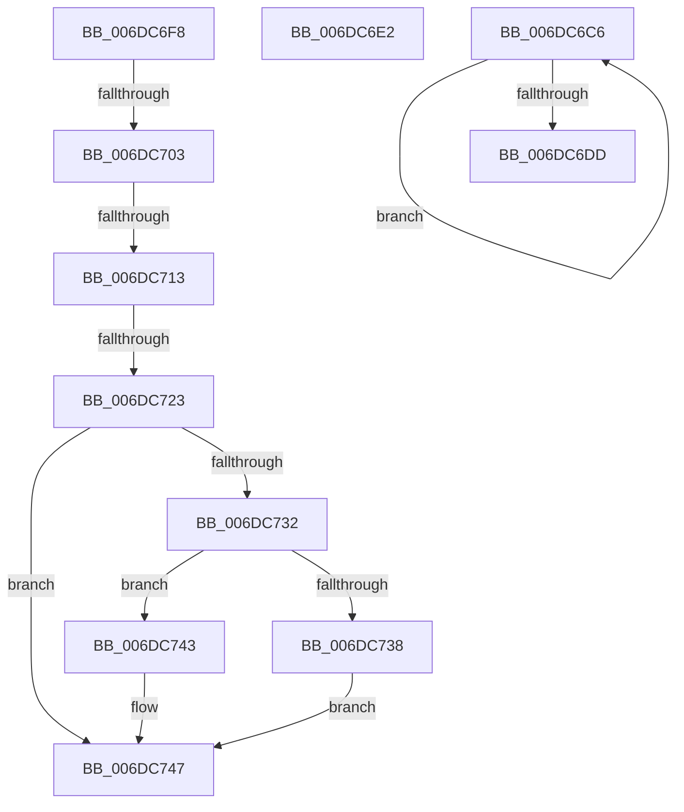

# sub_006DC6C6

- RVA: `0x006DC6C6`–`0x006DC750` (길이 `138` bytes)
- VA: `0x00000001406DC6C6`
- 실행 섹션: `.text`
- PDB 이름 있음: `아니요`; PDB Function 태그: `아니요`
- unwind 정보 RVA: `0x0006EBB4`
- 디코드: `35`개 명령, `138/138` bytes 표시
- 미해석 바이트: `0` (있으면 어셈블리에 `.byte`로 보존)

> 이 문서는 커널 이미지의 기계어와 PDB 기호를 분석해 생성했습니다. 4번과 5번은 함수 원형과 자료형을 바이너리 사용 방식에서 추정한 C 해석이며 원본 소스 복구 결과는 아닙니다.

## 1. Dependencies

- 직접 호출 지점: **2**; 고유 호출 대상: **2**
- 직접 호출자로 확인된 함수: **0**
- RIP 상대 이미지 참조: **1**

### Outgoing calls
- `0x006DC706` → [MiIsPrototypePteVadLookup](../32/MiIsPrototypePteVadLookup_function_00328B70.md) (function, `0x00328B70`)
- `0x006DC716` → [MI_PROTO_FORMAT_COMBINED](../22/MI_PROTO_FORMAT_COMBINED_function_0022F720.md) (function, `0x0022F720`)

### Direct callers
- 이 함수 시작 RVA로 연결되는 직접 call은 확인되지 않았습니다. 간접 호출은 완전히 역산할 수 없습니다.

### Static image references
- `0x006DC723` → RVA `0x00E2DC80` (`.data`; read)

## 2. Other-region calls and transfers

- 다른 실행 섹션으로 향하는 call: **0**
- call이 아닌 외부 분기/꼬리 이동: **6**
  - `0x006DC6DD` → [MiComputePageCommitment + 0xF8](../2C/MiComputePageCommitment_function_002C5C34.md) (`tail-transfer`)
  - `0x006DC6F3` → [MiComputePageCommitment + 0x2AE](../2C/MiComputePageCommitment_function_002C5C34.md) (`tail-transfer`)
  - `0x006DC6FD` → [MiComputePageCommitment + 0x184](../2C/MiComputePageCommitment_function_002C5C34.md) (`tail-transfer`)
  - `0x006DC70D` → [MiComputePageCommitment + 0x184](../2C/MiComputePageCommitment_function_002C5C34.md) (`tail-transfer`)
  - `0x006DC71D` → [MiComputePageCommitment + 0x184](../2C/MiComputePageCommitment_function_002C5C34.md) (`tail-transfer`)
  - `0x006DC74B` → [MiComputePageCommitment + 0x2AE](../2C/MiComputePageCommitment_function_002C5C34.md) (`tail-transfer`)

## 3. Assembly (complete function range)

```asm
006DC6C6  48 C1 EE 09                     shr rsi, 9
006DC6CA  48 23 F2                        and rsi, rdx
006DC6CD  49 8B C6                        mov rax, r14
006DC6D0  48 03 F0                        add rsi, rax
006DC6D3  49 C1 E7 09                     shl r15, 9
006DC6D7  48 83 E9 01                     sub rcx, 1
006DC6DB  75 E9                           jne 0x1406dc6c6
006DC6DD  E9 4A 96 BE FF                  jmp 0x1402c5d2c
006DC6E2  48 8B 52 08                     mov rdx, qword ptr [rdx + 8]
006DC6E6  48 B8 00 00 00 00 00 00 00 80   movabs rax, 0x8000000000000000
006DC6F0  48 0B D0                        or rdx, rax
006DC6F3  E9 EA 97 BE FF                  jmp 0x1402c5ee2
006DC6F8  49 0F BA E0 0A                  bt r8, 0xa
006DC6FD  0F 83 B5 96 BE FF               jae 0x1402c5db8
006DC703  49 8B C8                        mov rcx, r8
006DC706  E8 65 C4 C4 FF                  call 0x140328b70
006DC70B  85 C0                           test eax, eax
006DC70D  0F 85 A5 96 BE FF               jne 0x1402c5db8
006DC713  49 8B C8                        mov rcx, r8
006DC716  E8 05 30 B5 FF                  call 0x14022f720
006DC71B  84 C0                           test al, al
006DC71D  0F 85 95 96 BE FF               jne 0x1402c5db8
006DC723  48 8B 05 56 15 75 00            mov rax, qword ptr [rip + 0x751556]
006DC72A  49 8B D0                        mov rdx, r8
006DC72D  48 85 C0                        test rax, rax
006DC730  74 15                           je 0x1406dc747
006DC732  41 F6 C0 10                     test r8b, 0x10
006DC736  75 0B                           jne 0x1406dc743
006DC738  48 8B D0                        mov rdx, rax
006DC73B  48 F7 D2                        not rdx
006DC73E  49 23 D0                        and rdx, r8
006DC741  EB 04                           jmp 0x1406dc747
006DC743  48 83 E2 EF                     and rdx, 0xffffffffffffffef
006DC747  48 C1 FA 10                     sar rdx, 0x10
006DC74B  E9 92 97 BE FF                  jmp 0x1402c5ee2
```

## 4. C-style interpretation (structured pseudocode)

```c
__int64 __fastcall sub_006DC6C6(__int64 a1, __int64 a2, __int64 a3)
{
    __int64 v_r15;
    __int64 v_rsi;

    v_rsi = (v_rsi) >> (9);
    v_rsi = (v_rsi) & (a2);
    v_rsi = (v_rsi) + (v_r14);
    v_r15 = (v_r15) << (9);
    a1 = (a1) - (1);
    if (condition_is_not_equal) goto loc_006DC6C6;
}
```

## 5. (Beta) C Style

```c
int64_t sub_006DC6C6(int64_t Arg1, int64_t Arg2, int64_t Arg3)
{
    int64_t local_r15;
    int64_t local_rsi;

    local_rsi = (local_rsi) >> (9);
    local_rsi = (local_rsi) & (Arg2);
    local_rsi = (local_rsi) + (local_r14);
    local_r15 = (local_r15) << (9);
    Arg1 = (Arg1) - (1);
    if (condition_is_not_equal) goto loc_006DC6C6;
}
```

## 6. Execution-region graph

[열기: 2D/3D 그래프와 함수 탐색 컨트롤 패널](../../../control-panel.html?section=text&rva=0x006DC6C6&view=graph)

- 2D 그래프는 위에서 아래로 흐르고, 3D 그래프는 빈 공간을 드래그해 회전합니다. Shift+드래그는 이동, 휠은 확대·축소, 함수 노드 선택은 대상 보고서 이동입니다.

### Static fallback


