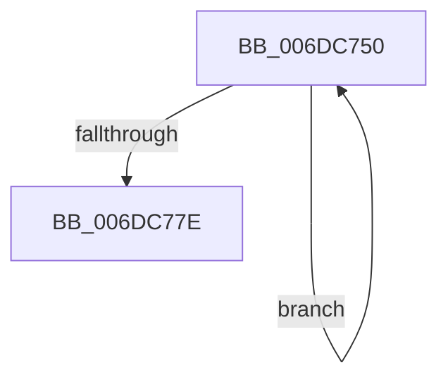

# sub_006DC750

- RVA: `0x006DC750`–`0x006DC793` (길이 `67` bytes)
- VA: `0x00000001406DC750`
- 실행 섹션: `.text`
- PDB 이름 있음: `아니요`; PDB Function 태그: `아니요`
- unwind 정보 RVA: `0x0006EC50`
- 디코드: `17`개 명령, `67/67` bytes 표시
- 미해석 바이트: `0` (있으면 어셈블리에 `.byte`로 보존)

> 이 문서는 커널 이미지의 기계어와 PDB 기호를 분석해 생성했습니다. 4번과 5번은 함수 원형과 자료형을 바이너리 사용 방식에서 추정한 C 해석이며 원본 소스 복구 결과는 아닙니다.

## 1. Dependencies

- 직접 호출 지점: **1**; 고유 호출 대상: **1**
- 직접 호출자로 확인된 함수: **0**
- RIP 상대 이미지 참조: **0**

### Outgoing calls
- `0x006DC767` → [MiZeroPhysicalPage](../33/MiZeroPhysicalPage_function_00332590.md) (function, `0x00332590`)

### Direct callers
- 이 함수 시작 RVA로 연결되는 직접 call은 확인되지 않았습니다. 간접 호출은 완전히 역산할 수 없습니다.

### Static image references
- 디코드된 RIP-relative 메모리 참조가 없습니다.

## 2. Other-region calls and transfers

- 다른 실행 섹션으로 향하는 call: **0**
- call이 아닌 외부 분기/꼬리 이동: **1**
  - `0x006DC78E` → [MiZeroChainWorker + 0x89](../2C/MiZeroChainWorker_function_002C67C8.md) (`tail-transfer`)

## 3. Assembly (complete function range)

```asm
006DC750  41 8B 07                        mov eax, dword ptr [r15]
006DC753  45 33 C0                        xor r8d, r8d
006DC756  C1 E8 10                        shr eax, 0x10
006DC759  48 8B D7                        mov rdx, rdi
006DC75C  44 0F B6 C8                     movzx r9d, al
006DC760  49 8B CD                        mov rcx, r13
006DC763  41 C1 E9 06                     shr r9d, 6
006DC767  E8 24 5E C5 FF                  call 0x140332590
006DC76C  41 FF C4                        inc r12d
006DC76F  4D 8D 7F 30                     lea r15, [r15 + 0x30]
006DC773  41 8B C4                        mov eax, r12d
006DC776  48 FF C7                        inc rdi
006DC779  48 3B C5                        cmp rax, rbp
006DC77C  72 D2                           jb 0x1406dc750
006DC77E  4C 8B AC 24 88 00 00 00         mov r13, qword ptr [rsp + 0x88]
006DC786  4C 8B BC 24 90 00 00 00         mov r15, qword ptr [rsp + 0x90]
006DC78E  E9 BE A0 BE FF                  jmp 0x1402c6851
```

## 4. C-style interpretation (structured pseudocode)

```c
__int64 __fastcall sub_006DC750(__int64 a1, __int64 a2, int a3, __int64 a4, __int64 a5, __int64 a6, __int64 a7, __int64 a8, __int64 a9, __int64 a10, __int64 a11, __int64 a12, __int64 a13, __int64 a14, __int64 a15, __int64 a16, __int64 a17, __int64 a18)
{
    __int64 result;
    __int64 v_r12;
    __int64 v_rdi;

    a3 = 0;
    result = (unsigned int)(((unsigned int)(*(unsigned int *)(v_r15))) >> (16));
    a4 = (unsigned int)(((unsigned __int8)(result)) >> (6));
    result = MiZeroPhysicalPage(v_r13, v_rdi, a3, a4);
    v_r12 = (unsigned int)((v_r12) + 1);
    v_rdi = (v_rdi) + 1;
    if (((unsigned int)((unsigned int)(v_r12))) < v_rbp) goto loc_006DC750;
}
```

## 5. (Beta) C Style

```c
int64_t sub_006DC750(int64_t Arg1, int64_t Arg2, int32_t Arg3, int64_t Arg4, uint64_t Arg5, uint64_t Arg6, uint64_t Arg7, uint64_t Arg8, uint64_t Arg9, uint64_t Arg10, uint64_t Arg11, uint64_t Arg12, uint64_t Arg13, uint64_t Arg14, uint64_t Arg15, uint64_t Arg16, int64_t Arg17, int64_t Arg18)
{
    int64_t result;
    int64_t local_r12;
    int64_t local_rdi;

    Arg3 = 0;
    result = (uint32_t)(((uint32_t)(*(uint32_t *)(local_r15))) >> (16));
    Arg4 = (uint32_t)(((uint8_t)(result)) >> (6));
    result = MiZeroPhysicalPage(local_r13, local_rdi, Arg3, Arg4);
    local_r12 = (uint32_t)((local_r12) + 1);
    local_rdi = (local_rdi) + 1;
    if (((uint32_t)((uint32_t)(local_r12))) < local_rbp) goto loc_006DC750;
}
```

## 6. Execution-region graph

[열기: 2D/3D 그래프와 함수 탐색 컨트롤 패널](../../../control-panel.html?section=text&rva=0x006DC750&view=graph)

- 2D 그래프는 위에서 아래로 흐르고, 3D 그래프는 빈 공간을 드래그해 회전합니다. Shift+드래그는 이동, 휠은 확대·축소, 함수 노드 선택은 대상 보고서 이동입니다.

### Static fallback


