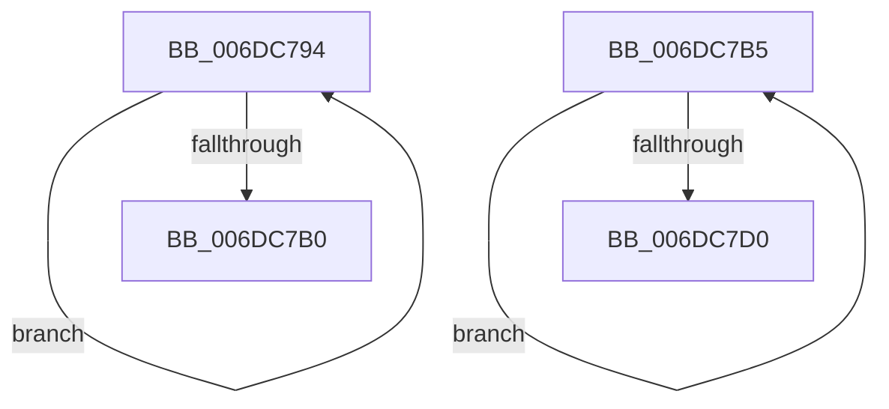

# sub_006DC794

- RVA: `0x006DC794`–`0x006DC7D5` (길이 `65` bytes)
- VA: `0x00000001406DC794`
- 실행 섹션: `.text`
- PDB 이름 있음: `아니요`; PDB Function 태그: `아니요`
- unwind 정보 RVA: `0x0006EC88`
- 디코드: `19`개 명령, `65/65` bytes 표시
- 미해석 바이트: `0` (있으면 어셈블리에 `.byte`로 보존)

> 이 문서는 커널 이미지의 기계어와 PDB 기호를 분석해 생성했습니다. 4번과 5번은 함수 원형과 자료형을 바이너리 사용 방식에서 추정한 C 해석이며 원본 소스 복구 결과는 아닙니다.

## 1. Dependencies

- 직접 호출 지점: **2**; 고유 호출 대상: **1**
- 직접 호출자로 확인된 함수: **0**
- RIP 상대 이미지 참조: **0**

### Outgoing calls
- `0x006DC79C` → [MiZeroPhysicalPage](../33/MiZeroPhysicalPage_function_00332590.md) (function, `0x00332590`)
- `0x006DC7C2` → [MiZeroPhysicalPage](../33/MiZeroPhysicalPage_function_00332590.md) (function, `0x00332590`)

### Direct callers
- 이 함수 시작 RVA로 연결되는 직접 call은 확인되지 않았습니다. 간접 호출은 완전히 역산할 수 없습니다.

### Static image references
- 디코드된 RIP-relative 메모리 참조가 없습니다.

## 2. Other-region calls and transfers

- 다른 실행 섹션으로 향하는 call: **0**
- call이 아닌 외부 분기/꼬리 이동: **2**
  - `0x006DC7B0` → [MiZeroLargePage + 0xF6](../2C/MiZeroLargePage_function_002C6914.md) (`tail-transfer`)
  - `0x006DC7D0` → [MiZeroLargePage + 0x301](../2C/MiZeroLargePage_function_002C6914.md) (`tail-transfer`)

## 3. Assembly (complete function range)

```asm
006DC794  44 8B CE                        mov r9d, esi
006DC797  49 8B D6                        mov rdx, r14
006DC79A  33 C9                           xor ecx, ecx
006DC79C  E8 EF 5D C5 FF                  call 0x140332590
006DC7A1  49 FF C6                        inc r14
006DC7A4  41 B8 02 00 00 00               mov r8d, 2
006DC7AA  48 83 EF 01                     sub rdi, 1
006DC7AE  75 E4                           jne 0x1406dc794
006DC7B0  E9 55 A2 BE FF                  jmp 0x1402c6a0a
006DC7B5  4A 8D 14 30                     lea rdx, [rax + r14]
006DC7B9  44 8B CE                        mov r9d, esi
006DC7BC  45 33 C0                        xor r8d, r8d
006DC7BF  49 8B CF                        mov rcx, r15
006DC7C2  E8 C9 5D C5 FF                  call 0x140332590
006DC7C7  FF C3                           inc ebx
006DC7C9  8B C3                           mov eax, ebx
006DC7CB  48 3B C7                        cmp rax, rdi
006DC7CE  72 E5                           jb 0x1406dc7b5
006DC7D0  E9 40 A4 BE FF                  jmp 0x1402c6c15
```

## 4. C-style interpretation (structured pseudocode)

```c
__int64 __fastcall sub_006DC794(int a1)
{
    __int64 result;
    __int64 v_r14;
    __int64 v_rdi;

    a1 = 0;
    result = MiZeroPhysicalPage(a1, v_r14, a3, (unsigned int)((unsigned int)(v_rsi)));
    v_r14 = (v_r14) + 1;
    v_rdi = (v_rdi) - (1);
    if (condition_is_not_equal) goto loc_006DC794;
}
```

## 5. (Beta) C Style

```c
int64_t sub_006DC794(int32_t Arg1)
{
    int64_t result;
    int64_t local_r14;
    int64_t local_rdi;

    Arg1 = 0;
    result = MiZeroPhysicalPage(Arg1, local_r14, a3, (uint32_t)((uint32_t)(local_rsi)));
    local_r14 = (local_r14) + 1;
    local_rdi = (local_rdi) - (1);
    if (condition_is_not_equal) goto loc_006DC794;
}
```

## 6. Execution-region graph

[열기: 2D/3D 그래프와 함수 탐색 컨트롤 패널](../../../control-panel.html?section=text&rva=0x006DC794&view=graph)

- 2D 그래프는 위에서 아래로 흐르고, 3D 그래프는 빈 공간을 드래그해 회전합니다. Shift+드래그는 이동, 휠은 확대·축소, 함수 노드 선택은 대상 보고서 이동입니다.

### Static fallback


