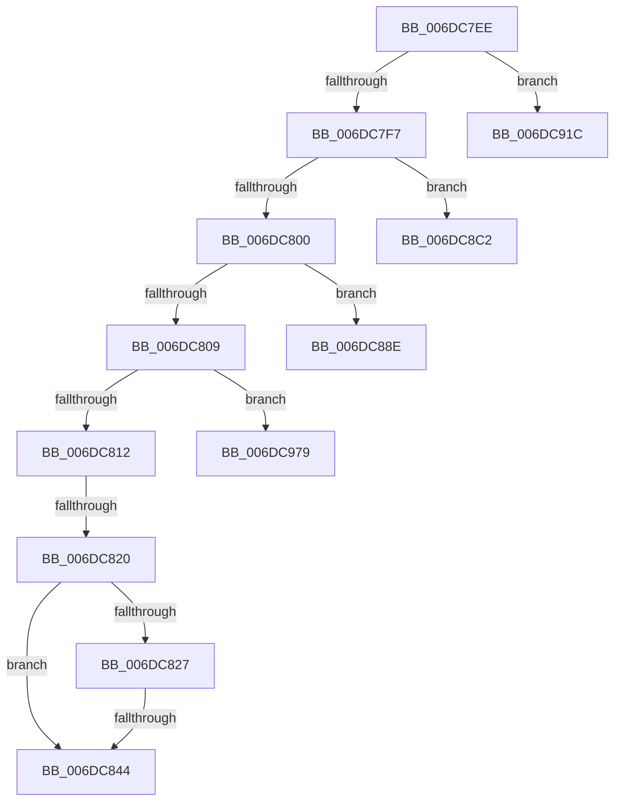

# sub_006DC7EE

- RVA: `0x006DC7EE`–`0x006DC983` (길이 `405` bytes)
- VA: `0x00000001406DC7EE`
- 실행 섹션: `.text`
- PDB 이름 있음: `아니요`; PDB Function 태그: `아니요`
- unwind 정보 RVA: `0x0006EEC4`
- 디코드: `98`개 명령, `405/405` bytes 표시
- 미해석 바이트: `0` (있으면 어셈블리에 `.byte`로 보존)

> 이 문서는 커널 이미지의 기계어와 PDB 기호를 분석해 생성했습니다. 4번과 5번은 함수 원형과 자료형을 바이너리 사용 방식에서 추정한 C 해석이며 원본 소스 복구 결과는 아닙니다.

## 1. Dependencies

- 직접 호출 지점: **5**; 고유 호출 대상: **2**
- 직접 호출자로 확인된 함수: **0**
- RIP 상대 이미지 참조: **0**

### Outgoing calls
- `0x006DC837` → [AccelBuildDescriptorNop](../66/AccelBuildDescriptorNop_function_006681AC.md) (function, `0x006681AC`)
- `0x006DC877` → [DsaBuildDescriptorCommon](../48/DsaBuildDescriptorCommon_function_00483934.md) (function, `0x00483934`)
- `0x006DC8B6` → [DsaBuildDescriptorCommon](../48/DsaBuildDescriptorCommon_function_00483934.md) (function, `0x00483934`)
- `0x006DC8FE` → [DsaBuildDescriptorCommon](../48/DsaBuildDescriptorCommon_function_00483934.md) (function, `0x00483934`)
- `0x006DC961` → [DsaBuildDescriptorCommon](../48/DsaBuildDescriptorCommon_function_00483934.md) (function, `0x00483934`)

### Direct callers
- 이 함수 시작 RVA로 연결되는 직접 call은 확인되지 않았습니다. 간접 호출은 완전히 역산할 수 없습니다.

### Static image references
- 디코드된 RIP-relative 메모리 참조가 없습니다.

## 2. Other-region calls and transfers

- 다른 실행 섹션으로 향하는 call: **0**
- call이 아닌 외부 분기/꼬리 이동: **7**
  - `0x006DC81A` → [AccelpSiovDsaOperationHandler + 0x14C](../2C/AccelpSiovDsaOperationHandler_function_002C7F30.md) (`tail-transfer`)
  - `0x006DC83E` → [AccelpSiovDsaOperationHandler + 0x91](../2C/AccelpSiovDsaOperationHandler_function_002C7F30.md) (`tail-transfer`)
  - `0x006DC889` → [AccelpSiovDsaOperationHandler + 0x82](../2C/AccelpSiovDsaOperationHandler_function_002C7F30.md) (`tail-transfer`)
  - `0x006DC8BD` → [AccelpSiovDsaOperationHandler + 0x82](../2C/AccelpSiovDsaOperationHandler_function_002C7F30.md) (`tail-transfer`)
  - `0x006DC917` → [AccelpSiovDsaOperationHandler + 0x82](../2C/AccelpSiovDsaOperationHandler_function_002C7F30.md) (`tail-transfer`)
  - `0x006DC974` → [AccelpSiovDsaOperationHandler + 0x82](../2C/AccelpSiovDsaOperationHandler_function_002C7F30.md) (`tail-transfer`)
  - `0x006DC97E` → [AccelpSiovDsaOperationHandler + 0x91](../2C/AccelpSiovDsaOperationHandler_function_002C7F30.md) (`tail-transfer`)

## 3. Assembly (complete function range)

```asm
006DC7EE  83 E9 01                        sub ecx, 1
006DC7F1  0F 84 25 01 00 00               je 0x1406dc91c
006DC7F7  83 E9 01                        sub ecx, 1
006DC7FA  0F 84 C2 00 00 00               je 0x1406dc8c2
006DC800  83 E9 01                        sub ecx, 1
006DC803  0F 84 85 00 00 00               je 0x1406dc88e
006DC809  83 F9 01                        cmp ecx, 1
006DC80C  0F 85 67 01 00 00               jne 0x1406dc979
006DC812  48 8B 4E 30                     mov rcx, qword ptr [rsi + 0x30]
006DC816  83 79 20 02                     cmp dword ptr [rcx + 0x20], 2
006DC81A  0F 82 5C B8 BE FF               jb 0x1402c807c
006DC820  48 83 7E 40 01                  cmp qword ptr [rsi + 0x40], 1
006DC825  75 1D                           jne 0x1406dc844
006DC827  48 C7 46 40 02 00 00 00         mov qword ptr [rsi + 0x40], 2
006DC82F  48 8B 49 28                     mov rcx, qword ptr [rcx + 0x28]
006DC833  48 83 C1 28                     add rcx, 0x28
006DC837  E8 70 B9 F8 FF                  call 0x1406681ac
006DC83C  85 C0                           test eax, eax
006DC83E  0F 88 7D B7 BE FF               js 0x1402c7fc1
006DC844  44 8B 4E 10                     mov r9d, dword ptr [rsi + 0x10]
006DC848  B9 01 00 00 00                  mov ecx, 1
006DC84D  48 8B 56 18                     mov rdx, qword ptr [rsi + 0x18]
006DC851  41 8B C1                        mov eax, r9d
006DC854  4C 8B 46 20                     mov r8, qword ptr [rsi + 0x20]
006DC858  25 FF FF 0F 00                  and eax, 0xfffff
006DC85D  4C 8B 5E 40                     mov r11, qword ptr [rsi + 0x40]
006DC861  4C 8B 56 38                     mov r10, qword ptr [rsi + 0x38]
006DC865  C6 44 24 30 00                  mov byte ptr [rsp + 0x30], 0
006DC86A  41 C1 E9 1F                     shr r9d, 0x1f
006DC86E  C6 44 24 28 00                  mov byte ptr [rsp + 0x28], 0
006DC873  89 44 24 20                     mov dword ptr [rsp + 0x20], eax
006DC877  E8 B8 70 DA FF                  call 0x140483934
006DC87C  4C 89 52 10                     mov qword ptr [rdx + 0x10], r10
006DC880  BB 01 00 00 00                  mov ebx, 1
006DC885  44 89 5A 20                     mov dword ptr [rdx + 0x20], r11d
006DC889  E9 24 B7 BE FF                  jmp 0x1402c7fb2
006DC88E  44 8B 4E 10                     mov r9d, dword ptr [rsi + 0x10]
006DC892  33 C9                           xor ecx, ecx
006DC894  4C 8B 46 20                     mov r8, qword ptr [rsi + 0x20]
006DC898  41 8B C1                        mov eax, r9d
006DC89B  48 8B 56 18                     mov rdx, qword ptr [rsi + 0x18]
006DC89F  25 FF FF 0F 00                  and eax, 0xfffff
006DC8A4  C6 44 24 30 00                  mov byte ptr [rsp + 0x30], 0
006DC8A9  41 C1 E9 1F                     shr r9d, 0x1f
006DC8AD  C6 44 24 28 00                  mov byte ptr [rsp + 0x28], 0
006DC8B2  89 44 24 20                     mov dword ptr [rsp + 0x20], eax
006DC8B6  E8 79 70 DA FF                  call 0x140483934
006DC8BB  33 DB                           xor ebx, ebx
006DC8BD  E9 F0 B6 BE FF                  jmp 0x1402c7fb2
006DC8C2  44 8B 4E 10                     mov r9d, dword ptr [rsi + 0x10]
006DC8C6  41 8B C9                        mov ecx, r9d
006DC8C9  48 8B 56 18                     mov rdx, qword ptr [rsi + 0x18]
006DC8CD  81 E1 FF FF 0F 00               and ecx, 0xfffff
006DC8D3  4C 8B 46 20                     mov r8, qword ptr [rsi + 0x20]
006DC8D7  48 8B 5E 40                     mov rbx, qword ptr [rsi + 0x40]
006DC8DB  4C 8B 5E 38                     mov r11, qword ptr [rsi + 0x38]
006DC8DF  4C 8B 56 30                     mov r10, qword ptr [rsi + 0x30]
006DC8E3  C0 E8 07                        shr al, 7
006DC8E6  24 01                           and al, 1
006DC8E8  C6 44 24 30 00                  mov byte ptr [rsp + 0x30], 0
006DC8ED  88 44 24 28                     mov byte ptr [rsp + 0x28], al
006DC8F1  89 4C 24 20                     mov dword ptr [rsp + 0x20], ecx
006DC8F5  B9 05 00 00 00                  mov ecx, 5
006DC8FA  41 C1 E9 1F                     shr r9d, 0x1f
006DC8FE  E8 31 70 DA FF                  call 0x140483934
006DC903  89 5A 20                        mov dword ptr [rdx + 0x20], ebx
006DC906  BB 05 00 00 00                  mov ebx, 5
006DC90B  4C 89 52 10                     mov qword ptr [rdx + 0x10], r10
006DC90F  4C 89 5A 18                     mov qword ptr [rdx + 0x18], r11
006DC913  C6 42 28 01                     mov byte ptr [rdx + 0x28], 1
006DC917  E9 96 B6 BE FF                  jmp 0x1402c7fb2
006DC91C  44 8B 4E 10                     mov r9d, dword ptr [rsi + 0x10]
006DC920  48 8B D0                        mov rdx, rax
006DC923  4C 8B 5E 18                     mov r11, qword ptr [rsi + 0x18]
006DC927  41 8B C9                        mov ecx, r9d
006DC92A  4C 8B 46 20                     mov r8, qword ptr [rsi + 0x20]
006DC92E  81 E1 FF FF 0F 00               and ecx, 0xfffff
006DC934  48 8B 7E 40                     mov rdi, qword ptr [rsi + 0x40]
006DC938  48 8B 5E 38                     mov rbx, qword ptr [rsi + 0x38]
006DC93C  4C 8B 56 30                     mov r10, qword ptr [rsi + 0x30]
006DC940  48 C1 EA 0A                     shr rdx, 0xa
006DC944  80 E2 01                        and dl, 1
006DC947  C0 E8 07                        shr al, 7
006DC94A  88 54 24 30                     mov byte ptr [rsp + 0x30], dl
006DC94E  24 01                           and al, 1
006DC950  88 44 24 28                     mov byte ptr [rsp + 0x28], al
006DC954  49 8B D3                        mov rdx, r11
006DC957  89 4C 24 20                     mov dword ptr [rsp + 0x20], ecx
006DC95B  8B CD                           mov ecx, ebp
006DC95D  41 C1 E9 1F                     shr r9d, 0x1f
006DC961  E8 CE 6F DA FF                  call 0x140483934
006DC966  49 89 5B 18                     mov qword ptr [r11 + 0x18], rbx
006DC96A  8B DD                           mov ebx, ebp
006DC96C  4D 89 53 10                     mov qword ptr [r11 + 0x10], r10
006DC970  41 89 7B 20                     mov dword ptr [r11 + 0x20], edi
006DC974  E9 39 B6 BE FF                  jmp 0x1402c7fb2
006DC979  B8 BB 00 00 C0                  mov eax, 0xc00000bb
006DC97E  E9 3E B6 BE FF                  jmp 0x1402c7fc1
```

## 4. C-style interpretation (structured pseudocode)

```c
__int64 __fastcall sub_006DC7EE(int a1)
{
    __int64 result;
    __int64 v_rbx;
    unsigned int v_stack_p20;
    unsigned __int8 v_stack_p28;
    unsigned __int8 v_stack_p30;

    a1 = (unsigned int)((a1) - (1));
    if (condition_is_equal) goto loc_006DC91C;
    a1 = (unsigned int)((a1) - (1));
    if (condition_is_equal) goto loc_006DC8C2;
    a1 = (unsigned int)((a1) - (1));
    if (condition_is_equal) goto loc_006DC88E;
    if (a1 != 1) goto loc_006DC979;
    if ((*(unsigned __int64 *)(v_rsi + 64)) != 1) goto loc_006DC844;
    *(unsigned __int64 *)(v_rsi + 64) = 2;
    a1 = (*(unsigned __int64 *)(*(unsigned __int64 *)(v_rsi + 48) + 40)) + (40);
    result = AccelBuildDescriptorNop(a1, a2, a3, a4);
loc_006DC844:
    result = (unsigned int)(((unsigned int)((unsigned int)((unsigned int)(*(unsigned int *)(v_rsi + 16))))) & (0xFFFFFULL));
    v_stack_p30 = 0;
    a4 = (unsigned int)(((unsigned int)(*(unsigned int *)(v_rsi + 16))) >> (31));
    v_stack_p28 = 0;
    v_stack_p20 = (unsigned int)(result);
    result = DsaBuildDescriptorCommon(1, *(unsigned __int64 *)(v_rsi + 24), *(unsigned __int64 *)(v_rsi + 32), a4);
    *(unsigned __int64 *)(*(unsigned __int64 *)(v_rsi + 24) + 16) = *(unsigned __int64 *)(v_rsi + 56);
    *(unsigned int *)(*(unsigned __int64 *)(v_rsi + 24) + 32) = (unsigned int)(*(unsigned __int64 *)(v_rsi + 64));
loc_006DC88E:
    a1 = 0;
    result = (unsigned int)(((unsigned int)((unsigned int)((unsigned int)(*(unsigned int *)(v_rsi + 16))))) & (0xFFFFFULL));
    v_stack_p30 = 0;
    a4 = (unsigned int)(((unsigned int)(*(unsigned int *)(v_rsi + 16))) >> (31));
    v_stack_p28 = 0;
    v_stack_p20 = (unsigned int)(result);
    result = DsaBuildDescriptorCommon(a1, *(unsigned __int64 *)(v_rsi + 24), *(unsigned __int64 *)(v_rsi + 32), a4);
    v_rbx = 0;
loc_006DC8C2:
    a1 = (unsigned int)(((unsigned int)((unsigned int)((unsigned int)(*(unsigned int *)(v_rsi + 16))))) & (0xFFFFFULL));
    result = (unsigned __int8)((result) >> (7));
    result = (unsigned __int8)((result) & (1));
    v_stack_p30 = 0;
    v_stack_p28 = (unsigned __int8)(result);
    v_stack_p20 = a1;
    a4 = (unsigned int)(((unsigned int)(*(unsigned int *)(v_rsi + 16))) >> (31));
    result = DsaBuildDescriptorCommon(5, *(unsigned __int64 *)(v_rsi + 24), *(unsigned __int64 *)(v_rsi + 32), a4);
    *(unsigned int *)(*(unsigned __int64 *)(v_rsi + 24) + 32) = (unsigned int)(*(unsigned __int64 *)(v_rsi + 64));
    *(unsigned __int64 *)(*(unsigned __int64 *)(v_rsi + 24) + 16) = *(unsigned __int64 *)(v_rsi + 48);
    *(unsigned __int64 *)(*(unsigned __int64 *)(v_rsi + 24) + 24) = *(unsigned __int64 *)(v_rsi + 56);
    *(unsigned __int8 *)(*(unsigned __int64 *)(v_rsi + 24) + 40) = 1;
loc_006DC91C:
    a1 = (unsigned int)(((unsigned int)((unsigned int)((unsigned int)(*(unsigned int *)(v_rsi + 16))))) & (0xFFFFFULL));
    a2 = (result) >> (10);
    a2 = (unsigned __int8)((a2) & (1));
    result = (unsigned __int8)((result) >> (7));
    v_stack_p30 = (unsigned __int8)(a2);
    result = (unsigned __int8)((result) & (1));
    v_stack_p28 = (unsigned __int8)(result);
    v_stack_p20 = a1;
    a4 = (unsigned int)(((unsigned int)(*(unsigned int *)(v_rsi + 16))) >> (31));
    result = DsaBuildDescriptorCommon((unsigned int)((unsigned int)(v_rbp)), *(unsigned __int64 *)(v_rsi + 24), *(unsigned __int64 *)(v_rsi + 32), a4);
    *(unsigned __int64 *)(*(unsigned __int64 *)(v_rsi + 24) + 24) = *(unsigned __int64 *)(v_rsi + 56);
    *(unsigned __int64 *)(*(unsigned __int64 *)(v_rsi + 24) + 16) = *(unsigned __int64 *)(v_rsi + 48);
    *(unsigned int *)(*(unsigned __int64 *)(v_rsi + 24) + 32) = (unsigned int)(*(unsigned __int64 *)(v_rsi + 64));
loc_006DC979:
}
```

## 5. (Beta) C Style

```c
int64_t sub_006DC7EE(int32_t Arg1)
{
    int64_t result;
    int64_t local_rbx;
    uint32_t v_stack_p20;
    uint8_t v_stack_p28;
    uint8_t v_stack_p30;

    Arg1 = (uint32_t)((Arg1) - (1));
    if (condition_is_equal) goto loc_006DC91C;
    Arg1 = (uint32_t)((Arg1) - (1));
    if (condition_is_equal) goto loc_006DC8C2;
    Arg1 = (uint32_t)((Arg1) - (1));
    if (condition_is_equal) goto loc_006DC88E;
    if (Arg1 != 1) goto loc_006DC979;
    if ((*(uint64_t *)(local_rsi + 0x40)) != 1) goto loc_006DC844;
    *(uint64_t *)(local_rsi + 0x40) = 2;
    Arg1 = (*(uint64_t *)(*(uint64_t *)(local_rsi + 0x30) + 0x28)) + (40);
    result = AccelBuildDescriptorNop(Arg1, a2, a3, a4);
loc_006DC844:
    result = (uint32_t)(((uint32_t)((uint32_t)((uint32_t)(*(uint32_t *)(local_rsi + 0x10))))) & (0xFFFFFULL));
    v_stack_p30 = 0;
    a4 = (uint32_t)(((uint32_t)(*(uint32_t *)(local_rsi + 0x10))) >> (31));
    v_stack_p28 = 0;
    v_stack_p20 = (uint32_t)(result);
    result = DsaBuildDescriptorCommon(1, *(uint64_t *)(local_rsi + 0x18), *(uint64_t *)(local_rsi + 0x20), a4);
    *(uint64_t *)(*(uint64_t *)(local_rsi + 0x18) + 0x10) = *(uint64_t *)(local_rsi + 0x38);
    *(uint32_t *)(*(uint64_t *)(local_rsi + 0x18) + 0x20) = (uint32_t)(*(uint64_t *)(local_rsi + 0x40));
loc_006DC88E:
    Arg1 = 0;
    result = (uint32_t)(((uint32_t)((uint32_t)((uint32_t)(*(uint32_t *)(local_rsi + 0x10))))) & (0xFFFFFULL));
    v_stack_p30 = 0;
    a4 = (uint32_t)(((uint32_t)(*(uint32_t *)(local_rsi + 0x10))) >> (31));
    v_stack_p28 = 0;
    v_stack_p20 = (uint32_t)(result);
    result = DsaBuildDescriptorCommon(Arg1, *(uint64_t *)(local_rsi + 0x18), *(uint64_t *)(local_rsi + 0x20), a4);
    local_rbx = 0;
loc_006DC8C2:
    Arg1 = (uint32_t)(((uint32_t)((uint32_t)((uint32_t)(*(uint32_t *)(local_rsi + 0x10))))) & (0xFFFFFULL));
    result = (uint8_t)((result) >> (7));
    result = (uint8_t)((result) & (1));
    v_stack_p30 = 0;
    v_stack_p28 = (uint8_t)(result);
    v_stack_p20 = Arg1;
    a4 = (uint32_t)(((uint32_t)(*(uint32_t *)(local_rsi + 0x10))) >> (31));
    result = DsaBuildDescriptorCommon(5, *(uint64_t *)(local_rsi + 0x18), *(uint64_t *)(local_rsi + 0x20), a4);
    *(uint32_t *)(*(uint64_t *)(local_rsi + 0x18) + 0x20) = (uint32_t)(*(uint64_t *)(local_rsi + 0x40));
    *(uint64_t *)(*(uint64_t *)(local_rsi + 0x18) + 0x10) = *(uint64_t *)(local_rsi + 0x30);
    *(uint64_t *)(*(uint64_t *)(local_rsi + 0x18) + 0x18) = *(uint64_t *)(local_rsi + 0x38);
    *(uint8_t *)(*(uint64_t *)(local_rsi + 0x18) + 0x28) = 1;
loc_006DC91C:
    Arg1 = (uint32_t)(((uint32_t)((uint32_t)((uint32_t)(*(uint32_t *)(local_rsi + 0x10))))) & (0xFFFFFULL));
    a2 = (result) >> (10);
    a2 = (uint8_t)((a2) & (1));
    result = (uint8_t)((result) >> (7));
    v_stack_p30 = (uint8_t)(a2);
    result = (uint8_t)((result) & (1));
    v_stack_p28 = (uint8_t)(result);
    v_stack_p20 = Arg1;
    a4 = (uint32_t)(((uint32_t)(*(uint32_t *)(local_rsi + 0x10))) >> (31));
    result = DsaBuildDescriptorCommon((uint32_t)((uint32_t)(local_rbp)), *(uint64_t *)(local_rsi + 0x18), *(uint64_t *)(local_rsi + 0x20), a4);
    *(uint64_t *)(*(uint64_t *)(local_rsi + 0x18) + 0x18) = *(uint64_t *)(local_rsi + 0x38);
    *(uint64_t *)(*(uint64_t *)(local_rsi + 0x18) + 0x10) = *(uint64_t *)(local_rsi + 0x30);
    *(uint32_t *)(*(uint64_t *)(local_rsi + 0x18) + 0x20) = (uint32_t)(*(uint64_t *)(local_rsi + 0x40));
loc_006DC979:
}
```

## 6. Execution-region graph

[열기: 2D/3D 그래프와 함수 탐색 컨트롤 패널](../../../control-panel.html?section=text&rva=0x006DC7EE&view=graph)

- 2D 그래프는 위에서 아래로 흐르고, 3D 그래프는 빈 공간을 드래그해 회전합니다. Shift+드래그는 이동, 휠은 확대·축소, 함수 노드 선택은 대상 보고서 이동입니다.

### Static fallback


