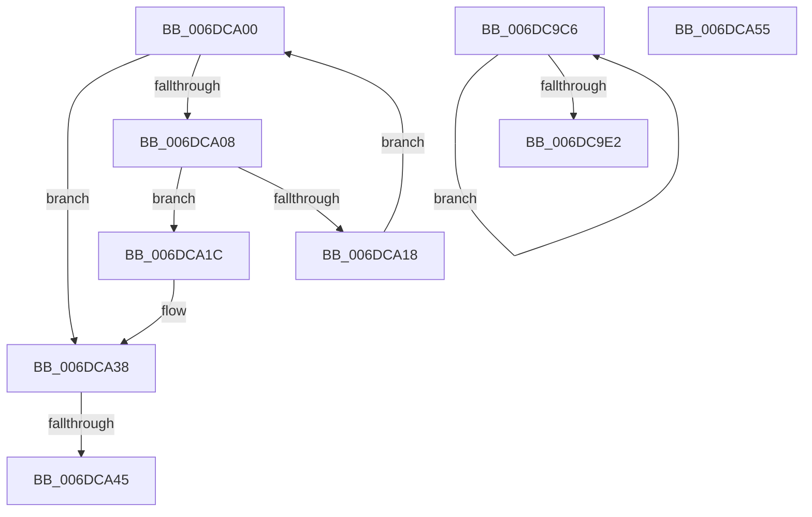

# sub_006DC9C6

- RVA: `0x006DC9C6`–`0x006DCA71` (길이 `171` bytes)
- VA: `0x00000001406DC9C6`
- 실행 섹션: `.text`
- PDB 이름 있음: `아니요`; PDB Function 태그: `아니요`
- unwind 정보 RVA: `0x0006EFB0`
- 디코드: `46`개 명령, `171/171` bytes 표시
- 미해석 바이트: `0` (있으면 어셈블리에 `.byte`로 보존)

> 이 문서는 커널 이미지의 기계어와 PDB 기호를 분석해 생성했습니다. 4번과 5번은 함수 원형과 자료형을 바이너리 사용 방식에서 추정한 C 해석이며 원본 소스 복구 결과는 아닙니다.

## 1. Dependencies

- 직접 호출 지점: **3**; 고유 호출 대상: **2**
- 직접 호출자로 확인된 함수: **0**
- RIP 상대 이미지 참조: **0**

### Outgoing calls
- `0x006DCA32` → [KeBugCheckEx](../4F/KeBugCheckEx_function_004FD660.md) (function, `0x004FD660`)
- `0x006DCA47` → [ExFreePoolWithTag](../../poolcode/B8/ExFreePoolWithTag_function_00B82870.md) (function, `0x00B82870`)
- `0x006DCA6B` → [KeBugCheckEx](../4F/KeBugCheckEx_function_004FD660.md) (function, `0x004FD660`)

### Direct callers
- 이 함수 시작 RVA로 연결되는 직접 call은 확인되지 않았습니다. 간접 호출은 완전히 역산할 수 없습니다.

### Static image references
- 디코드된 RIP-relative 메모리 참조가 없습니다.

## 2. Other-region calls and transfers

- 다른 실행 섹션으로 향하는 call: **1**
  - `0x006DCA47` → [ExFreePoolWithTag](../../poolcode/B8/ExFreePoolWithTag_function_00B82870.md) (`.text` → `POOLCODE`)
- call이 아닌 외부 분기/꼬리 이동: **3**
  - `0x006DC9FB` → [MiStartDpcGang + 0x55](../2C/MiStartDpcGang_function_002C8C34.md) (`tail-transfer`)
  - `0x006DCA3F` → [MiStartDpcGang + 0xCB](../2C/MiStartDpcGang_function_002C8C34.md) (`tail-transfer`)
  - `0x006DCA50` → [MiStartDpcGang + 0xCB](../2C/MiStartDpcGang_function_002C8C34.md) (`tail-transfer`)

## 3. Assembly (complete function range)

```asm
006DC9C6  48 8B 02                        mov rax, qword ptr [rdx]
006DC9C9  4C 89 14 01                     mov qword ptr [rcx + rax], r10
006DC9CD  4C 03 D6                        add r10, rsi
006DC9D0  48 8B 02                        mov rax, qword ptr [rdx]
006DC9D3  48 8D 49 10                     lea rcx, [rcx + 0x10]
006DC9D7  48 89 74 01 F8                  mov qword ptr [rcx + rax - 8], rsi
006DC9DC  49 83 E9 01                     sub r9, 1
006DC9E0  75 E4                           jne 0x1406dc9c6
006DC9E2  48 8D 8B B8 00 00 00            lea rcx, [rbx + 0xb8]
006DC9E9  48 8B 02                        mov rax, qword ptr [rdx]
006DC9EC  4D 03 DB                        add r11, r11
006DC9EF  4C 0F AF C6                     imul r8, rsi
006DC9F3  49 2B F8                        sub rdi, r8
006DC9F6  4A 01 7C D8 F8                  add qword ptr [rax + r11*8 - 8], rdi
006DC9FB  E9 89 C2 BE FF                  jmp 0x1402c8c89
006DCA00  48 8B 4B 10                     mov rcx, qword ptr [rbx + 0x10]
006DCA04  3B C5                           cmp eax, ebp
006DCA06  73 30                           jae 0x1406dca38
006DCA08  44 8B C8                        mov r9d, eax
006DCA0B  4D 03 C9                        add r9, r9
006DCA0E  4A 8B 54 C9 08                  mov rdx, qword ptr [rcx + r9*8 + 8]
006DCA13  48 85 D2                        test rdx, rdx
006DCA16  75 04                           jne 0x1406dca1c
006DCA18  FF C0                           inc eax
006DCA1A  EB E4                           jmp 0x1406dca00
006DCA1C  4E 8B 0C C9                     mov r9, qword ptr [rcx + r9*8]
006DCA20  4C 8B C3                        mov r8, rbx
006DCA23  48 89 54 24 20                  mov qword ptr [rsp + 0x20], rdx
006DCA28  B9 1A 00 00 00                  mov ecx, 0x1a
006DCA2D  BA 82 61 00 00                  mov edx, 0x6182
006DCA32  E8 29 0C E2 FF                  call 0x1404fd660
006DCA37  CC                              int3
006DCA38  48 8D 43 18                     lea rax, [rbx + 0x18]
006DCA3C  48 3B C8                        cmp rcx, rax
006DCA3F  0F 84 BA C2 BE FF               je 0x1402c8cff
006DCA45  33 D2                           xor edx, edx
006DCA47  E8 24 5E 4A 00                  call 0x140b82870
006DCA4C  4C 89 73 10                     mov qword ptr [rbx + 0x10], r14
006DCA50  E9 AA C2 BE FF                  jmp 0x1402c8cff
006DCA55  4C 8B 4B 08                     mov r9, qword ptr [rbx + 8]
006DCA59  4C 8B C3                        mov r8, rbx
006DCA5C  BA 83 61 00 00                  mov edx, 0x6183
006DCA61  48 89 44 24 20                  mov qword ptr [rsp + 0x20], rax
006DCA66  B9 1A 00 00 00                  mov ecx, 0x1a
006DCA6B  E8 F0 0B E2 FF                  call 0x1404fd660
006DCA70  CC                              int3
```

## 4. C-style interpretation (structured pseudocode)

```c
__int64 __fastcall sub_006DC9C6(__int64 a1, __int64 a2, __int64 a3, __int64 a4)
{
    __int64 v_r10;
    __int64 v_r11;
    __int64 v_rdi;
    unsigned __int64 v_stack_p20;

    *(unsigned __int64 *)(a1 + *(unsigned __int64 *)(a2) * 1) = v_r10;
    v_r10 = (v_r10) + (v_rsi);
    *(unsigned __int64 *)(a1 + 16 + *(unsigned __int64 *)(a2) * 1 - 8) = v_rsi;
    a4 = (a4) - (1);
    if (condition_is_not_equal) goto loc_006DC9C6;
    v_r11 = (v_r11) + (v_r11);
    a3 = (a3) * (v_rsi);
    v_rdi = (v_rdi) - (a3);
}
```

## 5. (Beta) C Style

```c
int64_t sub_006DC9C6(void *Arg1, void *Arg2, int64_t Arg3, int64_t Arg4)
{
    uint8_t *arg1 = (uint8_t *)Arg1;
    uint8_t *arg2 = (uint8_t *)Arg2;

    int64_t local_r10;
    int64_t local_r11;
    int64_t local_rdi;
    uint64_t v_stack_p20;

    *(uint64_t *)(arg1 + *(uint64_t *)(arg2) * 1) = local_r10;
    local_r10 = (local_r10) + (local_rsi);
    *(uint64_t *)(arg1 + 0x10 + *(uint64_t *)(arg2) * 1 - 0x8) = local_rsi;
    Arg4 = (Arg4) - (1);
    if (condition_is_not_equal) goto loc_006DC9C6;
    local_r11 = (local_r11) + (local_r11);
    Arg3 = (Arg3) * (local_rsi);
    local_rdi = (local_rdi) - (Arg3);
}
```

### 관측된 메모리 오프셋

구조체 형식이 확인되지 않은 접근은 인자 기준의 오프셋으로만 기록했습니다.

| 기준 인자 | 오프셋 표현 | 폭 (bit) | 접근 |
|---|---:|---:|---|
| `Arg1` | `- 0x8 + rax*1` | `64` | `W` |
| `Arg1` | `+ 0x0 + rax*1` | `64` | `W` |
| `Arg1` | `+ 0x10` | `64` | `R` |
| `Arg2` | `+ 0x0` | `64` | `R` |

## 6. Execution-region graph

[열기: 2D/3D 그래프와 함수 탐색 컨트롤 패널](../../../control-panel.html?section=text&rva=0x006DC9C6&view=graph)

- 2D 그래프는 위에서 아래로 흐르고, 3D 그래프는 빈 공간을 드래그해 회전합니다. Shift+드래그는 이동, 휠은 확대·축소, 함수 노드 선택은 대상 보고서 이동입니다.

### Static fallback


