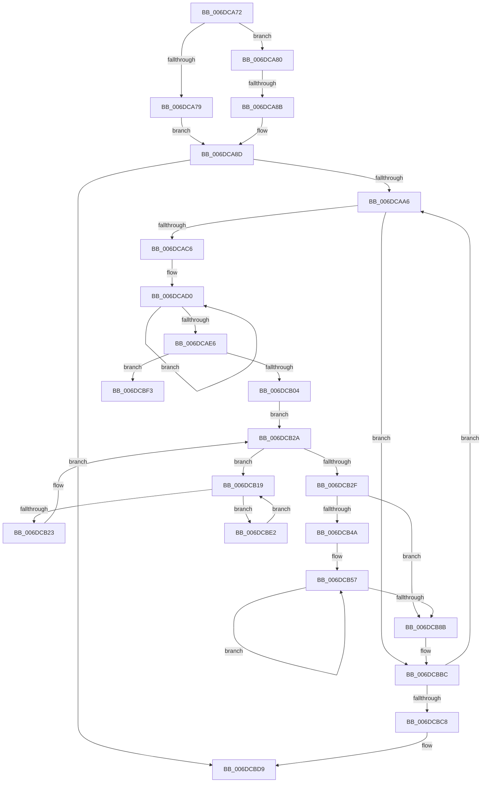

# sub_006DCA72

- RVA: `0x006DCA72`–`0x006DCBFA` (길이 `392` bytes)
- VA: `0x00000001406DCA72`
- 실행 섹션: `.text`
- PDB 이름 있음: `아니요`; PDB Function 태그: `아니요`
- unwind 정보 RVA: `0x0006EFF8`
- 디코드: `101`개 명령, `392/392` bytes 표시
- 미해석 바이트: `0` (있으면 어셈블리에 `.byte`로 보존)

> 이 문서는 커널 이미지의 기계어와 PDB 기호를 분석해 생성했습니다. 4번과 5번은 함수 원형과 자료형을 바이너리 사용 방식에서 추정한 C 해석이며 원본 소스 복구 결과는 아닙니다.

## 1. Dependencies

- 직접 호출 지점: **4**; 고유 호출 대상: **4**
- 직접 호출자로 확인된 함수: **0**
- RIP 상대 이미지 참조: **1**

### Outgoing calls
- `0x006DCA98` → [memset](../6C/memset_function_006C6C40.md) (function, `0x006C6C40`)
- `0x006DCAAB` → [MiGetLeafPfnBuddy](../43/MiGetLeafPfnBuddy_function_00438E30.md) (function, `0x00438E30`)
- `0x006DCAB6` → [MiGetPfnPageSizeIndex](../31/MiGetPfnPageSizeIndex_function_0031C710.md) (function, `0x0031C710`)
- `0x006DCBE9` → [MiDemotePfnListChain](../69/MiDemotePfnListChain_function_00698B5C.md) (function, `0x00698B5C`)

### Direct callers
- 이 함수 시작 RVA로 연결되는 직접 call은 확인되지 않았습니다. 간접 호출은 완전히 역산할 수 없습니다.

### Static image references
- `0x006DCB2F` → RVA `0x00011C60` (`.rdata`; read)

## 2. Other-region calls and transfers

- 다른 실행 섹션으로 향하는 call: **0**
- call이 아닌 외부 분기/꼬리 이동: **2**
  - `0x006DCA85` → [MiInitializeLargeMdlLeafPfns + 0x6C](../2C/MiInitializeLargeMdlLeafPfns_function_002C8EA4.md) (`tail-transfer`)
  - `0x006DCBDD` → [MiInitializeLargeMdlLeafPfns + 0x6C](../2C/MiInitializeLargeMdlLeafPfns_function_002C8EA4.md) (`tail-transfer`)

## 3. Assembly (complete function range)

```asm
006DCA72  41 0F BA E0 18                  bt r8d, 0x18
006DCA77  73 07                           jae 0x1406dca80
006DCA79  BE 01 00 00 00                  mov esi, 1
006DCA7E  EB 0D                           jmp 0x1406dca8d
006DCA80  41 0F BA E0 19                  bt r8d, 0x19
006DCA85  0F 83 85 C4 BE FF               jae 0x1402c8f10
006DCA8B  33 F6                           xor esi, esi
006DCA8D  33 D2                           xor edx, edx
006DCA8F  48 8D 4C 24 40                  lea rcx, [rsp + 0x40]
006DCA94  44 8D 42 60                     lea r8d, [rdx + 0x60]
006DCA98  E8 A3 A1 FE FF                  call 0x1406c6c40
006DCA9D  48 85 FF                        test rdi, rdi
006DCAA0  0F 84 33 01 00 00               je 0x1406dcbd9
006DCAA6  33 D2                           xor edx, edx
006DCAA8  48 8B CF                        mov rcx, rdi
006DCAAB  E8 80 C3 D5 FF                  call 0x140438e30
006DCAB0  48 8B CF                        mov rcx, rdi
006DCAB3  4C 8B E0                        mov r12, rax
006DCAB6  E8 55 FC C3 FF                  call 0x14031c710
006DCABB  44 8B F0                        mov r14d, eax
006DCABE  3B C6                           cmp eax, esi
006DCAC0  0F 84 F6 00 00 00               je 0x1406dcbbc
006DCAC6  48 8D 4C 24 40                  lea rcx, [rsp + 0x40]
006DCACB  BA 04 00 00 00                  mov edx, 4
006DCAD0  48 83 61 10 00                  and qword ptr [rcx + 0x10], 0
006DCAD5  48 89 49 08                     mov qword ptr [rcx + 8], rcx
006DCAD9  48 89 09                        mov qword ptr [rcx], rcx
006DCADC  48 83 C1 18                     add rcx, 0x18
006DCAE0  48 83 EA 01                     sub rdx, 1
006DCAE4  75 EA                           jne 0x1406dcad0
006DCAE6  4B 8D 04 76                     lea rax, [r14 + r14*2]
006DCAEA  4D 8B FE                        mov r15, r14
006DCAED  48 8D 6C 24 40                  lea rbp, [rsp + 0x40]
006DCAF2  48 8D 6C C5 00                  lea rbp, [rbp + rax*8]
006DCAF7  48 8B 4D 08                     mov rcx, qword ptr [rbp + 8]
006DCAFB  48 39 29                        cmp qword ptr [rcx], rbp
006DCAFE  0F 85 EF 00 00 00               jne 0x1406dcbf3
006DCB04  48 89 2F                        mov qword ptr [rdi], rbp
006DCB07  48 89 4F 08                     mov qword ptr [rdi + 8], rcx
006DCB0B  48 89 39                        mov qword ptr [rcx], rdi
006DCB0E  48 89 7D 08                     mov qword ptr [rbp + 8], rdi
006DCB12  48 FF 44 C4 50                  inc qword ptr [rsp + rax*8 + 0x50]
006DCB17  EB 11                           jmp 0x1406dcb2a
006DCB19  48 39 6D 00                     cmp qword ptr [rbp], rbp
006DCB1D  0F 85 BF 00 00 00               jne 0x1406dcbe2
006DCB23  41 FF C6                        inc r14d
006DCB26  48 83 C5 18                     add rbp, 0x18
006DCB2A  44 3B F6                        cmp r14d, esi
006DCB2D  72 EA                           jb 0x1406dcb19
006DCB2F  4C 8D 1D 2A 51 93 FF            lea r11, [rip - 0x6caed6]
006DCB36  4B 8B 04 FB                     mov rax, qword ptr [r11 + r15*8]
006DCB3A  4C 8D 0C 40                     lea r9, [rax + rax*2]
006DCB3E  49 C1 E1 04                     shl r9, 4
006DCB42  4C 03 CF                        add r9, rdi
006DCB45  49 3B F9                        cmp rdi, r9
006DCB48  74 41                           je 0x1406dcb8b
006DCB4A  44 8B D6                        mov r10d, esi
006DCB4D  48 BD 01 00 00 00 00 F0 FF FF   movabs rbp, 0xfffff00000000001
006DCB57  4B 8B 04 D3                     mov rax, qword ptr [r11 + r10*8]
006DCB5B  4C 8D 04 40                     lea r8, [rax + rax*2]
006DCB5F  48 8B 07                        mov rax, qword ptr [rdi]
006DCB62  49 C1 E0 04                     shl r8, 4
006DCB66  4C 03 C7                        add r8, rdi
006DCB69  49 8B C8                        mov rcx, r8
006DCB6C  48 C1 E9 04                     shr rcx, 4
006DCB70  48 8D 14 09                     lea rdx, [rcx + rcx]
006DCB74  48 8B CA                        mov rcx, rdx
006DCB77  48 33 C8                        xor rcx, rax
006DCB7A  48 23 CD                        and rcx, rbp
006DCB7D  48 33 CA                        xor rcx, rdx
006DCB80  48 89 0F                        mov qword ptr [rdi], rcx
006DCB83  49 8B F8                        mov rdi, r8
006DCB86  4D 3B C1                        cmp r8, r9
006DCB89  75 CC                           jne 0x1406dcb57
006DCB8B  8B C6                           mov eax, esi
006DCB8D  49 8B CC                        mov rcx, r12
006DCB90  48 C1 E9 04                     shr rcx, 4
006DCB94  49 6B 04 C3 D0                  imul rax, qword ptr [r11 + rax*8], -0x30
006DCB99  48 8D 14 09                     lea rdx, [rcx + rcx]
006DCB9D  48 03 F8                        add rdi, rax
006DCBA0  48 8B CA                        mov rcx, rdx
006DCBA3  48 8B 07                        mov rax, qword ptr [rdi]
006DCBA6  48 33 C8                        xor rcx, rax
006DCBA9  48 B8 01 00 00 00 00 F0 FF FF   movabs rax, 0xfffff00000000001
006DCBB3  48 23 C8                        and rcx, rax
006DCBB6  48 33 CA                        xor rcx, rdx
006DCBB9  48 89 0F                        mov qword ptr [rdi], rcx
006DCBBC  49 8B FC                        mov rdi, r12
006DCBBF  4D 85 E4                        test r12, r12
006DCBC2  0F 85 DE FE FF FF               jne 0x1406dcaa6
006DCBC8  48 8B 6C 24 30                  mov rbp, qword ptr [rsp + 0x30]
006DCBCD  4C 8D 3D 8C 50 93 FF            lea r15, [rip - 0x6caf74]
006DCBD4  4C 8B 74 24 38                  mov r14, qword ptr [rsp + 0x38]
006DCBD9  49 8B 7D 00                     mov rdi, qword ptr [r13]
006DCBDD  E9 2E C3 BE FF                  jmp 0x1402c8f10
006DCBE2  8B D6                           mov edx, esi
006DCBE4  48 8D 4C 24 40                  lea rcx, [rsp + 0x40]
006DCBE9  E8 6E BF FB FF                  call 0x140698b5c
006DCBEE  E9 26 FF FF FF                  jmp 0x1406dcb19
006DCBF3  B9 03 00 00 00                  mov ecx, 3
006DCBF8  CD 29                           int 0x29
```

## 4. C-style interpretation (structured pseudocode)

```c
__int64 __fastcall sub_006DCA72(__int64 a1, int a2, int a3, __int64 a4, __int64 a5, __int64 a6, __int64 a7, __int64 a8, __int64 a9, __int64 a10)
{
    __int64 result;
    __int64 v_r14;
    __int64 v_rbp;
    __int64 v_rdi;
    __int64 v_rsi;
    unsigned __int64 v_stack_p40;
    unsigned __int64 v_stack_p48;

    if (condition_is_above_or_equal) goto loc_006DCA80;
    goto loc_006DCA8D;
loc_006DCA80:
    v_rsi = 0;
loc_006DCA8D:
    a2 = 0;
    result = memset(a8, a2, a2 + 96, a4);
    if (v_rdi == 0) goto loc_006DCBD9;
loc_006DCAA6:
    a2 = 0;
    result = MiGetLeafPfnBuddy(v_rdi, a2, a2 + 96, a4);
    result = MiGetPfnPageSizeIndex(v_rdi, a2, a2 + 96, a4);
    if (((unsigned int)(result)) == 0) goto loc_006DCBBC;
loc_006DCAD0:
    *(unsigned __int64 *)(a8 + 8) = a8;
    *(unsigned __int64 *)(a8) = a8;
    a1 = (a8) + (24);
    a2 = (4) - (1);
    if (condition_is_not_equal) goto loc_006DCAD0;
    if ((*(unsigned __int64 *)(v_stack_p48)) != (a8 + (unsigned int)((unsigned int)(result)) + (unsigned int)((unsigned int)(result)) * 2 * 8)) goto loc_006DCBF3;
    *(unsigned __int64 *)(v_rdi) = a8 + (unsigned int)((unsigned int)(result)) + (unsigned int)((unsigned int)(result)) * 2 * 8;
    *(unsigned __int64 *)(v_rdi + 8) = v_stack_p48;
    *(unsigned __int64 *)(v_stack_p48) = v_rdi;
    v_stack_p48 = v_rdi;
    goto loc_006DCB2A;
loc_006DCB19:
    if (v_stack_p40 != (a8 + (unsigned int)((unsigned int)(result)) + (unsigned int)((unsigned int)(result)) * 2 * 8)) goto loc_006DCBE2;
    v_r14 = (unsigned int)(((unsigned int)((unsigned int)(result))) + 1);
    v_rbp = (a8 + (unsigned int)((unsigned int)(result)) + (unsigned int)((unsigned int)(result)) * 2 * 8) + (24);
loc_006DCB2A:
    if (((unsigned int)(v_r14)) < 0) goto loc_006DCB19;
    a4 = (*(unsigned __int64 *)(v_rip - 7122646 + (unsigned int)((unsigned int)(result)) * 8) + *(unsigned __int64 *)(v_rip - 7122646 + (unsigned int)((unsigned int)(result)) * 8) * 2) << (4);
    a4 = (a4) + (v_rdi);
    if (v_rdi == a4) goto loc_006DCB8B;
loc_006DCB57:
    a3 = (*(unsigned __int64 *)(v_rip - 7122646 + 0 * 8) + *(unsigned __int64 *)(v_rip - 7122646 + 0 * 8) * 2) << (4);
    a3 = (a3) + (v_rdi);
    a1 = (a3) >> (4);
    a1 = (a1 + a1 * 1) ^ (*(unsigned __int64 *)(v_rdi));
    a1 = (a1) & (v_rbp);
    a1 = (a1) ^ (a1 + a1 * 1);
    *(unsigned __int64 *)(v_rdi) = a1;
    if (a3 != a4) goto loc_006DCB57;
loc_006DCB8B:
    a1 = (result) >> (4);
    result = (0) * (*(unsigned __int64 *)(v_rip - 7122646 + 0 * 8));
    v_rdi = (a3) + (result);
    a1 = (a1 + a1 * 1) ^ (*(unsigned __int64 *)(v_rdi));
    a1 = (a1) & (*(unsigned __int64 *)(v_rdi));
    a1 = (a1) ^ (a1 + a1 * 1);
    *(unsigned __int64 *)(v_rdi) = a1;
loc_006DCBBC:
    if (result != 0) goto loc_006DCAA6;
loc_006DCBD9:
loc_006DCBE2:
    result = MiDemotePfnListChain(a8, 0, a3, a4);
    goto loc_006DCB19;
loc_006DCBF3:
    return result;
}
```

## 5. (Beta) C Style

```c
int64_t sub_006DCA72(int64_t Arg1, int32_t Arg2, int32_t Arg3, int64_t Arg4, uint64_t Arg5, int64_t Arg6, int64_t Arg7, int64_t Arg8, uint64_t Arg9, int64_t Arg10)
{
    int64_t result;
    int64_t local_r14;
    int64_t local_rbp;
    int64_t local_rdi;
    int64_t local_rsi;
    uint64_t v_stack_p40;
    uint64_t v_stack_p48;

    if (condition_is_above_or_equal) goto loc_006DCA80;
    goto loc_006DCA8D;
loc_006DCA80:
    local_rsi = 0;
loc_006DCA8D:
    Arg2 = 0;
    result = memset(Arg8, Arg2, Arg2 + 96, Arg4);
    if (local_rdi == 0) goto loc_006DCBD9;
loc_006DCAA6:
    Arg2 = 0;
    result = MiGetLeafPfnBuddy(local_rdi, Arg2, Arg2 + 96, Arg4);
    result = MiGetPfnPageSizeIndex(local_rdi, Arg2, Arg2 + 96, Arg4);
    if (((uint32_t)(result)) == 0) goto loc_006DCBBC;
loc_006DCAD0:
    *(uint64_t *)(Arg8 + 0x8) = Arg8;
    *(uint64_t *)(Arg8) = Arg8;
    Arg1 = (Arg8) + (24);
    Arg2 = (4) - (1);
    if (condition_is_not_equal) goto loc_006DCAD0;
    if ((*(uint64_t *)(v_stack_p48)) != (Arg8 + (uint32_t)((uint32_t)(result)) + (uint32_t)((uint32_t)(result)) * 2 * 8)) goto loc_006DCBF3;
    *(uint64_t *)(local_rdi) = Arg8 + (uint32_t)((uint32_t)(result)) + (uint32_t)((uint32_t)(result)) * 2 * 8;
    *(uint64_t *)(local_rdi + 0x8) = v_stack_p48;
    *(uint64_t *)(v_stack_p48) = local_rdi;
    v_stack_p48 = local_rdi;
    goto loc_006DCB2A;
loc_006DCB19:
    if (v_stack_p40 != (Arg8 + (uint32_t)((uint32_t)(result)) + (uint32_t)((uint32_t)(result)) * 2 * 8)) goto loc_006DCBE2;
    local_r14 = (uint32_t)(((uint32_t)((uint32_t)(result))) + 1);
    local_rbp = (Arg8 + (uint32_t)((uint32_t)(result)) + (uint32_t)((uint32_t)(result)) * 2 * 8) + (24);
loc_006DCB2A:
    if (((uint32_t)(local_r14)) < 0) goto loc_006DCB19;
    Arg4 = (*(uint64_t *)(v_rip - 0x6CAED6 + (uint32_t)((uint32_t)(result)) * 8) + *(uint64_t *)(v_rip - 0x6CAED6 + (uint32_t)((uint32_t)(result)) * 8) * 2) << (4);
    Arg4 = (Arg4) + (local_rdi);
    if (local_rdi == Arg4) goto loc_006DCB8B;
loc_006DCB57:
    Arg3 = (*(uint64_t *)(v_rip - 0x6CAED6 + 0x0 * 8) + *(uint64_t *)(v_rip - 0x6CAED6 + 0x0 * 8) * 2) << (4);
    Arg3 = (Arg3) + (local_rdi);
    Arg1 = (Arg3) >> (4);
    Arg1 = (Arg1 + Arg1 * 1) ^ (*(uint64_t *)(local_rdi));
    Arg1 = (Arg1) & (local_rbp);
    Arg1 = (Arg1) ^ (Arg1 + Arg1 * 1);
    *(uint64_t *)(local_rdi) = Arg1;
    if (Arg3 != Arg4) goto loc_006DCB57;
loc_006DCB8B:
    Arg1 = (result) >> (4);
    result = (0) * (*(uint64_t *)(v_rip - 0x6CAED6 + 0x0 * 8));
    local_rdi = (Arg3) + (result);
    Arg1 = (Arg1 + Arg1 * 1) ^ (*(uint64_t *)(local_rdi));
    Arg1 = (Arg1) & (*(uint64_t *)(local_rdi));
    Arg1 = (Arg1) ^ (Arg1 + Arg1 * 1);
    *(uint64_t *)(local_rdi) = Arg1;
loc_006DCBBC:
    if (result != 0) goto loc_006DCAA6;
loc_006DCBD9:
loc_006DCBE2:
    result = MiDemotePfnListChain(Arg8, 0, Arg3, Arg4);
    goto loc_006DCB19;
loc_006DCBF3:
    return result;
}
```

## 6. Execution-region graph

[열기: 2D/3D 그래프와 함수 탐색 컨트롤 패널](../../../control-panel.html?section=text&rva=0x006DCA72&view=graph)

- 2D 그래프는 위에서 아래로 흐르고, 3D 그래프는 빈 공간을 드래그해 회전합니다. Shift+드래그는 이동, 휠은 확대·축소, 함수 노드 선택은 대상 보고서 이동입니다.

### Static fallback


