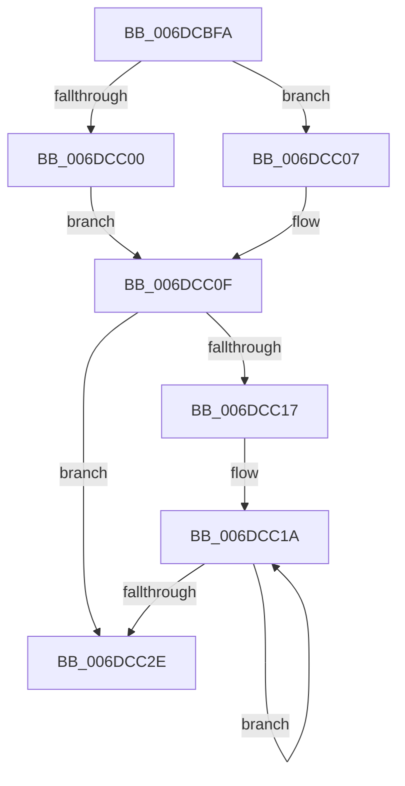

# sub_006DCBFA

- RVA: `0x006DCBFA`–`0x006DCC38` (길이 `62` bytes)
- VA: `0x00000001406DCBFA`
- 실행 섹션: `.text`
- PDB 이름 있음: `아니요`; PDB Function 태그: `아니요`
- unwind 정보 RVA: `0x0006F044`
- 디코드: `18`개 명령, `62/62` bytes 표시
- 미해석 바이트: `0` (있으면 어셈블리에 `.byte`로 보존)

> 이 문서는 커널 이미지의 기계어와 PDB 기호를 분석해 생성했습니다. 4번과 5번은 함수 원형과 자료형을 바이너리 사용 방식에서 추정한 C 해석이며 원본 소스 복구 결과는 아닙니다.

## 1. Dependencies

- 직접 호출 지점: **1**; 고유 호출 대상: **1**
- 직접 호출자로 확인된 함수: **0**
- RIP 상대 이미지 참조: **0**

### Outgoing calls
- `0x006DCC1F` → [MiConvertSmallPageRangeToLarge](../34/MiConvertSmallPageRangeToLarge_function_003484DC.md) (function, `0x003484DC`)

### Direct callers
- 이 함수 시작 RVA로 연결되는 직접 call은 확인되지 않았습니다. 간접 호출은 완전히 역산할 수 없습니다.

### Static image references
- 디코드된 RIP-relative 메모리 참조가 없습니다.

## 2. Other-region calls and transfers

- 다른 실행 섹션으로 향하는 call: **0**
- call이 아닌 외부 분기/꼬리 이동: **1**
  - `0x006DCC33` → [MiInitializeMdlBatchPages + 0xCC](../2C/MiInitializeMdlBatchPages_function_002C90E4.md) (`tail-transfer`)

## 3. Assembly (complete function range)

```asm
006DCBFA  0F BA E0 18                     bt eax, 0x18
006DCBFE  73 07                           jae 0x1406dcc07
006DCC00  BF 01 00 00 00                  mov edi, 1
006DCC05  EB 08                           jmp 0x1406dcc0f
006DCC07  0F BA E0 19                     bt eax, 0x19
006DCC0B  41 0F 42 FE                     cmovb edi, r14d
006DCC0F  48 8B F1                        mov rsi, rcx
006DCC12  4D 85 E4                        test r12, r12
006DCC15  74 17                           je 0x1406dcc2e
006DCC17  49 8B EC                        mov rbp, r12
006DCC1A  48 8B 0E                        mov rcx, qword ptr [rsi]
006DCC1D  8B D7                           mov edx, edi
006DCC1F  E8 B8 B8 C6 FF                  call 0x1403484dc
006DCC24  48 8D 76 08                     lea rsi, [rsi + 8]
006DCC28  48 83 ED 01                     sub rbp, 1
006DCC2C  75 EC                           jne 0x1406dcc1a
006DCC2E  BE 02 00 00 00                  mov esi, 2
006DCC33  E9 78 C5 BE FF                  jmp 0x1402c91b0
```

## 4. C-style interpretation (structured pseudocode)

```c
__int64 __fastcall sub_006DCBFA(__int64 a1)
{
    __int64 result;
    __int64 v_rbp;
    __int64 v_rdi;

    if (condition_is_above_or_equal) goto loc_006DCC07;
    goto loc_006DCC0F;
loc_006DCC07:
    v_rdi = 1;
    if (condition_is_below) { v_rdi = (unsigned int)(v_r14); }
loc_006DCC0F:
    if (v_r12 == 0) goto loc_006DCC2E;
loc_006DCC1A:
    result = MiConvertSmallPageRangeToLarge(*(unsigned __int64 *)(a1), (unsigned int)((unsigned int)(v_rdi)), a3, a4);
    v_rbp = (v_r12) - (1);
    if (condition_is_not_equal) goto loc_006DCC1A;
loc_006DCC2E:
}
```

## 5. (Beta) C Style

```c
int64_t sub_006DCBFA(void *Arg1)
{
    uint8_t *arg1 = (uint8_t *)Arg1;

    int64_t result;
    int64_t local_rbp;
    int64_t local_rdi;

    if (condition_is_above_or_equal) goto loc_006DCC07;
    goto loc_006DCC0F;
loc_006DCC07:
    local_rdi = 1;
    if (condition_is_below) { local_rdi = (uint32_t)(local_r14); }
loc_006DCC0F:
    if (local_r12 == 0) goto loc_006DCC2E;
loc_006DCC1A:
    result = MiConvertSmallPageRangeToLarge(*(uint64_t *)(arg1), (uint32_t)((uint32_t)(local_rdi)), a3, a4);
    local_rbp = (local_r12) - (1);
    if (condition_is_not_equal) goto loc_006DCC1A;
loc_006DCC2E:
}
```

### 관측된 메모리 오프셋

구조체 형식이 확인되지 않은 접근은 인자 기준의 오프셋으로만 기록했습니다.

| 기준 인자 | 오프셋 표현 | 폭 (bit) | 접근 |
|---|---:|---:|---|
| `Arg1` | `+ 0x0` | `64` | `R` |
| `Arg1` | `+ 0x8` | `64` | `R` |

## 6. Execution-region graph

[열기: 2D/3D 그래프와 함수 탐색 컨트롤 패널](../../../control-panel.html?section=text&rva=0x006DCBFA&view=graph)

- 2D 그래프는 위에서 아래로 흐르고, 3D 그래프는 빈 공간을 드래그해 회전합니다. Shift+드래그는 이동, 휠은 확대·축소, 함수 노드 선택은 대상 보고서 이동입니다.

### Static fallback


