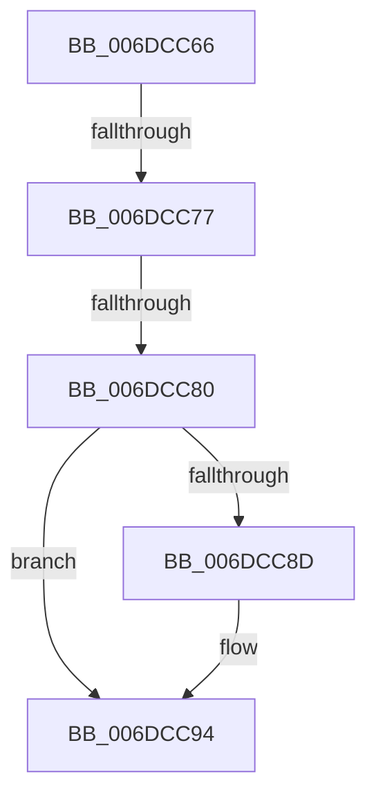

# sub_006DCC66

- RVA: `0x006DCC66`–`0x006DCC9D` (길이 `55` bytes)
- VA: `0x00000001406DCC66`
- 실행 섹션: `.text`
- PDB 이름 있음: `아니요`; PDB Function 태그: `아니요`
- unwind 정보 RVA: `0x0006F1B8`
- 디코드: `14`개 명령, `55/55` bytes 표시
- 미해석 바이트: `0` (있으면 어셈블리에 `.byte`로 보존)

> 이 문서는 커널 이미지의 기계어와 PDB 기호를 분석해 생성했습니다. 4번과 5번은 함수 원형과 자료형을 바이너리 사용 방식에서 추정한 C 해석이며 원본 소스 복구 결과는 아닙니다.

## 1. Dependencies

- 직접 호출 지점: **1**; 고유 호출 대상: **1**
- 직접 호출자로 확인된 함수: **0**
- RIP 상대 이미지 참조: **0**

### Outgoing calls
- `0x006DCC6A` → [MiGetNextAffinityWalker](../2C/MiGetNextAffinityWalker_function_002CCC28.md) (function, `0x002CCC28`)

### Direct callers
- 이 함수 시작 RVA로 연결되는 직접 call은 확인되지 않았습니다. 간접 호출은 완전히 역산할 수 없습니다.

### Static image references
- 디코드된 RIP-relative 메모리 참조가 없습니다.

## 2. Other-region calls and transfers

- 다른 실행 섹션으로 향하는 call: **0**
- call이 아닌 외부 분기/꼬리 이동: **3**
  - `0x006DCC71` → [MiLaunchZeroParent + 0x70](../2C/MiLaunchZeroParent_function_002CA5F8.md) (`tail-transfer`)
  - `0x006DCC7A` → [MiLaunchZeroParent + 0x70](../2C/MiLaunchZeroParent_function_002CA5F8.md) (`tail-transfer`)
  - `0x006DCC98` → [MiLaunchZeroParent + 0x70](../2C/MiLaunchZeroParent_function_002CA5F8.md) (`tail-transfer`)

## 3. Assembly (complete function range)

```asm
006DCC66  48 8D 57 28                     lea rdx, [rdi + 0x28]
006DCC6A  E8 B9 FF BE FF                  call 0x1402ccc28
006DCC6F  85 C0                           test eax, eax
006DCC71  0F 88 F1 D9 BE FF               js 0x1402ca668
006DCC77  83 3E 00                        cmp dword ptr [rsi], 0
006DCC7A  0F 85 E8 D9 BE FF               jne 0x1402ca668
006DCC80  83 4F 2C FF                     or dword ptr [rdi + 0x2c], 0xffffffff
006DCC84  48 8B 4B 50                     mov rcx, qword ptr [rbx + 0x50]
006DCC88  48 85 C9                        test rcx, rcx
006DCC8B  74 07                           je 0x1406dcc94
006DCC8D  48 8B 11                        mov rdx, qword ptr [rcx]
006DCC90  48 89 53 50                     mov qword ptr [rbx + 0x50], rdx
006DCC94  48 89 4F 30                     mov qword ptr [rdi + 0x30], rcx
006DCC98  E9 CB D9 BE FF                  jmp 0x1402ca668
```

## 4. C-style interpretation (structured pseudocode)

```c
__int64 __fastcall sub_006DCC66(void)
{
    __int64 result;

    result = MiGetNextAffinityWalker(a1, v_rdi + 40, a3, a4);
    if (*(unsigned __int64 *)(v_rbx + 80) != 0) {
        a2 = *(unsigned __int64 *)(*(unsigned __int64 *)(v_rbx + 80));
        *(unsigned __int64 *)(v_rbx + 80) = a2;
    }
    *(unsigned __int64 *)(v_rdi + 48) = *(unsigned __int64 *)(v_rbx + 80);
}
```

## 5. (Beta) C Style

```c
void sub_006DCC66(void)
{
    int64_t result;

    result = MiGetNextAffinityWalker(a1, local_rdi + 40, a3, a4);
    if (*(uint64_t *)(local_rbx + 0x50) != 0) {
        a2 = *(uint64_t *)(*(uint64_t *)(local_rbx + 0x50));
        *(uint64_t *)(local_rbx + 0x50) = a2;
    }
    *(uint64_t *)(local_rdi + 0x30) = *(uint64_t *)(local_rbx + 0x50);
}
```

## 6. Execution-region graph

[열기: 2D/3D 그래프와 함수 탐색 컨트롤 패널](../../../control-panel.html?section=text&rva=0x006DCC66&view=graph)

- 2D 그래프는 위에서 아래로 흐르고, 3D 그래프는 빈 공간을 드래그해 회전합니다. Shift+드래그는 이동, 휠은 확대·축소, 함수 노드 선택은 대상 보고서 이동입니다.

### Static fallback


