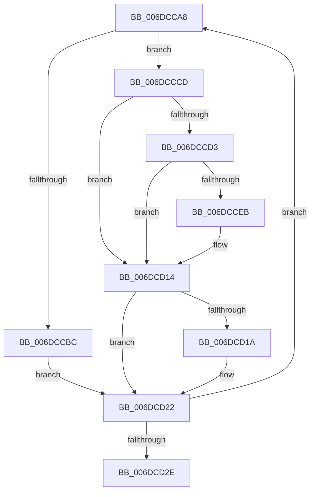

# sub_006DCCA8

- RVA: `0x006DCCA8`–`0x006DCD33` (길이 `139` bytes)
- VA: `0x00000001406DCCA8`
- 실행 섹션: `.text`
- PDB 이름 있음: `아니요`; PDB Function 태그: `아니요`
- unwind 정보 RVA: `0x0006F414`
- 디코드: `33`개 명령, `139/139` bytes 표시
- 미해석 바이트: `0` (있으면 어셈블리에 `.byte`로 보존)

> 이 문서는 커널 이미지의 기계어와 PDB 기호를 분석해 생성했습니다. 4번과 5번은 함수 원형과 자료형을 바이너리 사용 방식에서 추정한 C 해석이며 원본 소스 복구 결과는 아닙니다.

## 1. Dependencies

- 직접 호출 지점: **4**; 고유 호출 대상: **4**
- 직접 호출자로 확인된 함수: **0**
- RIP 상대 이미지 참조: **0**

### Outgoing calls
- `0x006DCCE2` → [ObReferenceObjectSafeWithTag](../21/ObReferenceObjectSafeWithTag_function_00210EE0.md) (function, `0x00210EE0`)
- `0x006DCD02` → [KeSetActualBasePriorityThread](../3C/KeSetActualBasePriorityThread_function_003C4370.md) (function, `0x003C4370`)
- `0x006DCD0F` → [ObfDereferenceObjectWithTag](../2F/ObfDereferenceObjectWithTag_function_002F78E0.md) (function, `0x002F78E0`)
- `0x006DCD1D` → [MiIncrementZeroEngineThread](../2C/MiIncrementZeroEngineThread_function_002CBB80.md) (function, `0x002CBB80`)

### Direct callers
- 이 함수 시작 RVA로 연결되는 직접 call은 확인되지 않았습니다. 간접 호출은 완전히 역산할 수 없습니다.

### Static image references
- 디코드된 RIP-relative 메모리 참조가 없습니다.

## 2. Other-region calls and transfers

- 다른 실행 섹션으로 향하는 call: **0**
- call이 아닌 외부 분기/꼬리 이동: **1**
  - `0x006DCD2E` → [MiWakeZeroingThreads + 0x98](../2C/MiWakeZeroingThreads_function_002CBEC0.md) (`tail-transfer`)

## 3. Assembly (complete function range)

```asm
006DCCA8  48 8D B7 60 FE FF FF            lea rsi, [rdi - 0x1a0]
006DCCAF  44 8B B6 80 01 00 00            mov r14d, dword ptr [rsi + 0x180]
006DCCB6  41 F6 C6 01                     test r14b, 1
006DCCBA  75 11                           jne 0x1406dcccd
006DCCBC  8B 86 80 01 00 00               mov eax, dword ptr [rsi + 0x180]
006DCCC2  83 C8 10                        or eax, 0x10
006DCCC5  89 86 80 01 00 00               mov dword ptr [rsi + 0x180], eax
006DCCCB  EB 55                           jmp 0x1406dcd22
006DCCCD  41 F6 C6 04                     test r14b, 4
006DCCD1  75 41                           jne 0x1406dcd14
006DCCD3  4C 8B BE 48 01 00 00            mov r15, qword ptr [rsi + 0x148]
006DCCDA  BA 4D 6D 5A 65                  mov edx, 0x655a6d4d
006DCCDF  49 8B CF                        mov rcx, r15
006DCCE2  E8 F9 41 B3 FF                  call 0x140210ee0
006DCCE7  84 C0                           test al, al
006DCCE9  74 29                           je 0x1406dcd14
006DCCEB  8B 86 80 01 00 00               mov eax, dword ptr [rsi + 0x180]
006DCCF1  BA 0C 00 00 00                  mov edx, 0xc
006DCCF6  83 C8 08                        or eax, 8
006DCCF9  49 8B CF                        mov rcx, r15
006DCCFC  89 86 80 01 00 00               mov dword ptr [rsi + 0x180], eax
006DCD02  E8 69 76 CE FF                  call 0x1403c4370
006DCD07  BA 4D 6D 5A 65                  mov edx, 0x655a6d4d
006DCD0C  49 8B CF                        mov rcx, r15
006DCD0F  E8 CC AB C1 FF                  call 0x1402f78e0
006DCD14  41 F6 C6 02                     test r14b, 2
006DCD18  74 08                           je 0x1406dcd22
006DCD1A  48 8B CE                        mov rcx, rsi
006DCD1D  E8 5E EE BE FF                  call 0x1402cbb80
006DCD22  48 8B 3F                        mov rdi, qword ptr [rdi]
006DCD25  48 3B FB                        cmp rdi, rbx
006DCD28  0F 85 7A FF FF FF               jne 0x1406dcca8
006DCD2E  E9 25 F2 BE FF                  jmp 0x1402cbf58
```

## 4. C-style interpretation (structured pseudocode)

```c
__int64 __fastcall sub_006DCCA8(void)
{
    __int64 result;

    if ((((unsigned __int8)((unsigned int)(*(unsigned int *)(v_rdi - 416 + 384)))) & (1)) != 0) goto loc_006DCCCD;
    result = (unsigned int)(((unsigned int)(*(unsigned int *)(v_rdi - 416 + 384))) | (16));
    *(unsigned int *)(v_rdi - 416 + 384) = (unsigned int)(result);
    goto loc_006DCD22;
loc_006DCCCD:
    if ((((unsigned __int8)((unsigned int)(*(unsigned int *)(v_rdi - 416 + 384)))) & (4)) != 0) goto loc_006DCD14;
    result = ObReferenceObjectSafeWithTag(*(unsigned __int64 *)(v_rdi - 416 + 328), (unsigned int)(0x655A6D4DULL), a3, a4);
    if ((unsigned __int8)(result) != 0) {
        result = *(unsigned int *)(v_rdi - 416 + 384);
        a2 = 12;
        result = (unsigned int)((result) | (8));
        a1 = *(unsigned __int64 *)(v_rdi - 416 + 328);
        *(unsigned int *)(v_rdi - 416 + 384) = (unsigned int)(result);
        result = KeSetActualBasePriorityThread(a1, a2, a3, a4);
        a2 = 0x655A6D4DULL;
        a1 = *(unsigned __int64 *)(v_rdi - 416 + 328);
        result = ObfDereferenceObjectWithTag(a1, a2, a3, a4);
    }
    if ((((unsigned __int8)((unsigned int)(*(unsigned int *)(v_rdi - 416 + 384)))) & (2)) != 0) {
        a1 = v_rdi - 416;
        result = MiIncrementZeroEngineThread(a1, a2, a3, a4);
    }
    if ((*(unsigned __int64 *)(v_rdi)) != v_rbx) goto loc_006DCCA8;
}
```

## 5. (Beta) C Style

```c
void sub_006DCCA8(void)
{
    int64_t result;

    if ((((uint8_t)((uint32_t)(*(uint32_t *)(local_rdi - 0x1A0 + 0x180)))) & (1)) != 0) goto loc_006DCCCD;
    result = (uint32_t)(((uint32_t)(*(uint32_t *)(local_rdi - 0x1A0 + 0x180))) | (16));
    *(uint32_t *)(local_rdi - 0x1A0 + 0x180) = (uint32_t)(result);
    goto loc_006DCD22;
loc_006DCCCD:
    if ((((uint8_t)((uint32_t)(*(uint32_t *)(local_rdi - 0x1A0 + 0x180)))) & (4)) != 0) goto loc_006DCD14;
    result = ObReferenceObjectSafeWithTag(*(uint64_t *)(local_rdi - 0x1A0 + 0x148), (uint32_t)(0x655A6D4DULL), a3, a4);
    if ((uint8_t)(result) != 0) {
        result = *(uint32_t *)(local_rdi - 0x1A0 + 0x180);
        a2 = 12;
        result = (uint32_t)((result) | (8));
        a1 = *(uint64_t *)(local_rdi - 0x1A0 + 0x148);
        *(uint32_t *)(local_rdi - 0x1A0 + 0x180) = (uint32_t)(result);
        result = KeSetActualBasePriorityThread(a1, a2, a3, a4);
        a2 = 0x655A6D4DULL;
        a1 = *(uint64_t *)(local_rdi - 0x1A0 + 0x148);
        result = ObfDereferenceObjectWithTag(a1, a2, a3, a4);
    }
    if ((((uint8_t)((uint32_t)(*(uint32_t *)(local_rdi - 0x1A0 + 0x180)))) & (2)) != 0) {
        a1 = local_rdi - 416;
        result = MiIncrementZeroEngineThread(a1, a2, a3, a4);
    }
    if ((*(uint64_t *)(local_rdi)) != local_rbx) goto loc_006DCCA8;
}
```

## 6. Execution-region graph

[열기: 2D/3D 그래프와 함수 탐색 컨트롤 패널](../../../control-panel.html?section=text&rva=0x006DCCA8&view=graph)

- 2D 그래프는 위에서 아래로 흐르고, 3D 그래프는 빈 공간을 드래그해 회전합니다. Shift+드래그는 이동, 휠은 확대·축소, 함수 노드 선택은 대상 보고서 이동입니다.

### Static fallback


