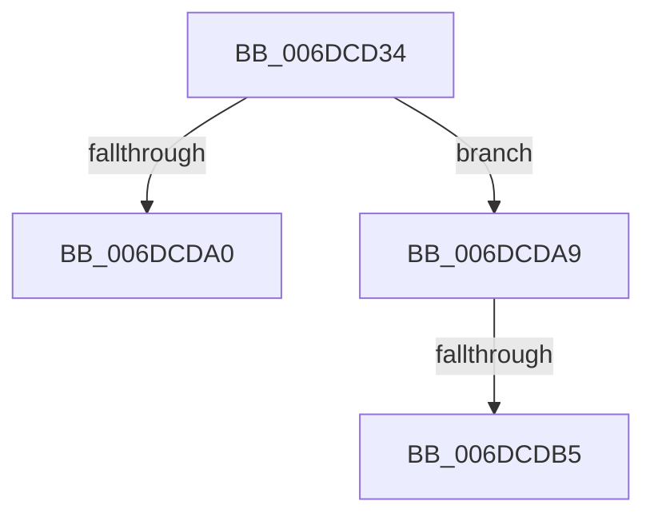

# sub_006DCD34

- RVA: `0x006DCD34`–`0x006DCDC1` (길이 `141` bytes)
- VA: `0x00000001406DCD34`
- 실행 섹션: `.text`
- PDB 이름 있음: `아니요`; PDB Function 태그: `아니요`
- unwind 정보 RVA: `0x0006F650`
- 디코드: `34`개 명령, `141/141` bytes 표시
- 미해석 바이트: `0` (있으면 어셈블리에 `.byte`로 보존)

> 이 문서는 커널 이미지의 기계어와 PDB 기호를 분석해 생성했습니다. 4번과 5번은 함수 원형과 자료형을 바이너리 사용 방식에서 추정한 C 해석이며 원본 소스 복구 결과는 아닙니다.

## 1. Dependencies

- 직접 호출 지점: **2**; 고유 호출 대상: **2**
- 직접 호출자로 확인된 함수: **0**
- RIP 상대 이미지 참조: **0**

### Outgoing calls
- `0x006DCD3F` → [KeGetTopologySiblingAffinityForProcessor](../4A/KeGetTopologySiblingAffinityForProcessor_function_004A946C.md) (function, `0x004A946C`)
- `0x006DCD8D` → [KiTryPopulateLogicalProcessorInformation](../2C/KiTryPopulateLogicalProcessorInformation_function_002CF724.md) (function, `0x002CF724`)

### Direct callers
- 이 함수 시작 RVA로 연결되는 직접 call은 확인되지 않았습니다. 간접 호출은 완전히 역산할 수 없습니다.

### Static image references
- 디코드된 RIP-relative 메모리 참조가 없습니다.

## 2. Other-region calls and transfers

- 다른 실행 섹션으로 향하는 call: **0**
- call이 아닌 외부 분기/꼬리 이동: **3**
  - `0x006DCDA4` → [KeQueryLogicalProcessorRelationship + 0x248](../2C/KeQueryLogicalProcessorRelationship_function_002CEA60.md) (`tail-transfer`)
  - `0x006DCDAF` → [KeQueryLogicalProcessorRelationship + 0x248](../2C/KeQueryLogicalProcessorRelationship_function_002CEA60.md) (`tail-transfer`)
  - `0x006DCDBC` → [KeQueryLogicalProcessorRelationship + 0x248](../2C/KeQueryLogicalProcessorRelationship_function_002CEA60.md) (`tail-transfer`)

## 3. Assembly (complete function range)

```asm
006DCD34  4D 8B C7                        mov r8, r15
006DCD37  BA 03 00 00 00                  mov edx, 3
006DCD3C  49 8B CD                        mov rcx, r13
006DCD3F  E8 28 C7 DC FF                  call 0x1404a946c
006DCD44  48 8B 75 70                     mov rsi, qword ptr [rbp + 0x70]
006DCD48  33 C0                           xor eax, eax
006DCD4A  48 39 45 60                     cmp qword ptr [rbp + 0x60], rax
006DCD4E  41 B9 05 00 00 00               mov r9d, 5
006DCD54  48 8B 55 A8                     mov rdx, qword ptr [rbp - 0x58]
006DCD58  49 8B CF                        mov rcx, r15
006DCD5B  89 44 24 58                     mov dword ptr [rsp + 0x58], eax
006DCD5F  41 0F 95 C0                     setne r8b
006DCD63  89 44 24 5C                     mov dword ptr [rsp + 0x5c], eax
006DCD67  48 8D 44 24 5C                  lea rax, [rsp + 0x5c]
006DCD6C  48 89 44 24 40                  mov qword ptr [rsp + 0x40], rax
006DCD71  48 8D 44 24 58                  lea rax, [rsp + 0x58]
006DCD76  48 89 44 24 38                  mov qword ptr [rsp + 0x38], rax
006DCD7B  8B 44 24 60                     mov eax, dword ptr [rsp + 0x60]
006DCD7F  44 89 74 24 30                  mov dword ptr [rsp + 0x30], r14d
006DCD84  89 44 24 28                     mov dword ptr [rsp + 0x28], eax
006DCD88  48 89 74 24 20                  mov qword ptr [rsp + 0x20], rsi
006DCD8D  E8 92 29 BF FF                  call 0x1402cf724
006DCD92  44 03 74 24 58                  add r14d, dword ptr [rsp + 0x58]
006DCD97  44 89 74 24 50                  mov dword ptr [rsp + 0x50], r14d
006DCD9C  85 C0                           test eax, eax
006DCD9E  79 09                           jns 0x1406dcda9
006DCDA0  89 44 24 64                     mov dword ptr [rsp + 0x64], eax
006DCDA4  E9 FF 1E BF FF                  jmp 0x1402ceca8
006DCDA9  8B 44 24 5C                     mov eax, dword ptr [rsp + 0x5c]
006DCDAD  85 C0                           test eax, eax
006DCDAF  0F 84 F3 1E BF FF               je 0x1402ceca8
006DCDB5  48 03 F0                        add rsi, rax
006DCDB8  48 89 75 70                     mov qword ptr [rbp + 0x70], rsi
006DCDBC  E9 E7 1E BF FF                  jmp 0x1402ceca8
```

## 4. C-style interpretation (structured pseudocode)

```c
__int64 __fastcall sub_006DCD34(__int64 a1, __int64 a2, __int64 a3, __int64 a4, __int64 a5, __int64 a6, __int64 a7, __int64 a8, __int64 a9, __int64 a10, unsigned int a11, unsigned int a12)
{
    __int64 result;
    __int64 v_r14;
    __int64 v_rsi;
    unsigned __int64 v_stack_p20;
    unsigned int v_stack_p28;
    unsigned int v_stack_p30;
    unsigned __int64 v_stack_p38;
    unsigned __int64 v_stack_p40;
    unsigned int v_stack_p50;
    unsigned int v_stack_p58;
    unsigned int v_stack_p5C;
    unsigned int v_stack_p64;

    result = KeGetTopologySiblingAffinityForProcessor(v_r13, 3, v_r15, a4);
    result = 0;
    v_stack_p58 = 0;
    a3 = ((*(unsigned __int64 *)(v_rbp + 96)) != 0) ? 1 : 0;
    v_stack_p5C = 0;
    v_stack_p40 = v_stack_p5C;
    v_stack_p38 = a11;
    v_stack_p30 = (unsigned int)(v_r14);
    v_stack_p28 = (unsigned int)((unsigned int)(a12));
    v_stack_p20 = *(unsigned __int64 *)(v_rbp + 112);
    result = KiTryPopulateLogicalProcessorInformation(v_r15, *(unsigned __int64 *)(v_rbp - 88), a3, 5);
    v_r14 = (unsigned int)((v_r14) + (a11));
    v_stack_p50 = (unsigned int)(v_r14);
    if (!sign_flag) goto loc_006DCDA9;
    v_stack_p64 = (unsigned int)(result);
loc_006DCDA9:
    v_rsi = (*(unsigned __int64 *)(v_rbp + 112)) + ((unsigned int)(v_stack_p5C));
    *(unsigned __int64 *)(v_rbp + 112) = v_rsi;
}
```

## 5. (Beta) C Style

```c
int64_t sub_006DCD34(int64_t Arg1, int64_t Arg2, int64_t Arg3, int64_t Arg4, uint64_t Arg5, uint64_t Arg6, uint64_t Arg7, uint64_t Arg8, uint64_t Arg9, uint64_t Arg10, uint32_t Arg11, uint32_t Arg12)
{
    int64_t result;
    int64_t local_r14;
    int64_t local_rsi;
    uint64_t v_stack_p20;
    uint32_t v_stack_p28;
    uint32_t v_stack_p30;
    uint64_t v_stack_p38;
    uint64_t v_stack_p40;
    uint32_t v_stack_p50;
    uint32_t v_stack_p58;
    uint32_t v_stack_p5C;
    uint32_t v_stack_p64;

    result = KeGetTopologySiblingAffinityForProcessor(local_r13, 3, local_r15, Arg4);
    result = 0;
    v_stack_p58 = 0;
    Arg3 = ((*(uint64_t *)(local_rbp + 0x60)) != 0) ? 1 : 0;
    v_stack_p5C = 0;
    v_stack_p40 = v_stack_p5C;
    v_stack_p38 = Arg11;
    v_stack_p30 = (uint32_t)(local_r14);
    v_stack_p28 = (uint32_t)((uint32_t)(Arg12));
    v_stack_p20 = *(uint64_t *)(local_rbp + 0x70);
    result = KiTryPopulateLogicalProcessorInformation(local_r15, *(uint64_t *)(local_rbp - 0x58), Arg3, 5);
    local_r14 = (uint32_t)((local_r14) + (Arg11));
    v_stack_p50 = (uint32_t)(local_r14);
    if (!sign_flag) goto loc_006DCDA9;
    v_stack_p64 = (uint32_t)(result);
loc_006DCDA9:
    local_rsi = (*(uint64_t *)(local_rbp + 0x70)) + ((uint32_t)(v_stack_p5C));
    *(uint64_t *)(local_rbp + 0x70) = local_rsi;
}
```

## 6. Execution-region graph

[열기: 2D/3D 그래프와 함수 탐색 컨트롤 패널](../../../control-panel.html?section=text&rva=0x006DCD34&view=graph)

- 2D 그래프는 위에서 아래로 흐르고, 3D 그래프는 빈 공간을 드래그해 회전합니다. Shift+드래그는 이동, 휠은 확대·축소, 함수 노드 선택은 대상 보고서 이동입니다.

### Static fallback


