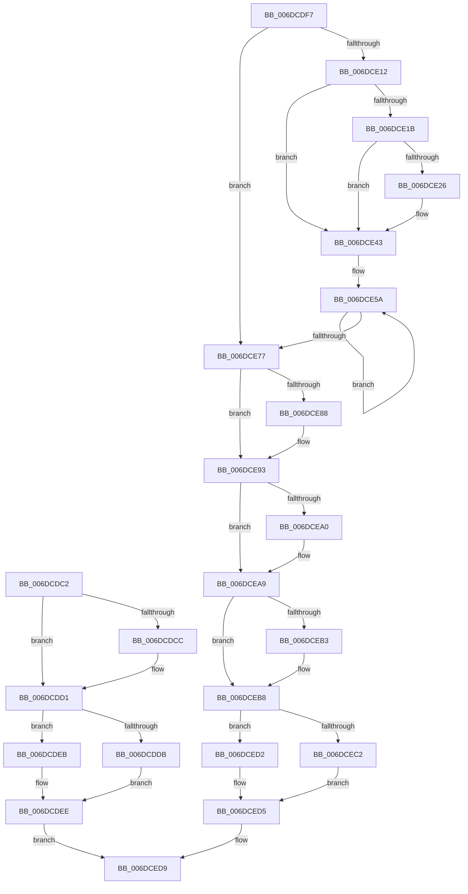

# sub_006DCDC2

- RVA: `0x006DCDC2`–`0x006DCEED` (길이 `299` bytes)
- VA: `0x00000001406DCDC2`
- 실행 섹션: `.text`
- PDB 이름 있음: `아니요`; PDB Function 태그: `아니요`
- unwind 정보 RVA: `0x0006F6E0`
- 디코드: `79`개 명령, `299/299` bytes 표시
- 미해석 바이트: `0` (있으면 어셈블리에 `.byte`로 보존)

> 이 문서는 커널 이미지의 기계어와 PDB 기호를 분석해 생성했습니다. 4번과 5번은 함수 원형과 자료형을 바이너리 사용 방식에서 추정한 C 해석이며 원본 소스 복구 결과는 아닙니다.

## 1. Dependencies

- 직접 호출 지점: **5**; 고유 호출 대상: **3**
- 직접 호출자로 확인된 함수: **0**
- RIP 상대 이미지 참조: **0**

### Outgoing calls
- `0x006DCDCC` → [KeExecuteVerw](../6C/KeExecuteVerw_function_006C66C0.md) (function, `0x006C66C0`)
- `0x006DCDD1` → [HalProcessorIdle](../6A/HalProcessorIdle_function_006AC7C0.md) (function, `0x006AC7C0`)
- `0x006DCEB3` → [KeExecuteVerw](../6C/KeExecuteVerw_function_006C66C0.md) (function, `0x006C66C0`)
- `0x006DCEB8` → [HalProcessorIdle](../6A/HalProcessorIdle_function_006AC7C0.md) (function, `0x006AC7C0`)
- `0x006DCEE2` → [KeIdleSpecCtrl](../4B/KeIdleSpecCtrl_function_004B0D40.md) (function, `0x004B0D40`)

### Direct callers
- 이 함수 시작 RVA로 연결되는 직접 call은 확인되지 않았습니다. 간접 호출은 완전히 역산할 수 없습니다.

### Static image references
- 디코드된 RIP-relative 메모리 참조가 없습니다.

## 2. Other-region calls and transfers

- 다른 실행 섹션으로 향하는 call: **0**
- call이 아닌 외부 분기/꼬리 이동: **1**
  - `0x006DCEE8` → [PoIdle + 0x65](../2C/PoIdle_function_002CFB40.md) (`tail-transfer`)

## 3. Assembly (complete function range)

```asm
006DCDC2  8B D7                           mov edx, edi
006DCDC4  C1 EA 10                        shr edx, 0x10
006DCDC7  66 85 D2                        test dx, dx
006DCDCA  74 05                           je 0x1406dcdd1
006DCDCC  E8 EF 98 FE FF                  call 0x1406c66c0
006DCDD1  E8 EA F9 FC FF                  call 0x1406ac7c0
006DCDD6  66 85 FF                        test di, di
006DCDD9  74 10                           je 0x1406dcdeb
006DCDDB  0F B7 D7                        movzx edx, di
006DCDDE  41 8B CE                        mov ecx, r14d
006DCDE1  8B C2                           mov eax, edx
006DCDE3  48 C1 EA 20                     shr rdx, 0x20
006DCDE7  0F 30                           wrmsr
006DCDE9  EB 03                           jmp 0x1406dcdee
006DCDEB  0F AE E8                        lfence
006DCDEE  44 0F B7 CE                     movzx r9d, si
006DCDF2  E9 E2 00 00 00                  jmp 0x1406dced9
006DCDF7  0F 0D 8B E0 06 00 00            prefetchw byte ptr [rbx + 0x6e0]
006DCDFE  44 0F B7 BB E0 06 00 00         movzx r15d, word ptr [rbx + 0x6e0]
006DCE06  41 BE 48 00 00 00               mov r14d, 0x48
006DCE0C  41 F6 C7 04                     test r15b, 4
006DCE10  74 65                           je 0x1406dce77
006DCE12  40 84 BB D8 06 00 00            test byte ptr [rbx + 0x6d8], dil
006DCE19  74 28                           je 0x1406dce43
006DCE1B  0F B7 83 E6 06 00 00            movzx eax, word ptr [rbx + 0x6e6]
006DCE22  A8 03                           test al, 3
006DCE24  75 1D                           jne 0x1406dce43
006DCE26  66 83 C8 02                     or ax, 2
006DCE2A  66 83 CE 02                     or si, 2
006DCE2E  0F B7 D0                        movzx edx, ax
006DCE31  41 8B CE                        mov ecx, r14d
006DCE34  66 89 93 E6 06 00 00            mov word ptr [rbx + 0x6e6], dx
006DCE3B  8B C2                           mov eax, edx
006DCE3D  48 C1 EA 20                     shr rdx, 0x20
006DCE41  0F 30                           wrmsr
006DCE43  66 F0 83 8B E0 06 00 00 02      lock or word ptr [rbx + 0x6e0], 2
006DCE4C  48 8B 93 B0 2D 00 00            mov rdx, qword ptr [rbx + 0x2db0]
006DCE53  0F 0D 8A E0 06 00 00            prefetchw byte ptr [rdx + 0x6e0]
006DCE5A  0F B7 82 E0 06 00 00            movzx eax, word ptr [rdx + 0x6e0]
006DCE61  0F B7 C8                        movzx ecx, ax
006DCE64  66 83 E1 EE                     and cx, 0xffee
006DCE68  66 83 C9 0A                     or cx, 0xa
006DCE6C  66 F0 0F B1 8A E0 06 00 00      lock cmpxchg word ptr [rdx + 0x6e0], cx
006DCE75  75 E3                           jne 0x1406dce5a
006DCE77  F6 83 DC 06 00 00 40            test byte ptr [rbx + 0x6dc], 0x40
006DCE7E  44 89 6D 6F                     mov dword ptr [rbp + 0x6f], r13d
006DCE82  66 89 75 6F                     mov word ptr [rbp + 0x6f], si
006DCE86  74 0B                           je 0x1406dce93
006DCE88  0F B7 83 AA AE 00 00            movzx eax, word ptr [rbx + 0xaeaa]
006DCE8F  66 89 45 71                     mov word ptr [rbp + 0x71], ax
006DCE93  44 8B 45 6F                     mov r8d, dword ptr [rbp + 0x6f]
006DCE97  44 89 45 FB                     mov dword ptr [rbp - 5], r8d
006DCE9B  66 85 F6                        test si, si
006DCE9E  74 09                           je 0x1406dcea9
006DCEA0  33 C0                           xor eax, eax
006DCEA2  41 8B CE                        mov ecx, r14d
006DCEA5  33 D2                           xor edx, edx
006DCEA7  0F 30                           wrmsr
006DCEA9  41 C1 E8 10                     shr r8d, 0x10
006DCEAD  66 45 85 C0                     test r8w, r8w
006DCEB1  74 05                           je 0x1406dceb8
006DCEB3  E8 08 98 FE FF                  call 0x1406c66c0
006DCEB8  E8 03 F9 FC FF                  call 0x1406ac7c0
006DCEBD  66 85 F6                        test si, si
006DCEC0  74 10                           je 0x1406dced2
006DCEC2  0F B7 D6                        movzx edx, si
006DCEC5  41 8B CE                        mov ecx, r14d
006DCEC8  8B C2                           mov eax, edx
006DCECA  48 C1 EA 20                     shr rdx, 0x20
006DCECE  0F 30                           wrmsr
006DCED0  EB 03                           jmp 0x1406dced5
006DCED2  0F AE E8                        lfence
006DCED5  45 0F B7 CF                     movzx r9d, r15w
006DCED9  4C 8D 45 FB                     lea r8, [rbp - 5]
006DCEDD  33 D2                           xor edx, edx
006DCEDF  48 8B CB                        mov rcx, rbx
006DCEE2  E8 59 3E DD FF                  call 0x1404b0d40
006DCEE7  90                              nop
006DCEE8  E9 B8 2C BF FF                  jmp 0x1402cfba5
```

## 4. C-style interpretation (structured pseudocode)

```c
__int64 __fastcall sub_006DCDC2(void)
{
    __int64 result;

    a2 = (unsigned int)(((unsigned int)((unsigned int)(v_rdi))) >> (16));
    if ((unsigned __int16)(a2) != 0) {
        result = KeExecuteVerw(a1, a2, a3, a4);
    }
    result = HalProcessorIdle(a1, a2, a3, a4);
    if ((unsigned __int16)(v_rdi) == 0) goto loc_006DCDEB;
    a2 = ((unsigned __int16)(v_rdi)) >> (32);
    goto loc_006DCDEE;
loc_006DCDEB:
loc_006DCDEE:
    goto loc_006DCED9;
loc_006DCED9:
    a2 = 0;
    result = KeIdleSpecCtrl(v_rbx, a2, v_rbp - 5, (unsigned __int16)(v_rsi));
}
```

## 5. (Beta) C Style

```c
void sub_006DCDC2(void)
{
    int64_t result;

    a2 = (uint32_t)(((uint32_t)((uint32_t)(local_rdi))) >> (16));
    if ((uint16_t)(a2) != 0) {
        result = KeExecuteVerw(a1, a2, a3, a4);
    }
    result = HalProcessorIdle(a1, a2, a3, a4);
    if ((uint16_t)(local_rdi) == 0) goto loc_006DCDEB;
    a2 = ((uint16_t)(local_rdi)) >> (32);
    goto loc_006DCDEE;
loc_006DCDEB:
loc_006DCDEE:
    goto loc_006DCED9;
loc_006DCED9:
    a2 = 0;
    result = KeIdleSpecCtrl(local_rbx, a2, local_rbp - 5, (uint16_t)(local_rsi));
}
```

## 6. Execution-region graph

[열기: 2D/3D 그래프와 함수 탐색 컨트롤 패널](../../../control-panel.html?section=text&rva=0x006DCDC2&view=graph)

- 2D 그래프는 위에서 아래로 흐르고, 3D 그래프는 빈 공간을 드래그해 회전합니다. Shift+드래그는 이동, 휠은 확대·축소, 함수 노드 선택은 대상 보고서 이동입니다.

### Static fallback


