# sub_006DD378

- RVA: `0x006DD378`–`0x006DD630` (길이 `696` bytes)
- VA: `0x00000001406DD378`
- 실행 섹션: `.text`
- PDB 이름 있음: `아니요`; PDB Function 태그: `아니요`
- unwind 정보 RVA: `0x0006F818`
- 디코드: `157`개 명령, `696/696` bytes 표시
- 미해석 바이트: `0` (있으면 어셈블리에 `.byte`로 보존)

> 이 문서는 커널 이미지의 기계어와 PDB 기호를 분석해 생성했습니다. 4번과 5번은 함수 원형과 자료형을 바이너리 사용 방식에서 추정한 C 해석이며 원본 소스 복구 결과는 아닙니다.

## 1. Dependencies

- 직접 호출 지점: **8**; 고유 호출 대상: **8**
- 직접 호출자로 확인된 함수: **0**
- RIP 상대 이미지 참조: **3**

### Outgoing calls
- `0x006DD42D` → [KeCheckProcessorAffinityEx](../30/KeCheckProcessorAffinityEx_function_00305150.md) (function, `0x00305150`)
- `0x006DD44C` → [PpmExitCoordinatedIdleState](../4B/PpmExitCoordinatedIdleState_function_004B3690.md) (function, `0x004B3690`)
- `0x006DD4DB` → [KdCallPowerHandlers](../5B/KdCallPowerHandlers_function_005B083C.md) (function, `0x005B083C`)
- `0x006DD4E7` → [KdPowerTransitionEx](../4D/KdPowerTransitionEx_function_004D9150.md) (function, `0x004D9150`)
- `0x006DD537` → [KeBugCheckEx](../4F/KeBugCheckEx_function_004FD660.md) (function, `0x004FD660`)
- `0x006DD5E7` → [PopIdleWakeNotifyWakeSource](../5D/PopIdleWakeNotifyWakeSource_function_005DC204.md) (function, `0x005DC204`)
- `0x006DD5F9` → [PpmUpdatePlatformIdleAccounting](../5D/PpmUpdatePlatformIdleAccounting_function_005D0BE4.md) (function, `0x005D0BE4`)
- `0x006DD625` → [PpmEventCoordinatedIdleTransition](../4B/PpmEventCoordinatedIdleTransition_function_004BB304.md) (function, `0x004BB304`)

### Direct callers
- 이 함수 시작 RVA로 연결되는 직접 call은 확인되지 않았습니다. 간접 호출은 완전히 역산할 수 없습니다.

### Static image references
- `0x006DD37C` → RVA `0x00FC6AD0` (`ALMOSTRO`; read)
- `0x006DD49C` → RVA `0x00E0B3B4` (`.data`; read)
- `0x006DD4F6` → RVA `0x00F0CF0C` (`.data`; read)

## 2. Other-region calls and transfers

- 다른 실행 섹션으로 향하는 call: **0**
- call이 아닌 외부 분기/꼬리 이동: **2**
  - `0x006DD612` → [PpmExitCoordinatedIdle + 0x42](../2D/PpmExitCoordinatedIdle_function_002D184C.md) (`tail-transfer`)
  - `0x006DD62B` → [PpmExitCoordinatedIdle + 0x42](../2D/PpmExitCoordinatedIdle_function_002D184C.md) (`tail-transfer`)

## 3. Assembly (complete function range)

```asm
006DD378  48 8B 46 10                     mov rax, qword ptr [rsi + 0x10]
006DD37C  4C 8B 15 4D 97 8E 00            mov r10, qword ptr [rip + 0x8e974d]
006DD383  8B CA                           mov ecx, edx
006DD385  44 8B 04 88                     mov r8d, dword ptr [rax + rcx*4]
006DD389  4D 69 C8 C0 01 00 00            imul r9, r8, 0x1c0
006DD390  43 8B 84 11 A0 01 00 00         mov eax, dword ptr [r9 + r10 + 0x1a0]
006DD398  8B C8                           mov ecx, eax
006DD39A  81 E1 00 00 00 03               and ecx, 0x3000000
006DD3A0  81 F9 00 00 00 01               cmp ecx, 0x1000000
006DD3A6  75 1E                           jne 0x1406dd3c6
006DD3A8  8B C8                           mov ecx, eax
006DD3AA  25 FF 0F 00 FE                  and eax, 0xfe000fff
006DD3AF  81 E1 FF 0F 00 00               and ecx, 0xfff
006DD3B5  0F BA E9 0D                     bts ecx, 0xd
006DD3B9  C1 E1 0C                        shl ecx, 0xc
006DD3BC  0B C8                           or ecx, eax
006DD3BE  43 89 8C 11 A0 01 00 00         mov dword ptr [r9 + r10 + 0x1a0], ecx
006DD3C6  44 38 9C 24 A0 00 00 00         cmp byte ptr [rsp + 0xa0], r11b
006DD3CE  74 14                           je 0x1406dd3e4
006DD3D0  48 8B 05 F9 96 8E 00            mov rax, qword ptr [rip + 0x8e96f9]
006DD3D7  49 C1 E0 0A                     shl r8, 0xa
006DD3DB  48 8B 48 30                     mov rcx, qword ptr [rax + 0x30]
006DD3DF  41 FF 44 08 28                  inc dword ptr [r8 + rcx + 0x28]
006DD3E4  FF C2                           inc edx
006DD3E6  3B 56 04                        cmp edx, dword ptr [rsi + 4]
006DD3E9  72 8D                           jb 0x1406dd378
006DD3EB  48 8B 94 24 80 00 00 00         mov rdx, qword ptr [rsp + 0x80]
006DD3F3  48 8B 05 D6 96 8E 00            mov rax, qword ptr [rip + 0x8e96d6]
006DD3FA  8B 00                           mov eax, dword ptr [rax]
006DD3FC  85 C0                           test eax, eax
006DD3FE  0F 84 0B 02 00 00               je 0x1406dd60f
006DD404  4C 8B 3D C5 96 8E 00            mov r15, qword ptr [rip + 0x8e96c5]
006DD40B  8D 78 FF                        lea edi, [rax - 1]
006DD40E  8B 52 24                        mov edx, dword ptr [rdx + 0x24]
006DD411  8B DF                           mov ebx, edi
006DD413  4C 69 F3 C0 01 00 00            imul r14, rbx, 0x1c0
006DD41A  49 8D 8F 80 00 00 00            lea rcx, [r15 + 0x80]
006DD421  44 88 5C 24 31                  mov byte ptr [rsp + 0x31], r11b
006DD426  49 03 CE                        add rcx, r14
006DD429  89 7C 24 38                     mov dword ptr [rsp + 0x38], edi
006DD42D  E8 1E 7D C2 FF                  call 0x140305150
006DD432  45 33 DB                        xor r11d, r11d
006DD435  85 C0                           test eax, eax
006DD437  0F 84 C1 01 00 00               je 0x1406dd5fe
006DD43D  49 8D 8F A0 01 00 00            lea rcx, [r15 + 0x1a0]
006DD444  49 03 CE                        add rcx, r14
006DD447  48 8D 54 24 30                  lea rdx, [rsp + 0x30]
006DD44C  E8 3F 62 DD FF                  call 0x1404b3690
006DD451  45 33 DB                        xor r11d, r11d
006DD454  84 C0                           test al, al
006DD456  0F 84 A2 01 00 00               je 0x1406dd5fe
006DD45C  48 8B 46 10                     mov rax, qword ptr [rsi + 0x10]
006DD460  8B CD                           mov ecx, ebp
006DD462  FF C5                           inc ebp
006DD464  89 3C 88                        mov dword ptr [rax + rcx*4], edi
006DD467  83 FD 01                        cmp ebp, 1
006DD46A  0F 85 D8 00 00 00               jne 0x1406dd548
006DD470  47 38 5C 3E 79                  cmp byte ptr [r14 + r15 + 0x79], r11b
006DD475  0F 84 CD 00 00 00               je 0x1406dd548
006DD47B  44 8B EF                        mov r13d, edi
006DD47E  45 84 E4                        test r12b, r12b
006DD481  0F 84 B6 00 00 00               je 0x1406dd53d
006DD487  8B 94 24 98 00 00 00            mov edx, dword ptr [rsp + 0x98]
006DD48E  85 D2                           test edx, edx
006DD490  78 3D                           js 0x1406dd4cf
006DD492  44 38 9C 24 A0 00 00 00         cmp byte ptr [rsp + 0xa0], r11b
006DD49A  75 33                           jne 0x1406dd4cf
006DD49C  3B 3D 12 DF 72 00               cmp edi, dword ptr [rip + 0x72df12]
006DD4A2  75 2B                           jne 0x1406dd4cf
006DD4A4  81 BC 24 C8 00 00 00 82 00 00 00  cmp dword ptr [rsp + 0xc8], 0x82
006DD4AF  74 1E                           je 0x1406dd4cf
006DD4B1  40 88 6C 24 31                  mov byte ptr [rsp + 0x31], bpl
006DD4B6  44 38 9C 24 B8 00 00 00         cmp byte ptr [rsp + 0xb8], r11b
006DD4BE  74 0F                           je 0x1406dd4cf
006DD4C0  48 8B 05 09 96 8E 00            mov rax, qword ptr [rip + 0x8e9609]
006DD4C7  48 8B 48 30                     mov rcx, qword ptr [rax + 0x30]
006DD4CB  48 FF 41 10                     inc qword ptr [rcx + 0x10]
006DD4CF  47 38 5C 3E 78                  cmp byte ptr [r14 + r15 + 0x78], r11b
006DD4D4  74 20                           je 0x1406dd4f6
006DD4D6  B9 01 00 00 00                  mov ecx, 1
006DD4DB  E8 5C 33 ED FF                  call 0x1405b083c
006DD4E0  B2 01                           mov dl, 1
006DD4E2  B9 01 00 00 80                  mov ecx, 0x80000001
006DD4E7  E8 64 BC DF FF                  call 0x1404d9150
006DD4EC  8B 94 24 98 00 00 00            mov edx, dword ptr [rsp + 0x98]
006DD4F3  45 33 DB                        xor r11d, r11d
006DD4F6  F7 05 0C FA 82 00 00 01 00 00   test dword ptr [rip + 0x82fa0c], 0x100
006DD500  74 3B                           je 0x1406dd53d
006DD502  85 D2                           test edx, edx
006DD504  78 37                           js 0x1406dd53d
006DD506  44 38 9C 24 A0 00 00 00         cmp byte ptr [rsp + 0xa0], r11b
006DD50E  75 2D                           jne 0x1406dd53d
006DD510  44 39 9C 24 B0 00 00 00         cmp dword ptr [rsp + 0xb0], r11d
006DD518  74 23                           je 0x1406dd53d
006DD51A  3B 3D 94 DE 72 00               cmp edi, dword ptr [rip + 0x72de94]
006DD520  75 1B                           jne 0x1406dd53d
006DD522  45 33 C9                        xor r9d, r9d
006DD525  4C 89 5C 24 20                  mov qword ptr [rsp + 0x20], r11
006DD52A  4C 8B C3                        mov r8, rbx
006DD52D  BA 99 05 00 00                  mov edx, 0x599
006DD532  B9 A0 00 00 00                  mov ecx, 0xa0
006DD537  E8 24 01 E2 FF                  call 0x1404fd660
006DD53C  CC                              int3
006DD53D  48 8B 05 8C 95 8E 00            mov rax, qword ptr [rip + 0x8e958c]
006DD544  44 89 58 38                     mov dword ptr [rax + 0x38], r11d
006DD548  45 84 E4                        test r12b, r12b
006DD54B  75 3C                           jne 0x1406dd589
006DD54D  44 39 9C 24 98 00 00 00         cmp dword ptr [rsp + 0x98], r11d
006DD555  0F 8D A3 00 00 00               jge 0x1406dd5fe
006DD55B  44 38 9C 24 A0 00 00 00         cmp byte ptr [rsp + 0xa0], r11b
006DD563  0F 85 95 00 00 00               jne 0x1406dd5fe
006DD569  44 38 5C 24 30                  cmp byte ptr [rsp + 0x30], r11b
006DD56E  0F 84 8A 00 00 00               je 0x1406dd5fe
006DD574  48 8B 05 55 95 8E 00            mov rax, qword ptr [rip + 0x8e9555]
006DD57B  48 C1 E3 0A                     shl rbx, 0xa
006DD57F  48 8B 48 30                     mov rcx, qword ptr [rax + 0x30]
006DD583  FF 44 0B 2C                     inc dword ptr [rbx + rcx + 0x2c]
006DD587  EB 75                           jmp 0x1406dd5fe
006DD589  48 8B 05 40 95 8E 00            mov rax, qword ptr [rip + 0x8e9540]
006DD590  4F 8B 8C 3E A8 01 00 00         mov r9, qword ptr [r14 + r15 + 0x1a8]
006DD598  48 C1 E3 0A                     shl rbx, 0xa
006DD59C  48 8B 78 30                     mov rdi, qword ptr [rax + 0x30]
006DD5A0  48 8B 84 24 A8 00 00 00         mov rax, qword ptr [rsp + 0xa8]
006DD5A8  48 03 FB                        add rdi, rbx
006DD5AB  49 3B C1                        cmp rax, r9
006DD5AE  73 05                           jae 0x1406dd5b5
006DD5B0  49 8B DB                        mov rbx, r11
006DD5B3  EB 0A                           jmp 0x1406dd5bf
006DD5B5  48 8B D8                        mov rbx, rax
006DD5B8  49 2B D9                        sub rbx, r9
006DD5BB  48 01 5F 48                     add qword ptr [rdi + 0x48], rbx
006DD5BF  44 38 5C 24 31                  cmp byte ptr [rsp + 0x31], r11b
006DD5C4  74 29                           je 0x1406dd5ef
006DD5C6  4C 8B 84 24 C0 00 00 00         mov r8, qword ptr [rsp + 0xc0]
006DD5CE  48 8D 4C 24 34                  lea rcx, [rsp + 0x34]
006DD5D3  8B 94 24 C8 00 00 00            mov edx, dword ptr [rsp + 0xc8]
006DD5DA  48 89 4C 24 28                  mov qword ptr [rsp + 0x28], rcx
006DD5DF  41 8B CD                        mov ecx, r13d
006DD5E2  48 89 44 24 20                  mov qword ptr [rsp + 0x20], rax
006DD5E7  E8 18 EC EF FF                  call 0x1405dc204
006DD5EC  45 33 DB                        xor r11d, r11d
006DD5EF  FF 47 30                        inc dword ptr [rdi + 0x30]
006DD5F2  48 8D 4F 28                     lea rcx, [rdi + 0x28]
006DD5F6  48 8B D3                        mov rdx, rbx
006DD5F9  E8 E6 35 EF FF                  call 0x1405d0be4
006DD5FE  8B 44 24 38                     mov eax, dword ptr [rsp + 0x38]
006DD602  48 8B 94 24 80 00 00 00         mov rdx, qword ptr [rsp + 0x80]
006DD60A  E9 ED FD FF FF                  jmp 0x1406dd3fc
006DD60F  45 84 E4                        test r12b, r12b
006DD612  0F 84 76 42 BF FF               je 0x1402d188e
006DD618  4C 8B 46 10                     mov r8, qword ptr [rsi + 0x10]
006DD61C  4C 8D 4C 24 34                  lea r9, [rsp + 0x34]
006DD621  8B D5                           mov edx, ebp
006DD623  33 C9                           xor ecx, ecx
006DD625  E8 DA DC DD FF                  call 0x1404bb304
006DD62A  90                              nop
006DD62B  E9 5E 42 BF FF                  jmp 0x1402d188e
```

## 4. C-style interpretation (structured pseudocode)

```c
__int64 __fastcall sub_006DD378(__int64 a1, int a2, __int64 a3, __int64 a4, __int64 a5, unsigned __int8 a6, unsigned int a7, __int64 a8, __int64 a9, __int64 a10, __int64 a11, __int64 a12, __int64 a13, __int64 a14, __int64 a15, __int64 a16, __int64 a17, __int64 a18, unsigned int a19, unsigned __int8 a20, __int64 a21, unsigned int a22, unsigned __int8 a23, __int64 a24, unsigned int a25)
{
    __int64 result;
    __int64 v_r11;
    __int64 v_r14;
    __int64 v_rbp;
    __int64 v_rbx;
    __int64 v_rdi;
    unsigned __int64 v_stack_p20;
    unsigned __int64 v_stack_p28;
    unsigned __int8 v_stack_p31;
    unsigned __int64 v_stack_p34;
    unsigned int v_stack_p38;

    a4 = (a4) * ((unsigned int)(*(unsigned int *)(*(unsigned __int64 *)(v_rsi + 16) + (unsigned int)(a2) * 4)));
    a1 = (unsigned int)(((unsigned int)((unsigned int)((unsigned int)(*(unsigned int *)(a4 + *(unsigned __int64 *)(v_rip + 9344845) * 1 + 416))))) & (0x3000000ULL));
    result = (unsigned int)(*(unsigned int *)(a4 + *(unsigned __int64 *)(v_rip + 9344845) * 1 + 416));
    if (((unsigned int)(a1)) == 0x1000000ULL) {
        a1 = (unsigned int)((unsigned int)(*(unsigned int *)(a4 + *(unsigned __int64 *)(v_rip + 9344845) * 1 + 416)));
        result = (unsigned int)(((unsigned int)(*(unsigned int *)(a4 + *(unsigned __int64 *)(v_rip + 9344845) * 1 + 416))) & (0xFE000FFFULL));
        a1 = (unsigned int)((a1) & (0xFFFULL));
        a1 = (unsigned int)((a1) << (12));
        a1 = (unsigned int)((a1) | ((unsigned int)(result)));
        *(unsigned int *)(a4 + *(unsigned __int64 *)(v_rip + 9344845) * 1 + 416) = (unsigned int)(a1);
    }
    if (a20 != ((unsigned __int8)(v_r11))) {
        result = *(unsigned __int64 *)(v_rip + 9344761);
        a3 = ((unsigned int)(*(unsigned int *)(*(unsigned __int64 *)(v_rsi + 16) + (unsigned int)(a2) * 4))) << (10);
        a1 = *(unsigned __int64 *)(result + 48);
    }
    a2 = (unsigned int)((a2) + 1);
    if (a2 < (*(unsigned int *)(v_rsi + 4))) goto loc_006DD378;
loc_006DD3FC:
    if ((unsigned int)((unsigned int)(*(unsigned int *)(*(unsigned __int64 *)(v_rip + 9344726)))) == 0) goto loc_006DD60F;
    v_r14 = (v_r14) * ((unsigned int)((unsigned int)((unsigned int)(*(unsigned int *)(*(unsigned __int64 *)(v_rip + 9344726))) - 1)));
    v_stack_p31 = (unsigned __int8)(v_r11);
    a1 = (*(unsigned __int64 *)(v_rip + 9344709) + 128) + (v_r14);
    v_stack_p38 = (unsigned int)((unsigned int)(*(unsigned int *)(*(unsigned __int64 *)(v_rip + 9344726))) - 1);
    result = KeCheckProcessorAffinityEx(a1, (unsigned int)(*(unsigned int *)(a16 + 36)), a3, a4);
    v_r11 = 0;
    if ((unsigned int)(result) == 0) goto loc_006DD5FE;
    a1 = (*(unsigned __int64 *)(v_rip + 9344709) + 416) + (v_r14);
    result = PpmExitCoordinatedIdleState(a1, a6, a3, a4);
    v_r11 = 0;
    if ((unsigned __int8)(result) == 0) goto loc_006DD5FE;
    v_rbp = (unsigned int)((v_rbp) + 1);
    *(unsigned int *)(*(unsigned __int64 *)(v_rsi + 16) + (unsigned int)((unsigned int)(v_rbp)) * 4) = (unsigned int)((unsigned int)(*(unsigned int *)(*(unsigned __int64 *)(v_rip + 9344726))) - 1);
    if (((unsigned int)(v_rbp)) != 1) goto loc_006DD548;
    if ((*(unsigned __int8 *)(v_r14 + *(unsigned __int64 *)(v_rip + 9344709) * 1 + 121)) == 0) goto loc_006DD548;
    if ((unsigned __int8)(v_r12) == 0) goto loc_006DD53D;
    if (sign_flag) goto loc_006DD4CF;
    if (a20 != 0) goto loc_006DD4CF;
    if (((unsigned int)((unsigned int)(*(unsigned int *)(*(unsigned __int64 *)(v_rip + 9344726))) - 1)) != (*(unsigned int *)(v_rip + 7528210))) goto loc_006DD4CF;
    if (a25 == 130) goto loc_006DD4CF;
    v_stack_p31 = (unsigned __int8)(v_rbp);
    result = *(unsigned __int64 *)(v_rsi + 16);
    if (a23 != 0) {
        result = *(unsigned __int64 *)(v_rip + 9344521);
        a1 = *(unsigned __int64 *)(result + 48);
    }
    if ((*(unsigned __int8 *)(v_r14 + *(unsigned __int64 *)(v_rip + 9344709) * 1 + 120)) != 0) {
        a1 = 1;
        result = KdCallPowerHandlers(a1, (unsigned int)(a19), a3, a4);
        a2 = 1;
        a1 = 0x80000001ULL;
        result = KdPowerTransitionEx(a1, a2, a3, a4);
        a2 = a19;
        v_r11 = 0;
    }
    if (((*(unsigned int *)(v_rip + 8583692)) & (256)) == 0) goto loc_006DD53D;
    if (sign_flag) goto loc_006DD53D;
    if (a20 != 0) goto loc_006DD53D;
    if (a22 == 0) goto loc_006DD53D;
    if (((unsigned int)((unsigned int)(*(unsigned int *)(*(unsigned __int64 *)(v_rip + 9344726))) - 1)) == (*(unsigned int *)(v_rip + 7528084))) {
        a4 = 0;
        v_stack_p20 = 0;
        a3 = (unsigned int)((unsigned int)((unsigned int)(*(unsigned int *)(*(unsigned __int64 *)(v_rip + 9344726))) - 1));
        a2 = 0x599ULL;
        a1 = 160;
        result = KeBugCheckEx(a1, a2, a3, a4);
    }
    *(unsigned int *)(*(unsigned __int64 *)(v_rip + 9344396) + 56) = 0;
loc_006DD548:
    if ((unsigned __int8)(v_r12) != 0) goto loc_006DD589;
    if (a19 >= 0) goto loc_006DD5FE;
    if (a20 != 0) goto loc_006DD5FE;
    if (a6 == 0) goto loc_006DD5FE;
    v_rbx = ((unsigned int)((unsigned int)((unsigned int)(*(unsigned int *)(*(unsigned __int64 *)(v_rip + 9344726))) - 1))) << (10);
    goto loc_006DD5FE;
loc_006DD589:
    v_rbx = (v_rbx) << (10);
    v_rdi = (*(unsigned __int64 *)(*(unsigned __int64 *)(v_rip + 9344320) + 48)) + (v_rbx);
    if (a21 >= (*(unsigned __int64 *)(v_r14 + *(unsigned __int64 *)(v_rip + 9344709) * 1 + 424))) goto loc_006DD5B5;
    goto loc_006DD5BF;
loc_006DD5B5:
    v_rbx = (a21) - (*(unsigned __int64 *)(v_r14 + *(unsigned __int64 *)(v_rip + 9344709) * 1 + 424));
loc_006DD5BF:
    result = a21;
    if (v_stack_p31 != 0) {
        a3 = a24;
        a1 = v_stack_p34;
        a2 = a25;
        v_stack_p28 = a1;
        a1 = (unsigned int)((unsigned int)((unsigned int)((unsigned int)(*(unsigned int *)(*(unsigned __int64 *)(v_rip + 9344726))) - 1)));
        v_stack_p20 = a21;
        result = PopIdleWakeNotifyWakeSource(a1, a2, a3, *(unsigned __int64 *)(v_r14 + *(unsigned __int64 *)(v_rip + 9344709) * 1 + 424));
        v_r11 = 0;
    }
    result = PpmUpdatePlatformIdleAccounting(v_rdi + 40, v_rbx, a3, *(unsigned __int64 *)(v_r14 + *(unsigned __int64 *)(v_rip + 9344709) * 1 + 424));
loc_006DD5FE:
    goto loc_006DD3FC;
loc_006DD60F:
    a1 = 0;
    result = PpmEventCoordinatedIdleTransition(a1, (unsigned int)((unsigned int)(v_rbp)), *(unsigned __int64 *)(v_rsi + 16), v_stack_p34);
}
```

## 5. (Beta) C Style

```c
int64_t sub_006DD378(int64_t Arg1, int32_t Arg2, int64_t Arg3, void *Arg4, uint64_t Arg5, uint8_t Arg6, uint32_t Arg7, uint64_t Arg8, uint64_t Arg9, uint64_t Arg10, uint64_t Arg11, uint64_t Arg12, uint64_t Arg13, uint64_t Arg14, uint64_t Arg15, void *Arg16, uint64_t Arg17, uint64_t Arg18, uint32_t Arg19, uint8_t Arg20, int64_t Arg21, uint32_t Arg22, uint8_t Arg23, int64_t Arg24, uint32_t Arg25)
{
    uint8_t *arg4 = (uint8_t *)Arg4;
    uint8_t *arg16 = (uint8_t *)Arg16;

    int64_t result;
    int64_t local_r11;
    int64_t local_r14;
    int64_t local_rbp;
    int64_t local_rbx;
    int64_t local_rdi;
    uint64_t v_stack_p20;
    uint64_t v_stack_p28;
    uint8_t v_stack_p31;
    uint64_t v_stack_p34;
    uint32_t v_stack_p38;

    Arg4 = (Arg4) * ((uint32_t)(*(uint32_t *)(*(uint64_t *)(local_rsi + 0x10) + (uint32_t)(Arg2) * 4)));
    Arg1 = (uint32_t)(((uint32_t)((uint32_t)((uint32_t)(*(uint32_t *)(arg4 + *(uint64_t *)(v_rip + 0x8E974D) * 1 + 0x1A0))))) & (0x3000000ULL));
    result = (uint32_t)(*(uint32_t *)(arg4 + *(uint64_t *)(v_rip + 0x8E974D) * 1 + 0x1A0));
    if (((uint32_t)(Arg1)) == 0x1000000ULL) {
        Arg1 = (uint32_t)((uint32_t)(*(uint32_t *)(arg4 + *(uint64_t *)(v_rip + 0x8E974D) * 1 + 0x1A0)));
        result = (uint32_t)(((uint32_t)(*(uint32_t *)(arg4 + *(uint64_t *)(v_rip + 0x8E974D) * 1 + 0x1A0))) & (0xFE000FFFULL));
        Arg1 = (uint32_t)((Arg1) & (0xFFFULL));
        Arg1 = (uint32_t)((Arg1) << (12));
        Arg1 = (uint32_t)((Arg1) | ((uint32_t)(result)));
        *(uint32_t *)(arg4 + *(uint64_t *)(v_rip + 0x8E974D) * 1 + 0x1A0) = (uint32_t)(Arg1);
    }
    if (Arg20 != ((uint8_t)(local_r11))) {
        result = *(uint64_t *)(v_rip + 0x8E96F9);
        Arg3 = ((uint32_t)(*(uint32_t *)(*(uint64_t *)(local_rsi + 0x10) + (uint32_t)(Arg2) * 4))) << (10);
        Arg1 = *(uint64_t *)(result + 0x30);
    }
    Arg2 = (uint32_t)((Arg2) + 1);
    if (Arg2 < (*(uint32_t *)(local_rsi + 0x4))) goto loc_006DD378;
loc_006DD3FC:
    if ((uint32_t)((uint32_t)(*(uint32_t *)(*(uint64_t *)(v_rip + 0x8E96D6)))) == 0) goto loc_006DD60F;
    local_r14 = (local_r14) * ((uint32_t)((uint32_t)((uint32_t)(*(uint32_t *)(*(uint64_t *)(v_rip + 0x8E96D6))) - 1)));
    v_stack_p31 = (uint8_t)(local_r11);
    Arg1 = (*(uint64_t *)(v_rip + 0x8E96C5) + 128) + (local_r14);
    v_stack_p38 = (uint32_t)((uint32_t)(*(uint32_t *)(*(uint64_t *)(v_rip + 0x8E96D6))) - 1);
    result = KeCheckProcessorAffinityEx(Arg1, (uint32_t)(*(uint32_t *)(arg16 + 0x24)), Arg3, Arg4);
    local_r11 = 0;
    if ((uint32_t)(result) == 0) goto loc_006DD5FE;
    Arg1 = (*(uint64_t *)(v_rip + 0x8E96C5) + 416) + (local_r14);
    result = PpmExitCoordinatedIdleState(Arg1, Arg6, Arg3, Arg4);
    local_r11 = 0;
    if ((uint8_t)(result) == 0) goto loc_006DD5FE;
    local_rbp = (uint32_t)((local_rbp) + 1);
    *(uint32_t *)(*(uint64_t *)(local_rsi + 0x10) + (uint32_t)((uint32_t)(local_rbp)) * 4) = (uint32_t)((uint32_t)(*(uint32_t *)(*(uint64_t *)(v_rip + 0x8E96D6))) - 1);
    if (((uint32_t)(local_rbp)) != 1) goto loc_006DD548;
    if ((*(uint8_t *)(local_r14 + *(uint64_t *)(v_rip + 0x8E96C5) * 1 + 0x79)) == 0) goto loc_006DD548;
    if ((uint8_t)(local_r12) == 0) goto loc_006DD53D;
    if (sign_flag) goto loc_006DD4CF;
    if (Arg20 != 0) goto loc_006DD4CF;
    if (((uint32_t)((uint32_t)(*(uint32_t *)(*(uint64_t *)(v_rip + 0x8E96D6))) - 1)) != (*(uint32_t *)(v_rip + 0x72DF12))) goto loc_006DD4CF;
    if (Arg25 == 130) goto loc_006DD4CF;
    v_stack_p31 = (uint8_t)(local_rbp);
    result = *(uint64_t *)(local_rsi + 0x10);
    if (Arg23 != 0) {
        result = *(uint64_t *)(v_rip + 0x8E9609);
        Arg1 = *(uint64_t *)(result + 0x30);
    }
    if ((*(uint8_t *)(local_r14 + *(uint64_t *)(v_rip + 0x8E96C5) * 1 + 0x78)) != 0) {
        Arg1 = 1;
        result = KdCallPowerHandlers(Arg1, (uint32_t)(Arg19), Arg3, Arg4);
        Arg2 = 1;
        Arg1 = 0x80000001ULL;
        result = KdPowerTransitionEx(Arg1, Arg2, Arg3, Arg4);
        Arg2 = Arg19;
        local_r11 = 0;
    }
    if (((*(uint32_t *)(v_rip + 0x82FA0C)) & (256)) == 0) goto loc_006DD53D;
    if (sign_flag) goto loc_006DD53D;
    if (Arg20 != 0) goto loc_006DD53D;
    if (Arg22 == 0) goto loc_006DD53D;
    if (((uint32_t)((uint32_t)(*(uint32_t *)(*(uint64_t *)(v_rip + 0x8E96D6))) - 1)) == (*(uint32_t *)(v_rip + 0x72DE94))) {
        Arg4 = 0;
        v_stack_p20 = 0;
        Arg3 = (uint32_t)((uint32_t)((uint32_t)(*(uint32_t *)(*(uint64_t *)(v_rip + 0x8E96D6))) - 1));
        Arg2 = 0x599ULL;
        Arg1 = 160;
        result = KeBugCheckEx(Arg1, Arg2, Arg3, Arg4);
    }
    *(uint32_t *)(*(uint64_t *)(v_rip + 0x8E958C) + 0x38) = 0;
loc_006DD548:
    if ((uint8_t)(local_r12) != 0) goto loc_006DD589;
    if (Arg19 >= 0) goto loc_006DD5FE;
    if (Arg20 != 0) goto loc_006DD5FE;
    if (Arg6 == 0) goto loc_006DD5FE;
    local_rbx = ((uint32_t)((uint32_t)((uint32_t)(*(uint32_t *)(*(uint64_t *)(v_rip + 0x8E96D6))) - 1))) << (10);
    goto loc_006DD5FE;
loc_006DD589:
    local_rbx = (local_rbx) << (10);
    local_rdi = (*(uint64_t *)(*(uint64_t *)(v_rip + 0x8E9540) + 0x30)) + (local_rbx);
    if (Arg21 >= (*(uint64_t *)(local_r14 + *(uint64_t *)(v_rip + 0x8E96C5) * 1 + 0x1A8))) goto loc_006DD5B5;
    goto loc_006DD5BF;
loc_006DD5B5:
    local_rbx = (Arg21) - (*(uint64_t *)(local_r14 + *(uint64_t *)(v_rip + 0x8E96C5) * 1 + 0x1A8));
loc_006DD5BF:
    result = Arg21;
    if (v_stack_p31 != 0) {
        Arg3 = Arg24;
        Arg1 = v_stack_p34;
        Arg2 = Arg25;
        v_stack_p28 = Arg1;
        Arg1 = (uint32_t)((uint32_t)((uint32_t)((uint32_t)(*(uint32_t *)(*(uint64_t *)(v_rip + 0x8E96D6))) - 1)));
        v_stack_p20 = Arg21;
        result = PopIdleWakeNotifyWakeSource(Arg1, Arg2, Arg3, *(uint64_t *)(local_r14 + *(uint64_t *)(v_rip + 0x8E96C5) * 1 + 0x1A8));
        local_r11 = 0;
    }
    result = PpmUpdatePlatformIdleAccounting(local_rdi + 40, local_rbx, Arg3, *(uint64_t *)(local_r14 + *(uint64_t *)(v_rip + 0x8E96C5) * 1 + 0x1A8));
loc_006DD5FE:
    goto loc_006DD3FC;
loc_006DD60F:
    Arg1 = 0;
    result = PpmEventCoordinatedIdleTransition(Arg1, (uint32_t)((uint32_t)(local_rbp)), *(uint64_t *)(local_rsi + 0x10), v_stack_p34);
}
```

### 관측된 메모리 오프셋

구조체 형식이 확인되지 않은 접근은 인자 기준의 오프셋으로만 기록했습니다.

| 기준 인자 | 오프셋 표현 | 폭 (bit) | 접근 |
|---|---:|---:|---|
| `Arg4` | `+ 0x1A0 + r10*1` | `32` | `R` |
| `Arg4` | `+ 0x1A0 + r10*1` | `32` | `W` |
| `Arg16` | `+ 0x24` | `32` | `R` |

## 6. Execution-region graph

[열기: 2D/3D 그래프와 함수 탐색 컨트롤 패널](../../../control-panel.html?section=text&rva=0x006DD378&view=graph)

- 2D 그래프는 위에서 아래로 흐르고, 3D 그래프는 빈 공간을 드래그해 회전합니다. Shift+드래그는 이동, 휠은 확대·축소, 함수 노드 선택은 대상 보고서 이동입니다.

### Static fallback

```mermaid
flowchart TD
  bb_006DD378[BB_006DD378]
  bb_006DD3A8[BB_006DD3A8]
  bb_006DD3C6[BB_006DD3C6]
  bb_006DD3D0[BB_006DD3D0]
  bb_006DD3E4[BB_006DD3E4]
  bb_006DD3EB[BB_006DD3EB]
  bb_006DD3FC[BB_006DD3FC]
  bb_006DD404[BB_006DD404]
  bb_006DD43D[BB_006DD43D]
  bb_006DD45C[BB_006DD45C]
  bb_006DD470[BB_006DD470]
  bb_006DD47B[BB_006DD47B]
  bb_006DD487[BB_006DD487]
  bb_006DD492[BB_006DD492]
  bb_006DD49C[BB_006DD49C]
  bb_006DD4A4[BB_006DD4A4]
  bb_006DD4B1[BB_006DD4B1]
  bb_006DD4C0[BB_006DD4C0]
  bb_006DD4CF[BB_006DD4CF]
  bb_006DD4D6[BB_006DD4D6]
  bb_006DD4F6[BB_006DD4F6]
  bb_006DD502[BB_006DD502]
  bb_006DD506[BB_006DD506]
  bb_006DD510[BB_006DD510]
  bb_006DD51A[BB_006DD51A]
  bb_006DD522[BB_006DD522]
  bb_006DD53D[BB_006DD53D]
  bb_006DD548[BB_006DD548]
  bb_006DD54D[BB_006DD54D]
  bb_006DD55B[BB_006DD55B]
  bb_006DD569[BB_006DD569]
  bb_006DD574[BB_006DD574]
  bb_006DD589[BB_006DD589]
  bb_006DD5B0[BB_006DD5B0]
  bb_006DD5B5[BB_006DD5B5]
  bb_006DD5BF[BB_006DD5BF]
  bb_006DD5C6[BB_006DD5C6]
  bb_006DD5EF[BB_006DD5EF]
  bb_006DD5FE[BB_006DD5FE]
  bb_006DD60F[BB_006DD60F]
  bb_006DD618[BB_006DD618]
  bb_006DD378 -->|branch| bb_006DD3C6
  bb_006DD378 -->|fallthrough| bb_006DD3A8
  bb_006DD3A8 -->|flow| bb_006DD3C6
  bb_006DD3C6 -->|branch| bb_006DD3E4
  bb_006DD3C6 -->|fallthrough| bb_006DD3D0
  bb_006DD3D0 -->|flow| bb_006DD3E4
  bb_006DD3E4 -->|branch| bb_006DD378
  bb_006DD3E4 -->|fallthrough| bb_006DD3EB
  bb_006DD3EB -->|flow| bb_006DD3FC
  bb_006DD3FC -->|branch| bb_006DD60F
  bb_006DD3FC -->|fallthrough| bb_006DD404
  bb_006DD404 -->|branch| bb_006DD5FE
  bb_006DD404 -->|fallthrough| bb_006DD43D
  bb_006DD43D -->|branch| bb_006DD5FE
  bb_006DD43D -->|fallthrough| bb_006DD45C
  bb_006DD45C -->|branch| bb_006DD548
  bb_006DD45C -->|fallthrough| bb_006DD470
  bb_006DD470 -->|branch| bb_006DD548
  bb_006DD470 -->|fallthrough| bb_006DD47B
  bb_006DD47B -->|branch| bb_006DD53D
  bb_006DD47B -->|fallthrough| bb_006DD487
  bb_006DD487 -->|branch| bb_006DD4CF
  bb_006DD487 -->|fallthrough| bb_006DD492
  bb_006DD492 -->|branch| bb_006DD4CF
  bb_006DD492 -->|fallthrough| bb_006DD49C
  bb_006DD49C -->|branch| bb_006DD4CF
  bb_006DD49C -->|fallthrough| bb_006DD4A4
  bb_006DD4A4 -->|branch| bb_006DD4CF
  bb_006DD4A4 -->|fallthrough| bb_006DD4B1
  bb_006DD4B1 -->|branch| bb_006DD4CF
  bb_006DD4B1 -->|fallthrough| bb_006DD4C0
  bb_006DD4C0 -->|flow| bb_006DD4CF
  bb_006DD4CF -->|branch| bb_006DD4F6
  bb_006DD4CF -->|fallthrough| bb_006DD4D6
  bb_006DD4D6 -->|flow| bb_006DD4F6
  bb_006DD4F6 -->|branch| bb_006DD53D
  bb_006DD4F6 -->|fallthrough| bb_006DD502
  bb_006DD502 -->|branch| bb_006DD53D
  bb_006DD502 -->|fallthrough| bb_006DD506
  bb_006DD506 -->|branch| bb_006DD53D
  bb_006DD506 -->|fallthrough| bb_006DD510
  bb_006DD510 -->|branch| bb_006DD53D
  bb_006DD510 -->|fallthrough| bb_006DD51A
  bb_006DD51A -->|branch| bb_006DD53D
  bb_006DD51A -->|fallthrough| bb_006DD522
  bb_006DD522 -->|flow| bb_006DD53D
  bb_006DD53D -->|flow| bb_006DD548
  bb_006DD548 -->|branch| bb_006DD589
  bb_006DD548 -->|fallthrough| bb_006DD54D
  bb_006DD54D -->|branch| bb_006DD5FE
  bb_006DD54D -->|fallthrough| bb_006DD55B
  bb_006DD55B -->|branch| bb_006DD5FE
  bb_006DD55B -->|fallthrough| bb_006DD569
  bb_006DD569 -->|branch| bb_006DD5FE
  bb_006DD569 -->|fallthrough| bb_006DD574
  bb_006DD574 -->|branch| bb_006DD5FE
  bb_006DD589 -->|branch| bb_006DD5B5
  bb_006DD589 -->|fallthrough| bb_006DD5B0
  bb_006DD5B0 -->|branch| bb_006DD5BF
  bb_006DD5B5 -->|flow| bb_006DD5BF
  bb_006DD5BF -->|branch| bb_006DD5EF
  bb_006DD5BF -->|fallthrough| bb_006DD5C6
  bb_006DD5C6 -->|flow| bb_006DD5EF
  bb_006DD5EF -->|flow| bb_006DD5FE
  bb_006DD5FE -->|branch| bb_006DD3FC
  bb_006DD60F -->|fallthrough| bb_006DD618
```


