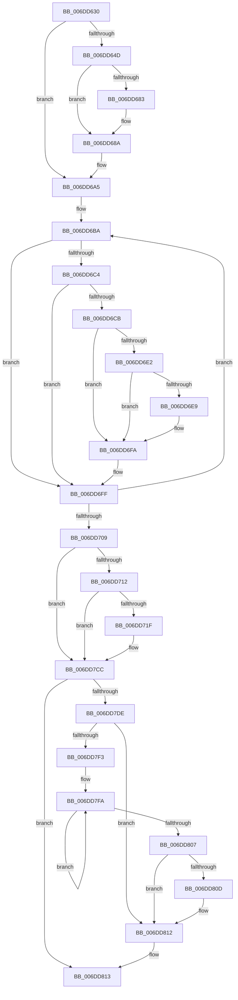

# sub_006DD630

- RVA: `0x006DD630`–`0x006DD81D` (길이 `493` bytes)
- VA: `0x00000001406DD630`
- 실행 섹션: `.text`
- PDB 이름 있음: `아니요`; PDB Function 태그: `아니요`
- unwind 정보 RVA: `0x0006F850`
- 디코드: `109`개 명령, `493/493` bytes 표시
- 미해석 바이트: `0` (있으면 어셈블리에 `.byte`로 보존)

> 이 문서는 커널 이미지의 기계어와 PDB 기호를 분석해 생성했습니다. 4번과 5번은 함수 원형과 자료형을 바이너리 사용 방식에서 추정한 C 해석이며 원본 소스 복구 결과는 아닙니다.

## 1. Dependencies

- 직접 호출 지점: **8**; 고유 호출 대상: **8**
- 직접 호출자로 확인된 함수: **0**
- RIP 상대 이미지 참조: **2**

### Outgoing calls
- `0x006DD630` → [KeDisableInterrupts](../21/KeDisableInterrupts_function_00217BE0.md) (function, `0x00217BE0`)
- `0x006DD63C` → [KeAcquireSpinLockAtDpcLevel](../20/KeAcquireSpinLockAtDpcLevel_function_00208430.md) (function, `0x00208430`)
- `0x006DD66D` → [memset](../6C/memset_function_006C6C40.md) (function, `0x006C6C40`)
- `0x006DD698` → [RtlGetInterruptTimePrecise](../20/RtlGetInterruptTimePrecise_function_0020A4C0.md) (function, `0x0020A4C0`)
- `0x006DD6D8` → [PpmPerfFeedbackCounterUpdate](../5D/PpmPerfFeedbackCounterUpdate_function_005D411C.md) (function, `0x005D411C`)
- `0x006DD7C7` → [tlgWriteTransfer_EtwWriteTransfer](../42/tlgWriteTransfer_EtwWriteTransfer_function_004260E0.md) (function, `0x004260E0`)
- `0x006DD7D3` → [KxReleaseSpinLock](../20/KxReleaseSpinLock_function_00206670.md) (function, `0x00206670`)
- `0x006DD80D` → [KiRemoveSystemWorkPriorityKick](../26/KiRemoveSystemWorkPriorityKick_function_002631D0.md) (function, `0x002631D0`)

### Direct callers
- 이 함수 시작 RVA로 연결되는 직접 call은 확인되지 않았습니다. 간접 호출은 완전히 역산할 수 없습니다.

### Static image references
- `0x006DD712` → RVA `0x00E076A0` (`.data`; read)
- `0x006DD726` → RVA `0x00048F47` (`.rdata`; read)

## 2. Other-region calls and transfers

- 다른 실행 섹션으로 향하는 call: **0**
- call이 아닌 외부 분기/꼬리 이동: **1**
  - `0x006DD818` → [PpmBeginActiveTimeAccumulation + 0x65](../2D/PpmBeginActiveTimeAccumulation_function_002D18D0.md) (`tail-transfer`)

## 3. Assembly (complete function range)

```asm
006DD630  E8 AB A5 B3 FF                  call 0x140217be0
006DD635  49 8B CD                        mov rcx, r13
006DD638  88 44 24 30                     mov byte ptr [rsp + 0x30], al
006DD63C  E8 EF AD B2 FF                  call 0x140208430
006DD641  4C 8B B7 B8 89 00 00            mov r14, qword ptr [rdi + 0x89b8]
006DD648  4D 85 F6                        test r14, r14
006DD64B  74 58                           je 0x1406dd6a5
006DD64D  41 8B B6 98 00 00 00            mov esi, dword ptr [r14 + 0x98]
006DD654  33 D2                           xor edx, edx
006DD656  48 C1 E6 07                     shl rsi, 7
006DD65A  41 B8 80 00 00 00               mov r8d, 0x80
006DD660  48 81 C6 A0 00 00 00            add rsi, 0xa0
006DD667  49 03 F6                        add rsi, r14
006DD66A  48 8B CE                        mov rcx, rsi
006DD66D  E8 CE 95 FE FF                  call 0x1406c6c40
006DD672  41 FF 86 98 00 00 00            inc dword ptr [r14 + 0x98]
006DD679  41 83 BE 98 00 00 00 08         cmp dword ptr [r14 + 0x98], 8
006DD681  75 07                           jne 0x1406dd68a
006DD683  41 89 9E 98 00 00 00            mov dword ptr [r14 + 0x98], ebx
006DD68A  65 8B 04 25 A4 01 00 00         mov eax, dword ptr gs:[0x1a4]
006DD692  48 8D 4D 8F                     lea rcx, [rbp - 0x71]
006DD696  89 06                           mov dword ptr [rsi], eax
006DD698  E8 23 CE B2 FF                  call 0x14020a4c0
006DD69D  48 89 46 08                     mov qword ptr [rsi + 8], rax
006DD6A1  C6 46 04 01                     mov byte ptr [rsi + 4], 1
006DD6A5  49 8B C5                        mov rax, r13
006DD6A8  4C 8D 7E 28                     lea r15, [rsi + 0x28]
006DD6AC  48 2B C6                        sub rax, rsi
006DD6AF  41 BD 02 00 00 00               mov r13d, 2
006DD6B5  48 89 44 24 40                  mov qword ptr [rsp + 0x40], rax
006DD6BA  4E 8B 64 38 F0                  mov r12, qword ptr [rax + r15 - 0x10]
006DD6BF  4D 85 E4                        test r12, r12
006DD6C2  74 3B                           je 0x1406dd6ff
006DD6C4  41 38 5C 24 22                  cmp byte ptr [r12 + 0x22], bl
006DD6C9  74 34                           je 0x1406dd6ff
006DD6CB  4C 8D 44 24 48                  lea r8, [rsp + 0x48]
006DD6D0  49 8B CC                        mov rcx, r12
006DD6D3  48 8D 54 24 50                  lea rdx, [rsp + 0x50]
006DD6D8  E8 3F 6A EF FF                  call 0x1405d411c
006DD6DD  48 85 F6                        test rsi, rsi
006DD6E0  74 18                           je 0x1406dd6fa
006DD6E2  41 38 5C 24 21                  cmp byte ptr [r12 + 0x21], bl
006DD6E7  74 11                           je 0x1406dd6fa
006DD6E9  48 8B 44 24 48                  mov rax, qword ptr [rsp + 0x48]
006DD6EE  49 89 07                        mov qword ptr [r15], rax
006DD6F1  48 8B 44 24 50                  mov rax, qword ptr [rsp + 0x50]
006DD6F6  49 89 47 10                     mov qword ptr [r15 + 0x10], rax
006DD6FA  48 8B 44 24 40                  mov rax, qword ptr [rsp + 0x40]
006DD6FF  49 83 C7 08                     add r15, 8
006DD703  49 83 ED 01                     sub r13, 1
006DD707  75 B1                           jne 0x1406dd6ba
006DD709  48 85 F6                        test rsi, rsi
006DD70C  0F 84 BA 00 00 00               je 0x1406dd7cc
006DD712  83 3D 87 9F 72 00 05            cmp dword ptr [rip + 0x729f87], 5
006DD719  0F 86 AD 00 00 00               jbe 0x1406dd7cc
006DD71F  41 8B 86 98 00 00 00            mov eax, dword ptr [r14 + 0x98]
006DD726  48 8D 15 1A B8 96 FF            lea rdx, [rip - 0x6947e6]
006DD72D  89 44 24 34                     mov dword ptr [rsp + 0x34], eax
006DD731  48 8D 0D 68 9F 72 00            lea rcx, [rip + 0x729f68]
006DD738  48 8D 44 24 34                  lea rax, [rsp + 0x34]
006DD73D  48 C7 45 BF 04 00 00 00         mov qword ptr [rbp - 0x41], 4
006DD745  48 89 45 B7                     mov qword ptr [rbp - 0x49], rax
006DD749  45 33 C9                        xor r9d, r9d
006DD74C  8B 47 24                        mov eax, dword ptr [rdi + 0x24]
006DD74F  45 33 C0                        xor r8d, r8d
006DD752  89 44 24 38                     mov dword ptr [rsp + 0x38], eax
006DD756  48 8D 44 24 38                  lea rax, [rsp + 0x38]
006DD75B  48 89 45 C7                     mov qword ptr [rbp - 0x39], rax
006DD75F  48 8B 46 08                     mov rax, qword ptr [rsi + 8]
006DD763  48 89 45 87                     mov qword ptr [rbp - 0x79], rax
006DD767  48 8D 45 87                     lea rax, [rbp - 0x79]
006DD76B  48 89 45 D7                     mov qword ptr [rbp - 0x29], rax
006DD76F  8B 06                           mov eax, dword ptr [rsi]
006DD771  89 44 24 3C                     mov dword ptr [rsp + 0x3c], eax
006DD775  48 8D 44 24 3C                  lea rax, [rsp + 0x3c]
006DD77A  48 89 45 E7                     mov qword ptr [rbp - 0x19], rax
006DD77E  48 8D 46 28                     lea rax, [rsi + 0x28]
006DD782  48 89 45 F7                     mov qword ptr [rbp - 9], rax
006DD786  48 8D 46 38                     lea rax, [rsi + 0x38]
006DD78A  48 89 45 07                     mov qword ptr [rbp + 7], rax
006DD78E  48 8D 45 97                     lea rax, [rbp - 0x69]
006DD792  48 89 44 24 28                  mov qword ptr [rsp + 0x28], rax
006DD797  C7 44 24 20 08 00 00 00         mov dword ptr [rsp + 0x20], 8
006DD79F  48 C7 45 CF 04 00 00 00         mov qword ptr [rbp - 0x31], 4
006DD7A7  48 C7 45 DF 08 00 00 00         mov qword ptr [rbp - 0x21], 8
006DD7AF  48 C7 45 EF 04 00 00 00         mov qword ptr [rbp - 0x11], 4
006DD7B7  48 C7 45 FF 10 00 00 00         mov qword ptr [rbp - 1], 0x10
006DD7BF  48 C7 45 0F 10 00 00 00         mov qword ptr [rbp + 0xf], 0x10
006DD7C7  E8 14 89 D4 FF                  call 0x1404260e0
006DD7CC  48 8D 8F 90 88 00 00            lea rcx, [rdi + 0x8890]
006DD7D3  E8 98 8E B2 FF                  call 0x140206670
006DD7D8  38 5C 24 30                     cmp byte ptr [rsp + 0x30], bl
006DD7DC  74 35                           je 0x1406dd813
006DD7DE  65 48 8B 0C 25 20 00 00 00      mov rcx, qword ptr gs:[0x20]
006DD7E7  4C 8B 81 B8 8E 00 00            mov r8, qword ptr [rcx + 0x8eb8]
006DD7EE  4D 85 C0                        test r8, r8
006DD7F1  74 1F                           je 0x1406dd812
006DD7F3  41 0F 0D 08                     prefetchw byte ptr [r8]
006DD7F7  41 8B 00                        mov eax, dword ptr [r8]
006DD7FA  8B D0                           mov edx, eax
006DD7FC  0F BA F2 15                     btr edx, 0x15
006DD800  F0 41 0F B1 10                  lock cmpxchg dword ptr [r8], edx
006DD805  75 F3                           jne 0x1406dd7fa
006DD807  0F BA E0 15                     bt eax, 0x15
006DD80B  73 05                           jae 0x1406dd812
006DD80D  E8 BE 59 B8 FF                  call 0x1402631d0
006DD812  FB                              sti
006DD813  4C 8B 4C 24 58                  mov r9, qword ptr [rsp + 0x58]
006DD818  E9 18 41 BF FF                  jmp 0x1402d1935
```

## 4. C-style interpretation (structured pseudocode)

```c
__int64 __fastcall sub_006DD630(__int64 a1, int a2, __int64 a3, int a4, __int64 a5, unsigned __int8 a6, __int64 a7, __int64 a8, __int64 a9, __int64 a10, __int64 a11)
{
    __int64 result;
    __int64 v_r13;
    __int64 v_r15;
    __int64 v_rsi;
    unsigned int v_stack_p20;
    unsigned __int64 v_stack_p28;
    unsigned __int8 v_stack_p30;
    unsigned int v_stack_p34;
    unsigned int v_stack_p38;
    unsigned int v_stack_p3C;
    unsigned __int64 v_stack_p40;

    result = KeDisableInterrupts(a1, a2, a3, a4);
    v_stack_p30 = (unsigned __int8)(result);
    result = KeAcquireSpinLockAtDpcLevel(v_r13, a2, a3, a4);
    if (*(unsigned __int64 *)(v_rdi + 35256) == 0) goto loc_006DD6A5;
    a2 = 0;
    v_rsi = ((unsigned int)(*(unsigned int *)(*(unsigned __int64 *)(v_rdi + 35256) + 152))) << (7);
    v_rsi = (v_rsi) + (160);
    v_rsi = (v_rsi) + (*(unsigned __int64 *)(v_rdi + 35256));
    result = memset(v_rsi, a2, 128, a4);
    if ((*(unsigned int *)(*(unsigned __int64 *)(v_rdi + 35256) + 152)) == 8) {
        *(unsigned int *)(*(unsigned __int64 *)(v_rdi + 35256) + 152) = (unsigned int)(v_rbx);
    }
    *(unsigned int *)(v_rsi) = (unsigned int)((unsigned int)(*(unsigned int *)(gs_base + (0 + 420))));
    result = RtlGetInterruptTimePrecise(v_rbp - 113, a2, 128, a4);
    *(unsigned __int64 *)(v_rsi + 8) = result;
    *(unsigned __int8 *)(v_rsi + 4) = 1;
loc_006DD6A5:
    result = (v_r13) - (v_rsi);
    v_stack_p40 = result;
loc_006DD6BA:
    if (*(unsigned __int64 *)(result + v_rsi + 40 * 1 - 16) == 0) goto loc_006DD6FF;
    if ((*(unsigned __int8 *)(*(unsigned __int64 *)(result + v_rsi + 40 * 1 - 16) + 34)) == ((unsigned __int8)(v_rbx))) goto loc_006DD6FF;
    result = PpmPerfFeedbackCounterUpdate(*(unsigned __int64 *)(result + v_rsi + 40 * 1 - 16), a10, a9, a4);
    if (v_rsi == 0) goto loc_006DD6FA;
    if ((*(unsigned __int8 *)(*(unsigned __int64 *)(result + v_rsi + 40 * 1 - 16) + 33)) != ((unsigned __int8)(v_rbx))) {
        result = a9;
        *(unsigned __int64 *)(v_rsi + 40) = result;
        result = a10;
        *(unsigned __int64 *)(v_rsi + 40 + 16) = result;
    }
loc_006DD6FF:
    v_r15 = (v_rsi + 40) + (8);
    v_r13 = (2) - (1);
    if (condition_is_not_equal) goto loc_006DD6BA;
    if (v_rsi == 0) goto loc_006DD7CC;
    result = a8;
    if ((*(unsigned int *)(v_rip + 7511943)) >= = 5) {
        result = *(unsigned int *)(*(unsigned __int64 *)(v_rdi + 35256) + 152);
        a2 = v_rip - 6899686;
        v_stack_p34 = (unsigned int)(result);
        a1 = v_rip + 7511912;
        result = v_stack_p34;
        *(unsigned __int64 *)(v_rbp - 65) = 4;
        *(unsigned __int64 *)(v_rbp - 73) = result;
        a4 = 0;
        result = *(unsigned int *)(v_rdi + 36);
        a3 = 0;
        v_stack_p38 = (unsigned int)(result);
        result = a7;
        *(unsigned __int64 *)(v_rbp - 57) = result;
        result = *(unsigned __int64 *)(v_rsi + 8);
        *(unsigned __int64 *)(v_rbp - 121) = result;
        result = v_rbp - 121;
        *(unsigned __int64 *)(v_rbp - 41) = result;
        result = *(unsigned int *)(v_rsi);
        v_stack_p3C = (unsigned int)(result);
        result = v_stack_p3C;
        *(unsigned __int64 *)(v_rbp - 25) = result;
        result = v_rsi + 40;
        *(unsigned __int64 *)(v_rbp - 9) = result;
        result = v_rsi + 56;
        *(unsigned __int64 *)(v_rbp + 7) = result;
        result = v_rbp - 105;
        v_stack_p28 = result;
        v_stack_p20 = 8;
        *(unsigned __int64 *)(v_rbp - 49) = 4;
        *(unsigned __int64 *)(v_rbp - 33) = 8;
        *(unsigned __int64 *)(v_rbp - 17) = 4;
        *(unsigned __int64 *)(v_rbp - 1) = 16;
        *(unsigned __int64 *)(v_rbp + 15) = 16;
        result = tlgWriteTransfer_EtwWriteTransfer(a1, a2, a3, a4);
    }
    result = KxReleaseSpinLock(v_rdi + 34960, a2, a3, a4);
    if (a6 == ((unsigned __int8)(v_rbx))) goto loc_006DD813;
    if (*(unsigned __int64 *)(*(unsigned __int64 *)(gs_base + (0 + 32)) + 36536) == 0) goto loc_006DD812;
loc_006DD7FA:
    if (*(unsigned __int64 *)(*(unsigned __int64 *)(gs_base + (0 + 32)) + 36536) != 0) goto loc_006DD7FA;
    result = (unsigned int)(*(unsigned int *)(*(unsigned __int64 *)(*(unsigned __int64 *)(gs_base + (0 + 32)) + 36536)));
    if (!(condition_is_above_or_equal)) {
        result = KiRemoveSystemWorkPriorityKick(*(unsigned __int64 *)(gs_base + (0 + 32)), (unsigned int)((unsigned int)((unsigned int)(*(unsigned int *)(*(unsigned __int64 *)(*(unsigned __int64 *)(gs_base + (0 + 32)) + 36536))))), *(unsigned __int64 *)(*(unsigned __int64 *)(gs_base + (0 + 32)) + 36536), a4);
    }
loc_006DD813:
}
```

## 5. (Beta) C Style

```c
int64_t sub_006DD630(int64_t Arg1, int32_t Arg2, int64_t Arg3, int32_t Arg4, uint64_t Arg5, uint8_t Arg6, int64_t Arg7, int64_t Arg8, int64_t Arg9, int64_t Arg10, int64_t Arg11)
{
    int64_t result;
    int64_t local_r13;
    int64_t local_r15;
    int64_t local_rsi;
    uint32_t v_stack_p20;
    uint64_t v_stack_p28;
    uint8_t v_stack_p30;
    uint32_t v_stack_p34;
    uint32_t v_stack_p38;
    uint32_t v_stack_p3C;
    uint64_t v_stack_p40;

    result = KeDisableInterrupts(Arg1, Arg2, Arg3, Arg4);
    v_stack_p30 = (uint8_t)(result);
    result = KeAcquireSpinLockAtDpcLevel(local_r13, Arg2, Arg3, Arg4);
    if (*(uint64_t *)(local_rdi + 0x89B8) == 0) goto loc_006DD6A5;
    Arg2 = 0;
    local_rsi = ((uint32_t)(*(uint32_t *)(*(uint64_t *)(local_rdi + 0x89B8) + 0x98))) << (7);
    local_rsi = (local_rsi) + (160);
    local_rsi = (local_rsi) + (*(uint64_t *)(local_rdi + 0x89B8));
    result = memset(local_rsi, Arg2, 128, Arg4);
    if ((*(uint32_t *)(*(uint64_t *)(local_rdi + 0x89B8) + 0x98)) == 8) {
        *(uint32_t *)(*(uint64_t *)(local_rdi + 0x89B8) + 0x98) = (uint32_t)(local_rbx);
    }
    *(uint32_t *)(local_rsi) = (uint32_t)((uint32_t)(*(uint32_t *)(gs_base + (0 + 0x1A4))));
    result = RtlGetInterruptTimePrecise(local_rbp - 113, Arg2, 128, Arg4);
    *(uint64_t *)(local_rsi + 0x8) = result;
    *(uint8_t *)(local_rsi + 0x4) = 1;
loc_006DD6A5:
    result = (local_r13) - (local_rsi);
    v_stack_p40 = result;
loc_006DD6BA:
    if (*(uint64_t *)(result + local_rsi + 0x28 * 1 - 0x10) == 0) goto loc_006DD6FF;
    if ((*(uint8_t *)(*(uint64_t *)(result + local_rsi + 0x28 * 1 - 0x10) + 0x22)) == ((uint8_t)(local_rbx))) goto loc_006DD6FF;
    result = PpmPerfFeedbackCounterUpdate(*(uint64_t *)(result + local_rsi + 0x28 * 1 - 0x10), Arg10, Arg9, Arg4);
    if (local_rsi == 0) goto loc_006DD6FA;
    if ((*(uint8_t *)(*(uint64_t *)(result + local_rsi + 0x28 * 1 - 0x10) + 0x21)) != ((uint8_t)(local_rbx))) {
        result = Arg9;
        *(uint64_t *)(local_rsi + 0x28) = result;
        result = Arg10;
        *(uint64_t *)(local_rsi + 0x28 + 0x10) = result;
    }
loc_006DD6FF:
    local_r15 = (local_rsi + 40) + (8);
    local_r13 = (2) - (1);
    if (condition_is_not_equal) goto loc_006DD6BA;
    if (local_rsi == 0) goto loc_006DD7CC;
    result = Arg8;
    if ((*(uint32_t *)(v_rip + 0x729F87)) >= = 5) {
        result = *(uint32_t *)(*(uint64_t *)(local_rdi + 0x89B8) + 0x98);
        Arg2 = v_rip - 6899686;
        v_stack_p34 = (uint32_t)(result);
        Arg1 = v_rip + 7511912;
        result = v_stack_p34;
        *(uint64_t *)(local_rbp - 0x41) = 4;
        *(uint64_t *)(local_rbp - 0x49) = result;
        Arg4 = 0;
        result = *(uint32_t *)(local_rdi + 0x24);
        Arg3 = 0;
        v_stack_p38 = (uint32_t)(result);
        result = Arg7;
        *(uint64_t *)(local_rbp - 0x39) = result;
        result = *(uint64_t *)(local_rsi + 0x8);
        *(uint64_t *)(local_rbp - 0x79) = result;
        result = local_rbp - 121;
        *(uint64_t *)(local_rbp - 0x29) = result;
        result = *(uint32_t *)(local_rsi);
        v_stack_p3C = (uint32_t)(result);
        result = v_stack_p3C;
        *(uint64_t *)(local_rbp - 0x19) = result;
        result = local_rsi + 40;
        *(uint64_t *)(local_rbp - 0x9) = result;
        result = local_rsi + 56;
        *(uint64_t *)(local_rbp + 0x7) = result;
        result = local_rbp - 105;
        v_stack_p28 = result;
        v_stack_p20 = 8;
        *(uint64_t *)(local_rbp - 0x31) = 4;
        *(uint64_t *)(local_rbp - 0x21) = 8;
        *(uint64_t *)(local_rbp - 0x11) = 4;
        *(uint64_t *)(local_rbp - 0x1) = 16;
        *(uint64_t *)(local_rbp + 0xF) = 16;
        result = tlgWriteTransfer_EtwWriteTransfer(Arg1, Arg2, Arg3, Arg4);
    }
    result = KxReleaseSpinLock(local_rdi + 34960, Arg2, Arg3, Arg4);
    if (Arg6 == ((uint8_t)(local_rbx))) goto loc_006DD813;
    if (*(uint64_t *)(*(uint64_t *)(gs_base + (0 + 0x20)) + 0x8EB8) == 0) goto loc_006DD812;
loc_006DD7FA:
    if (*(uint64_t *)(*(uint64_t *)(gs_base + (0 + 0x20)) + 0x8EB8) != 0) goto loc_006DD7FA;
    result = (uint32_t)(*(uint32_t *)(*(uint64_t *)(*(uint64_t *)(gs_base + (0 + 0x20)) + 0x8EB8)));
    if (!(condition_is_above_or_equal)) {
        result = KiRemoveSystemWorkPriorityKick(*(uint64_t *)(gs_base + (0 + 0x20)), (uint32_t)((uint32_t)((uint32_t)(*(uint32_t *)(*(uint64_t *)(*(uint64_t *)(gs_base + (0 + 0x20)) + 0x8EB8))))), *(uint64_t *)(*(uint64_t *)(gs_base + (0 + 0x20)) + 0x8EB8), Arg4);
    }
loc_006DD813:
}
```

## 6. Execution-region graph

[열기: 2D/3D 그래프와 함수 탐색 컨트롤 패널](../../../control-panel.html?section=text&rva=0x006DD630&view=graph)

- 2D 그래프는 위에서 아래로 흐르고, 3D 그래프는 빈 공간을 드래그해 회전합니다. Shift+드래그는 이동, 휠은 확대·축소, 함수 노드 선택은 대상 보고서 이동입니다.

### Static fallback


