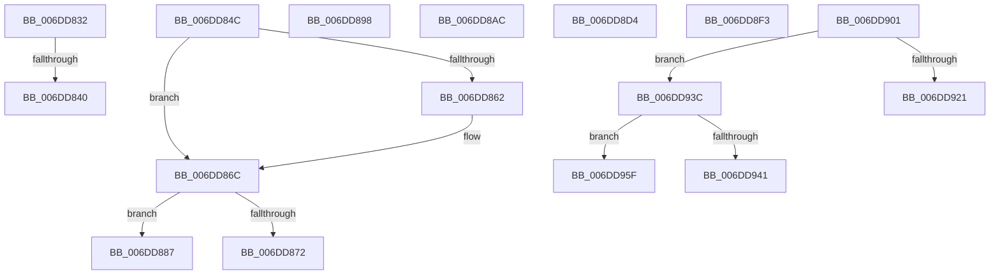

# sub_006DD832

- RVA: `0x006DD832`–`0x006DD98D` (길이 `347` bytes)
- VA: `0x00000001406DD832`
- 실행 섹션: `.text`
- PDB 이름 있음: `아니요`; PDB Function 태그: `아니요`
- unwind 정보 RVA: `0x0006F968`
- 디코드: `88`개 명령, `347/347` bytes 표시
- 미해석 바이트: `0` (있으면 어셈블리에 `.byte`로 보존)

> 이 문서는 커널 이미지의 기계어와 PDB 기호를 분석해 생성했습니다. 4번과 5번은 함수 원형과 자료형을 바이너리 사용 방식에서 추정한 C 해석이며 원본 소스 복구 결과는 아닙니다.

## 1. Dependencies

- 직접 호출 지점: **0**; 고유 호출 대상: **0**
- 직접 호출자로 확인된 함수: **0**
- RIP 상대 이미지 참조: **0**

### Outgoing calls
- 직접 디코드된 call 명령이 없습니다.

### Direct callers
- 이 함수 시작 RVA로 연결되는 직접 call은 확인되지 않았습니다. 간접 호출은 완전히 역산할 수 없습니다.

### Static image references
- 디코드된 RIP-relative 메모리 참조가 없습니다.

## 2. Other-region calls and transfers

- 다른 실행 섹션으로 향하는 call: **0**
- call이 아닌 외부 분기/꼬리 이동: **11**
  - `0x006DD83A` → [IvtFlushTbInternal + 0xD1](../2D/IvtFlushTbInternal_function_002D2548.md) (`tail-transfer`)
  - `0x006DD847` → [IvtFlushTbInternal + 0xC1](../2D/IvtFlushTbInternal_function_002D2548.md) (`tail-transfer`)
  - `0x006DD882` → [IvtFlushTbInternal + 0xDC](../2D/IvtFlushTbInternal_function_002D2548.md) (`tail-transfer`)
  - `0x006DD893` → [IvtFlushTbInternal + 0xDC](../2D/IvtFlushTbInternal_function_002D2548.md) (`tail-transfer`)
  - `0x006DD8A7` → [IvtFlushTbInternal + 0x215](../2D/IvtFlushTbInternal_function_002D2548.md) (`tail-transfer`)
  - `0x006DD8CF` → [IvtFlushTbInternal + 0x4E1](../2D/IvtFlushTbInternal_function_002D2548.md) (`tail-transfer`)
  - `0x006DD8EE` → [IvtFlushTbInternal + 0x4AB](../2D/IvtFlushTbInternal_function_002D2548.md) (`tail-transfer`)
  - `0x006DD8FC` → [IvtFlushTbInternal + 0x429](../2D/IvtFlushTbInternal_function_002D2548.md) (`tail-transfer`)
  - `0x006DD937` → [IvtFlushTbInternal + 0x4A7](../2D/IvtFlushTbInternal_function_002D2548.md) (`tail-transfer`)
  - `0x006DD95A` → [IvtFlushTbInternal + 0x4AB](../2D/IvtFlushTbInternal_function_002D2548.md) (`tail-transfer`)
  - `0x006DD988` → [IvtFlushTbInternal + 0x4AB](../2D/IvtFlushTbInternal_function_002D2548.md) (`tail-transfer`)

## 3. Assembly (complete function range)

```asm
006DD832  BB 22 00 00 00                  mov ebx, 0x22
006DD837  49 3B CF                        cmp rcx, r15
006DD83A  0F 84 D9 4D BF FF               je 0x1402d2619
006DD840  48 C1 E1 10                     shl rcx, 0x10
006DD844  48 33 D9                        xor rbx, rcx
006DD847  E9 BD 4D BF FF                  jmp 0x1402d2609
006DD84C  41 8B DB                        mov ebx, r11d
006DD84F  81 E3 FF FF 0F 00               and ebx, 0xfffff
006DD855  48 C1 E3 20                     shl rbx, 0x20
006DD859  48 83 CB 06                     or rbx, 6
006DD85D  49 3B CF                        cmp rcx, r15
006DD860  74 0A                           je 0x1406dd86c
006DD862  0F B7 C1                        movzx eax, cx
006DD865  48 C1 E0 10                     shl rax, 0x10
006DD869  48 0B D8                        or rbx, rax
006DD86C  44 39 45 77                     cmp dword ptr [rbp + 0x77], r8d
006DD870  75 15                           jne 0x1406dd887
006DD872  48 83 E3 EF                     and rbx, 0xffffffffffffffef
006DD876  44 88 44 24 40                  mov byte ptr [rsp + 0x40], r8b
006DD87B  48 83 CB 20                     or rbx, 0x20
006DD87F  41 8A F8                        mov dil, r8b
006DD882  E9 9D 4D BF FF                  jmp 0x1402d2624
006DD887  40 B7 01                        mov dil, 1
006DD88A  48 83 CB 30                     or rbx, 0x30
006DD88E  40 88 7C 24 40                  mov byte ptr [rsp + 0x40], dil
006DD893  E9 8C 4D BF FF                  jmp 0x1402d2624
006DD898  41 8A F8                        mov dil, r8b
006DD89B  40 88 7D 80                     mov byte ptr [rbp - 0x80], dil
006DD89F  4C 8D 75 83                     lea r14, [rbp - 0x7d]
006DD8A3  49 8D 4A 40                     lea rcx, [r10 + 0x40]
006DD8A7  E9 B1 4E BF FF                  jmp 0x1402d275d
006DD8AC  48 8B 46 48                     mov rax, qword ptr [rsi + 0x48]
006DD8B0  4C 8D 71 20                     lea r14, [rcx + 0x20]
006DD8B4  48 8B 76 28                     mov rsi, qword ptr [rsi + 0x28]
006DD8B8  B2 01                           mov dl, 1
006DD8BA  C1 EF 0B                        shr edi, 0xb
006DD8BD  4C 8B E9                        mov r13, rcx
006DD8C0  48 89 4D 97                     mov qword ptr [rbp - 0x69], rcx
006DD8C4  40 22 FA                        and dil, dl
006DD8C7  44 8B 78 3C                     mov r15d, dword ptr [rax + 0x3c]
006DD8CB  48 8D 48 40                     lea rcx, [rax + 0x40]
006DD8CF  E9 55 51 BF FF                  jmp 0x1402d2a29
006DD8D4  41 8B CF                        mov ecx, r15d
006DD8D7  48 C1 E1 10                     shl rcx, 0x10
006DD8DB  48 8B C1                        mov rax, rcx
006DD8DE  48 33 C2                        xor rax, rdx
006DD8E1  48 25 FF FF E0 FF               and rax, 0xffffffffffe0ffff
006DD8E7  48 33 C1                        xor rax, rcx
006DD8EA  48 89 45 E7                     mov qword ptr [rbp - 0x19], rax
006DD8EE  E9 00 51 BF FF                  jmp 0x1402d29f3
006DD8F3  48 8B 45 E7                     mov rax, qword ptr [rbp - 0x19]
006DD8F7  BA 01 00 00 00                  mov edx, 1
006DD8FC  E9 70 50 BF FF                  jmp 0x1402d2971
006DD901  41 8B CF                        mov ecx, r15d
006DD904  48 C1 E1 10                     shl rcx, 0x10
006DD908  48 8B C1                        mov rax, rcx
006DD90B  48 33 C2                        xor rax, rdx
006DD90E  48 25 FF FF E0 FF               and rax, 0xffffffffffe0ffff
006DD914  48 33 C1                        xor rax, rcx
006DD917  48 89 45 E7                     mov qword ptr [rbp - 0x19], rax
006DD91B  44 39 45 77                     cmp dword ptr [rbp + 0x77], r8d
006DD91F  75 1B                           jne 0x1406dd93c
006DD921  48 8B 45 EF                     mov rax, qword ptr [rbp - 0x11]
006DD925  48 B9 01 F0 FF FF FF FF FF 7F   movabs rcx, 0x7ffffffffffff001
006DD92F  25 FE 0F 00 00                  and eax, 0xffe
006DD934  48 0B C1                        or rax, rcx
006DD937  E9 B3 50 BF FF                  jmp 0x1402d29ef
006DD93C  45 85 C9                        test r9d, r9d
006DD93F  75 1E                           jne 0x1406dd95f
006DD941  48 8B 4D EF                     mov rcx, qword ptr [rbp - 0x11]
006DD945  48 8B 45 B7                     mov rax, qword ptr [rbp - 0x49]
006DD949  81 E1 FF 0F 00 00               and ecx, 0xfff
006DD94F  48 C1 E0 0C                     shl rax, 0xc
006DD953  48 0B C8                        or rcx, rax
006DD956  48 89 4D EF                     mov qword ptr [rbp - 0x11], rcx
006DD95A  E9 94 50 BF FF                  jmp 0x1402d29f3
006DD95F  48 8B 45 EF                     mov rax, qword ptr [rbp - 0x11]
006DD963  8B CB                           mov ecx, ebx
006DD965  25 FE 0F 00 00                  and eax, 0xffe
006DD96A  BA 01 00 00 00                  mov edx, 1
006DD96F  48 D3 E2                        shl rdx, cl
006DD972  48 FF CA                        dec rdx
006DD975  48 0B 55 B7                     or rdx, qword ptr [rbp - 0x49]
006DD979  48 C1 E2 0C                     shl rdx, 0xc
006DD97D  48 0B D0                        or rdx, rax
006DD980  48 83 CA 01                     or rdx, 1
006DD984  48 89 55 EF                     mov qword ptr [rbp - 0x11], rdx
006DD988  E9 66 50 BF FF                  jmp 0x1402d29f3
```

## 4. C-style interpretation (structured pseudocode)

```c
__int64 __fastcall sub_006DD832(__int64 a1, __int64 a2, int a3, int a4)
{
    __int64 v_rbx;
    unsigned __int8 v_stack_p40;

    a1 = (a1) << (16);
    v_rbx = (34) ^ (a1);
}
```

## 5. (Beta) C Style

```c
int64_t sub_006DD832(int64_t Arg1, int64_t Arg2, int32_t Arg3, int32_t Arg4)
{
    int64_t local_rbx;
    uint8_t v_stack_p40;

    Arg1 = (Arg1) << (16);
    local_rbx = (34) ^ (Arg1);
}
```

## 6. Execution-region graph

[열기: 2D/3D 그래프와 함수 탐색 컨트롤 패널](../../../control-panel.html?section=text&rva=0x006DD832&view=graph)

- 2D 그래프는 위에서 아래로 흐르고, 3D 그래프는 빈 공간을 드래그해 회전합니다. Shift+드래그는 이동, 휠은 확대·축소, 함수 노드 선택은 대상 보고서 이동입니다.

### Static fallback


