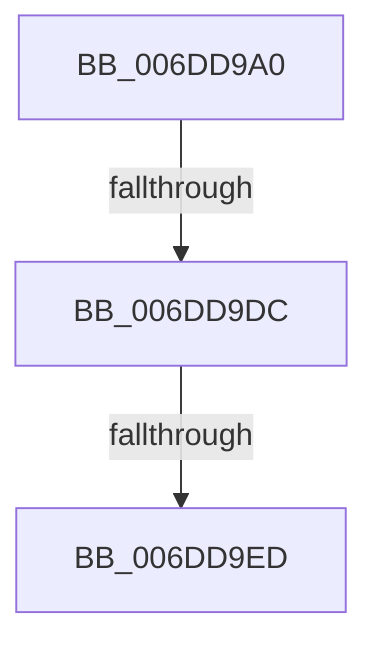

# sub_006DD9A0

- RVA: `0x006DD9A0`–`0x006DDA45` (길이 `165` bytes)
- VA: `0x00000001406DD9A0`
- 실행 섹션: `.text`
- PDB 이름 있음: `아니요`; PDB Function 태그: `아니요`
- unwind 정보 RVA: `0x0006FA28`
- 디코드: `40`개 명령, `165/165` bytes 표시
- 미해석 바이트: `0` (있으면 어셈블리에 `.byte`로 보존)

> 이 문서는 커널 이미지의 기계어와 PDB 기호를 분석해 생성했습니다. 4번과 5번은 함수 원형과 자료형을 바이너리 사용 방식에서 추정한 C 해석이며 원본 소스 복구 결과는 아닙니다.

## 1. Dependencies

- 직접 호출 지점: **5**; 고유 호출 대상: **5**
- 직접 호출자로 확인된 함수: **0**
- RIP 상대 이미지 참조: **1**

### Outgoing calls
- `0x006DD9AA` → [HalpGetProcessorStateByNtIndex](../2D/HalpGetProcessorStateByNtIndex_function_002D5598.md) (function, `0x002D5598`)
- `0x006DD9E0` → [HalpInterruptGsiToLine](../2D/HalpInterruptGsiToLine_function_002D2DD0.md) (function, `0x002D2DD0`)
- `0x006DD9F7` → [HalpAcquireHighLevelLock](../2D/HalpAcquireHighLevelLock_function_002D2390.md) (function, `0x002D2390`)
- `0x006DDA2B` → [HalpInterruptSetLineState](../48/HalpInterruptSetLineState_function_0048A0C8.md) (function, `0x0048A0C8`)
- `0x006DDA3A` → [HalpReleaseHighLevelLock](../2D/HalpReleaseHighLevelLock_function_002D1C58.md) (function, `0x002D1C58`)

### Direct callers
- 이 함수 시작 RVA로 연결되는 직접 call은 확인되지 않았습니다. 간접 호출은 완전히 역산할 수 없습니다.

### Static image references
- `0x006DD9F0` → RVA `0x00FC19A8` (`.data`; read)

## 2. Other-region calls and transfers

- 다른 실행 섹션으로 향하는 call: **0**
- call이 아닌 외부 분기/꼬리 이동: **3**
  - `0x006DD9D6` → [HalpInterruptEnablePerformanceEvents + 0xD1](../2D/HalpInterruptEnablePerformanceEvents_function_002D3420.md) (`tail-transfer`)
  - `0x006DD9E7` → [HalpInterruptEnablePerformanceEvents + 0xD1](../2D/HalpInterruptEnablePerformanceEvents_function_002D3420.md) (`tail-transfer`)
  - `0x006DDA40` → [HalpInterruptEnablePerformanceEvents + 0xD1](../2D/HalpInterruptEnablePerformanceEvents_function_002D3420.md) (`tail-transfer`)

## 3. Assembly (complete function range)

```asm
006DD9A0  65 8B 14 25 A4 01 00 00         mov edx, dword ptr gs:[0x1a4]
006DD9A8  8B CA                           mov ecx, edx
006DD9AA  E8 E9 7B BF FF                  call 0x1402d5598
006DD9AF  83 4D 6F FF                     or dword ptr [rbp + 0x6f], 0xffffffff
006DD9B3  48 8B D8                        mov rbx, rax
006DD9B6  33 C0                           xor eax, eax
006DD9B8  44 89 7D 73                     mov dword ptr [rbp + 0x73], r15d
006DD9BC  0F 57 C0                        xorps xmm0, xmm0
006DD9BF  48 89 45 F7                     mov qword ptr [rbp - 9], rax
006DD9C3  0F 11 45 E7                     movups xmmword ptr [rbp - 0x19], xmm0
006DD9C7  8B 4B 28                        mov ecx, dword ptr [rbx + 0x28]
006DD9CA  C7 45 E7 06 00 00 00            mov dword ptr [rbp - 0x19], 6
006DD9D1  89 55 EF                        mov dword ptr [rbp - 0x11], edx
006DD9D4  85 C9                           test ecx, ecx
006DD9D6  0F 84 15 5B BF FF               je 0x1402d34f1
006DD9DC  48 8D 55 67                     lea rdx, [rbp + 0x67]
006DD9E0  E8 EB 53 BF FF                  call 0x1402d2dd0
006DD9E5  85 C0                           test eax, eax
006DD9E7  0F 88 04 5B BF FF               js 0x1402d34f1
006DD9ED  8A 5B 0E                        mov bl, byte ptr [rbx + 0xe]
006DD9F0  48 8D 0D B1 3F 8E 00            lea rcx, [rip + 0x8e3fb1]
006DD9F7  E8 94 49 BF FF                  call 0x1402d2390
006DD9FC  40 8A F8                        mov dil, al
006DD9FF  48 8D 4D 67                     lea rcx, [rbp + 0x67]
006DDA03  48 8D 45 6F                     lea rax, [rbp + 0x6f]
006DDA07  84 DB                           test bl, bl
006DDA09  48 89 44 24 30                  mov qword ptr [rsp + 0x30], rax
006DDA0E  41 B0 0F                        mov r8b, 0xf
006DDA11  48 8D 45 E7                     lea rax, [rbp - 0x19]
006DDA15  40 0F 95 C6                     setne sil
006DDA19  48 89 44 24 28                  mov qword ptr [rsp + 0x28], rax
006DDA1E  44 8B CE                        mov r9d, esi
006DDA21  BA FE 00 00 00                  mov edx, 0xfe
006DDA26  44 89 7C 24 20                  mov dword ptr [rsp + 0x20], r15d
006DDA2B  E8 98 C6 DA FF                  call 0x14048a0c8
006DDA30  40 8A D7                        mov dl, dil
006DDA33  48 8D 0D 6E 3F 8E 00            lea rcx, [rip + 0x8e3f6e]
006DDA3A  E8 19 42 BF FF                  call 0x1402d1c58
006DDA3F  90                              nop
006DDA40  E9 AC 5A BF FF                  jmp 0x1402d34f1
```

## 4. C-style interpretation (structured pseudocode)

```c
__int64 __fastcall sub_006DD9A0(void)
{
    __int64 result;
    __int64 v_rsi;
    unsigned int v_stack_p20;
    unsigned __int64 v_stack_p28;
    unsigned __int64 v_stack_p30;

    result = HalpGetProcessorStateByNtIndex((unsigned int)((unsigned int)((unsigned int)(*(unsigned int *)(gs_base + (0 + 420))))), (unsigned int)(*(unsigned int *)(gs_base + (0 + 420))), a3, a4);
    result = 0;
    *(unsigned int *)(v_rbp + 115) = (unsigned int)(v_r15);
    *(unsigned __int64 *)(v_rbp - 9) = 0;
    *(unsigned __int64 *)(v_rbp - 25) = v_xmm0;
    *(unsigned int *)(v_rbp - 25) = 6;
    *(unsigned int *)(v_rbp - 17) = (unsigned int)((unsigned int)(*(unsigned int *)(gs_base + (0 + 420))));
    result = HalpInterruptGsiToLine((unsigned int)(*(unsigned int *)(result + 40)), v_rbp + 103, a3, a4);
    result = HalpAcquireHighLevelLock(v_rip + 9322417, v_rbp + 103, a3, a4);
    v_stack_p30 = v_rbp + 111;
    v_rsi = ((unsigned __int8)(*(unsigned __int8 *)(result + 14)) != 0) ? 1 : 0;
    v_stack_p28 = v_rbp - 25;
    v_stack_p20 = (unsigned int)(v_r15);
    result = HalpInterruptSetLineState(v_rbp + 103, 254, 15, (unsigned int)((unsigned int)(v_rsi)));
    result = HalpReleaseHighLevelLock(v_rip + 9322350, (unsigned __int8)((unsigned __int8)(result)), 15, (unsigned int)((unsigned int)(v_rsi)));
}
```

## 5. (Beta) C Style

```c
void sub_006DD9A0(void)
{
    int64_t result;
    int64_t local_rsi;
    uint32_t v_stack_p20;
    uint64_t v_stack_p28;
    uint64_t v_stack_p30;

    result = HalpGetProcessorStateByNtIndex((uint32_t)((uint32_t)((uint32_t)(*(uint32_t *)(gs_base + (0 + 0x1A4))))), (uint32_t)(*(uint32_t *)(gs_base + (0 + 0x1A4))), a3, a4);
    result = 0;
    *(uint32_t *)(local_rbp + 0x73) = (uint32_t)(local_r15);
    *(uint64_t *)(local_rbp - 0x9) = 0;
    *(uint64_t *)(local_rbp - 0x19) = v_xmm0;
    *(uint32_t *)(local_rbp - 0x19) = 6;
    *(uint32_t *)(local_rbp - 0x11) = (uint32_t)((uint32_t)(*(uint32_t *)(gs_base + (0 + 0x1A4))));
    result = HalpInterruptGsiToLine((uint32_t)(*(uint32_t *)(result + 0x28)), local_rbp + 103, a3, a4);
    result = HalpAcquireHighLevelLock(v_rip + 9322417, local_rbp + 103, a3, a4);
    v_stack_p30 = local_rbp + 111;
    local_rsi = ((uint8_t)(*(uint8_t *)(result + 0xE)) != 0) ? 1 : 0;
    v_stack_p28 = local_rbp - 25;
    v_stack_p20 = (uint32_t)(local_r15);
    result = HalpInterruptSetLineState(local_rbp + 103, 254, 15, (uint32_t)((uint32_t)(local_rsi)));
    result = HalpReleaseHighLevelLock(v_rip + 9322350, (uint8_t)((uint8_t)(result)), 15, (uint32_t)((uint32_t)(local_rsi)));
}
```

## 6. Execution-region graph

[열기: 2D/3D 그래프와 함수 탐색 컨트롤 패널](../../../control-panel.html?section=text&rva=0x006DD9A0&view=graph)

- 2D 그래프는 위에서 아래로 흐르고, 3D 그래프는 빈 공간을 드래그해 회전합니다. Shift+드래그는 이동, 휠은 확대·축소, 함수 노드 선택은 대상 보고서 이동입니다.

### Static fallback


