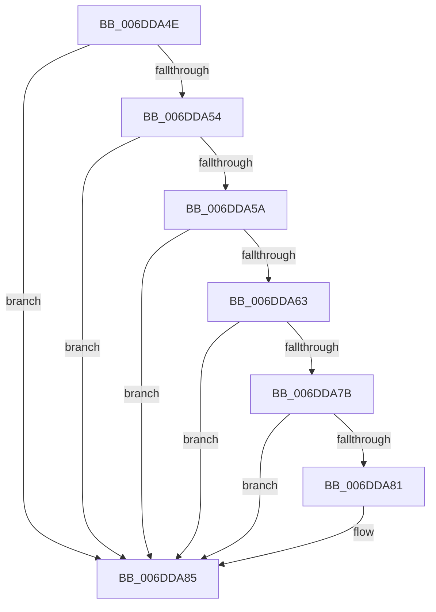

# sub_006DDA4E

- RVA: `0x006DDA4E`–`0x006DDA8E` (길이 `64` bytes)
- VA: `0x00000001406DDA4E`
- 실행 섹션: `.text`
- PDB 이름 있음: `아니요`; PDB Function 태그: `아니요`
- unwind 정보 RVA: `0x0006FB40`
- 디코드: `19`개 명령, `64/64` bytes 표시
- 미해석 바이트: `0` (있으면 어셈블리에 `.byte`로 보존)

> 이 문서는 커널 이미지의 기계어와 PDB 기호를 분석해 생성했습니다. 4번과 5번은 함수 원형과 자료형을 바이너리 사용 방식에서 추정한 C 해석이며 원본 소스 복구 결과는 아닙니다.

## 1. Dependencies

- 직접 호출 지점: **1**; 고유 호출 대상: **1**
- 직접 호출자로 확인된 함수: **0**
- RIP 상대 이미지 참조: **0**

### Outgoing calls
- `0x006DDA6F` → [KiInsertInterruptObjectOrdered](../4A/KiInsertInterruptObjectOrdered_function_004AC7EC.md) (function, `0x004AC7EC`)

### Direct callers
- 이 함수 시작 RVA로 연결되는 직접 call은 확인되지 않았습니다. 간접 호출은 완전히 역산할 수 없습니다.

### Static image references
- 디코드된 RIP-relative 메모리 참조가 없습니다.

## 2. Other-region calls and transfers

- 다른 실행 섹션으로 향하는 call: **0**
- call이 아닌 외부 분기/꼬리 이동: **1**
  - `0x006DDA89` → [KiConnectSecondaryInterrupt + 0x8B](../2D/KiConnectSecondaryInterrupt_function_002D4200.md) (`tail-transfer`)

## 3. Assembly (complete function range)

```asm
006DDA4E  40 38 73 64                     cmp byte ptr [rbx + 0x64], sil
006DDA52  74 31                           je 0x1406dda85
006DDA54  41 38 72 64                     cmp byte ptr [r10 + 0x64], sil
006DDA58  74 2B                           je 0x1406dda85
006DDA5A  8B 43 6C                        mov eax, dword ptr [rbx + 0x6c]
006DDA5D  41 39 42 6C                     cmp dword ptr [r10 + 0x6c], eax
006DDA61  75 22                           jne 0x1406dda85
006DDA63  40 B5 01                        mov bpl, 1
006DDA66  48 8B D3                        mov rdx, rbx
006DDA69  49 8B CA                        mov rcx, r10
006DDA6C  40 8A F5                        mov sil, bpl
006DDA6F  E8 78 ED DC FF                  call 0x1404ac7ec
006DDA74  41 80 7A 5D 00                  cmp byte ptr [r10 + 0x5d], 0
006DDA79  75 0A                           jne 0x1406dda85
006DDA7B  80 7B 5D 00                     cmp byte ptr [rbx + 0x5d], 0
006DDA7F  74 04                           je 0x1406dda85
006DDA81  48 89 5F 28                     mov qword ptr [rdi + 0x28], rbx
006DDA85  C6 43 5F 01                     mov byte ptr [rbx + 0x5f], 1
006DDA89  E9 FD 67 BF FF                  jmp 0x1402d428b
```

## 4. C-style interpretation (structured pseudocode)

```c
__int64 __fastcall sub_006DDA4E(void)
{
    __int64 result;

    if ((*(unsigned __int8 *)(v_rbx + 100)) == ((unsigned __int8)(v_rsi))) goto loc_006DDA85;
    if ((*(unsigned __int8 *)(v_r10 + 100)) == ((unsigned __int8)(v_rsi))) goto loc_006DDA85;
    if ((*(unsigned int *)(v_r10 + 108)) != ((unsigned int)((unsigned int)(*(unsigned int *)(v_rbx + 108))))) goto loc_006DDA85;
    result = KiInsertInterruptObjectOrdered(v_r10, v_rbx, a3, a4);
    if ((*(unsigned __int8 *)(v_r10 + 93)) != 0) goto loc_006DDA85;
    if ((*(unsigned __int8 *)(v_rbx + 93)) != 0) {
        *(unsigned __int64 *)(v_rdi + 40) = v_rbx;
    }
    *(unsigned __int8 *)(v_rbx + 95) = 1;
}
```

## 5. (Beta) C Style

```c
void sub_006DDA4E(void)
{
    int64_t result;

    if ((*(uint8_t *)(local_rbx + 0x64)) == ((uint8_t)(local_rsi))) goto loc_006DDA85;
    if ((*(uint8_t *)(local_r10 + 0x64)) == ((uint8_t)(local_rsi))) goto loc_006DDA85;
    if ((*(uint32_t *)(local_r10 + 0x6C)) != ((uint32_t)((uint32_t)(*(uint32_t *)(local_rbx + 0x6C))))) goto loc_006DDA85;
    result = KiInsertInterruptObjectOrdered(local_r10, local_rbx, a3, a4);
    if ((*(uint8_t *)(local_r10 + 0x5D)) != 0) goto loc_006DDA85;
    if ((*(uint8_t *)(local_rbx + 0x5D)) != 0) {
        *(uint64_t *)(local_rdi + 0x28) = local_rbx;
    }
    *(uint8_t *)(local_rbx + 0x5F) = 1;
}
```

## 6. Execution-region graph

[열기: 2D/3D 그래프와 함수 탐색 컨트롤 패널](../../../control-panel.html?section=text&rva=0x006DDA4E&view=graph)

- 2D 그래프는 위에서 아래로 흐르고, 3D 그래프는 빈 공간을 드래그해 회전합니다. Shift+드래그는 이동, 휠은 확대·축소, 함수 노드 선택은 대상 보고서 이동입니다.

### Static fallback


